# AERIS

## Evidence Alignment and Reasoning Intelligence System

[](https://www.rust-lang.org/)
[](https://www.postgresql.org/)
[](https://www.docker.com/)
[](LICENSE)

**AERIS** is a multimodal evidence reasoning engine designed to transform heterogeneous evidence into a unified, traceable representation and determine how individual pieces of evidence relate to one another.

It processes **text, images, structured tables, and time-series data**, extracts structured claims, resolves entities, aligns evidence temporally, normalizes measurements, and evaluates relationships between claims.

AERIS does not treat an LLM as the final authority.

> **AI interprets evidence. Deterministic software validates evidence relationships.**

---

## Why AERIS?

Real-world information rarely arrives as a clean database.

A single investigation may contain:

* maintenance reports,
* technician observations,
* inspection images,
* sensor telemetry,
* CSV files,
* structured records,
* timestamps,
* measurements using different units,
* incomplete observations,
* and conflicting descriptions.

Traditional multimodal AI systems can extract information from these sources, but extraction alone does not answer the important questions:

* Are two observations about the same entity?
* Do they refer to the same time period?
* Are their measurements comparable?
* Do they actually disagree?
* Is one source missing?
* Is an apparent disagreement caused by different units?
* Can the final conclusion be traced back to the original evidence?

AERIS is designed around these questions.

---

# Core Capabilities

### Multimodal Evidence Processing

AERIS accepts multiple evidence modalities:

```text
Text
Images
Structured Data
Tables
CSV
JSON
Time-Series / Sensor Data
```

---

### Unified Evidence Representation

Different modalities are converted into a common internal representation:

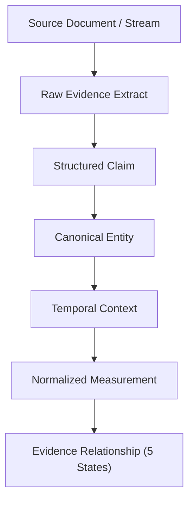

This allows evidence from different sources to be compared using the same reasoning framework.

---

### Claim-Based Reasoning

AERIS represents observations as structured claims:

```text
Entity:     Pump-B
Attribute:  Temperature
Value:      94 °C
Time:       09:21 UTC
Source:     sensor.csv
Evidence:   row 481
```

A claim is never detached from its provenance.

---

### Provenance

Every important claim should be traceable to its original evidence:

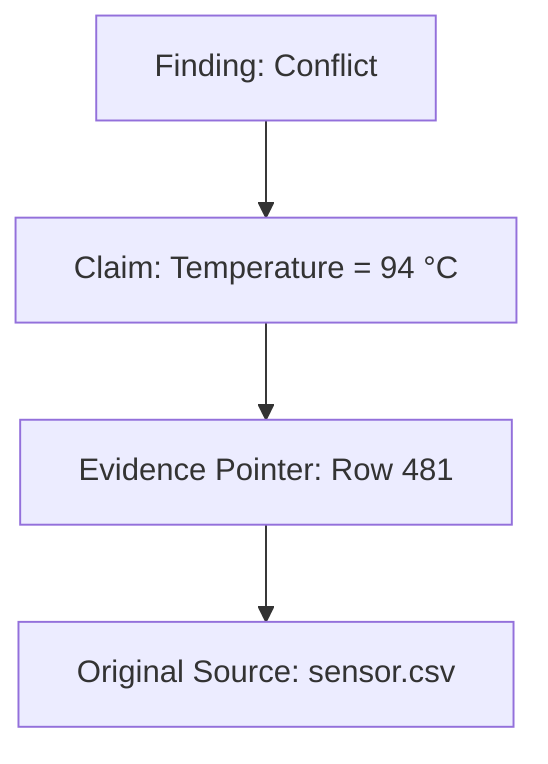

Depending on the modality, provenance may identify:

* text offsets,
* document pages,
* image regions,
* table cells,
* timestamps,
* structured fields,
* or source records.

---

### Entity Resolution

Different sources may refer to the same entity using different identifiers:

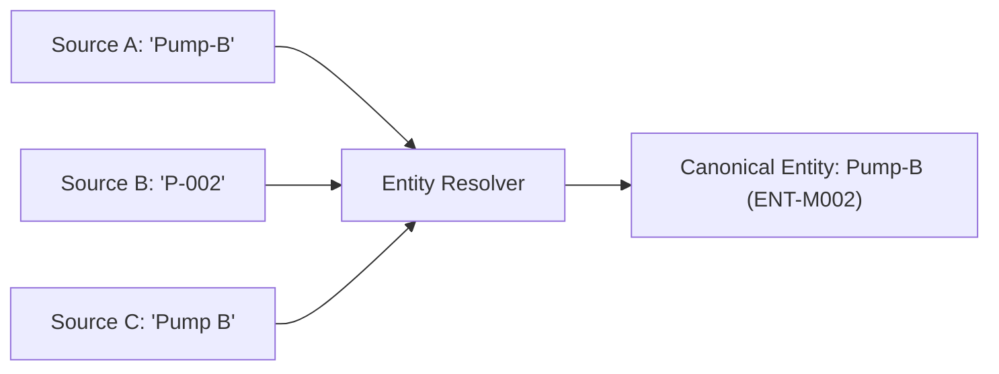

AERIS attempts to resolve these references to a canonical entity.

Ambiguity is preserved rather than silently guessed:

```text
Resolved
Ambiguous
Distinct
Unresolved
```

---

### Temporal Alignment

Evidence is meaningful only when its temporal context is understood.

AERIS represents:

* timestamps,
* intervals,
* approximate times,
* unknown times,
* timezone information,
* temporal precision,
* event-relative time.

Example:

```text
09:21 UTC
09:22 UTC
09:30 UTC
```

can be evaluated for temporal overlap or distance using Allen interval algebra.

AERIS distinguishes **temporal proximity** from **causality**.

---

### Measurement Normalization

Measurements from different sources may use different units.

Example:

```text
158 °F
```

is normalized to approximately:

```text
70 °C
```

before comparison.

The original measurement remains preserved for provenance.

Canonical units are used for reasoning where applicable.

---

### Conflict Detection

AERIS does not define conflict simply as:

```text
Value A != Value B
```

Instead, comparison requires compatible evidence.

Conceptually:

```text
Conflict(A, B) =
    Same Entity
    AND Same Attribute
    AND Temporal Overlap
    AND Comparable Units
    AND Semantic Compatibility
    AND Difference Beyond Tolerance
```

Possible evidence relationships include:

```text
Agreement
Conflict
Ambiguous
Insufficient Evidence
Not Comparable
```

---

# Example

Suppose AERIS receives:

### Sensor telemetry

```text
Pump-B
09:21 UTC
Temperature = 94 °C
```

### Technician note

```text
09:22 UTC

"Pump appears to be operating normally."
```

AERIS can represent these as separate claims.

After entity resolution and temporal alignment:

```text
Claim A: Pump-B temperature = 94 °C      | Source: sensor.csv
Claim B: Pump-B operating state = normal  | Source: technician note
```

The reasoning engine evaluates whether the claims describe compatible or conflicting attributes.

If two claims instead report:

```text
Temperature = 94 °C
Temperature = 70 °C
```

for the same entity and overlapping time period, the conflict engine can evaluate the difference after measurement normalization and tolerance rules.

The system preserves the evidence rather than replacing one observation with another.

---

# Architecture

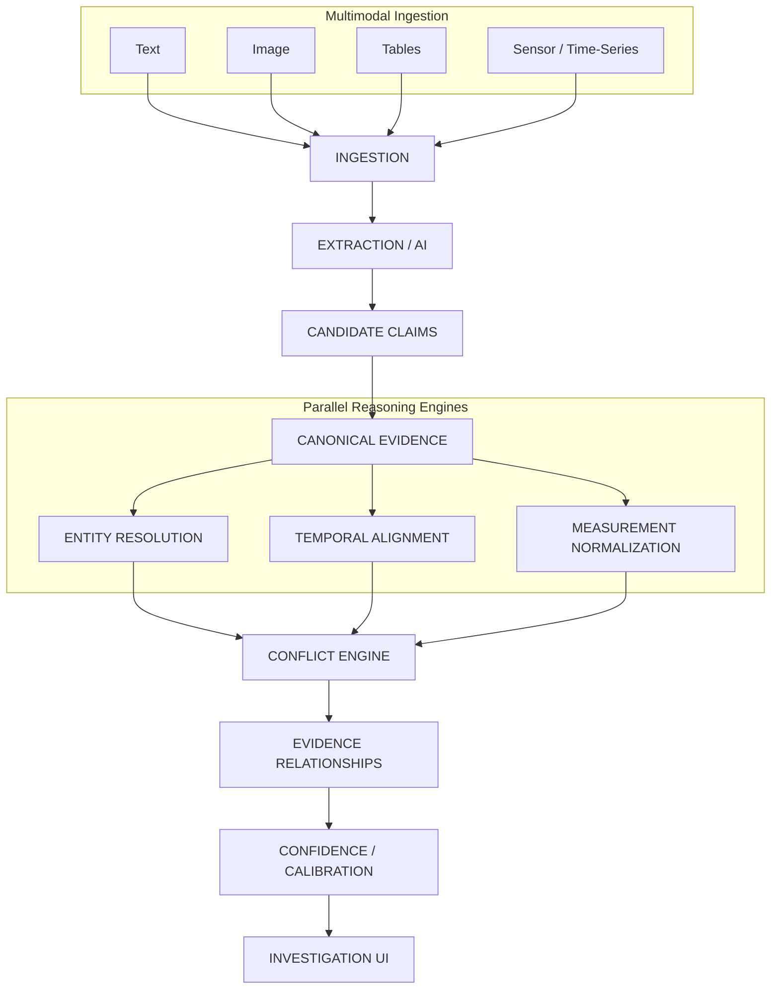

---

# Design Philosophy

AERIS follows several core principles.

## 1. Evidence First

The system should preserve observations rather than immediately collapsing them into a single answer.

---

## 2. Provenance Is Mandatory

Important claims must remain traceable to their originating evidence.

---

## 3. Ambiguity Is a Result

When the system cannot confidently resolve an entity or relationship, it should report ambiguity.

It should not manufacture certainty.

---

## 4. Missing Evidence Is Different From Negative Evidence

These are not equivalent:

```text
No failure observed
```

and:

```text
No telemetry available
```

AERIS explicitly represents missing evidence.

---

## 5. AI Interprets, Software Verifies

AI models may assist with:

* extraction,
* classification,
* semantic interpretation,
* candidate generation,
* entity matching.

Deterministic components handle critical evidence relationships such as:

* temporal overlap,
* unit conversion,
* tolerance comparison,
* conflict classification,
* provenance integrity.

---

## 6. Confidence Is Not Truth

A confidence score represents uncertainty in a processing result.

It does not mean:

```text
confidence = probability of truth
```

unless it has been properly calibrated and validated.

---

# Evidence Status Model

AERIS uses the following primary relationship states:

| Status                    | Meaning                                           |
| ------------------------- | ------------------------------------------------- |
| **Agreement**             | Evidence is compatible under the comparison rules |
| **Conflict**              | Comparable evidence materially disagrees          |
| **Ambiguous**             | Evidence cannot be reliably resolved              |
| **Insufficient Evidence** | Required evidence is missing                      |
| **Not Comparable**        | Evidence cannot meaningfully be compared          |

These states are intentionally distinct.

---

# Synthetic Benchmark

AERIS includes a synthetic industrial benchmark designed to test the complete reasoning pipeline.

The benchmark contains six machine scenarios:

| Machine                | Scenario                 |
| ---------------------- | ------------------------ |
| **M-001 Press-A**      | Normal baseline          |
| **M-002 Pump-B**       | Temperature conflict     |
| **M-003 Motor-C**      | Unit variation           |
| **M-004 Compressor-D** | Missing telemetry        |
| **M-005 Conveyor-E**   | Entity ambiguity         |
| **M-006 Robot-F**      | Cross-modal disagreement |

Each machine produces multiple evidence sources:

```text
telemetry.csv
events.json
maintenance_report.txt
inspection.png
```

The benchmark also contains:

```text
manifest.json
component_registry.csv
ground_truth_events.json
ground_truth_claims.json
```

Ground truth is kept separate from the inference pipeline to prevent evaluation leakage.

---

# Benchmark Scenarios

### M-001 — Normal Baseline

Used to verify that compatible evidence does not generate false conflicts.

---

### M-002 — Temperature Conflict

Telemetry reports a high temperature while another source provides a conflicting operational observation.

Used to test:

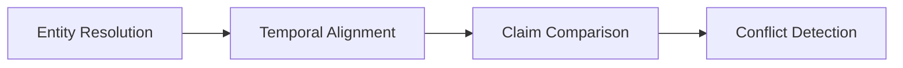

---

### M-003 — Unit Variation

One source reports temperature in Fahrenheit while another uses Celsius.

Example:

```text
158 °F ≈ 70 °C
```

Used to verify measurement normalization before conflict detection.

---

### M-004 — Missing Telemetry

A telemetry interval contains a gap.

Used to test whether the system distinguishes:

```text
missing evidence
```

from:

```text
normal operation
```

---

### M-005 — Entity Ambiguity

Different sources reference a potentially related entity using identifiers such as:

```text
CV-E
CV-E2
```

The system must preserve the ambiguity when evidence is insufficient for reliable resolution.

---

### M-006 — Cross-Modal Disagreement

A technician observation and an inspection image provide conflicting evidence regarding the same component.

Used to test multimodal claim comparison and evidence provenance.

---

# Technology Stack

## Backend

```text
Rust
Tokio
Axum
Serde
SQLx
PostgreSQL
```

Rust is used for the core reasoning and service architecture because deterministic evidence processing benefits from strong typing, explicit data models, and predictable execution.

---

## AI / Extraction

AERIS uses an AI provider abstraction.

Supported architecture includes:

```text
Ollama
External LLM providers
Vision providers
Mock providers
```

The system should not depend directly on one model implementation.

---

## Frontend

```text
React
TypeScript
```

The frontend provides the investigation interface for exploring:

* cases,
* evidence,
* claims,
* entities,
* timelines,
* conflicts,
* provenance,
* confidence,
* evaluation.

---

## Infrastructure

```text
Docker
Docker Compose
PostgreSQL
Object Storage
Ollama
```

---

# Repository Structure

```text
aeris/
│
├── crates/
│   ├── aeris-core/
│   ├── ingestion/
│   ├── extraction/
│   ├── normalization/
│   ├── entity-resolution/
│   ├── temporal-engine/
│   ├── conflict-engine/
│   ├── confidence-engine/
│   ├── reasoning/
│   ├── api/
│   └── storage/
│
├── apps/
│   └── web/
│
├── benchmark/
│   ├── cases/
│   ├── ground-truth/
│   └── evaluation/
│
├── datasets/
│
├── docs/
│
├── docker/
│
├── tests/
│
├── scripts/
│
└── docker-compose.yml
```

---

# Core Domain Model

The central object in AERIS is the claim.

Conceptually:

```rust
struct ClaimRecord {
    id: ClaimId,
    case_id: CaseId,
    subject: EntityRef,
    predicate: Predicate,
    object: ClaimValue,
    temporal_context: Option<TemporalContext>,
    provenance: Vec<EvidencePointer>,
    claim_type: ClaimType,
    confidence: ConfidenceRecord,
    status: ClaimStatus,
}
```

Claims may be:

```text
Extracted
Inferred
```

The system must distinguish the two.

---

# Processing Pipeline

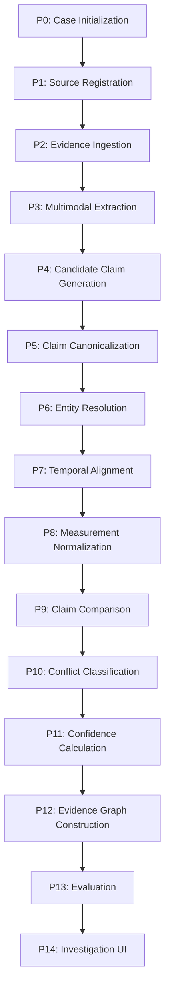

Each stage is independently observable and versioned.

---

# AI Provider Boundary

AERIS uses an abstraction around AI models:

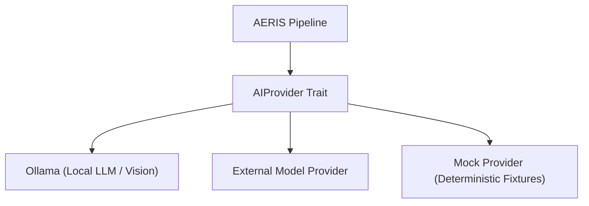

This allows development and testing without requiring a live AI provider.

---

# Deterministic Reasoning Boundary

The following operations should remain deterministic:

```text
Unit conversion
Temporal overlap
Tolerance comparison
Missing interval detection
Evidence relationship classification
Provenance validation
Confidence propagation rules
```

AI-generated outputs must be validated before entering the reasoning layer.

---

# Investigation Interface

The AERIS interface is designed around investigation rather than simple chatbot interaction.

Primary views include:

```text
Case Dashboard
Evidence Timeline
Claim Explorer
Entity Inspector
Conflict Inspector
Evidence Viewer
Confidence / Calibration
Evidence Graph
Processing History
Audit Trail
```

A user should be able to move from conflict to source without losing context:

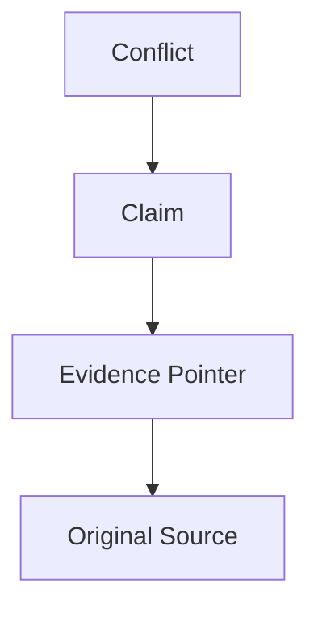

---

# Security

Evidence is treated as untrusted input.

Security considerations include:

* file upload validation,
* path traversal protection,
* parser isolation,
* container isolation,
* authentication,
* authorization,
* database access controls,
* prompt injection defense,
* structured AI output validation,
* resource limits,
* audit logging,
* provenance integrity,
* dependency security,
* model security.

AERIS must never allow an extracted instruction inside an evidence document to override system-level processing rules.

---

# Evaluation

AERIS evaluates more than final conflict accuracy.

Evaluation includes:

```text
Claim Extraction
Entity Resolution
Temporal Alignment
Measurement Normalization
Conflict Detection
Provenance
Confidence Calibration
End-to-End Reasoning
```

Primary metrics may include:

```text
Precision
Recall
F1
Accuracy
ECE
Brier Score
Abstention / Selective Prediction
Latency
Throughput
```

The benchmark is versioned so that changes to models, prompts, rules, and algorithms can be compared reproducibly.

---

# Testing

Testing is divided into:

```text
Unit Tests
Component Tests
Contract Tests
Integration Tests
Pipeline Tests
Multimodal Tests
Security Tests
Performance Tests
Regression Tests
Benchmark Tests
End-to-End Tests
```

The most important deterministic reasoning components should have extensive unit coverage.

---

# Docker Development

Start the environment with:

```bash
docker compose up -d
```

Build images with:

```bash
docker compose build
```

Run the synthetic benchmark environment:

```bash
docker compose up
```

The synthetic machines are isolated into separate services and produce independent evidence directories.

---

# Development

Clone the repository:

```bash
git clone <repository-url>
cd aeris
```

Start dependencies:

```bash
docker compose up -d
```

Build the Rust workspace:

```bash
cargo build --workspace
```

Run tests:

```bash
cargo test --workspace
```

Run formatting:

```bash
cargo fmt --all
```

Run linting:

```bash
cargo clippy --workspace --all-targets --all-features -- -D warnings
```

---

# Engineering Principles

AERIS follows these principles:

### Evidence Before Conclusions

Never discard contradictory observations simply because one appears more convenient.

### Traceability Before Abstraction

A conclusion must remain connected to the evidence supporting it.

### Ambiguity Before False Certainty

If the system cannot establish identity or comparability, it should report that limitation.

### Determinism Before Unnecessary Intelligence

Use deterministic logic wherever the relationship can be formally defined.

### Version Everything That Can Change Reasoning

Track:

```text
model version
prompt version
rule version
pipeline version
dataset version
configuration
```

### Evaluate Before Claiming Improvement

A change is not automatically an improvement because the demo looks nicer.

---

# Project Status

AERIS is being developed as a research and engineering prototype focused on multimodal evidence representation, provenance, temporal alignment, entity resolution, measurement normalization, and conflict detection.

Current development priorities:

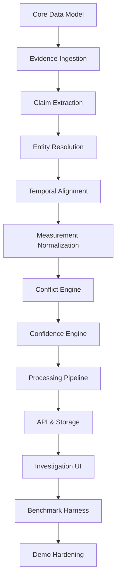

---

# Documentation

Detailed engineering documentation is maintained under `docs/`.

| Document | Description |
| :--- | :--- |
| [`00-project-overview.md`](docs/00-project-overview.md) | Project overview |
| [`01-problem-definition.md`](docs/01-problem-definition.md) | Problem definition |
| [`02-system-concept.md`](docs/02-system-concept.md) | System concept |
| [`03-requirements.md`](docs/03-requirements.md) | Functional and non-functional requirements |
| [`04-architecture.md`](docs/04-architecture.md) | System architecture |
| [`05-data-model.md`](docs/05-data-model.md) | Domain data model |
| [`06-evidence-provenance.md`](docs/06-evidence-provenance.md) | Evidence provenance |
| [`07-entity-resolution.md`](docs/07-entity-resolution.md) | Entity resolution |
| [`08-temporal-alignment.md`](docs/08-temporal-alignment.md) | Temporal reasoning |
| [`09-measurement-normalization.md`](docs/09-measurement-normalization.md) | Measurement normalization |
| [`10-conflict-detection.md`](docs/10-conflict-detection.md) | Conflict detection |
| [`11-confidence-and-calibration.md`](docs/11-confidence-and-calibration.md) | Confidence and calibration |
| [`12-investigation-and-ui.md`](docs/12-investigation-and-ui.md) | Investigation interface |
| [`13-api-and-service-contracts.md`](docs/13-api-and-service-contracts.md) | API contracts |
| [`14-processing-pipeline-and-orchestration.md`](docs/14-processing-pipeline-and-orchestration.md) | Processing pipeline |
| [`15-storage-and-database.md`](docs/15-storage-and-database.md) | Storage architecture |
| [`16-benchmark-and-evaluation.md`](docs/16-benchmark-and-evaluation.md) | Evaluation |
| [`17-deployment-and-docker.md`](docs/17-deployment-and-docker.md) | Deployment |
| [`18-security-and-threat-model.md`](docs/18-security-and-threat-model.md) | Security |
| [`19-testing-strategy.md`](docs/19-testing-strategy.md) | Testing |
| [`20-demo-playbook.md`](docs/20-demo-playbook.md) | Demonstration workflow |
| [`21-implementation-roadmap.md`](docs/21-implementation-roadmap.md) | Implementation roadmap |
| [`22-team-task-breakdown.md`](docs/22-team-task-breakdown.md) | Team responsibilities |
| [`23-final-architecture.md`](docs/23-final-architecture.md) | Consolidated architecture |
| [`24-implementation-specification.md`](docs/24-implementation-specification.md) | Implementation specification |
| [`25-development-workflow.md`](docs/25-development-workflow.md) | Development workflow |

---

# Project Structure at a Glance

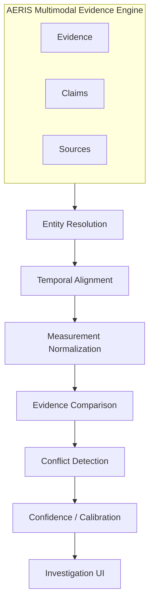

---

# Final Principle

AERIS is not designed to produce an answer first and explain it afterward.

It is designed to construct an unbroken evidentiary chain:

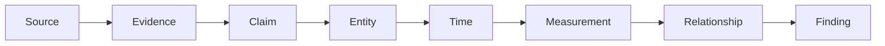

Every important finding should be inspectable through that chain.

> **AERIS turns heterogeneous evidence into structured, traceable, and comparable knowledge without pretending that uncertainty does not exist.**
