# AERIS Technical Architecture

## 1. Architecture Overview

AERIS follows a modular, evidence-centric architecture designed to process heterogeneous multimodal sources and transform them into a unified, provenance-aware evidence state.

The architecture separates:

1. Evidence ingestion
2. Multimodal extraction
3. Evidence representation
4. Normalization
5. Entity resolution
6. Temporal reasoning
7. Conflict detection
8. Confidence evaluation
9. Storage
10. API orchestration
11. Investigation interface
12. Benchmark evaluation

### System Topology Diagram

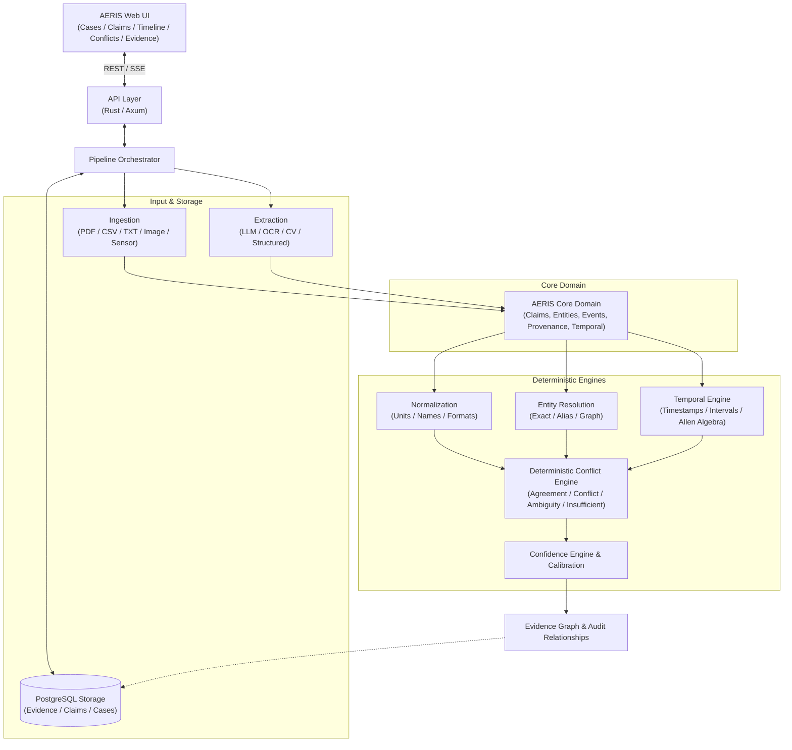

---

## 2. Architectural Principle

The primary architectural principle is:

> **Separate interpretation from verification.**

The AI layer interprets heterogeneous evidence and produces candidate structured observations. The deterministic reasoning layer determines how those observations relate.

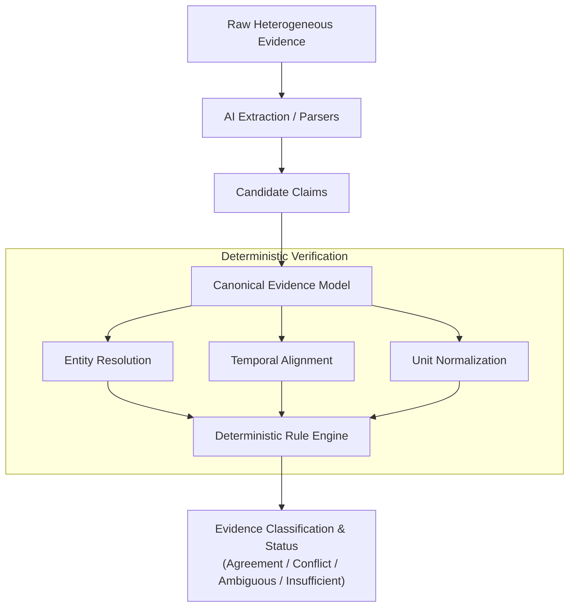

This prevents an LLM from becoming the sole authority for conflict detection.

---

## 3. Architectural Layers

### Layer 1: Source Layer

Responsible for:

* File ingestion
* Source registration
* Metadata collection
* Input validation
* Source identification

Supported initial sources:

```text
PDF
TXT
CSV
JSON
PNG
JPEG
Sensor / Time-Series
```

---

### Layer 2: Extraction Layer

Responsible for converting raw sources into candidate observations.

Components include:

```text
Text Extractor
PDF Extractor
OCR Processor
Vision Processor
CSV Parser
JSON Parser
Time-Series Parser
LLM Extraction Provider
```

The extraction layer produces a common intermediate representation rather than writing directly into the database.

---

## 4. Intermediate Representation

The extraction layer produces candidate claims:

```text
CandidateClaim
│
├── subject
├── predicate
├── value
├── unit
├── temporal information
├── source reference
└── extraction confidence
```

These candidates are then validated and converted into the canonical AERIS model. This provides a clean boundary between extraction providers and the reasoning system.

---

## 5. AERIS Core

`aeris-core` is the central shared Rust crate. It contains the canonical domain types used across the system.

Proposed structure:

```text
crates/
└── aeris-core/
    ├── src/
    │   ├── case.rs
    │   ├── source.rs
    │   ├── evidence.rs
    │   ├── claim.rs
    │   ├── entity.rs
    │   ├── event.rs
    │   ├── temporal.rs
    │   ├── measurement.rs
    │   ├── confidence.rs
    │   ├── conflict.rs
    │   └── lib.rs
    └── Cargo.toml
```

The core crate must remain independent from:

* Web frameworks
* Database implementations
* LLM providers
* Frontend code

This keeps the domain model stable and portable.

---

## 6. Source Processing Pipeline

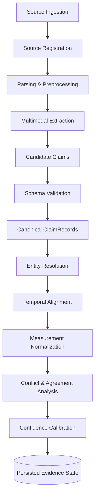

Each stage has a well-defined input and output contract.

---

## 7. Entity Resolution Architecture

The entity-resolution subsystem combines deterministic and similarity-based techniques.

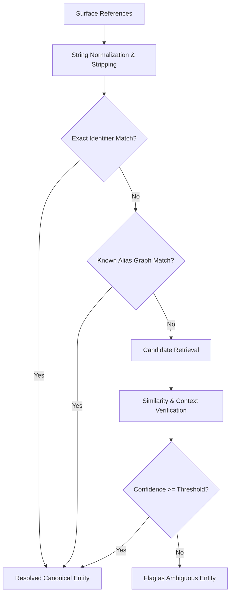

Potential matching signals include:

* Exact identifier
* Normalized name
* Alias
* Component metadata
* Context
* Source relationships
* Semantic similarity

Similarity assists entity resolution but cannot automatically override explicit identifiers or evidence constraints.

---

## 8. Temporal Engine Architecture

The temporal engine converts different time representations into a common representation.

Input examples:

```text
09:21
09:21:43 UTC
09:20–09:23
approximately 09:22
```

The engine produces `TemporalContext`, which represents:

* Instant (point in time)
* Interval (start and end bounds)
* Approximate (timestamp with $\pm \delta$ window)
* Unknown (unanchored or missing)

The temporal engine exposes operations such as:

* `overlaps()`
* `contains()`
* `before()`
* `after()`
* `distance()`
* `compatible()`

The conflict engine uses these relationships when determining whether claims can be compared.

---

## 9. Normalization Architecture

Normalization is independent of conflict detection.

Its responsibilities include:

* Unit Conversion (SI canonicalization)
* Name Normalization
* Timestamp Normalization (UTC epoch)
* Value Formatting
* Measurement Canonicalization

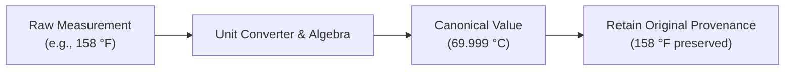

The normalized representation retains the original value and unit so that provenance is never lost.

---

## 10. Conflict Engine

The conflict engine evaluates pairs of claims after entity resolution, temporal alignment, and normalization:

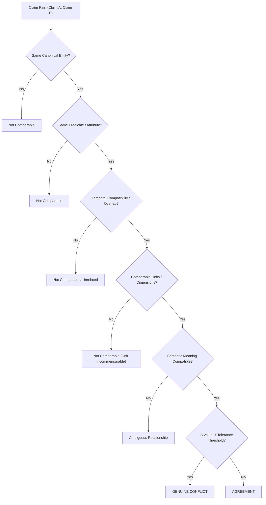

Output: A `ConflictRecord` or an explicit non-conflict relationship (`Agreement`, `Ambiguous`, `Not Comparable`).

---

## 11. Conflict Rule

The initial deterministic conflict rule is formally:

```text
Conflict(A, B) =
    SameEntity(A, B)
    AND SameAttribute(A, B)
    AND TemporalOverlap(A, B)
    AND ComparableUnits(A, B)
    AND SemanticCompatibility(A, B)
    AND DifferenceBeyondTolerance(A, B)
```

This rule will evolve as benchmark results reveal edge cases. The implementation uses modular predicate functions rather than a monolithic hard-coded block.

---

## 12. Evidence Relationship Model

AERIS represents explicit typed relationships between claims in the evidence graph:

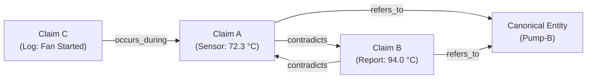

Supported relationship types:
* `supports`
* `contradicts`
* `agrees_with`
* `derived_from`
* `refers_to`
* `occurs_during`
* `same_entity_as`
* `possibly_same_entity_as`

---

## 13. Storage Architecture

The storage layer uses PostgreSQL.

Proposed relational schema structure:

```text
cases
sources
entities
entity_aliases
events
claims
evidence_pointers
measurements
conflicts
confidence_records
inferences
relationships
processing_runs
```

PostgreSQL is selected because the core problem is structured evidence reconciliation and relational integrity rather than open graph traversal. A graph database will not be introduced unless benchmark requirements demonstrate a measured need.

---

## 14. API Architecture

The backend exposes a REST API using Rust and Axum.

Proposed endpoint groups:

```text
/api/cases
/api/sources
/api/claims
/api/entities
/api/events
/api/conflicts
/api/evidence
/api/timeline
/api/evaluation
```

### Core API Flow

| Method | Endpoint | Description |
| :--- | :--- | :--- |
| `POST` | `/api/cases` | Creates an investigation case |
| `POST` | `/api/cases/{id}/sources` | Uploads and registers raw evidence files |
| `POST` | `/api/cases/{id}/process` | Initiates asynchronous processing pipeline |
| `GET` | `/api/cases/{id}/claims` | Retrieves all extracted and inferred claims |
| `GET` | `/api/cases/{id}/conflicts` | Returns all detected conflicts with proofs |
| `GET` | `/api/claims/{id}/evidence` | Returns supporting evidence pointers and snippets |

---

## 15. Processing Orchestration

Processing is asynchronous to ensure non-blocking operation:

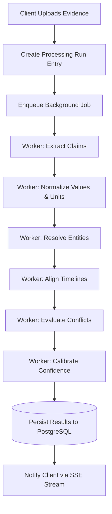

---

## 16. Real-Time Progress

The Web UI receives real-time execution status over Server-Sent Events (SSE):

```text
Processing CASE-047

✓ Sources registered
✓ Text extracted
✓ Sensor data processed
✓ Claims generated
✓ Entities resolved
→ Aligning timeline
○ Conflict detection
○ Confidence analysis
```

---

## 17. AI Provider Architecture

AI providers are abstracted behind asynchronous traits:

```rust
#[async_trait]
pub trait ExtractionProvider: Send + Sync {
    async fn extract(
        &self,
        input: EvidenceInput,
    ) -> Result<Vec<CandidateClaim>, ExtractionError>;
}
```

Pluggable implementations:
* `OllamaProvider` (local offline LLM)
* `ExternalLLMProvider` (API-based model)
* `VisionProvider` (VLM / OCR pipeline)
* `MockProvider` (deterministic provider for testing)

The reasoning core does not depend on any specific LLM provider.

---

## 18. Frontend Architecture

The web interface is organized around case investigation:

```text
apps/web/
├── pages/
│   ├── cases/
│   ├── claims/
│   ├── entities/
│   ├── conflicts/
│   └── evidence/
│
├── components/
│   ├── CaseDashboard
│   ├── ClaimInspector
│   ├── ConflictInspector
│   ├── EvidenceViewer
│   ├── Timeline
│   ├── EntityInspector
│   └── ConfidencePanel
│
└── services/
    └── api/
```

The UI prioritizes investigation, auditability, and traceability over decorative visualization.

---

## 19. Evidence Viewer Architecture

The evidence viewer supports modality-specific inspection:

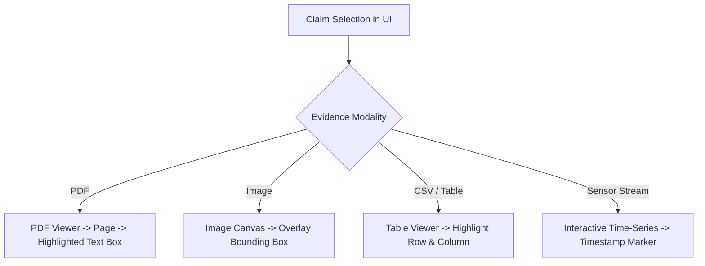

---

## 20. Evaluation Architecture

The benchmark system remains completely separated from production inference:

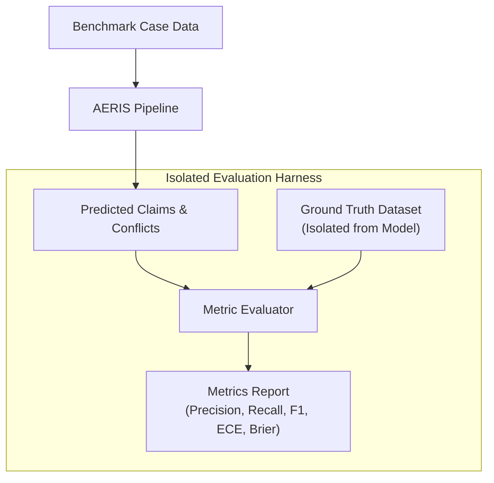

Ground truth is strictly barred from entering the inference pipeline.

---

## 21. Deployment Architecture

The system is deployed via Docker Compose:

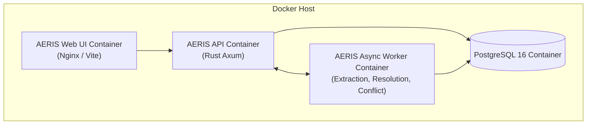

---

## 22. Synthetic Benchmark Topology

The benchmark environment isolates multi-machine services:

```text
M-001 Press-A
M-002 Pump-B
M-003 Motor-C
M-004 Compressor-D
M-005 Conveyor-E
M-006 Robot-F
```

Each containerized machine fixture outputs an isolated evidence directory:

```text
/data
├── telemetry.csv
├── events.json
├── maintenance_report.txt
└── inspection.png
```

---

## 23. Repository Architecture

```text
aeris/
│
├── crates/
│   ├── aeris-core/
│   ├── ingestion/
│   ├── extraction/
│   ├── normalization/
│   ├── entity-resolution/
│   ├── temporal-engine/
│   ├── conflict-engine/
│   ├── confidence-engine/
│   ├── reasoning/
│   ├── storage/
│   └── api/
│
├── apps/
│   └── web/
│
├── benchmark/
│   ├── cases/
│   ├── ground-truth/
│   ├── evaluation/
│   └── reports/
│
├── datasets/
├── docker/
├── docs/
└── docker-compose.yml
```

---

## 24. Component Ownership & Team Division

| Track | Lead | Primary Components | Dependencies |
| :--- | :--- | :--- | :--- |
| **Track 1** | Person 1 | Ingestion, extraction, provenance, OCR/VLM adapters | `aeris-core` |
| **Track 2** | Person 2 | Entity resolution, temporal engine, interval algebra | `aeris-core` |
| **Track 3** | Person 3 | Normalization, conflict engine, confidence calibration, benchmark | `aeris-core` |
| **Track 4** | Person 4 | Storage (PostgreSQL), Axum API, job orchestrator, Web UI | `aeris-core`, all crates |

---

## 25. Interface Contracts

Data transformations flow through typed Rust structures:

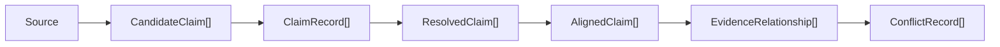

---

## 26. Failure Isolation

AERIS degrades gracefully when individual inputs encounter errors:

```text
PDF        ✓ (Processed)
CSV        ✓ (Processed)
Image      ✗ (OCR Failed)
```

The system logs:

```text
Image processing failed for source IMG-004: format unsupported
```

and continues processing all remaining sources. Unresolved entities produce `Ambiguous Entity` rather than halting execution.

---

## 27. Security Architecture

* **Strict Input Validation:** File size caps, MIME verification, and magic byte checking.
* **Non-Executable Storage:** Uploaded files are stored as immutable data blobs with no execution rights.
* **Credential Isolation:** AI provider tokens and database passwords are provided via environment secrets, never exposed to client bundles.
* **Audit Logging:** Every claim creation and conflict evaluation emits structured audit logs.

---

## 28. Architectural Decision Summary

| Concern | Architectural Decision | Rationale |
| :--- | :--- | :--- |
| **Backend Language** | Rust | Memory safety, deterministic execution speed, type safety across complex graphs |
| **Domain Model** | `aeris-core` crate | Decoupled domain contract shared across all backend crates |
| **Database** | PostgreSQL | Strong relational guarantees, JSONB support, proven ACID reliability |
| **Processing Model** | Async Tokio workers | Non-blocking execution for long-running multimodal pipelines |
| **Conflict Engine** | Deterministic rule engine | Avoids LLM non-determinism and hallucinated truth values |
| **Benchmark Suite** | Standalone evaluation crate | Completely eliminates ground-truth data contamination |

---

## 29. Architectural Invariants

The following rules must remain true throughout development:

1. **Every claim has provenance.**
2. **Extracted and inferred claims remain distinguishable.**
3. **Conflicting evidence is never silently discarded.**
4. **Entity ambiguity is preserved.**
5. **Temporal context participates in conflict reasoning.**
6. **Comparable measurements are normalized before comparison.**
7. **The reasoning core does not depend on a specific LLM provider.**
8. **Ground truth never enters the production inference pipeline.**
9. **A user can trace an important result back to its original evidence.**

---

## 30. Final Architecture Principle

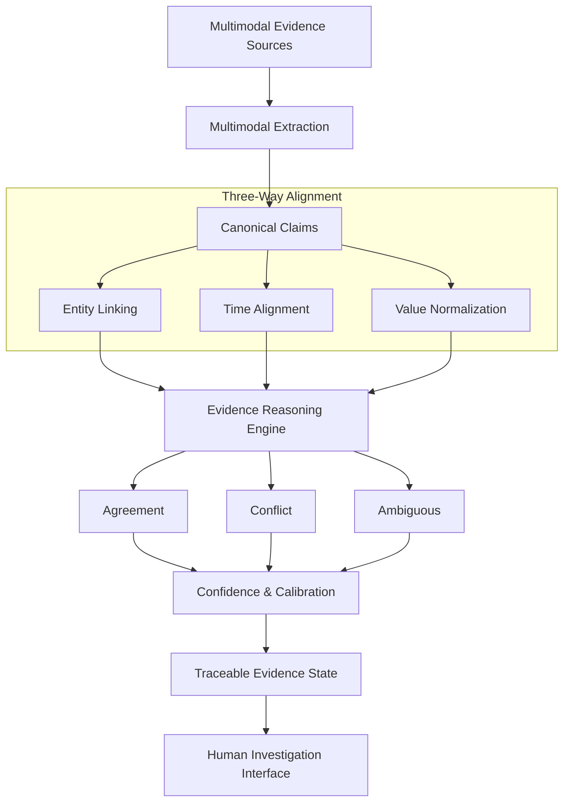

The architecture is deliberately centered on **evidence**, not on the LLM.

If a later feature makes AERIS less traceable, less deterministic, or less able to preserve conflicting evidence, that feature must be treated as an architectural regression rather than an enhancement.

---

**Next: `05-data-model.md`**, where we define the actual `SourceRecord`, `EvidencePointer`, `EntityRecord`, `EventRecord`, `ClaimRecord`, `TemporalContext`, `ConfidenceRecord`, `ConflictRecord`, and their relationships. This is the document the four developers should treat as the contract before writing the core Rust code.
