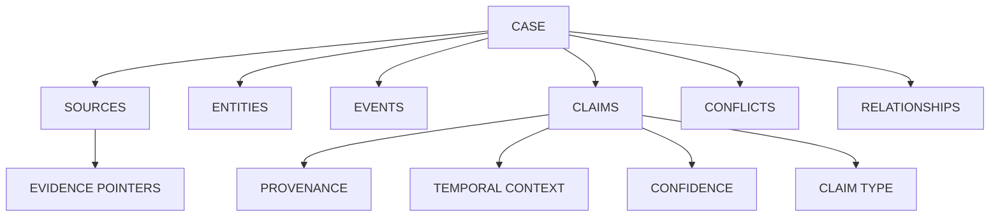
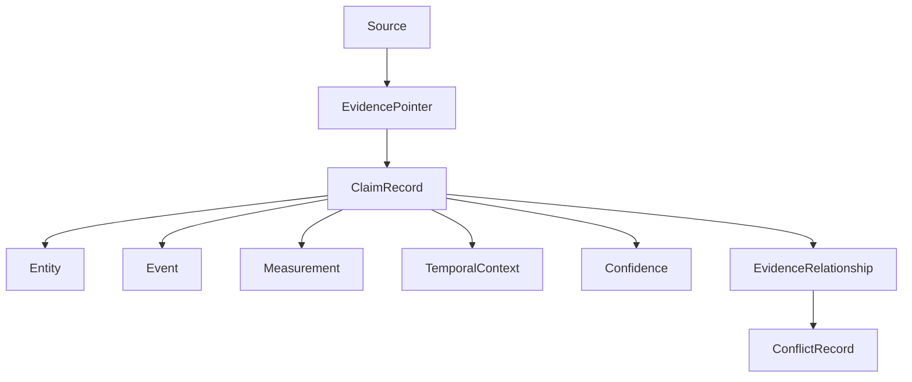
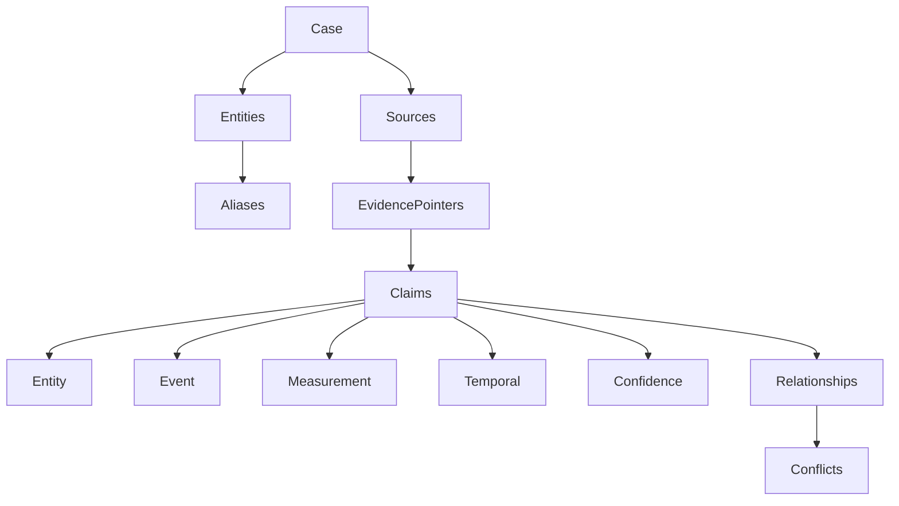
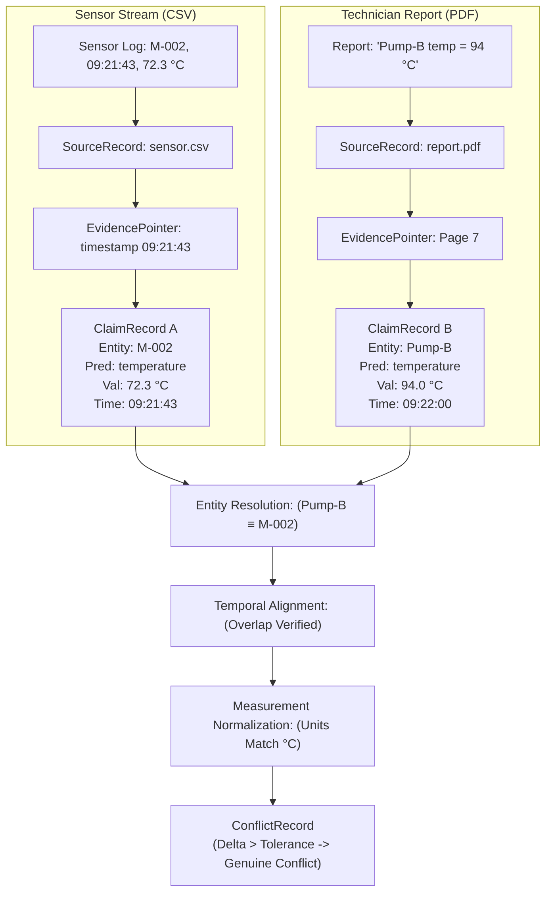
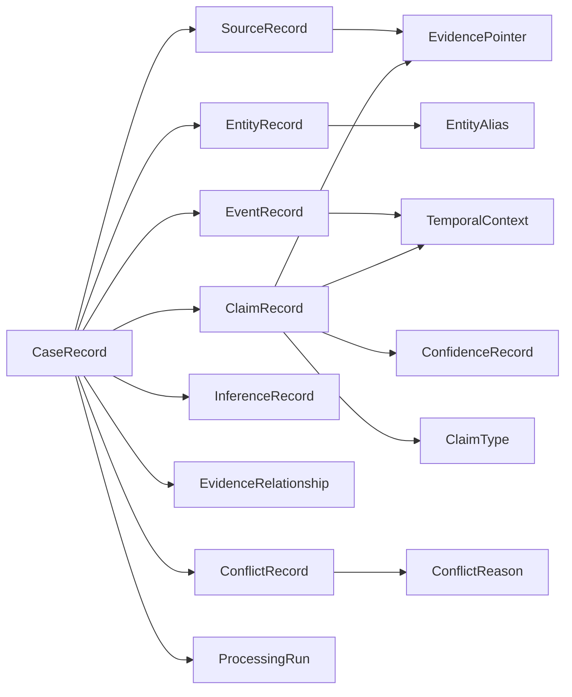

# AERIS Data Model

## 1. Purpose

This document defines the canonical data model used by AERIS to represent multimodal evidence, entities, events, claims, measurements, temporal context, provenance, confidence, and conflicts.

The data model is designed around one principle:

> **Every meaningful conclusion must remain connected to the evidence from which it was derived.**

The model therefore separates:

* Raw sources
* Evidence locations
* Entities
* Events
* Claims
* Measurements
* Temporal context
* Confidence
* Inferences
* Conflicts
* Relationships

---

## 2. Data Model Overview

The core structural relationship is:



The simplified evidence flow from raw source to conflict record is:



---

## 3. Identifier Strategy

AERIS shall use stable identifiers for all major domain objects.

Recommended types:

```rust
type CaseId = Uuid;
type SourceId = Uuid;
type EntityId = Uuid;
type EventId = Uuid;
type ClaimId = Uuid;
type ConflictId = Uuid;
type EvidenceId = Uuid;
type ProcessingRunId = Uuid;
```

Identifiers must remain stable throughout the lifetime of the corresponding object.

---

## 4. CaseRecord

A case represents a complete investigation or evidence-processing context.

```rust
struct CaseRecord {
    id: CaseId,
    case_number: String,
    title: String,
    description: Option<String>,
    status: CaseStatus,
    created_at: DateTime<Utc>,
    updated_at: DateTime<Utc>,
}
```

Possible statuses:

```rust
enum CaseStatus {
    Created,
    Processing,
    Completed,
    Failed,
    Archived,
}
```

Example:

```text
CASE-047

Title:
Turbine Engine Anomaly

Status:
Completed
```

---

## 5. SourceRecord

A `SourceRecord` represents an individual evidence source.

```rust
struct SourceRecord {
    id: SourceId,
    case_id: CaseId,
    source_type: SourceType,
    name: String,
    uri: String,
    mime_type: Option<String>,
    checksum: Option<String>,
    size_bytes: Option<u64>,
    created_at: Option<DateTime<Utc>>,
    metadata: SourceMetadata,
    reliability: Option<f32>,
}
```

---

## 6. SourceType

```rust
enum SourceType {
    Pdf,
    Text,
    Image,
    Csv,
    Json,
    Table,
    Sensor,
    Other,
}
```

The enum can be expanded as additional ingestion formats are introduced.

---

## 7. SourceMetadata

Metadata may include:

```rust
struct SourceMetadata {
    author: Option<String>,
    device_id: Option<String>,
    capture_time: Option<DateTime<Utc>>,
    location: Option<String>,
    schema_version: Option<String>,
    attributes: HashMap<String, String>,
}
```

Metadata must remain separate from extracted claims. For example, a PDF's creation timestamp should not automatically become an event timestamp.

---

## 8. EvidencePointer

An `EvidencePointer` identifies the exact location of evidence supporting a claim.

```rust
enum EvidencePointer {
    Text {
        source_id: SourceId,
        page: Option<u32>,
        char_start: Option<u32>,
        char_end: Option<u32>,
    },

    Image {
        source_id: SourceId,
        x: f32,
        y: f32,
        width: f32,
        height: f32,
    },

    Table {
        source_id: SourceId,
        row: u32,
        column: String,
    },

    TimeSeries {
        source_id: SourceId,
        timestamp: DateTime<Utc>,
    },

    StructuredField {
        source_id: SourceId,
        path: String,
    },
}
```

The pointer should identify **where** the evidence exists, not reproduce the evidence itself.

---

## 9. EvidenceRecord

For cases where richer evidence metadata is required, AERIS may store an explicit evidence record.

```rust
struct EvidenceRecord {
    id: EvidenceId,
    source_id: SourceId,
    pointer: EvidencePointer,
    extracted_text: Option<String>,
    extracted_value: Option<ClaimValue>,
    created_at: DateTime<Utc>,
}
```

This allows the system to cache processed evidence while preserving the original source.

---

## 10. EntityRecord

An entity represents a real-world object, system, component, person, location, or other identifiable subject.

```rust
struct EntityRecord {
    id: EntityId,
    case_id: CaseId,
    canonical_name: String,
    entity_type: EntityType,
    confidence: f32,
    status: EntityStatus,
    created_at: DateTime<Utc>,
}
```

---

## 11. EntityType

```rust
enum EntityType {
    Machine,
    Component,
    Person,
    Location,
    Organization,
    Sensor,
    EventObject,
    Unknown,
}
```

The initial industrial benchmark will primarily use machine and component entities.

---

## 12. EntityAlias

Aliases represent source-specific references to an entity.

```rust
struct EntityAlias {
    id: Uuid,
    entity_id: EntityId,
    source_id: SourceId,
    alias: String,
    confidence: f32,
}
```

Example:

```text
Entity:
M-002 / Pump-B

Aliases:
Pump-B
Pump B
P-002
Pump_02
```

---

## 13. EntityLink

An `EntityLink` represents the relationship between two references or entities.

```rust
struct EntityLink {
    source_entity: EntityId,
    target_entity: EntityId,
    relationship: EntityLinkType,
    confidence: f32,
    evidence: Vec<EvidencePointer>,
}
```

Possible relationship types:

```rust
enum EntityLinkType {
    SameEntity,
    PossibleSameEntity,
    RelatedEntity,
    DistinctEntity,
    Unknown,
}
```

This allows AERIS to preserve uncertainty.

---

## 14. EventRecord

An event represents something that occurred or is believed to have occurred.

```rust
struct EventRecord {
    id: EventId,
    case_id: CaseId,
    event_type: String,
    subject: Option<EntityId>,
    temporal_context: TemporalContext,
    confidence: ConfidenceRecord,
    provenance: Vec<EvidencePointer>,
}
```

Examples:
* Inspection
* Maintenance
* Temperature Alarm
* Component Failure
* Shutdown

---

## 15. TemporalContext

Temporal information must be represented explicitly.

```rust
struct TemporalContext {
    start: Option<DateTime<Utc>>,
    end: Option<DateTime<Utc>>,
    precision: TemporalPrecision,
    timezone: Option<String>,
    approximate: bool,
}
```

---

## 16. TemporalPrecision

```rust
enum TemporalPrecision {
    Exact,
    Second,
    Minute,
    Hour,
    Day,
    Approximate,
    Interval,
    Unknown,
}
```

The implementation can later refine this model if benchmark requirements demand greater temporal precision.

---

## 17. ClaimRecord

The `ClaimRecord` is the central object in AERIS.

```rust
struct ClaimRecord {
    id: ClaimId,
    case_id: CaseId,
    subject: EntityRef,
    predicate: Predicate,
    object: ClaimValue,
    temporal_context: Option<TemporalContext>,
    provenance: Vec<EvidencePointer>,
    claim_type: ClaimType,
    confidence: ConfidenceRecord,
    status: ClaimStatus,
    created_at: DateTime<Utc>,
}
```

A claim represents an observation or proposition about an entity, event, measurement, or relationship.

---

## 18. EntityRef

A claim may refer to a resolved or unresolved entity.

```rust
enum EntityRef {
    Resolved(EntityId),
    Unresolved {
        reference: String,
    },
    Ambiguous {
        candidates: Vec<EntityId>,
    },
}
```

This is critical because an unresolved entity should not be forced into an incorrect canonical identity.

---

## 19. Predicate

The predicate describes what relationship or property the claim represents.

Examples:
* `temperature`
* `pressure`
* `status`
* `location`
* `operating_state`
* `damage_state`
* `inspection_result`
* `maintenance_state`

The initial implementation uses a normalized string representation:

```rust
type Predicate = String;
```

A controlled vocabulary can be introduced later for domain-specific predicates.

---

## 20. ClaimValue

A claim may contain different types of values.

```rust
enum ClaimValue {
    Text(String),
    Number {
        value: f64,
        unit: Option<String>,
    },
    Boolean(bool),
    Entity(EntityRef),
    Category(String),
    Measurement(MeasurementValue),
    Range {
        min: f64,
        max: f64,
        unit: Option<String>,
    },
}
```

This allows the same claim model to represent both qualitative and quantitative observations.

---

## 21. MeasurementValue

```rust
struct MeasurementValue {
    value: f64,
    unit: String,
    normalized_value: Option<f64>,
    normalized_unit: Option<String>,
    tolerance: Option<f64>,
}
```

The original value and unit must always be preserved:

```text
Original:
158 °F

Normalized:
69.999 °C
```

The normalized value must never overwrite the original observation.

---

## 22. ClaimType

```rust
enum ClaimType {
    Extracted,
    Inferred,
}
```

* **Extracted:** Directly supported by source evidence.
* **Inferred:** Derived from one or more existing claims.

---

## 23. ClaimStatus

```rust
enum ClaimStatus {
    Active,
    Superseded,
    Ambiguous,
    Disputed,
    Invalid,
}
```

A disputed claim can remain active while being involved in a conflict. The system should not delete it simply because another source disagrees.

---

## 24. ConfidenceRecord

Confidence should be represented as structured information rather than one unexplained number:

```rust
struct ConfidenceRecord {
    overall: Option<f32>,
    extraction: Option<f32>,
    entity_resolution: Option<f32>,
    temporal_alignment: Option<f32>,
    inference: Option<f32>,
    source_reliability: Option<f32>,
}
```

Values should normally fall within:

$$0.0 \le \text{confidence} \le 1.0$$

---

## 25. InferenceRecord

An inference records how a derived claim was produced.

```rust
struct InferenceRecord {
    claim_id: ClaimId,
    input_claims: Vec<ClaimId>,
    method: String,
    explanation: Option<String>,
    confidence: ConfidenceRecord,
    created_at: DateTime<Utc>,
}
```

Example:

```text
Input:
Temperature = 94°C

Input:
Normal operating threshold = 80°C

Inference:
Temperature anomaly detected
```

The inferred claim remains linked to its source claims.

---

## 26. EvidenceRelationship

Relationships connect claims and entities.

```rust
struct EvidenceRelationship {
    id: Uuid,
    source_claim: ClaimId,
    target_claim: Option<ClaimId>,
    target_entity: Option<EntityId>,
    relationship: EvidenceRelationshipType,
    confidence: Option<f32>,
    evidence: Vec<EvidencePointer>,
}
```

---

## 27. EvidenceRelationshipType

```rust
enum EvidenceRelationshipType {
    Supports,
    Contradicts,
    AgreesWith,
    DerivedFrom,
    RefersTo,
    SameEntityAs,
    PossibleSameEntityAs,
    OccursDuring,
    RelatedTo,
}
```

---

## 28. ConflictRecord

A conflict represents a structured disagreement between claims.

```rust
struct ConflictRecord {
    id: ConflictId,
    case_id: CaseId,
    claim_a: ClaimId,
    claim_b: ClaimId,
    conflict_type: ConflictType,
    reason: ConflictReason,
    temporal_overlap: Option<TemporalOverlap>,
    confidence: ConfidenceRecord,
    created_at: DateTime<Utc>,
}
```

---

## 29. ConflictType

```rust
enum ConflictType {
    ValueConflict,
    StateConflict,
    CrossModalConflict,
    TemporalConflict,
    SemanticConflict,
}
```

The initial implementation prioritizes value and cross-modal conflicts.

---

## 30. ConflictReason

A conflict should contain machine-readable reasoning conditions:

```rust
struct ConflictReason {
    same_entity: bool,
    same_attribute: bool,
    temporal_overlap: bool,
    comparable_units: bool,
    semantic_compatibility: bool,
    exceeds_tolerance: bool,
    explanation: String,
}
```

Example check result:

```text
Same entity: ✓
Same attribute: ✓
Temporal overlap: ✓
Comparable units: ✓
Semantic compatibility: ✓
Exceeds tolerance: ✓
```

This information is essential for explainability.

---

## 31. TemporalOverlap

```rust
struct TemporalOverlap {
    start: DateTime<Utc>,
    end: DateTime<Utc>,
    duration_seconds: i64,
}
```

This allows the UI to explain why two claims were considered temporally comparable.

---

## 32. EvidenceStatus

AERIS uses an explicit evidence status:

```rust
enum EvidenceStatus {
    Agreement,
    Conflict,
    Ambiguous,
    InsufficientEvidence,
    NotComparable,
}
```

This status must not be confused with the lifecycle status of a claim.

---

## 33. ProcessingRun

Each processing execution should be traceable:

```rust
struct ProcessingRun {
    id: ProcessingRunId,
    case_id: CaseId,
    pipeline_version: String,
    model_versions: Vec<ModelVersion>,
    status: ProcessingStatus,
    started_at: DateTime<Utc>,
    completed_at: Option<DateTime<Utc>>,
}
```

This supports reproducibility and debugging.

---

## 34. ModelVersion

```rust
struct ModelVersion {
    provider: String,
    model: String,
    version: Option<String>,
}
```

Example:

```text
Provider:
Ollama

Model:
qwen2.5:7b

Version:
v0.3.1
```

The exact model must be recorded for every processing run that uses AI.

---

## 35. ProcessingStatus

```rust
enum ProcessingStatus {
    Queued,
    Running,
    Completed,
    Failed,
    Partial,
}
```

`Partial` is important for multimodal cases where one source fails while other sources succeed.

---

## 36. Data Relationships



---

## 37. Example Complete Claim

A fully represented claim serialized to JSON:

```json
{
  "id": "claim-1042",
  "subject": {
    "type": "resolved",
    "entity_id": "entity-m002"
  },
  "predicate": "temperature",
  "object": {
    "type": "measurement",
    "value": 94.0,
    "unit": "C"
  },
  "temporal_context": {
    "start": "2026-09-01T09:22:00Z",
    "precision": "minute"
  },
  "claim_type": "extracted",
  "provenance": [
    {
      "source": "maintenance-report",
      "type": "text",
      "page": 7
    }
  ],
  "confidence": {
    "overall": 0.94,
    "extraction": 0.96
  },
  "status": "active"
}
```

---

## 38. Example Conflict

```json
{
  "id": "conflict-002",
  "claim_a": "claim-1042",
  "claim_b": "claim-1043",
  "conflict_type": "value_conflict",
  "reason": {
    "same_entity": true,
    "same_attribute": true,
    "temporal_overlap": true,
    "comparable_units": true,
    "semantic_compatibility": true,
    "exceeds_tolerance": true
  },
  "confidence": {
    "overall": 0.91
  }
}
```

This allows the UI to explain the conflict deterministically without asking an LLM to generate the explanation from scratch.

---

## 39. PostgreSQL Mapping

The canonical model maps to relational tables:

```text
cases
sources
entities
entity_aliases
entity_links
events
claims
measurements
evidence_pointers
inferences
evidence_relationships
conflicts
confidence_records
processing_runs
model_versions
```

Foreign-key relationships preserve referential integrity.

---

## 40. JSON Serialization

All core domain objects support JSON serialization:

```rust
#[derive(Debug, Clone, Serialize, Deserialize)]
```

This allows the same domain model to be shared across:
* Rust services
* REST API
* Benchmark tools
* Frontend
* Test fixtures

---

## 41. Versioning

The data model is explicitly versioned:

```text
AERIS Schema v0.1
```

The schema version is recorded in:
* Processing runs
* Dataset manifests
* Stored case metadata
* Benchmark reports

Breaking changes increment the schema version.

---

## 42. Data Integrity Rules

The following rules are mandatory:

1. **Rule 1:** Every claim must have at least one provenance pointer unless explicitly classified as a derived system state.
2. **Rule 2:** Every extracted claim must reference its source evidence.
3. **Rule 3:** Every inferred claim must reference the claims used to derive it.
4. **Rule 4:** Original measurement values must never be overwritten by normalized values.
5. **Rule 5:** An ambiguous entity must not be silently converted into a resolved entity.
6. **Rule 6:** A conflict must retain references to all participating claims.
7. **Rule 7:** Deleting a source must not silently leave orphaned claims.
8. **Rule 8:** Processing runs must record the pipeline and model versions used.
9. **Rule 9:** Ground-truth records must remain outside the production evidence model.
10. **Rule 10:** Evidence pointers must remain resolvable to the original source whenever that source is available.

---

## 43. Data Flow Example



Both original claims remain completely intact.

---

## 44. Data Model Philosophy

The AERIS data model intentionally avoids representing the world as one definitive state. Instead, it represents:

```text
WHAT WAS OBSERVED
        +
WHERE IT CAME FROM
        +
WHEN IT APPLIED
        +
WHAT ENTITY IT REFERRED TO
        +
HOW CERTAIN THE SYSTEM IS
        +
HOW IT RELATES TO OTHER EVIDENCE
```

This makes the data model suitable for evidence reconciliation rather than simple document storage.

---

## 45. Canonical Data Model Summary

The essential AERIS objects are:



This model forms the contract between all AERIS subsystems.

---

The next implementation step after this document is to freeze **Schema v0.1** and implement these types inside `aeris-core` before building the individual processing engines.
