# AERIS Evidence and Provenance Model

## 1. Purpose

This document defines how AERIS preserves, represents, and exposes the relationship between processed claims and their original evidence.

Provenance is a foundational component of AERIS because the system is intended to produce results that can be inspected, audited, and challenged.

AERIS must therefore answer:

> **What does the system believe, where did that information come from, and what evidence supports it?**

---

## 2. Provenance Principle

The fundamental rule is:

> **No important claim should become detached from the evidence that supports it.**

The system maintains provenance throughout the complete processing pipeline:

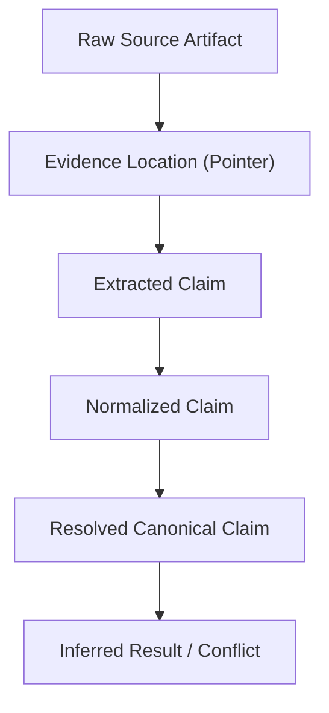

At every stage, the relationship with the original evidence remains immutable and available.

---

## 3. Why Provenance Matters

Consider two observations:

```text
Temperature = 94°C
```

and:

```text
Temperature = 72.3°C
```

A system that simply reports:

```text
CONFLICT
```

does not provide enough information for an engineer or investigator to validate the result.

AERIS instead provides:

```text
CONFLICT

Claim A:
94°C
Source:
maintenance_report.pdf
Page 7, Paragraph 3

Claim B:
72.3°C
Source:
sensor_temperature.csv
Row 481, Timestamp 09:21:43 UTC
```

The user can therefore inspect the underlying evidence independently.

---

## 4. Provenance Levels

AERIS maintains provenance across four explicit architectural levels:

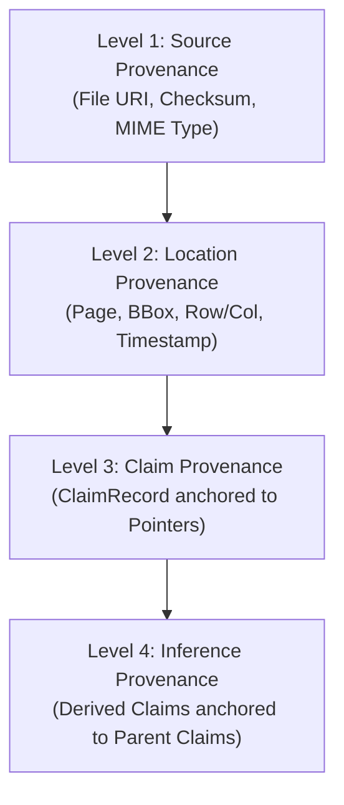

### Level 1: Source Provenance

Identifies the original source artifact:

```text
maintenance_report.pdf
sensor_temperature.csv
inspection.png
technician_notes.txt
```

---

### Level 2: Location Provenance

Identifies where within the source artifact the evidence occurs:

* **PDF:** Page 7, bounding box `[120, 450, 310, 480]`
* **CSV:** Row 481, column `"temperature"`
* **Image:** Bounding box `[x=420, y=185, w=310, h=240]`
* **Sensor Stream:** Timestamp `2026-09-01T09:21:43Z`

---

### Level 3: Claim Provenance

Connects a structured claim to one or more evidence locations:

```text
Claim
 ├── Evidence Pointer A
 └── Evidence Pointer B
```

---

### Level 4: Inference Provenance

Connects a derived claim to the upstream claims from which it was inferred:

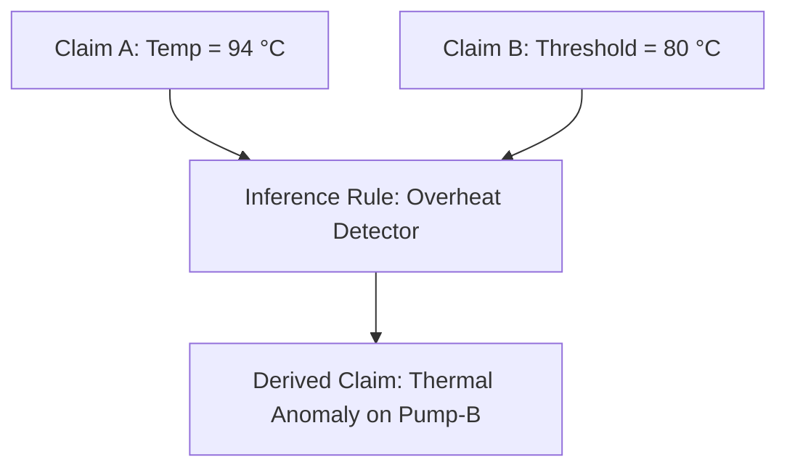

This creates an auditable reasoning chain.

---

## 5. SourceRecord

Every source entering AERIS receives an immutable `SourceRecord`:

```rust
struct SourceRecord {
    id: SourceId,
    case_id: CaseId,
    source_type: SourceType,
    name: String,
    uri: String,
    checksum: Option<String>,
    metadata: SourceMetadata,
}
```

The source identifier remains stable throughout all downstream processing.

---

## 6. EvidencePointer

An `EvidencePointer` identifies the precise coordinate of evidence within a source:

```rust
enum EvidencePointer {
    Text {
        source_id: SourceId,
        page: Option<u32>,
        char_start: Option<u32>,
        char_end: Option<u32>,
    },

    Image {
        source_id: SourceId,
        x: f32,
        y: f32,
        width: f32,
        height: f32,
    },

    Table {
        source_id: SourceId,
        row: u32,
        column: String,
    },

    TimeSeries {
        source_id: SourceId,
        timestamp: DateTime<Utc>,
    },

    StructuredField {
        source_id: SourceId,
        path: String,
    },
}
```

The pointer is a reference coordinate, not a duplicate copy of the raw source data.

---

## 7. Text Provenance

For textual evidence, AERIS preserves enough information to locate the exact phrase:

```text
Source:
maintenance_report.pdf

Page:
7

Text range:
Paragraph 3 (Chars 1240–1272)

Claim:
Temperature reached 94°C.
```

---

## 8. PDF Provenance

PDF evidence preserves hierarchical document coordinates:

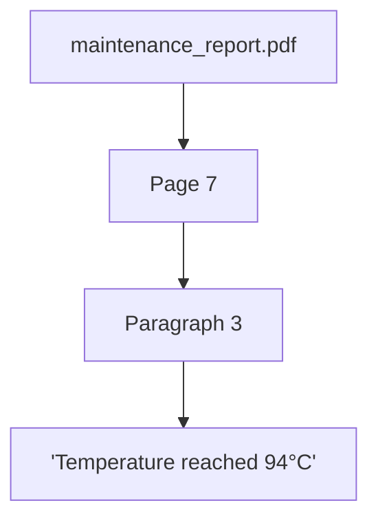

The Web UI uses this coordinate to render and highlight the exact text box on the PDF canvas.

---

## 9. Image Provenance

Image-based evidence preserves normalized bounding box coordinates:

```text
Source:
inspection.png

Bounding region:
x = 420
y = 185
width = 310
height = 240
```

```text
┌──────────────────────────────┐
│                              │
│       ┌──────────────┐       │
│       │   EVIDENCE   │       │
│       │    REGION    │       │
│       └──────────────┘       │
│                              │
└──────────────────────────────┘
```

The UI renders an overlay rectangle highlighting the anomaly or gauge reading.

---

## 10. Structured Data Provenance

For CSV or tabular data, provenance identifies the exact row, column, and timestamp:

```text
Source:
sensor_temperature.csv

Row:
481

Column:
temperature

Timestamp:
09:21:43 UTC

Value:
72.3
```

This makes tabular evidence directly inspectable in the UI data table.

---

## 11. Time-Series Provenance

Time-series evidence anchors directly to ISO 8601 / UTC timestamps:

```text
Source:
temperature_sensor.csv

Timestamp:
2026-09-01T09:21:43Z

Measurement:
72.3°C
```

The timestamp serves as both the physical occurrence time and the data index.

---

## 12. Claim Provenance

A `ClaimRecord` retains one or more evidence pointers:

```text
Claim:
Pump-B temperature = 94°C

Provenance:
maintenance_report.pdf
 └── Page 7
      └── Paragraph 3
```

Multiple evidence pointers may support the same claim:

```text
Claim:
Pump-B is overheating

Evidence:
 ├── sensor.csv
 │    └── 94°C at 09:21
 │
 └── maintenance_report.pdf
      └── overheating observation
```

---

## 13. Multiple Evidence Sources

When a claim is corroborated by multiple sources, AERIS preserves each source separately:

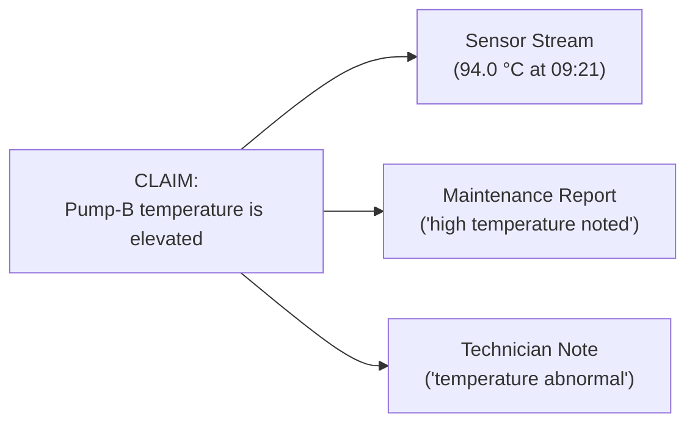

The system does not collapse multiple sources into a single generic entry.

---

## 14. Conflicting Provenance

Conflicting claims retain distinct, unmerged provenance chains:

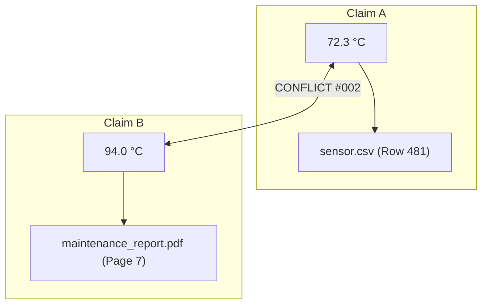

The conflict record references both claims and both provenance trees.

---

## 15. Inference Provenance

An inferred claim records its provenance through a directed graph of supporting claims:

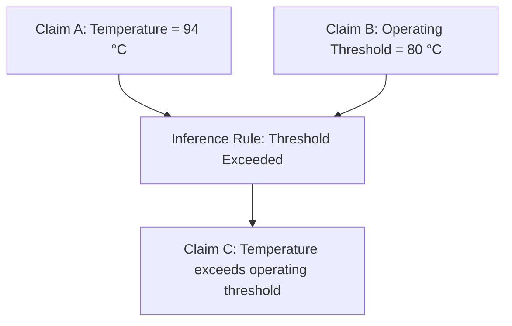

The stored relationship:

```text
Claim C
 ├── derived_from → Claim A
 └── derived_from → Claim B
```

---

## 16. Extraction vs Inference

Provenance communicates whether an observation was directly observed or derived:

| Dimension | Extracted Claim | Inferred Claim |
| :--- | :--- | :--- |
| **Origin** | Direct sensor reading, text phrase, or image crop | Logical derivation, threshold rule, or model deduction |
| **Supporting Pointer** | `EvidencePointer` to raw artifact bytes | Array of upstream `ClaimId` references |
| **ClaimType Tag** | `ClaimType::Extracted` | `ClaimType::Inferred` |
| **UI Presentation** | "Observed in [Source]" | "Inferred from [Claim A, Claim B]" |

---

## 17. Provenance Graph

The full provenance relationship is navigable as a directed acyclic graph (DAG):

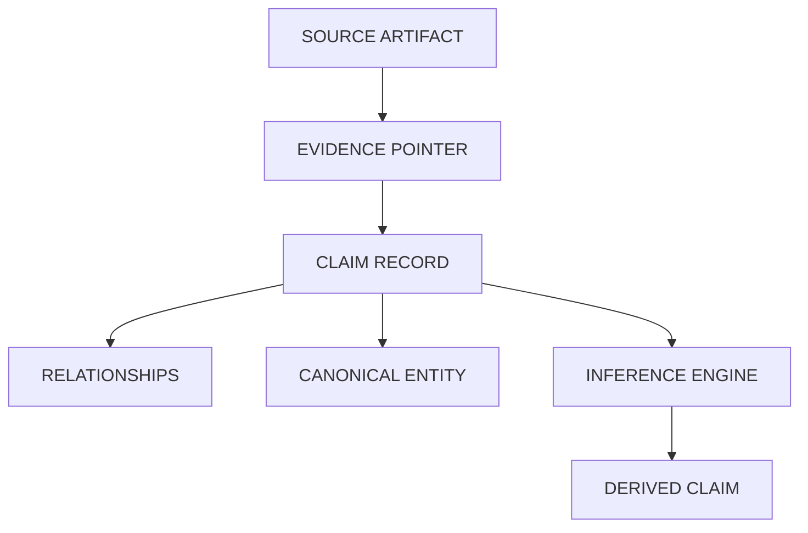

This graph enables bidirectional navigation:
* **Forward:** From raw evidence to all derived conclusions.
* **Backward:** From a high-level anomaly flag back to the exact source bytes.

---

## 18. Provenance and Normalization

Normalization preserves original observation values alongside canonical representations:

```text
Original Observation:
158 °F

Normalized Form:
69.999 °C

Preserved Provenance Record:
├── Original Value: 158.0
├── Original Unit: °F
├── Normalized Value: 69.999
├── Normalized Unit: °C
└── Source: maintenance_report.pdf, Page 7
```

---

## 19. Provenance and Entity Resolution

Entity resolution records the matching signals that justified the canonical link:

```text
Surface Mentions:
"Pump-B", "P-002", "Pump_02"
      │
      ▼
Canonical Entity:
M-002 (Primary Feed Pump B)

Recorded Matching Signals:
├── Exact component registry ID: ✓
├── Normalized string match: ✓
├── Spatial / bay location context: ✓
└── Semantic embedding similarity: 0.94
```

When signals are insufficient, provenance preserves ambiguity:

```text
Resolution:
AMBIGUOUS

Candidates:
├── CV-E (Control Valve East)
└── CV-E2 (Control Valve Emergency 2)
```

---

## 20. Provenance and Temporal Reasoning

Temporal alignment exposes the exact overlap duration and calculation:

```text
Claim A: 94 °C at 09:21:43 UTC
Claim B: 70 °C at 09:22:00 UTC

Recorded Temporal Relationship:
├── Relationship Type: Overlaps
├── Temporal Window: [09:21:43, 09:22:00]
└── Overlap Duration: 17 seconds
```

---

## 21. Provenance and Conflict Explanation

A conflict record packages its own complete justification:

```text
CONFLICT #002

Claim A:
├── Value: 72.3 °C
├── Source: sensor_temperature.csv
└── Timestamp: 09:21:43 UTC

Claim B:
├── Value: 94.0 °C
├── Source: maintenance_report.pdf (Page 7)
└── Timestamp: 09:22:00 UTC

Verification Conditions:
├── Same entity: ✓
├── Same attribute: ✓
├── Temporal overlap: ✓ (17s)
├── Comparable units: ✓ (°C)
└── Beyond tolerance: ✓ (Δ = 21.7 °C > ±1.0 °C)
```

---

## 22. Evidence Integrity

Uploaded sources are protected against tampering and modification:

* **Cryptographic Checksum:** SHA-256 computed immediately upon receipt.
* **Immutability:** Source files are stored in read-only storage.
* **Metadata Binding:** File size, original name, MIME type, and ingest timestamp are committed in `SourceRecord`.

```text
SHA-256: 7f83b1657ff1fc53b92dc18148a1d65dfc2d4b1fa3d677284addd200126d9069
```

---

## 23. Evidence Lifecycle

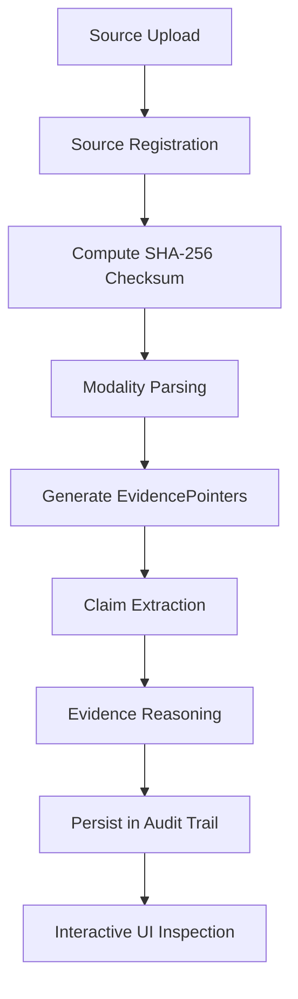

The raw source remains available and unmodified throughout this lifecycle.

---

## 24. Provenance API

The backend exposes endpoints for direct provenance querying:

```http
GET /api/claims/{claim_id}/evidence
```

```json
{
  "claim_id": "claim-1042",
  "evidence": [
    {
      "source_id": "src-7701",
      "source_name": "maintenance_report.pdf",
      "type": "text",
      "page": 7,
      "char_start": 1240,
      "char_end": 1272
    }
  ]
}
```

```http
GET /api/conflicts/{conflict_id}
```

Returns the conflict reason, both participating claims, and both provenance trees.

---

## 25. UI Provenance Requirements

When an investigator clicks on any claim, the UI presents:

```text
CLAIM: Pump-B temperature = 94 °C

Source:      maintenance_report.pdf
Location:    Page 7, Paragraph 3
Claim Type:  Extracted
Confidence:  94%
```

Clicking the source link immediately opens the PDF viewer and scrolls to Page 7 with the text highlighted.

---

## 26. Provenance Audit Trail

Processing executions record a timestamped event log:

```text
Processing Run #PR-0091

10:31:04 UTC - Source registered: maintenance_report.pdf (SHA-256: 7f83b...)
10:31:06 UTC - Text extracted: 14 candidate claims
10:31:08 UTC - Claim generated: CLM-1042 (Pump-B temp = 94 °C)
10:31:09 UTC - Entity resolved: Pump-B -> M-002
10:31:10 UTC - Temporal alignment: Overlap with CLM-1043 verified (17s)
10:31:11 UTC - Conflict detected: CONFLICT-002 (Δ = 21.7 °C)
```

---

## 27. Provenance for Model-Generated Evidence

When an AI model produces an extraction or candidate claim, the system records:
* Model Provider (e.g., `Ollama`, `OpenAI`)
* Model Name (e.g., `qwen2.5:7b`, `gpt-4o`)
* Model Version / Checksum
* Processing Run ID
* Input Artifact Reference

An LLM generation is **never** considered primary evidence; the underlying document text remains the primary evidence.

---

## 28. Provenance Integrity Rules

The following ten rules are strictly enforced:

1. **Rule 1:** Every extracted claim must have source provenance.
2. **Rule 2:** Every inferred claim must reference the claims used to derive it.
3. **Rule 3:** Normalization must preserve original values and units.
4. **Rule 4:** Conflict records must reference all participating claims.
5. **Rule 5:** Entity-resolution decisions should preserve supporting evidence or matching signals.
6. **Rule 6:** Temporal relationships should remain inspectable.
7. **Rule 7:** Source checksums should be recorded where practical.
8. **Rule 8:** AI-generated observations must remain distinguishable from primary source evidence.
9. **Rule 9:** Deleting or replacing evidence must not silently invalidate the historical processing record.
10. **Rule 10:** A user must be able to trace an important conclusion back to its underlying evidence.

---

## 29. Complete Provenance Chain Example

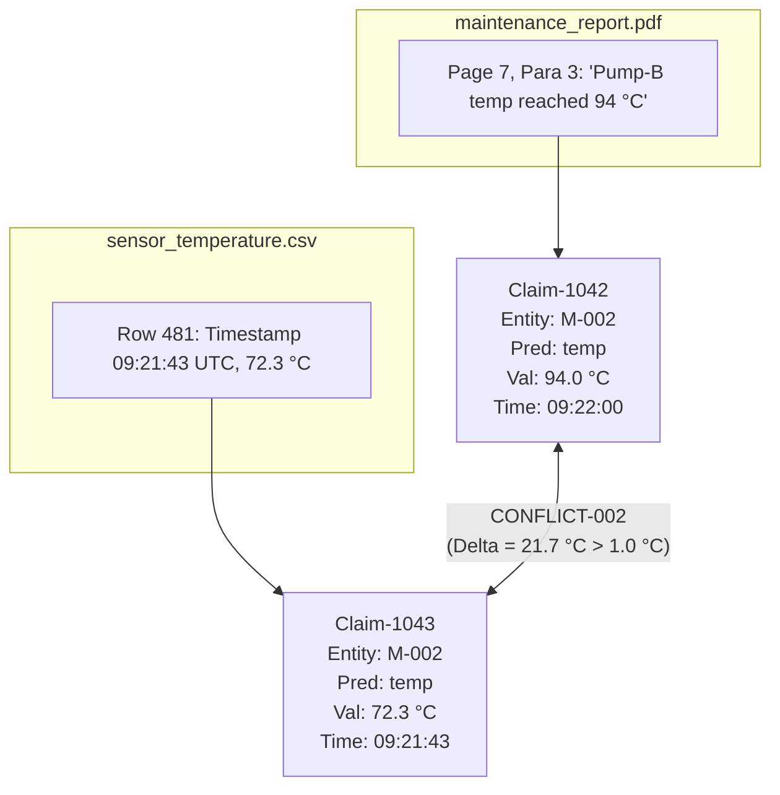

The complete chain from raw artifact to conflict is fully inspectable.

---

## 30. Why Provenance Is a Core AERIS Capability

AERIS is engineered for environments where conclusions must be defensible in engineering audits, regulatory compliance, and incident investigations.

The provenance system empowers engineers to answer:
* *What evidence produced this claim?*
* *Which source disagrees?*
* *When did the observation occur?*
* *Are the two values actually comparable?*
* *Why were these two references considered the same entity?*
* *Which claims produced this inference?*
* *What information was missing?*

---

## 31. Final Provenance Model

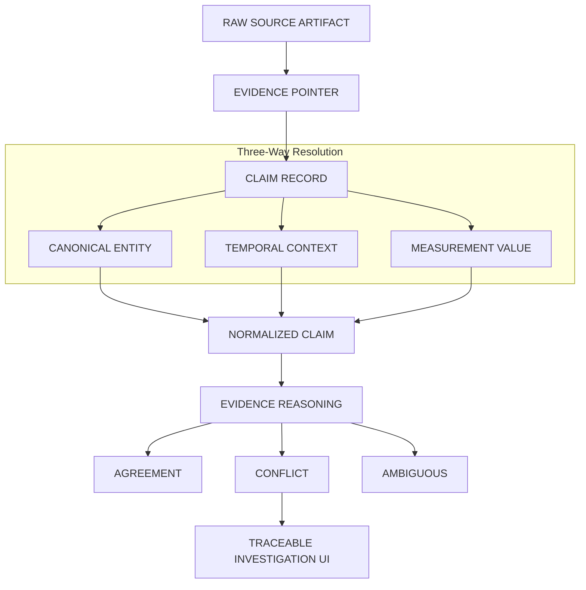

The defining property of AERIS provenance is:

> **The system never asks the user to trust a conclusion without providing a path back to the evidence behind it.**

---

**Next: `07-entity-resolution.md`**, where we define exactly how AERIS decides whether `Pump-B`, `Pump B`, `P-002`, and similar references represent the same entity, while deliberately preserving ambiguity when the evidence is insufficient.
