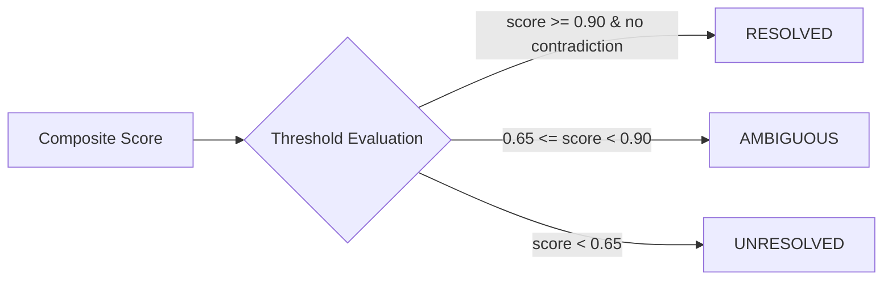
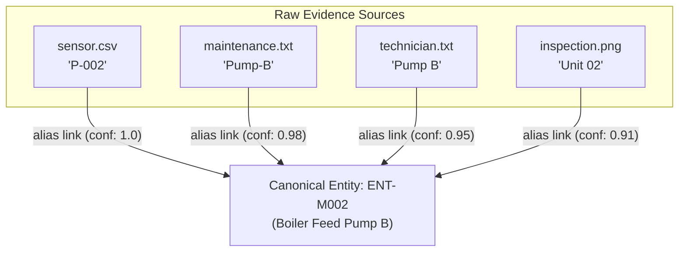
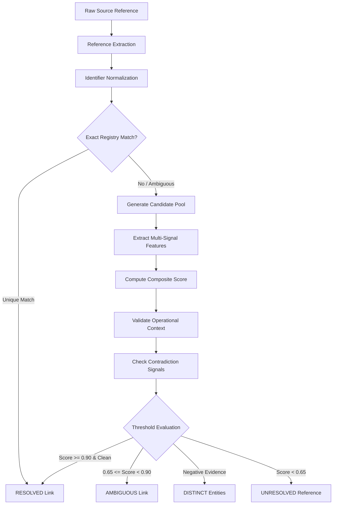
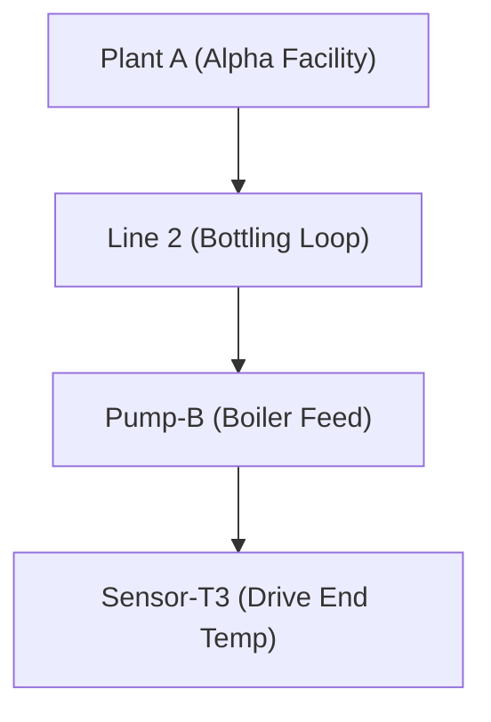
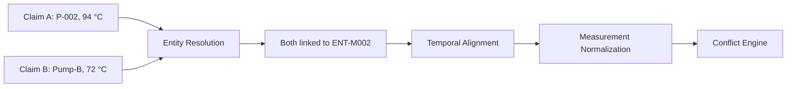
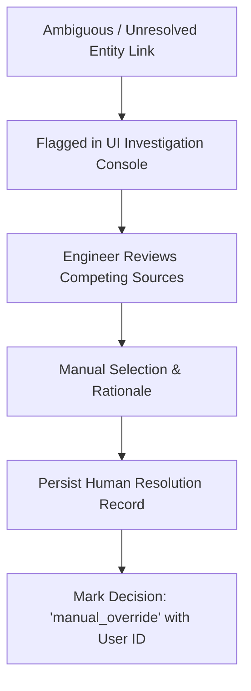
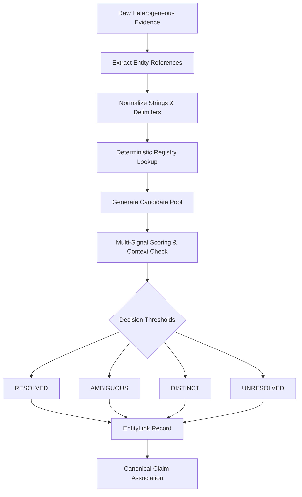

# AERIS Entity Resolution

## 1. Purpose

Entity resolution determines whether references appearing in different evidence sources refer to the same real-world entity.

AERIS must not assume that two similar names represent the same entity. It must combine identifiers, aliases, source context, attributes, relationships, and temporal information to produce a resolution decision with supporting evidence.

The entity-resolution subsystem converts source-specific references such as:

```text
Pump-B
Pump B
P-002
PUMP_002
Unit 02
```

into references to a canonical entity when the available evidence supports that conclusion.

When the evidence is insufficient, AERIS must preserve the ambiguity rather than forcing a match.

The central rule is:

> **Entity resolution is evidence-based linking, not string matching.**

---

## 2. Entity Resolution Problem

Different evidence sources rarely use identical identifiers.

A single physical machine may appear as:

| Source | Reference |
| :--- | :--- |
| Sensor CSV | `P-002` |
| Maintenance report | `Pump-B` |
| Technician note | `Pump B` |
| Inspection image | `unit_02` |
| Asset registry | `PUMP-002` |

A naive string comparison would treat these as different entities.

AERIS instead attempts to determine whether the references describe the same entity using multiple signals.

However, similarity alone is not sufficient. For example:

```text
CV-E
CV-E2
```

may look similar but could represent two different conveyor assets.

The system must therefore support three explicit outcomes:

```text
RESOLVED
AMBIGUOUS
DISTINCT
```

An additional state is used when no reasonable candidate exists:

```text
UNRESOLVED
```

---

## 3. Entity Resolution Goals

The entity-resolution subsystem must:

1. Identify entity references in incoming evidence.
2. Normalize identifiers and aliases.
3. Search the canonical entity registry.
4. Generate possible candidates.
5. Compare candidates using multiple signals.
6. Calculate a resolution confidence.
7. Preserve supporting evidence.
8. Detect conflicting identity information.
9. Preserve ambiguity when evidence is insufficient.
10. Create auditable entity-link records.
11. Support cross-modal entity linking.
12. Support evaluation against known ground truth.

---

## 4. Canonical Entity Model

AERIS maintains a canonical representation for each known entity.

```rust
struct EntityRecord {
    id: EntityId,
    case_id: CaseId,
    entity_type: EntityType,
    canonical_name: String,
    aliases: Vec<EntityAlias>,
    attributes: HashMap<String, Value>,
    source_references: Vec<SourceReference>,
    confidence: ConfidenceRecord,
    status: EntityStatus,
}
```

The canonical entity is not necessarily the identifier appearing in the source:

```text
Entity ID: ENT-M002
Canonical Name: Pump-B
Type: Machine

Aliases:
    Pump B
    P-002
    PUMP-002
    Unit 02
```

---

## 5. Entity Types

AERIS supports extensible entity types:

```rust
enum EntityType {
    Machine,
    Component,
    Sensor,
    Location,
    Person,
    Organization,
    Vehicle,
    Event,
    Asset,
    Unknown,
}
```

The enum remains extensible because the evidence model is designed for broad operational domains beyond factory equipment.

---

## 6. Entity Alias

Aliases represent source-specific references to a canonical entity:

```rust
struct EntityAlias {
    alias: String,
    normalized_alias: String,
    source_id: Option<SourceId>,
    confidence: f32,
}
```

Example JSON:

```json
{
  "alias": "Pump B",
  "normalized_alias": "pump-b",
  "source_id": "SRC-M002-REPORT",
  "confidence": 0.98
}
```

Aliases do not automatically become globally trusted identifiers. An alias learned from one weak source remains associated with its source provenance.

---

## 7. Identifier Normalization

Before candidate matching, AERIS normalizes entity references:

```text
"Pump-B"
"pump b"
"PUMP_B"
"Pump B "
    ↓
"pump-b"
```

Normalization steps include:
* Unicode normalization (NFKC)
* Whitespace trimming and collapse
* Case folding to lowercase
* Punctuation normalization
* Delimiter unification (converting spaces and underscores to hyphens)
* Known prefix normalization
* Controlled abbreviation expansion

```text
PUMP_002
PUMP-002
pump 002
    ↓
pump-002
```

However, normalization must never destroy meaningful distinctions. For example:

```text
CV-E
CV-E2
```

must remain distinct after normalization. The purpose of normalization is to eliminate superficial syntactic differences, not to manufacture false equivalence.

---

## 8. Deterministic Registry Lookup

The first resolution stage uses deterministic matching against the master registry:

* Exact canonical ID match
* Exact canonical name match
* Exact normalized alias match
* Registered source identifier
* Known external asset barcode / serial number

Example:

```text
Incoming reference:
P-002

Registry:
ENT-M002
canonical_name = Pump-B
aliases = [Pump B, P-002, PUMP-002]
```

Direct match:

```text
P-002 → ENT-M002 (Score = 1.0)
```

Deterministic matches receive higher baseline confidence than fuzzy matches, provided there is no contradictory context.

---

## 9. Candidate Generation

If deterministic lookup does not produce a unique match, AERIS generates candidate entities from the broader registry using multiple indexing keys:

* Normalized identifier similarity
* Canonical-name similarity
* Alias similarity
* Entity type compatibility
* Source metadata and plant location
* Component hierarchy (parent-child assets)
* Neighboring connected entities
* Shared attributes and operational ratings
* Temporal validity windows

Example:

```text
Incoming Reference:
"Pump B"

Candidate Pool:
├── ENT-M002 → Pump-B (Primary Feed Pump)
├── ENT-M008 → Pump-B-Backup (Auxiliary Standby Pump)
└── ENT-M011 → Pump-C (Secondary Loop Pump)
```

The resolver then scores and compares these candidates.

---

## 10. Matching Signals

AERIS evaluates entity resolution as a multi-signal decision:

| Signal | Description | Weight Class |
| :--- | :--- | :--- |
| **Exact ID** | Exact canonical identifier match | Decisive (1.00) |
| **Alias** | Match against established alias registry | High (0.90) |
| **String Similarity** | Edit distance / token similarity | Medium (0.55) |
| **Entity Type** | Compatibility of domain entity types | Gating (0.35) |
| **Attribute Match** | Shared attributes (serial no., rating, power) | High (0.60) |
| **Source Context** | Expected entity in this file/report section | Medium (0.50) |
| **Location Match** | Shared plant bay, room, or skid | High (0.60) |
| **Relationship Match**| Shared parent asset or connected pipeline | Medium (0.45) |
| **Temporal Context** | Active operation window matches report time | Medium (0.25) |
| **Negative Evidence** | Contradicting location, state, or specs | Penalizing (-0.80) |

---

## 11. Similarity Matching

Fuzzy matching is used for candidate generation and preliminary ranking:
* Normalized Levenshtein distance
* Jaro-Winkler similarity (favoring common prefixes)
* Token sort ratio (handling word transpositions)
* N-gram character overlap
* Dense vector embedding cosine similarity

Dense embeddings provide candidate generation hints, never authoritative identity proof:

```text
"Pump B" vs "Pump-B"        --> High Lexical Similarity, Same Asset
"Pump B" vs "Pump B Backup" --> High Lexical Similarity, DIFFERENT Assets

Rule: Similarity ≠ Identity
```

---

## 12. Contextual Matching

Context frequently breaks lexical ties:

```text
Source A:
Pump-B located in Bay 2

Source B:
P-002 located in Bay 2

Registry:
P-002 ≡ Pump-B located in Bay 2
```

Multiple independent signals corroborate the match.

Conversely:

```text
Pump-B → Bay 2
P-002  → Bay 7
```

A contradictory location signal penalizes the score, forcing an `AMBIGUOUS` classification rather than an unsafe merge.

---

## 13. Entity Resolution Scoring

AERIS computes a composite weighted score:

$$\text{Score}(c) = \sum_{k} w_k \cdot S_k(c) - w_{\text{neg}} \cdot C_{\text{neg}}(c)$$

Configured in `aeris.yaml`:

```yaml
entity_resolution:
  thresholds:
    resolved: 0.90
    ambiguous: 0.65

  weights:
    exact_id: 1.00
    alias: 0.90
    name_similarity: 0.55
    type_match: 0.35
    attribute_match: 0.60
    context_match: 0.50
    location_match: 0.60
    relationship_match: 0.45
    temporal_match: 0.25
    contradiction: 0.80
```

These parameters are calibrated against the ground-truth benchmark suite.

---

## 14. Resolution Thresholds



A high score alone does not guarantee correctness; any significant negative contradiction (e.g., location mismatch) blocks the `RESOLVED` outcome.

---

## 15. Ambiguity Preservation

AERIS strictly prohibits forcing a match when evidence is inconclusive.

Example:

```text
Source A: CV-E
Source B: CV-E2

Master Registry:
ENT-CV-E  (Main Conveyor East)
ENT-CV-E2 (Auxiliary Conveyor East 2)
```

If the document does not specify whether "CV-E" refers to the entire conveyor system or specifically the primary unit:

```text
status = AMBIGUOUS
candidates = [ENT-CV-E, ENT-CV-E2]
```

Preserving ambiguity prevents downstream modules from generating false temperature or state conflicts.

---

## 16. Ambiguous Entity Representation

```rust
struct EntityLink {
    id: EntityLinkId,
    source_id: SourceId,
    source_reference: String,
    candidate_entities: Vec<EntityCandidate>,
    status: EntityLinkStatus,
    confidence: ConfidenceRecord,
    evidence: Vec<EvidencePointer>,
}

struct EntityCandidate {
    entity_id: EntityId,
    score: f32,
    supporting_signals: Vec<String>,
    contradicting_signals: Vec<String>,
}
```

Serialized ambiguous link:

```json
{
  "source_reference": "CV-E",
  "status": "ambiguous",
  "candidate_entities": [
    {
      "entity_id": "ENT-CVE",
      "score": 0.76,
      "supporting_signals": ["name_prefix_match", "bay_3_match"],
      "contradicting_signals": []
    },
    {
      "entity_id": "ENT-CVE2",
      "score": 0.71,
      "supporting_signals": ["name_prefix_match", "bay_3_match"],
      "contradicting_signals": []
    }
  ]
}
```

---

## 17. Distinct Entity Detection

When evidence shows that two entities are distinct, the relationship is explicitly recorded:

```text
Pump-B
Pump-B-Backup

Signals:
├── Distinct serial numbers in BOM
├── Different physical skids
└── Independent circuit breaker IDs

Result: DISTINCT
```

Negative evidence prevents incorrect future merges when aliases are refreshed.

---

## 18. Cross-Source Entity Linking



Each alias retains its originating source identifier and confidence score.

---

## 19. Entity Link Record

```rust
struct EntityLink {
    id: EntityLinkId,
    source_id: SourceId,
    source_reference: String,
    normalized_reference: String,
    resolved_entity: Option<EntityId>,
    candidates: Vec<EntityCandidate>,
    status: EntityLinkStatus,
    confidence: ConfidenceRecord,
    evidence: Vec<EvidencePointer>,
    resolver_version: String,
    created_at: DateTime<Utc>,
}

enum EntityLinkStatus {
    Resolved,
    Ambiguous,
    Distinct,
    Unresolved,
}
```

Recording `resolver_version` guarantees algorithmic reproducibility.

---

## 20. Supporting Evidence for Resolution

Entity resolution requires its own verifiable provenance:

```text
P-002 → Pump-B (ENT-M002)

Supporting Signals Recorded:
├── Asset registry: P-002 = Pump-B (reg_v2.csv, Row 14)
├── Location: Bay 2 confirmed in shift log
└── Machine ID: M-002 in SCADA configuration
```

The system answers *"Why are these the same entity?"* with concrete data points rather than model assertions.

---

## 21. Resolution Pipeline



---

## 22. Resolution Decision Algorithm

```text
for each reference in extracted_references:
    norm_ref = normalize(reference)
    exact_matches = registry.exact_lookup(norm_ref)
    
    if len(exact_matches) == 1 and not has_contradiction(exact_matches[0]):
        return EntityLink::Resolved(exact_matches[0].id)
        
    candidates = registry.generate_candidates(norm_ref, max_pool=20)
    if candidates.is_empty():
        return EntityLink::Unresolved(reference)
        
    scored = []
    for cand in candidates:
        signals = extract_signals(reference, cand)
        neg_signals = check_contradictions(reference, cand)
        final_score = compute_score(signals, neg_signals)
        scored.push((cand, final_score, signals, neg_signals))
        
    scored.sort_by_score_descending()
    top = scored[0]
    runner_up = scored.get(1)
    
    if top.score >= THRESH_RESOLVED and top.neg_signals.is_empty():
        if runner_up.is_none() or (top.score - runner_up.score) >= DELTA_MARGIN:
            return EntityLink::Resolved(top.id)
            
    if top.score >= THRESH_AMBIGUOUS:
        return EntityLink::Ambiguous(scored.filter(|c| c.score >= THRESH_AMBIGUOUS))
        
    if has_explicit_distinct_evidence(reference, candidates):
        return EntityLink::Distinct
        
    return EntityLink::Unresolved(reference)
```

---

## 23. Temporal Validation

Entity identities can be time-dependent:
* Assets undergo replacement (e.g., motor replacement on 2026-06-15).
* Identifier `P-002` referred to Serial `SN-104` prior to June 2026, and Serial `SN-990` afterward.

Entity resolution evaluates temporal validity intervals:

$$\text{Valid}(\text{Entity}, t_{\text{ref}}) \iff t_{\text{start}} \le t_{\text{ref}} \le t_{\text{end}}$$

---

## 24. Relationship-Based Resolution

Asset hierarchy links offer high-confidence contextual disambiguation:



If a field note states *"Sensor T3 on Line 2 overheating"*, the hierarchy uniquely isolates `Sensor-T3` belonging to `Pump-B` even if `Line 1` also has a generic `Sensor-T3`.

---

## 25. Resolution and Claim Processing

Entity resolution is a mandatory prerequisite for claim comparison:



Without entity resolution, claims referencing different aliases cannot be compared.

---

## 26. Preventing False Conflicts

Incorrect entity resolution generates dangerous false conflicts:

```text
Pump-A: temp = 72 °C
Pump-B: temp = 95 °C
```

If the resolver erroneously merges `Pump-A` and `Pump-B` into one entity:
$$\to \text{False Temperature Conflict (23 °C discrepancy)}$$

Therefore, the system defaults to `AMBIGUOUS` whenever confidence is below $\theta_{\text{resolve}}$, preventing invalid downstream alarms.

---

## 27. Entity Resolution and Temporal Alignment

| Stage | Core Question | Decision Space |
| :--- | :--- | :--- |
| **Entity Resolution** | *Are these observations about the same real-world asset?* | `Resolved`, `Ambiguous`, `Distinct`, `Unresolved` |
| **Temporal Alignment**| *Are these observations valid during overlapping time windows?*| `Overlaps`, `Before`, `After`, `Concurrent` |

Both conditions must be satisfied before comparing quantitative measurements.

---

## 28. Failure Modes

### 28.1 Alias Collision
Two distinct machines share a generic tag (`"Unit-02"`).  
*Handling:* Flag as `AMBIGUOUS` unless plant bay or section disambiguates the assignment.

### 28.2 Partial Identifier
Report states `"P-00"` while registry contains `P-001`, `P-002`, `P-003`.  
*Handling:* Preserve `AMBIGUOUS` with candidate list.

### 28.3 OCR Substitution
Image OCR yields `"P-0O2"` (capital letter O instead of zero).  
*Handling:* N-gram candidate generator recovers `P-002`, recording the OCR correction provenance.

### 28.4 Missing Registry Entry
Unregistered asset `"Pump-Z"` appears in notes.  
*Handling:* Output `UNRESOLVED`; never invent a canonical entity without human approval.

### 28.5 Conflicting Metadata
`P-002` reported in Bay 2 by Report A and Bay 7 by Report B.  
*Handling:* Flag identity conflict for human review.

### 28.6 Entity Reuse
Identifier reassigned after scheduled overhaul.  
*Handling:* Filter candidates by timestamp validity window.

---

## 29. Evaluation Dataset

The benchmark suite includes six controlled entity scenarios:

| Case ID | Primary Scenario | Expected Behavior |
| :--- | :--- | :--- |
| **M-001** | Exact identifier match | Direct deterministic resolution (`Score = 1.0`) |
| **M-002** | Multi-alias linking (`Pump-B` $\equiv$ `P-002`) | High-confidence resolution via alias graph |
| **M-003** | Cross-source entity identity | Linking sensor CSV tag to handwritten report name |
| **M-004** | Missing telemetry stream | Entity identity maintained despite data dropout |
| **M-005** | Ambiguous tags (`CV-E` vs `CV-E2`) | Preserve `AMBIGUOUS` state with candidate list |
| **M-006** | Cross-modal linking (Photo badge $\equiv$ Report) | OCR bounding box linked to canonical asset |

---

## 30. Entity Resolution Metrics

$$\text{Precision} = \frac{\text{Correct Resolutions}}{\text{All Assigned Resolved Links}}$$

$$\text{Recall} = \frac{\text{Correct Resolutions}}{\text{Ground-Truth Resolvable Links}}$$

$$\text{F1 Score} = \frac{2 \cdot \text{Precision} \cdot \text{Recall}}{\text{Precision} + \text{Recall}}$$

$$\text{Ambiguity Precision} = \frac{\text{Correct Ambiguous Classifications}}{\text{All Ambiguous Decisions}}$$

$$\text{False-Link Rate} = \frac{\text{Incorrect Canonical Assignments}}{\text{All Resolution Decisions}}$$

---

## 31. Evaluation by Source Type

Resolution accuracy is tracked independently across cross-modal pairs:
* Text $\to$ Registry
* Image (OCR) $\to$ Registry
* CSV Telemetry $\to$ Registry
* Text $\to$ Text
* Image $\to$ Text
* CSV $\to$ Text
* Cross-Modal Overall

This prevents high text-matching performance from masking poor OCR-linking performance.

---

## 32. API Design

### Resolve Reference Endpoint

```http
POST /api/v1/cases/{case_id}/entities/resolve
Content-Type: application/json

{
  "source_id": "SRC-M002-REPORT",
  "reference": "Pump-B"
}
```

```json
{
  "status": "resolved",
  "entity_id": "ENT-M002",
  "canonical_name": "Pump-B",
  "confidence": 0.97,
  "signals": [
    "alias_match",
    "asset_registry_match",
    "location_match"
  ],
  "resolver_version": "entity-resolver-0.1"
}
```

---

## 33. Candidate Inspection API

```http
GET /api/v1/entity-links/{link_id}
```

```json
{
  "source_reference": "CV-E",
  "status": "ambiguous",
  "candidates": [
    {
      "entity_id": "ENT-CVE",
      "canonical_name": "Conveyor East Main",
      "score": 0.76
    },
    {
      "entity_id": "ENT-CVE2",
      "canonical_name": "Conveyor East Secondary",
      "score": 0.71
    }
  ]
}
```

---

## 34. Storage Model

PostgreSQL relational schema:

```text
entities
entity_aliases
entity_links
entity_candidates
entity_relationships
entity_attributes
entity_resolution_runs
```

Key indexes:
```sql
CREATE INDEX idx_entities_case_id ON entities(case_id);
CREATE INDEX idx_entities_canonical_name ON entities(canonical_name);
CREATE INDEX idx_entity_aliases_normalized ON entity_aliases(normalized_alias);
CREATE INDEX idx_entity_links_source_id ON entity_links(source_id);
CREATE INDEX idx_entity_links_resolved_entity ON entity_links(resolved_entity);
CREATE INDEX idx_entity_links_status ON entity_links(status);
```

---

## 35. Versioning

Every entity resolution decision records:

```json
{
  "resolver_version": "entity-resolver-0.1.0",
  "registry_version": "registry-2026-09-30",
  "configuration_version": "config-003",
  "created_at": "2026-09-30T09:32:00Z"
}
```

Decisions remain reproducible across software updates.

---

## 36. Security Considerations

* **Untrusted Text Sanitization:** Raw entity strings are sanitized to block SQL injection and script execution.
* **Denial-of-Service Defense:** Candidate pool generation is strictly bounded ($\le 50$ candidates per query).
* **Immutability of Source Evidence:** Raw strings in `ClaimRecord` are never modified by the resolver.

---

## 37. UI Requirements

* **Resolved Entity Card:** Displays canonical name, established aliases, and resolution confidence badge.
* **Ambiguous Entity Drawer:** Displays competing candidates side-by-side with supporting evidence snippets, allowing manual override.
* **Disambiguation Provenance:** Shows exact signals (registry, location, similarity) that justified the link.

---

## 38. Human Review Workflow



---

## 39. Entity Resolution Invariants

1. **Invariant 1:** A source reference must never be silently rewritten.
2. **Invariant 2:** Every resolved link must retain its source provenance.
3. **Invariant 3:** Ambiguous references must not be forced into a canonical entity.
4. **Invariant 4:** Similarity alone must not establish identity.
5. **Invariant 5:** Contradictory identity evidence must remain visible.
6. **Invariant 6:** Entity-resolution decisions must be versioned.
7. **Invariant 7:** Entity resolution must precede cross-entity claim comparison.
8. **Invariant 8:** Ground truth must never be used as runtime evidence.
9. **Invariant 9:** Manual resolutions must remain distinguishable from automated resolutions.
10. **Invariant 10:** A low-confidence identity must not silently produce a high-confidence downstream conflict.

---

## 40. End-to-End Example

```text
Sensor CSV:        timestamp: 09:21:00 UTC, asset_id: "P-002",  temp: 94.0 °C
Maintenance Doc:   "Pump-B operating normally at approximately 09:22 UTC"
Asset Registry:    P-002 ≡ Pump-B (Location: Bay 2)

Step 1: Resolver maps "P-002"  --> ENT-M002 (Exact Registry Match)
Step 2: Resolver maps "Pump-B" --> ENT-M002 (Exact Alias Match)
Step 3: Claims become comparable under Canonical Entity ENT-M002
Step 4: Temporal engine verifies 09:21:00 and ~09:22 overlap
Step 5: Conflict engine evaluates 94 °C vs "normal operation"
```

---

## 41. Resolution Pipeline Summary



---

## 42. Acceptance Criteria Checklist

- [x] Canonical entities can be created and managed.
- [x] Source-specific aliases can be registered with source provenance.
- [x] References can be normalized deterministically.
- [x] Exact registry matches work deterministically.
- [x] Candidate generation works for non-exact references.
- [x] Multiple matching signals can be combined into a weighted score.
- [x] Contradictory identity evidence is preserved and penalizes matching.
- [x] Ambiguous references remain explicit without forced merges.
- [x] Distinct entities can be represented.
- [x] Cross-modal references can be linked.
- [x] Resolution confidence is recorded with component dimensions.
- [x] Supporting evidence is retained for every link.
- [x] Resolver versions are recorded for full auditability.
- [x] Historical resolution decisions are reproducible.
- [x] Entity links are available through the REST API.
- [x] The UI can inspect resolution decisions and competing candidates.
- [x] Benchmark precision, recall, and F1 can be calculated.
- [x] False-link rate is measured and tracked.
- [x] Ground truth remains isolated from runtime inference.

---

## 43. Final Design Principle

AERIS never asks:

> *“Which entity name looks closest?”*

It asks:

> *“What evidence supports the claim that these references identify the same real-world entity?”*

A string matcher produces a convenient answer. An evidence reasoning system produces an **auditable, defensible answer**. AERIS requires the latter.

---

**Next: `08-temporal-alignment.md`**, where we define how AERIS aligns point timestamps, observation intervals, time zones, and event ordering to ensure claims are only compared when their temporal contexts are genuinely compatible.
