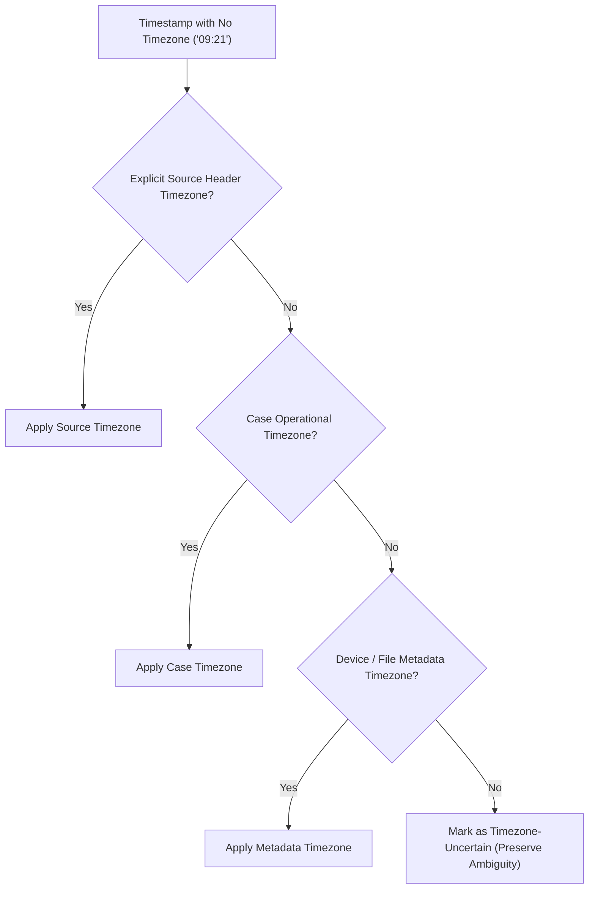
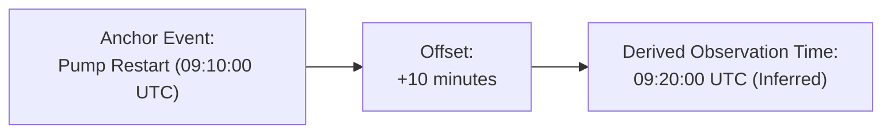
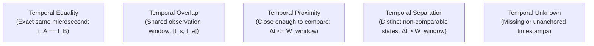
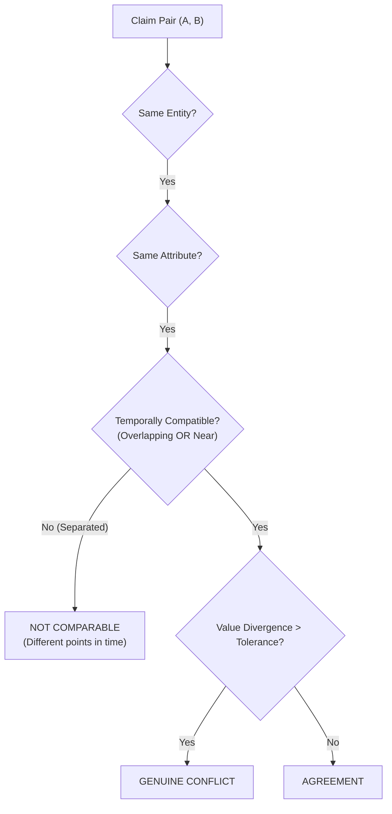
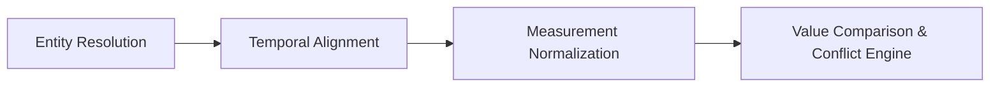
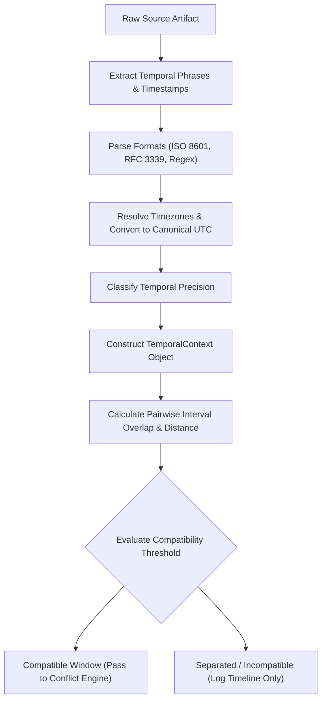
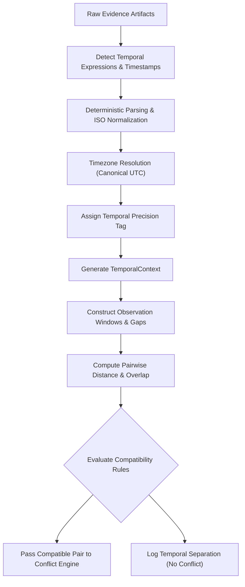

# AERIS Temporal Alignment

## 1. Purpose

Temporal alignment determines whether evidence from different sources refers to the same point in time or to overlapping time intervals.

AERIS must not compare two claims merely because they refer to the same entity and attribute:

```text
09:21 — Sensor: temperature = 94°C
14:00 — Maintenance report: temperature = 70°C
```

These values may both be physically accurate because they describe different operating states at different times.

Temporal reasoning acts as a mandatory prerequisite for cross-source comparison.

The central rule is:

> **Same entity + same attribute does not imply same event or observation.**

AERIS must establish temporal compatibility before classifying evidence as agreement, conflict, or another relationship.

---

## 2. Temporal Reasoning Problem

Different evidence sources represent time using disparate conventions and granularities:

```text
09:21:00Z
09:21 UTC
09:21 AM
2026-09-30 09:21
around 09:20
during inspection
between 09:20 and 09:25
```

Some sources provide sub-second sensor timestamps, while others provide approximate shift windows or narrative expressions.

AERIS preserves this uncertainty instead of coercing every observation into an artificially precise timestamp.

---

## 3. Temporal Goals

The temporal engine must:

1. Parse temporal expressions across structured and unstructured modalities.
2. Normalize timestamps into canonical UTC while preserving original provenance.
3. Preserve source timezone information.
4. Represent observation intervals explicitly.
5. Represent approximate times with uncertainty windows.
6. Detect temporal overlap using interval calculus.
7. Calculate temporal distance between disparate claims.
8. Determine temporal compatibility thresholds.
9. Handle missing or unanchored timestamps safely.
10. Support event-relative time calculations.
11. Preserve original temporal provenance coordinates.
12. Expose auditable temporal rationale to the investigation UI.

---

## 4. Temporal Context Model

Every claim that contains temporal information carries a `TemporalContext`:

```rust
struct TemporalContext {
    start: Option<DateTime<Utc>>,
    end: Option<DateTime<Utc>>,
    precision: TemporalPrecision,
    timezone: Option<String>,
    approximate: bool,
}
```

The model explicitly supports partial and incomplete information:
* Exact point timestamp
* Defined interval $[t_{\text{start}}, t_{\text{end}}]$
* Approximate timestamp ($t \pm \delta_t$)
* Date only (coarse granularity)
* Unknown / missing time

---

## 5. Temporal Precision

AERIS records the exact precision provided by the source:

```rust
enum TemporalPrecision {
    Millisecond,
    Second,
    Minute,
    Hour,
    Day,
    Date,
    Approximate,
    Interval,
    Unknown,
}
```

Example:

```text
09:21:13.512 UTC  --> Precision: Millisecond
around 09:20       --> Precision: Approximate
```

The system never manufactures millisecond precision when the source only provides an approximate minute.

---

## 6. Temporal Representation

AERIS distinguishes between instants, intervals, and approximate time windows:

### Instant
An exact point in time:
```text
09:21:00 UTC  ==>  start = 09:21:00, end = 09:21:00, approximate = false
```

### Interval
An observation bounded by start and end:
```text
09:20–09:25 UTC ==>  start = 09:20:00, end = 09:25:00, approximate = false
```

### Approximate Time
A central anchor with bounded uncertainty:
```text
around 09:20 UTC ==> center = 09:20:00, approximate = true, window = ±300s
```

The original raw string remains accessible through the claim's provenance pointer.

---

## 7. Timezone Normalization

All internal temporal comparisons evaluate against canonical UTC:

```text
09:21 IST (UTC+05:30)  ──►  03:51:00 UTC
```

AERIS preserves the source timezone for human inspection:

```json
{
  "original_time": "09:21 IST",
  "normalized_time": "2026-09-30T03:51:00Z",
  "timezone": "Asia/Kolkata"
}
```

Normalization never discards original temporal evidence.

---

## 8. Unknown Timezone Handling

If a timestamp arrives without timezone metadata (`"09:21"`), AERIS resolves timezone by hierarchical fallback:



The system never silently assumes UTC when the source context is ambiguous.

---

## 9. Temporal Provenance

Temporal information remains auditable to its exact source coordinate:

```text
Maintenance report:
"Pump temperature reached 94°C at approximately 09:21."

Canonical Record:
├── start: 2026-09-30T09:21:00Z
├── end: 2026-09-30T09:21:00Z
├── precision: Approximate
├── approximate: true
└── Provenance: maintenance_report.pdf (Page 7, Chars 1832–1847)
```

Investigators can verify whether a timestamp was explicitly stated in the source or inferred by the system.

---

## 10. Temporal Extraction

Temporal expressions are extracted across all supported modalities:
* **Sensor Streams:** ISO 8601 or UNIX epoch indices
* **Structured Data:** Date/time columns in CSV, Parquet, or SQL dumps
* **PDF / Text:** Textual expressions parsed via temporal NER and regex rules
* **Images:** EXIF capture timestamps and on-image timestamp watermarks
* **File Metadata:** File creation/modification headers (as fallback anchors)

```text
"Inspection completed around 09:30."
    ↓
start: 09:30:00Z, end: 09:30:00Z, approximate: true, precision: Approximate
```

---

## 11. Deterministic Timestamp Parsing

Structured timestamps use strict deterministic parsers conforming to ISO 8601 and RFC 3339:

```text
2026-09-30T09:21:00Z
2026-09-30 09:21:00+05:30
2026-09-30T09:21:00.124Z
```

Invalid or impossible strings (e.g., `2026-13-47 31:82`) are explicitly rejected as parsing errors. The engine never silently fabricates a valid timestamp from corrupted input.

---

## 12. Natural-Language Temporal Expressions

Narrative documents frequently use relative or imprecise temporal phrasing:
* *today*, *yesterday*, *last night*
* *during morning inspection*
* *before maintenance*
* *ten minutes after restart*
* *around noon*

These expressions are grounded using anchor events. If the reference anchor cannot be verified, the expression remains `TemporalPrecision::Unknown`.

---

## 13. Event-Relative Time

AERIS resolves relative temporal offsets when a causal or operational anchor event is known:



The resulting timestamp is tagged as `ClaimType::Inferred`, preserving the reference to the parent event.

---

## 14. Extracted vs Inferred Temporal Information

| Dimension | Extracted Timestamp | Inferred Timestamp |
| :--- | :--- | :--- |
| **Origin** | Direct literal in source (`"09:20 UTC"`) | Derived via anchor event (`"10m post restart"`) |
| **Provenance** | Pointer to byte/character range in source | Pointer to parent `EventRecord` + offset rule |
| **Precision** | Inherited from source expression | Constrained by anchor event uncertainty |
| **UI Presentation** | "Observed timestamp" | "Inferred from event [Restart at 09:10]" |

---

## 15. Temporal Intervals

Continuous operations, shift tasks, and fault states are inherently intervals:

```text
Machine Operating Window:  [09:00:00Z, 09:30:00Z]
Technician Overhaul Task:  [09:15:00Z, 09:45:00Z]
High-Temperature Alarm:    [09:21:12Z, 09:24:08Z]
```

Intervals are preserved as $[t_{\text{start}}, t_{\text{end}}]$ pairs rather than compressed into a single midpoint.

---

## 16. Interval Overlap Calculus

For two intervals $A = [A_{\text{start}}, A_{\text{end}}]$ and $B = [B_{\text{start}}, B_{\text{end}}]$, temporal overlap occurs if and only if:

$$\max(A_{\text{start}}, B_{\text{start}}) \le \min(A_{\text{end}}, B_{\text{end}})$$

$$\text{Overlap Window} = [\max(A_{\text{start}}, B_{\text{start}}), \min(A_{\text{end}}, B_{\text{end}})]$$

```text
Interval A: [09:20, 09:25]
Interval B: [09:23, 09:28]
Overlap:    [09:23, 09:25] (Duration: 120 seconds) ==> Overlap = true
```

---

## 17. Temporal Distance

For non-overlapping observations, AERIS computes the absolute temporal gap:

$$\Delta t_{\text{dist}}(A, B) = \begin{cases} 
0 & \text{if } \text{Overlaps}(A, B) \\
B_{\text{start}} - A_{\text{end}} & \text{if } A_{\text{end}} < B_{\text{start}} \\
A_{\text{start}} - B_{\text{end}} & \text{if } B_{\text{end}} < A_{\text{start}}
\end{cases}$$

Example: Observation A at 09:20 and Observation B at 09:27 have $\Delta t_{\text{dist}} = 7 \text{ minutes}$.

---

## 18. Temporal Compatibility

Two claims are **temporally compatible** for comparative analysis if they overlap or fall within a configurable proximity window:

$$\text{Compatible}(A, B) \iff \text{Overlaps}(A, B) \lor \Delta t_{\text{dist}}(A, B) \le W_{\text{proximity}}$$

If $W_{\text{proximity}} = 300\text{s}$ (5 minutes), claims recorded at 09:21 and 09:22 are compatible for comparison.

---

## 19. Temporal Compatibility vs. Temporal Equality

AERIS enforces a strict conceptual distinction:



Compatibility allows comparative reasoning; it does **not** assert that observations occurred at the exact same instant.

---

## 20. Temporal Relationship Types

AERIS models interval relationships inspired by Allen's Interval Algebra:

```rust
enum TemporalRelationshipType {
    SameInstant,
    Overlapping,
    Adjacent,
    Before,
    After,
    Near,
    Separated,
    Unknown,
}
```

```text
09:20–09:25 and 09:23–09:30  ──►  Overlapping
09:20:00    and 09:22:00     ──►  Near (within window)
09:20:00    and 14:00:00     ──►  Separated
```

---

## 21. Temporal Alignment Decision Algorithm

```text
fn evaluate_temporal_alignment(claim_a, claim_b, config) -> TemporalRelationship {
    let ctx_a = claim_a.temporal_context;
    let ctx_b = claim_b.temporal_context;
    
    if ctx_a.is_none() || ctx_b.is_none() {
        return TemporalRelationship::unknown("Missing temporal context in one or both claims");
    }
    
    let a = ctx_a.unwrap();
    let b = ctx_b.unwrap();
    
    if a.is_exact_instant() && b.is_exact_instant() && a.start == b.start {
        return TemporalRelationship::same_instant(a.start.unwrap());
    }
    
    if intervals_overlap(a, b) {
        let (overlap_start, overlap_end) = compute_overlap(a, b);
        return TemporalRelationship::overlapping(overlap_start, overlap_end);
    }
    
    let distance = compute_temporal_distance(a, b);
    if distance <= config.proximity_threshold {
        return TemporalRelationship::near(distance);
    }
    
    if a.end < b.start {
        return TemporalRelationship::before(distance);
    } else {
        return TemporalRelationship::after(distance);
    }
}
```

---

## 22. Temporal Uncertainty

Approximate phrasing (*"around 09:20"*) is bounded by domain-configured uncertainty margins:

$$\tau_{\text{approx}} = [t_{\text{center}} - \delta_t, t_{\text{center}} + \delta_t]$$

The uncertainty margin is explicitly preserved in `TemporalContext::approximate` and flagged in the investigation console.

---

## 23. Missing Temporal Information

When a claim lacks any temporal reference (*"Pump bearing inspected; condition acceptable"*), AERIS assigns:

$$\text{TemporalContext} = \bot_{\text{unknown}}$$

The system outputs `InsufficientEvidence` rather than fabricating a comparison against a high-temperature alarm from 09:21.

---

## 24. Temporal Alignment and Conflict Detection

Temporal compatibility is a hard gating condition for conflict detection:



Observations separated by hours or days are not conflicts—they represent distinct points in equipment operating history.

---

## 25. Temporal Alignment and Agreement

The same principle governs agreement: identical numerical values recorded at 09:20 and 14:00 do not validate each other as corroborating evidence. They are logged as separate observations across a historical timeline.

---

## 26. Pipeline Choreography



1. **Entity Resolution:** Confirms observations target the same physical asset.
2. **Temporal Alignment:** Confirms observations apply to the same operational time window.
3. **Measurement Normalization:** Standardizes physical units.
4. **Value Comparison:** Evaluates discrepancies against tolerance thresholds.

---

## 27. Temporal Alignment with Entity Ambiguity

If entity resolution outputs `AMBIGUOUS`, temporal alignment is suspended. Temporal proximity alone (`09:21` vs `09:21`) must never force two ambiguous asset mentions into a comparative judgment.

---

## 28. Temporal Alignment Pipeline



---

## 29. Temporal Engine Data Model

```rust
struct TemporalContext {
    start: Option<DateTime<Utc>>,
    end: Option<DateTime<Utc>>,
    precision: TemporalPrecision,
    timezone: Option<String>,
    approximate: bool,
    original_expression: Option<String>,
}

struct TemporalRelationship {
    source_claim: ClaimId,
    target_claim: ClaimId,
    relationship: TemporalRelationshipType,
    overlap_start: Option<DateTime<Utc>>,
    overlap_end: Option<DateTime<Utc>>,
    distance_ms: Option<i64>,
    confidence: ConfidenceRecord,
}
```

---

## 30. Temporal Evidence Provenance

```json
{
  "start": "2026-09-30T09:21:00Z",
  "end": "2026-09-30T09:21:00Z",
  "precision": "minute",
  "approximate": true,
  "original_expression": "approximately 09:21",
  "provenance": {
    "source_id": "SRC-M002-REPORT",
    "page": 7,
    "char_start": 1832,
    "char_end": 1851
  }
}
```

---

## 31. Temporal Comparison Cases

| Case | Scenario | Evidence Condition | Alignment Result | Downstream Action |
| :--- | :--- | :--- | :--- | :--- |
| **Case A** | Exact Same Time | $t_A = t_B = 09:21:00\text{Z}$ | `SameInstant` | Immediate Value Comparison |
| **Case B** | Nearby Time Window | $t_A = 09:21:00\text{Z}, t_B = 09:22:00\text{Z}$ | `Near` ($\Delta t \le W_{\text{prox}}$) | Permitted Comparison |
| **Case C** | Separated Intervals | $[09:00, 09:05]$ vs $[09:30, 09:35]$ | `Separated` | Excluded from Conflict |
| **Case D** | Missing Timestamp | Claim B has no time metadata | `Unknown` | `InsufficientEvidence` |
| **Case E** | Approximate Window | *"around 09:20"* vs $09:21:00\text{Z}$ | `Overlapping` (approx) | Comparison with Uncertainty Flag |

---

## 32. Synthetic Benchmark Case (M-004 Telemetry Gap)

In the AERIS benchmark scenario for machine **M-004**, sensor data is intentionally dropped between `09:25:00Z` and `09:29:00Z`:

```text
09:25:00Z ──► Telemetry Stream Interrupt
09:29:00Z ──► Telemetry Stream Resumed
```

The temporal engine outputs:

```text
TemporalGapRecord:
├── interval: [2026-09-30T09:25:00Z, 2026-09-30T09:29:00Z]
├── status: INSUFFICIENT_EVIDENCE
└── rationale: "Telemetry transmission lost; no operational state can be assumed"
```

AERIS refuses to assume normal operation during this blackout window.

---

## 33. Temporal Gaps as First-Class Evidence

Data dropouts are treated as evidence of absence:

```text
09:20 UTC: 72.0 °C
09:21 UTC: 72.1 °C
09:22 UTC: 72.2 °C
[09:23 - 09:24]: MISSING DATA GAP
09:25 UTC: 98.4 °C
```

The gap is displayed prominently in the investigation timeline.

---

## 34. Sampling-Aware Gap Detection

Gaps are detected relative to the source stream's declared cadence:

$$\text{Gap Condition} \iff \Delta t_{\text{consecutive}} > k \cdot \Delta t_{\text{expected}} \quad (k \ge 2.0)$$

* If telemetry samples every 60 seconds, a 180-second silence triggers a gap.
* If a weather report samples every 24 hours, an 8-hour silence is expected operation.

---

## 35. Temporal Event Ordering

```mermaid
timeline
    title Incident Sequence: CASE-047
    09:10 UTC : Restart Initiated
    09:21 UTC : High Temperature Alarm (94 °C)
    09:22 UTC : Technician Visual Note
    09:25 UTC : Sensor Telemetry Blackout Window
    09:30 UTC : Formal Maintenance Overhaul
```

Events are strictly ordered chronologically to assist root-cause analysis (RCA).

---

## 36. Temporal Causality Boundary

AERIS records chronological sequence ($\text{Event } A \prec \text{Event } B$).

The temporal engine strictly refrains from making autonomous causality claims:

$$\text{Post hoc ergo propter hoc is rejected: } A \prec B \not\implies A \to B$$

Causality requires physical models or operator verification.

---

## 37. API Design

### Temporal Alignment Endpoint

```http
POST /api/v1/cases/{case_id}/temporal/align
Content-Type: application/json

{
  "claim_a": "CLM-001",
  "claim_b": "CLM-002"
}
```

```json
{
  "relationship": "overlapping",
  "overlap_start": "2026-09-30T09:21:00Z",
  "overlap_end": "2026-09-30T09:22:00Z",
  "distance_ms": 0,
  "compatible": true,
  "confidence": 0.94
}
```

---

## 38. Temporal Configuration

Configured in `aeris.yaml`:

```yaml
temporal:
  default_timezone: "UTC"

  comparison:
    proximity_seconds: 300

  approximate:
    default_uncertainty_seconds: 300

  telemetry:
    expected_interval_seconds: 60
    gap_multiplier: 2.0
```

---

## 39. Temporal Storage

PostgreSQL relational schema:

```text
temporal_contexts
temporal_relationships
temporal_events
temporal_expressions
temporal_gaps
```

```sql
CREATE INDEX idx_temporal_contexts_start ON temporal_contexts(start);
CREATE INDEX idx_temporal_contexts_end ON temporal_contexts(end);
CREATE INDEX idx_temporal_relationships_src ON temporal_relationships(source_claim);
CREATE INDEX idx_temporal_relationships_tgt ON temporal_relationships(target_claim);
```

---

## 40. UI Requirements

* **Synchronized Case Timeline:** Renders points, intervals, and approximate bands on a unified time axis.
* **Telemetry Gap Shading:** Visualizes data dropouts as hashed amber regions.
* **Temporal Relationship Inspector:** Details exact delta, overlap seconds, and configured proximity tolerance.

---

## 41. Timeline Visualization

```mermaid
gantt
    title Operational Timeline for Asset M-002
    dateFormat HH:mm
    axisFormat %H:%M

    section Physical Events
    Normal Operation       :09:00, 09:20
    Temperature Spike      :09:21, 09:24
    Shutdown Maintenance   :09:25, 09:40

    section Sensor Telemetry
    Continuous Sensor Stream :09:00, 09:25
    Telemetry Drop Gap       :crit, 09:25, 09:29
    Resumed Telemetry        :09:29, 09:40

    section Reports
    Technician Note          :milestone, 09:22, 00:00
```



---

## 42. Failure Handling

```rust
enum TemporalStatus {
    Valid,
    Approximate,
    Partial,
    Unknown,
    Invalid,
}
```

Invalid timestamps are rejected at ingestion and logged in the processing run audit trail.

---

## 43. Temporal Evaluation Metrics

* **Extraction Accuracy:** Percentage of temporal expressions correctly extracted from text.
* **Normalization Accuracy:** Percentage of parsed timestamps accurately converted to canonical UTC.
* **Interval Overlap Accuracy:** F1 score of interval intersection calculations against ground truth.
* **Gap Detection Precision & Recall:** Accuracy of telemetry gap detection against simulated sensor blackouts.

---

## 44. Temporal Benchmark Scenarios

* **TB-01:** Exact timestamp match across multiple sensors.
* **TB-02:** Timezone conversion (IST $\to$ UTC, EST $\to$ UTC).
* **TB-03:** Approximate text expression (*"around 09:20"*).
* **TB-04:** Overlapping multi-minute intervals.
* **TB-05:** Non-overlapping intervals (verifying conflict suppression).
* **TB-06:** Missing timestamp handling (`InsufficientEvidence`).
* **TB-07:** Relative event offset (*"10m after restart"*).
* **TB-08:** Sampling gap identification (Case M-004).

---

## 45. Temporal Invariants

1. **Invariant 1:** Original temporal expressions must be preserved.
2. **Invariant 2:** Timezone normalization must not destroy original timezone information.
3. **Invariant 3:** Unknown time must remain unknown.
4. **Invariant 4:** Approximate time must not become falsely exact.
5. **Invariant 5:** Temporal proximity must not automatically imply agreement.
6. **Invariant 6:** Temporal separation must not automatically imply contradiction.
7. **Invariant 7:** Missing telemetry must not be interpreted as normal operation.
8. **Invariant 8:** Temporal ordering must not imply causality.
9. **Invariant 9:** Temporal reasoning must preserve provenance.
10. **Invariant 10:** Temporal compatibility must be evaluated before automated conflict classification.

---

## 46. End-to-End Example

```text
Source A (Sensor CSV):
09:21:00 UTC | Asset: P-002 | Temp: 94.0 °C

Source B (Technician Log):
09:22:00 UTC | Asset: Pump-B | Status: "operating normally"

Step 1: Entity Resolution resolves P-002 and Pump-B -> ENT-M002
Step 2: Temporal Engine evaluates 09:21:00 and 09:22:00
        ├── Distance: 60 seconds
        ├── Proximity Threshold: 300 seconds
        └── Result: NEAR (Temporally Compatible)
Step 3: Downstream Conflict Engine receives permission to compare claims
```

---

## 47. Complete Temporal Processing Flow



---

## 48. Acceptance Criteria Checklist

- [x] Exact timestamps can be parsed deterministically.
- [x] Timezones are normalized to UTC.
- [x] Original timezone strings and expressions are retained in provenance.
- [x] Temporal intervals $[t_{\text{start}}, t_{\text{end}}]$ are supported natively.
- [x] Approximate timestamps are bounded by uncertainty windows.
- [x] Temporal precision is preserved without false precision inflation.
- [x] Event-relative expressions can be resolved using anchor events.
- [x] Extracted and inferred timestamps remain distinguishable.
- [x] Temporal overlap is calculated via interval calculus.
- [x] Temporal distance is computed for non-overlapping observations.
- [x] Temporal proximity thresholds are domain-configurable.
- [x] Missing temporal information remains explicitly `Unknown`.
- [x] Telemetry gaps are detected relative to expected sampling rates.
- [x] Temporal relationships are persisted to the database.
- [x] Temporal provenance is retained for all temporal contexts.
- [x] Case timeline visualization is supported by the investigation UI.
- [x] Temporal evaluation metrics can be calculated against benchmark ground truth.
- [x] Temporal ordering is decoupled from causality assertions.
- [x] Temporal compatibility is enforced as a gating condition for conflict detection.

---

## 49. Final Design Principle

AERIS never asks:

> *“Do these two observations have timestamps?”*

It asks:

> *“Do these observations describe sufficiently compatible points or intervals in time for the evidence relationship being evaluated?”*

Time is not an arbitrary string of characters attached to an event. It dictates whether two pieces of evidence are describing the same physical operational reality. Temporal alignment is a foundational reasoning layer, not a formatting utility.

---

**Next: `09-conflict-engine.md`**, where we define the deterministic conflict reasoning engine, multi-condition rule evaluations, value tolerance formulas, and conflict preservation semantics.
