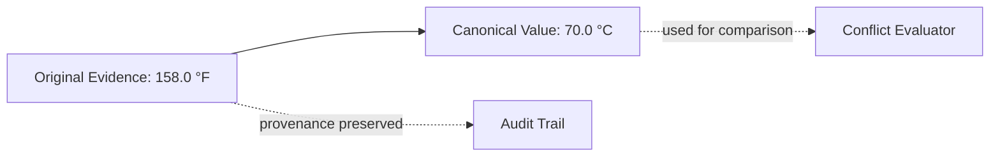
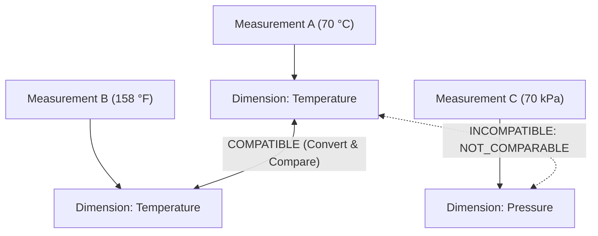
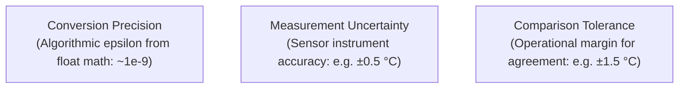
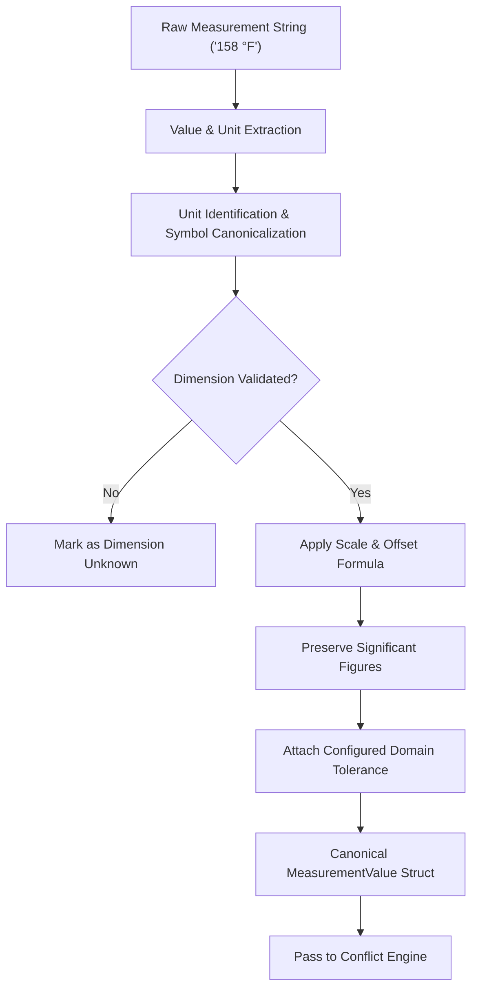
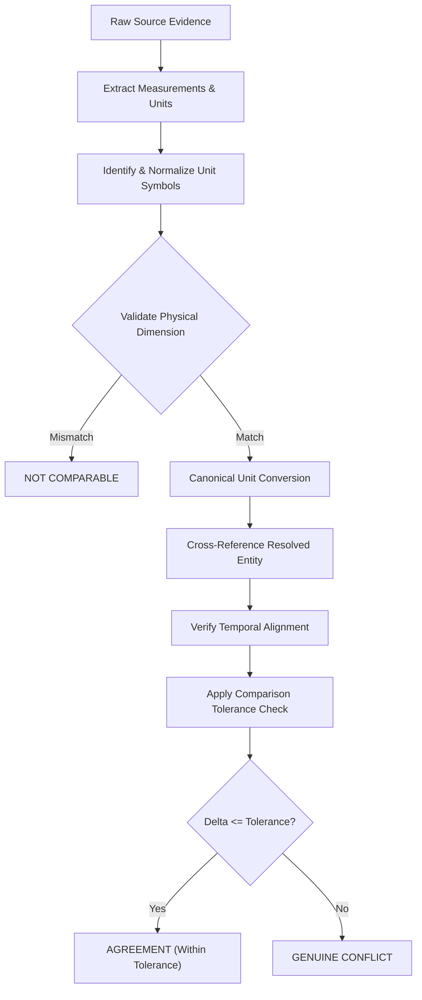

# AERIS Measurement Normalization

## 1. Purpose

Measurement normalization converts measurements expressed in different units, formats, scales, and representations into a canonical form that can be safely compared.

AERIS must distinguish between:

```text
Different representation
```

and:

```text
Different observation
```

For example:

```text
158°F
```

and:

```text
70°C
```

represent approximately the same physical temperature.

Without normalization, a naive conflict detector will incorrectly classify them as contradictory.

The central rule is:

> **Normalize measurements before comparing their values, while preserving the original representation and provenance.**

---

## 2. Measurement Problem

Evidence sources represent the same physical quantity using different notations, systems of measurement, and prefixes:

```text
70°C  <--->  158°F  <--->  343.15 K
1.5 bar  <--->  150 kPa  <--->  21.75 psi
2.0 m/s  <--->  7.2 km/h  <--->  393.7 ft/min
```

AERIS converts these representations into canonical units before numerical comparison.

However, normalization must never modify or overwrite the original evidence.

---

## 3. Measurement Goals

The normalization subsystem must:

1. Detect measurement values within multimodal extractions.
2. Identify and parse unit strings.
3. Normalize unit representations to standard symbols.
4. Convert compatible units using verified dimensional algebra.
5. Preserve original values.
6. Preserve original units.
7. Store canonical values alongside original values.
8. Track conversion provenance.
9. Detect incompatible physical dimensions.
10. Apply configurable comparison tolerances (absolute and relative).
11. Support measurement uncertainty intervals where available.
12. Prevent unsafe automatic comparisons.

---

## 4. Measurement Model

AERIS represents measurements explicitly:

```rust
struct MeasurementValue {
    value: f64,
    unit: Unit,
    canonical_value: Option<f64>,
    canonical_unit: Option<Unit>,
    uncertainty: Option<f64>,
    tolerance: Option<f64>,
    provenance: Vec<EvidencePointer>,
}
```

Serialized JSON representation:

```json
{
  "value": 158.0,
  "unit": "degF",
  "canonical_value": 70.0,
  "canonical_unit": "degC",
  "tolerance": 1.0
}
```

The original value remains immutable.

---

## 5. Original vs Canonical Value

AERIS never replaces the original measurement:



The system stores both:

```text
original_value = 158.0
original_unit  = °F

canonical_value = 70.0
canonical_unit  = °C
```

This allows an investigator to trace the comparison back to the exact source bytes.

---

## 6. Unit Representation

Units use structured identifiers and physical dimensions rather than unstructured strings:

```rust
enum UnitDimension {
    Temperature,
    Pressure,
    Length,
    Mass,
    Time,
    Velocity,
    Acceleration,
    Energy,
    Power,
    Frequency,
    Voltage,
    Current,
    Resistance,
    Volume,
    Area,
    Unknown,
}

struct Unit {
    symbol: String,
    dimension: UnitDimension,
}
```

---

## 7. Unit Normalization

Different spellings and symbols normalize to standard identifiers:

```text
"C", "°C", "degC", "celsius", "Celsius"       ──►  degC
"F", "°F", "degF", "fahrenheit", "Fahrenheit" ──►  degF
"bar", "Bar", "BAR"                           ──►  bar
"kPa", "kpa", "kilopascal"                   ──►  kPa
```

Normalization is deterministic and based on a controlled unit registry.

---

## 8. Unit Registry

AERIS maintains a controlled configuration registry:

```yaml
units:
  degC:
    dimension: temperature
    symbol: "°C"
    canonical: true

  degF:
    dimension: temperature
    symbol: "°F"
    scale: 0.5555555555555556
    offset: -17.77777777777778

  K:
    dimension: temperature
    symbol: "K"
    scale: 1.0
    offset: -273.15

  kPa:
    dimension: pressure
    symbol: "kPa"
    canonical: true

  bar:
    dimension: pressure
    symbol: "bar"
    scale: 100.0
    offset: 0.0

  m:
    dimension: length
    symbol: "m"
    canonical: true

  km:
    dimension: length
    symbol: "km"
    scale: 1000.0
    offset: 0.0
```

---

## 9. Conversion Rules

For linear physical units:

$$\text{Canonical Value} = (\text{Value} \times \text{Scale}) + \text{Offset}$$

* **Distance:** $\text{m} = \text{km} \times 1000$
* **Pressure:** $\text{kPa} = \text{bar} \times 100$
* **Temperature:** $T_{\text{°C}} = (T_{\text{°F}} - 32) \times \frac{5}{9}$

Both scale factor and offset terms are supported natively.

---

## 10. Temperature Conversion Example

Given an extracted measurement of `158 °F`:

$$T_{\text{°C}} = (158 - 32) \times \frac{5}{9} = 70.0\text{ °C}$$

Canonical representation:

```json
{
  "value": 158.0,
  "unit": "degF",
  "canonical_value": 70.0,
  "canonical_unit": "degC"
}
```

The conversion is an inferred transformation, not an alteration of the source observation.

---

## 11. Dimension Compatibility

Two measurements can only be numerically compared if their physical dimensions match:



AERIS returns `NOT_COMPARABLE` rather than attempting cross-dimensional subtraction.

---

## 12. Measurement Comparability

$$\text{Comparable}(A, B) \iff \text{Dimension}(A) \equiv \text{Dimension}(B) \land \text{ValidConversion}(A, B)$$

Dimensional compatibility is a necessary condition, but downstream reasoning must also verify:
* `SameEntity(A, B)`
* `SameAttribute(A, B)`
* `TemporalCompatibility(A, B)`
* `SemanticCompatibility(A, B)`

---

## 13. Canonical Unit Standards

| Dimension | Canonical Unit | Symbol | Base SI Unit |
| :--- | :--- | :--- | :--- |
| **Temperature** | Celsius | `°C` | K |
| **Pressure** | Kilopascal | `kPa` | Pa |
| **Length** | Meter | `m` | m |
| **Mass** | Kilogram | `kg` | kg |
| **Time** | Second | `s` | s |
| **Velocity** | Meters per second | `m/s` | m/s |
| **Acceleration**| Meters per second squared | `m/s²` | m/s² |
| **Energy** | Joule | `J` | J |
| **Power** | Watt | `W` | W |
| **Frequency** | Hertz | `Hz` | s⁻¹ |
| **Voltage** | Volt | `V` | V |
| **Current** | Ampere | `A` | A |
| **Resistance** | Ohm | `Ω` | Ω |

---

## 14. Precision Preservation

Unit conversion must not manufacture false precision:

```text
Source: 70.0 °C (Precision: 1 decimal place)
Converted: 158.0 °F (Should NOT be written as 158.000000 °F)
```

AERIS preserves significant figures and source precision metadata:

```json
{
  "value": 70.0,
  "unit": "degC",
  "significant_figures": 3,
  "precision_decimals": 1
}
```

---

## 15. Rounding

Rounding occurs exclusively at the UI presentation layer. Internal calculations maintain 64-bit IEEE 754 floating-point precision to eliminate compounding rounding errors during intermediate reasoning steps.

---

## 16. Floating-Point Considerations

AERIS strictly forbids exact floating-point equality checks:

```rust
// FORBIDDEN
if canonical_a == canonical_b { ... }

// MANDATORY
if (canonical_a - canonical_b).abs() <= tolerance { ... }
```

Comparisons must always evaluate against a configured tolerance margin.

---

## 17. Measurement Tolerance Spectrum



These three concepts are tracked separately:
1. **Conversion Precision:** Floating-point rounding artifact.
2. **Measurement Uncertainty:** Sensor physical tolerance.
3. **Comparison Tolerance:** Operational threshold distinguishing normal variance from genuine operational discrepancy.

---

## 18. Tolerance Model

```rust
struct ComparisonTolerance {
    absolute: Option<f64>,
    relative: Option<f64>,
}
```

Evaluation condition:

$$\Delta v = |v_{\text{canonical}, A} - v_{\text{canonical}, B}|$$

$$\text{Within Tolerance} \iff \Delta v \le \text{Tol}_{\text{abs}} \lor \frac{\Delta v}{\max(|v_A|, |v_B|)} \le \text{Tol}_{\text{rel}}$$

Example:
* $A = 70.0\text{ °C}, B = 70.2\text{ °C}$
* Configured $\text{Tol}_{\text{abs}} = 0.5\text{ °C}$
* Result: `Agreement (Within Tolerance)`

---

## 19. Relative Tolerance

For high-magnitude measurements (e.g., RPM, vibration frequencies, megawatt loads), relative percentage tolerance is applied:

$$\text{RelDiff}(A, B) = \frac{|A - B|}{\max(|A|, |B|)}$$

Example:
* Generator output $A = 100.0\text{ MW}, B = 101.0\text{ MW}$
* Relative difference = $1.0\%$
* If $\text{Tol}_{\text{rel}} = 2.0\%$, the claims are classified as compatible agreement.

---

## 20. Uncertainty-Aware Comparison

When sources report uncertainty bounds:

$$A = 70 \pm 2\text{ °C} \implies [68, 72]\text{ °C}$$
$$B = 71 \pm 2\text{ °C} \implies [69, 73]\text{ °C}$$

Because the uncertainty intervals intersect ($[69, 72]\text{ °C}$), AERIS classifies the relationship as **Consistent Agreement**, avoiding a false discrepancy alarm.

---

## 21. Measurement Uncertainty Model

```rust
struct MeasurementUncertainty {
    value: f64,
    uncertainty_type: UncertaintyType,
}

enum UncertaintyType {
    Absolute,
    Relative,
    Interval,
    Unknown,
}
```

```text
70 °C ± 2 °C ==> value: 70.0, uncertainty: 2.0, type: Absolute
```

---

## 22. Missing Units

If an extracted claim contains a naked numerical value (`temperature = 70`):

AERIS strictly forbids guessing the unit as `°C` or `°F`. The value is tagged as `UnitStatus::Unknown`, and comparative evaluation is suspended until resolved by schema or human review.

```rust
enum UnitStatus {
    Explicit,
    SchemaDerived,
    Inferred,
    Unknown,
}
```

---

## 23. Schema-Derived vs. Model-Inferred Units

| Dimension | Schema-Derived Unit | Model-Inferred Unit |
| :--- | :--- | :--- |
| **Origin** | Telemetry table header (`"bearing_temp_c"`) | LLM guessing context from paragraph |
| **Authority** | Deterministic plant specification | Probabilistic extraction hypothesis |
| **Confidence** | $1.0$ (High certainty) | $\le 0.70$ (Requires validation) |
| **Provenance** | File schema metadata | Extraction prompt and token logits |

---

## 24. Ambiguous Unit Disambiguation

Ambiguous symbols are gated by physical context:
* Symbol `"m"`: Meters in length context; Minutes in time context.
* Symbol `"M"`: Molar concentration or Mega prefix.

If context fails to disambiguate the symbol, AERIS sets `UnitStatus::Unknown` to protect downstream reasoning.

---

## 25. Compound Units

Compound engineering units are resolved via dimensional multiplication and division:

$$\text{km/h} \to \text{m/s} \quad \left(1\text{ km/h} = \frac{1000\text{ m}}{3600\text{ s}} = 0.277778\text{ m/s}\right)$$

Supported compound units:
* Velocity: `m/s`, `km/h`, `ft/min`
* Density: `kg/m³`, `g/cm³`, `lb/ft³`
* Torque: `N·m`, `lbf·ft`
* Heat flux: `W/m²`, `BTU/(hr·ft²)`

---

## 26. Derived Measurements

Measurements computed through physical formulas:

$$\text{Electrical Power } (P) = \text{Voltage } (V) \times \text{Current } (I)$$

If $V = 220\text{ V}$ and $I = 5\text{ A}$, the calculated $P = 1100\text{ W}$ is classified as `ClaimType::Inferred`, retaining provenance links to both underlying measurements.

---

## 27. Measurement Provenance

Every normalized measurement records its complete conversion lineage:

```json
{
  "original": {
    "value": 158.0,
    "unit": "degF"
  },
  "canonical": {
    "value": 70.0,
    "unit": "degC"
  },
  "conversion_rule": "fahrenheit_to_celsius",
  "normalizer_version": "measurement-normalizer-0.1.0",
  "source_pointer": {
    "source_id": "SRC-M003-DOC",
    "page": 4,
    "char_start": 320,
    "char_end": 332
  }
}
```

---

## 28. Normalization Pipeline



---

## 29. Interaction with Entity Resolution

Measurements are compared **only after** entity resolution verifies asset identity:

```text
P-002:  94 °C
Pump-B: 72.3 °C

Entity Resolution: P-002 ≡ Pump-B (ENT-M002)
==> Claims target the SAME entity; Proceed to temporal check.
```

---

## 30. Interaction with Temporal Alignment

Measurements are compared **only after** temporal alignment confirms observation overlap:

```text
09:19 UTC: 158 °F  ──►  70.0 °C
09:20 UTC: 70.0 °C  ──►  70.0 °C

Temporal Engine: 09:19 and 09:20 are within proximity window (60s <= 300s)
==> Measurements are temporally comparable.
```

---

## 31. Measurement Conflict Formulation

$$\text{Conflict}(A, B) \iff \begin{cases}
\text{SameEntity}(A, B) \\
\land\ \text{SameAttribute}(A, B) \\
\land\ \text{TemporallyCompatible}(A, B) \\
\land\ \text{Dimension}(A) \equiv \text{Dimension}(B) \\
\land\ |v_{\text{norm}, A} - v_{\text{norm}, B}| > \text{Tolerance}
\end{cases}$$

Example: $94.0\text{ °C}$ vs $72.3\text{ °C}$ ($\Delta = 21.7\text{ °C} > 2.0\text{ °C}$) triggers a **Genuine Value Conflict**.

---

## 32. Equivalent Measurement Example

* Maintenance report: `158.0 °F`
* Telemetry sensor: `70.0 °C`

Normalization:
$$158.0\text{ °F} \to 70.0\text{ °C} \implies \Delta = |70.0 - 70.0| = 0.0\text{ °C} \le 1.0\text{ °C}$$

Classification: **Agreement (Within Tolerance)**. No false conflict is generated.

---

## 33. Incompatible Measurement Example

* Sensor: `70 °C` (Temperature)
* Maintenance log: `70 kPa` (Pressure)

Dimensions: `Temperature` vs `Pressure`.  
Classification: **Not Comparable**. The conflict engine refuses to evaluate numerical delta.

---

## 34. Unknown Measurement Example

* Report snippet: `"Pump temperature registered 70 during morning round."`

Unit status: `UNIT_UNKNOWN`.  
Classification: **Insufficient Evidence**. AERIS suppresses automated comparison until the unit is disambiguated.

---

## 35. Measurement Status Lifecycle

```rust
enum MeasurementStatus {
    Valid,
    Converted,
    Approximate,
    Uncertain,
    UnitUnknown,
    DimensionUnknown,
    Invalid,
    NotComparable,
}
```

---

## 36. Conversion Error Handling

Conversion errors produce explicit failure records:
* Unknown unit symbol
* Dimension mismatch
* Non-numeric / NaN payload
* Arithmetic overflow / underflow

The originating claim remains preserved; only the comparison operation is gated.

---

## 37. Invalid Measurements

Values such as `NaN`, `INF`, `"null"`, or qualitative adjectives (`"running hot"`) cannot participate in numerical comparisons. They are routed to qualitative/state conflict reasoning instead.

---

## 38. Schema-Aware Normalization

Tabular feeds declare field units via JSON schema:

```json
{
  "field": "bearing_de_temp",
  "data_type": "float",
  "unit": "degC",
  "tolerance": 1.5
}
```

The ingestion parser automatically binds `degC` with $1.0$ confidence.

---

## 39. Text Measurement Extraction

Text: *"Bearing temperature reached 158°F at morning peak."*

1. Regex & NER extract: `value = 158.0`, `unit = "degF"`
2. Normalizer computes: `canonical_value = 70.0`, `canonical_unit = "degC"`
3. Text coordinate recorded in `EvidencePointer`

---

## 40. Image Measurement Extraction

Gauge readout photo:
1. OCR parses string: `"158°F"`
2. Bounding box coordinates recorded: `[x: 0.42, y: 0.31, w: 0.18, h: 0.07]`
3. Normalizer computes: `70.0 °C` retaining pointer to image crop

---

## 41. Structured Data Telemetry Extraction

CSV row: `timestamp: "09:19", asset_id: "M-003", temp_f: 158`

* Column mapping: `temp_f` $\to$ `degF`
* Computed canonical value: `70.0 °C`
* Recorded coordinate: `row: 142, col: "temp_f"`

---

## 42. Synthetic Benchmark Case (M-003 Unit Variation)

In benchmark scenario **M-003**, a deliberate unit mismatch is injected:
* Maintenance log: `158.0 °F`
* Sensor telemetry: `70.0 °C`

AERIS must:
1. Ingest both sources without modification.
2. Resolve asset to canonical `ENT-M003`.
3. Verify temporal proximity window.
4. Normalize `158.0 °F` to `70.0 °C`.
5. Classify relationship as **Agreement**.
6. Display both representations in UI with conversion proof.

---

## 43. API Design

### Normalize Endpoint

```http
POST /api/v1/cases/{case_id}/measurements/normalize
Content-Type: application/json

{
  "value": 158.0,
  "unit": "degF"
}
```

```json
{
  "original": {
    "value": 158.0,
    "unit": "degF"
  },
  "canonical": {
    "value": 70.0,
    "unit": "degC"
  },
  "dimension": "temperature",
  "status": "converted",
  "normalizer_version": "measurement-normalizer-0.1"
}
```

---

## 44. Comparison API

```http
POST /api/v1/cases/{case_id}/measurements/compare
Content-Type: application/json

{
  "measurement_a": "MEAS-001",
  "measurement_b": "MEAS-002"
}
```

```json
{
  "dimension": "temperature",
  "comparable": true,
  "canonical_a": 70.0,
  "canonical_b": 70.0,
  "difference": 0.0,
  "within_tolerance": true
}
```

---

## 45. Storage Model

PostgreSQL relational schema:

```text
measurements
units
unit_aliases
measurement_conversions
measurement_uncertainties
comparison_policies
measurement_comparisons
```

```sql
CREATE INDEX idx_measurements_claim_id ON measurements(claim_id);
CREATE INDEX idx_measurements_dimension ON measurements(dimension);
CREATE INDEX idx_measurements_canonical_unit ON measurements(canonical_unit);
CREATE INDEX idx_measurement_comparisons_a ON measurement_comparisons(measurement_a);
CREATE INDEX idx_measurement_comparisons_b ON measurement_comparisons(measurement_b);
```

---

## 46. Versioning

Every normalization decision records:

```json
{
  "normalizer_version": "measurement-normalizer-0.1.0",
  "unit_registry_version": "units-2026-09",
  "comparison_policy_version": "policy-003",
  "timestamp": "2026-09-30T09:40:00Z"
}
```

Decisions remain reproducible across software upgrades.

---

## 47. UI Requirements

The UI displays the dual-representation audit card:

```text
MEASUREMENT AUDIT: Bearing DE Temperature

Original Value:      158.0 °F
Canonical Value:     70.0 °C
Dimension:           Temperature
Conversion Formula:  (158 - 32) * 5/9 = 70.0 °C
Comparison Delta:    0.0 °C (Within ±1.0 °C tolerance)
Classification:      AGREEMENT
Source Provenance:   maintenance_report.txt (Page 4)
```

---

## 48. Normalization Audit Trail

```text
MEAS-003 Audit Entry
├── Source: maintenance_report.txt
├── Original: 158.0 °F
├── Canonical: 70.0 °C
├── Rule: Fahrenheit to Celsius (affine)
├── Normalizer Version: 0.1.0
└── Timestamp: 2026-09-30T09:40:00Z
```

---

## 49. Evaluation Metrics

* **Unit Detection Accuracy:** Percentage of units correctly recognized from text.
* **Conversion Accuracy:** Percentage of conversions within $10^{-6}$ relative error of ground truth.
* **Dimension Precision:** Accuracy of physical dimension assignments.
* **False Comparability Rate:** Percentage of incompatible units incorrectly evaluated.
* **False Conflict Suppression Rate:** Percentage of unit-discrepant agreements correctly saved from false conflict classification.

---

## 50. Benchmark Scenarios

* **MN-01:** Celsius $\leftrightarrow$ Fahrenheit conversion.
* **MN-02:** Celsius $\leftrightarrow$ Kelvin conversion.
* **MN-03:** bar $\leftrightarrow$ kPa conversion.
* **MN-04:** km $\leftrightarrow$ m conversion.
* **MN-05:** km/h $\leftrightarrow$ m/s compound velocity conversion.
* **MN-06:** Same-unit identity comparison.
* **MN-07:** Missing / unknown unit rejection.
* **MN-08:** Incompatible dimension blocking (`°C` vs `kPa`).
* **MN-09:** Approximate measurement window evaluation.
* **MN-10:** Overlapping uncertainty interval matching.

---

## 51. Security Considerations

* **Registry Whitelisting:** Units must match registered symbols; arbitrary string execution is forbidden.
* **Formula Sanitization:** Conversions use hard-coded Rust mathematical routines, never dynamically evaluated scripting expressions.
* **Floating-Point Clamping:** Values are checked for finite bounds to prevent `NaN` and `Infinity` propagation.

---

## 52. Performance Considerations

Deterministic mathematical unit conversion runs in sub-microsecond time in native compiled Rust. LLMs are never invoked for unit arithmetic. Large telemetry datasets are normalized in parallel vectorized batches.

---

## 53. Measurement Invariants

1. **Invariant 1:** Original measurement values must never be overwritten.
2. **Invariant 2:** Original units must remain available in provenance.
3. **Invariant 3:** Canonical values must retain conversion provenance.
4. **Invariant 4:** Different dimensions must never be numerically compared.
5. **Invariant 5:** Unknown units must not be silently assumed.
6. **Invariant 6:** Conversion must not create artificial precision.
7. **Invariant 7:** Tolerance must be explicit and configurable.
8. **Invariant 8:** Uncertainty must be preserved where available.
9. **Invariant 9:** Derived measurements must be marked as inferred.
10. **Invariant 10:** Normalization must occur before numerical conflict detection.

---

## 54. Complete Evidence Comparison Flow



---

## 55. End-to-End Example (Scenario M-003)

```text
Input 1 (Maintenance Report):
"Motor-C peak temperature observed at 158.0°F around 09:19 UTC"

Input 2 (Sensor Telemetry):
"Asset M-003, timestamp 09:20 UTC, temperature 70.0°C"

Resolution Steps:
1. Entity Resolution: Motor-C ≡ M-003 (ENT-M003)
2. Temporal Engine: 09:19 and 09:20 within 300s window (NEAR)
3. Normalization Engine: 158.0 °F -> 70.0 °C
4. Delta Calculation: |70.0 - 70.0| = 0.0 °C
5. Tolerance: Configured ±1.0 °C
6. Result: AGREEMENT
```

---

## 56. Final Design Principle

AERIS never asks:

> *“Are these numbers different?”*

It asks:

> *“Are these measurements expressed in compatible dimensions and units, and after normalization and uncertainty handling, do they represent materially different observations?”*

Measurement normalization is not a cosmetic formatting utility. It is an indispensable prerequisite for **trustworthy, auditable evidence reconciliation**.

---

**Next: `10-conflict-engine.md`**, where we formalize the deterministic conflict reasoning engine, multi-condition rule evaluations, value tolerance formulas, and conflict preservation semantics.
