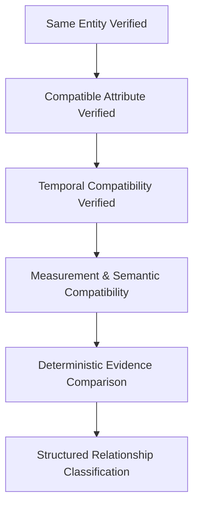
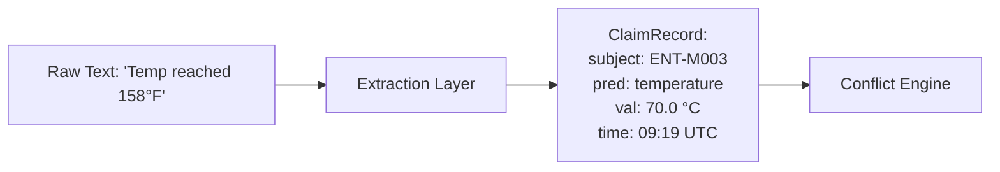
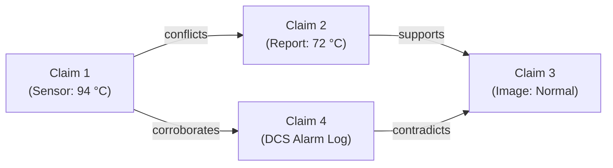
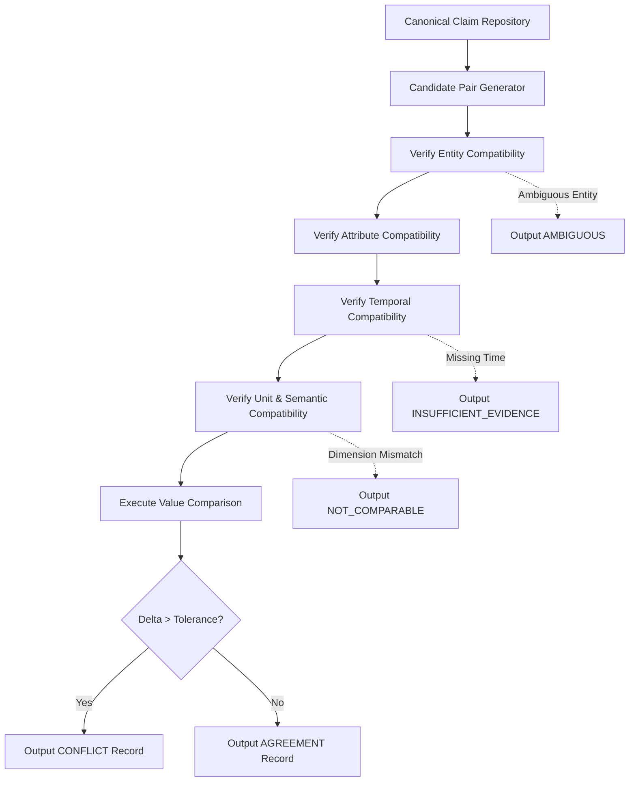
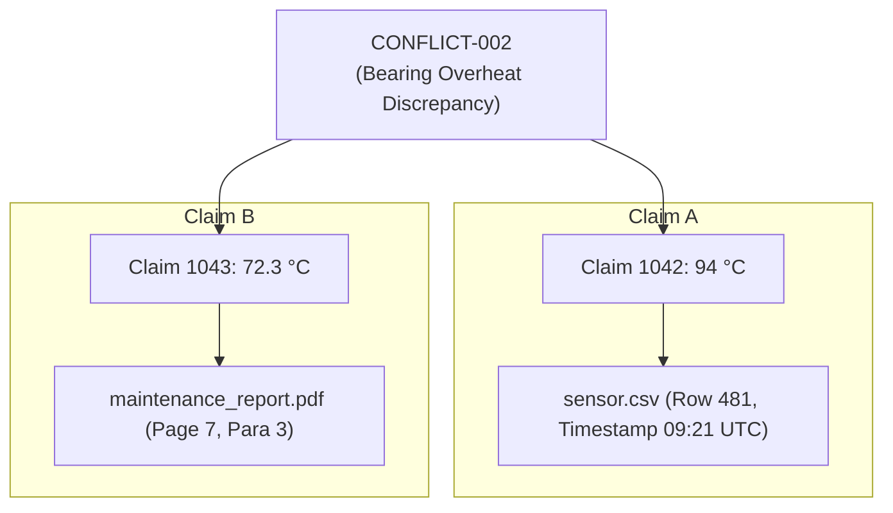
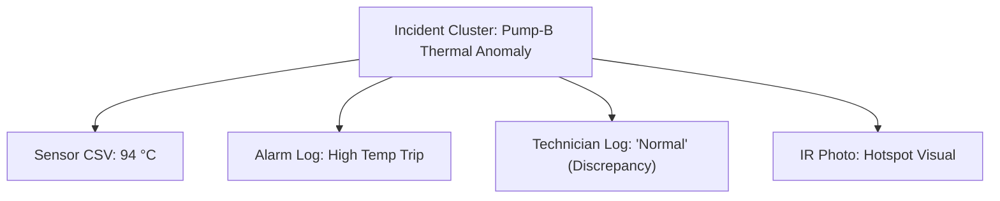
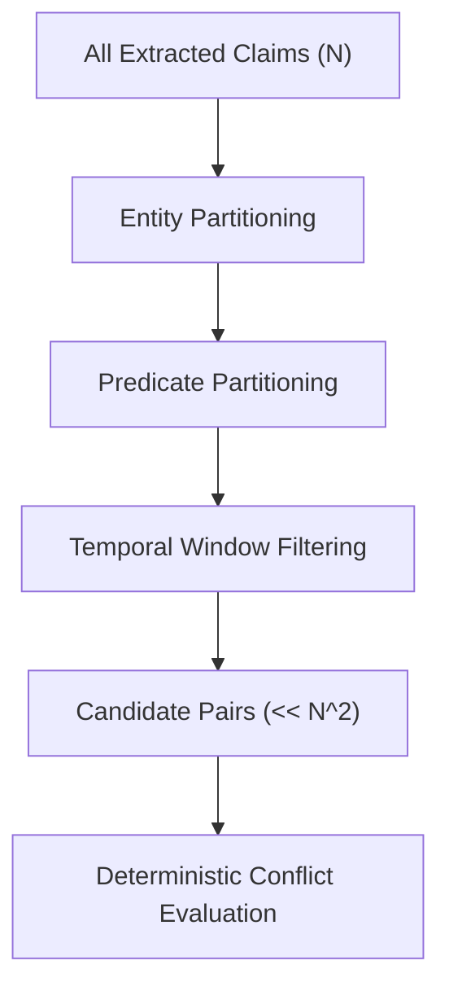
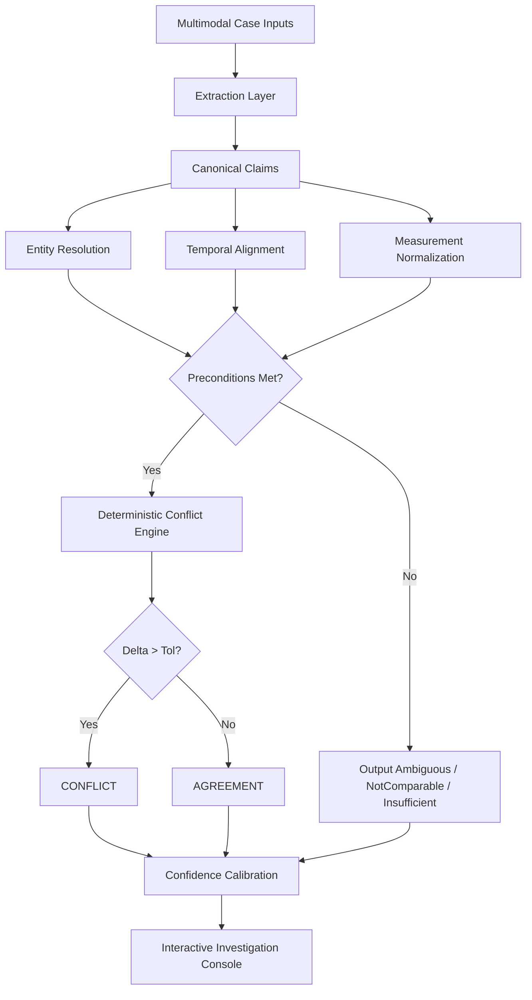

# AERIS Conflict Detection

## 1. Purpose

The conflict-detection engine determines whether two or more evidence claims are mutually consistent, contradictory, ambiguous, insufficiently supported, or not comparable.

AERIS must never classify evidence as conflicting merely because two extracted values or statements appear different.

Conflict detection requires a chain of validated conditions:



The core principle is:

> **Conflict is a structured relationship between claims, not a property of an individual claim.**

---

## 2. Problem Definition

Consider:

```text
Sensor Telemetry:
Pump-B temperature = 94°C at 09:21 UTC

Technician Log:
Pump-B appears normal at 09:22 UTC
```

These statements appear contradictory at face value.

However, AERIS must first establish:
* Both references identify the same physical entity (`Pump-B` $\equiv$ `ENT-M002`).
* Observations occur within a relevant temporal window ($|09:21 - 09:22| \le 300\text{s}$).
* The claims describe compatible attributes (`temperature` vs `operational_status`).
* The measurement and semantic representations are comparable.
* Sufficient evidence exists across all inputs.

Only then can the reasoning engine determine whether the observations conflict.

---

## 3. Required Relationship Types

The AERIS evidence reasoning layer supports five distinct relationship states:

```rust
enum EvidenceStatus {
    Agreement,
    Conflict,
    Ambiguous,
    InsufficientEvidence,
    NotComparable,
}
```

These states must never be collapsed into a simplistic `true / false` boolean.

---

## 4. Agreement

Evidence represents **Agreement** when independently derived claims are mutually compatible within configured tolerance:

```text
Maintenance report:  158°F
Sensor telemetry:    70°C

Normalization:       158°F ≈ 70°C
Tolerance Check:     |70.0 - 70.0| = 0.0°C <= ±1.0°C
Result:              Agreement
```

Agreement indicates mutual consistency under the evaluation conditions; it does not claim to establish universal metaphysical truth.

---

## 5. Conflict

A **Conflict** exists when two comparable claims assert materially incompatible states:

```text
Sensor:              Temperature = 94°C
Maintenance report:  Temperature = 72°C
```

A conflict is flagged if and only if:
1. Same canonical entity
2. Same attribute
3. Overlapping or proximal time window
4. Compatible physical units
5. Numerical discrepancy exceeds configured tolerance ($\Delta = 22\text{°C} > \pm 2\text{°C}$)

The conflict record retains pointers to both original sources.

---

## 6. Ambiguity

**Ambiguity** occurs when available evidence supports multiple plausible interpretations without sufficient signal to break the tie:

```text
Source A: CV-E
Source B: CV-E2
```

If entity resolution cannot determine which physical conveyor is referenced, AERIS assigns `EvidenceStatus::Ambiguous`. The system refuses to fabricate a conflict from unresolved identity.

---

## 7. Insufficient Evidence

**Insufficient Evidence** indicates that a comparison might be meaningful, but vital metadata is missing:

```text
Claim A: Pump-B temperature = 94°C at 09:21 UTC
Claim B: Pump-B operating normally (No timestamp provided)
```

Without an operational timestamp anchor for Claim B, the engine cannot verify whether the statement describes the morning startup or the afternoon shift. AERIS outputs `EvidenceStatus::InsufficientEvidence`.

---

## 8. Not Comparable

**Not Comparable** indicates that claims represent fundamentally incompatible physical quantities or incommensurable semantic properties:

```text
Claim A: Temperature = 70°C
Claim B: Pressure    = 70 kPa
```

Even though both numerical values equal `70.0`, their physical dimensions (`Temperature` vs `Pressure`) are incommensurable. Numerical subtraction is blocked.

---

## 9. Conflict Detection Preconditions

Before pairwise comparison, AERIS evaluates six formal preconditions:

```text
P1: Entity Identity           Γ_resolve(S_A) == Γ_resolve(S_B) == E_m != ⊥_ambiguous
P2: Attribute Compatibility   Compatible(P_A, P_B)
P3: Temporal Compatibility    Overlaps(τ_A, τ_B) ∨ Distance(τ_A, τ_B) <= W_proximity
P4: Measurement Dimension     dim(u_A) == dim(u_B)
P5: Semantic Compatibility    CompatibleSemanticDomain(O_A, O_B)
P6: Evidence Validity         Confidence(c_A) >= θ_valid ∧ Confidence(c_B) >= θ_valid
```

$$\text{Comparable}(A, B) \iff P_1 \land P_2 \land P_3 \land P_4 \land P_5 \land P_6$$

---

## 10. Core Conflict Rule

For numerical measurements:

$$\text{Conflict}(A, B) \iff \text{Comparable}(A, B) \land |v_{\text{norm}, A} - v_{\text{norm}, B}| > \text{Tolerance}$$

This rule is strictly **deterministic**. An LLM may assist in text extraction, but it is strictly barred from deciding whether numbers conflict.

---

## 11. Claim-Level Comparison

AERIS compares canonical claims, not unstructured raw text fragments:



---

## 12. Claim Comparison Model

```rust
struct ClaimComparison {
    id: ComparisonId,
    claim_a: ClaimId,
    claim_b: ClaimId,
    entity_relation: EntityRelation,
    temporal_relation: TemporalRelationshipType,
    attribute_relation: AttributeRelation,
    value_relation: ValueRelation,
    status: EvidenceStatus,
    confidence: ConfidenceRecord,
    reasons: Vec<ConflictReason>,
}
```

---

## 13. Entity Compatibility

| Entity Resolution State | Engine Action |
| :--- | :--- |
| **Resolved Same Entity** | Proceed to attribute and temporal validation |
| **Resolved Distinct Entity** | Classify as `NotComparable` (Different assets) |
| **Ambiguous Entity** | Classify as `Ambiguous`; preserve uncertainty |
| **Unresolved Entity** | Classify as `InsufficientEvidence` |

---

## 14. Attribute Compatibility

Attributes must map to compatible operational predicates:

```yaml
predicates:
  bearing_temperature:
    canonical: "temperature.bearing"
    aliases:
      - "temp_bearing"
      - "bearing_temp"
      - "de_bearing_temperature"
    dimension: "temperature"

  line_pressure:
    canonical: "pressure.line"
    aliases:
      - "discharge_pressure"
      - "p_out"
    dimension: "pressure"
```

---

## 15. Attribute Equivalence

AERIS recognizes:
* `ExactAttributeMatch`: Exact string predicate identity.
* `CanonicalAttributeMatch`: Aliases mapped via registry schema.
* `RelatedAttribute`: Subsumption or parent-child attributes.
* `IncompatibleAttribute`: Distinct dimensions (e.g., vibration vs temperature).
* `UnknownAttribute`: Unregistered predicates.

---

## 16. Temporal Compatibility

The conflict engine evaluates claims within bounded observation windows:
* If $|t_A - t_B| \le W_{\text{window}}$, comparison proceeds.
* If $|t_A - t_B| > W_{\text{window}}$, claims represent distinct historical events; conflict evaluation is suppressed.

---

## 17. Temporal Relationship Requirements

The conflict engine consumes typed outputs from `TemporalRelationship`:
* `SameInstant` $\to$ Direct comparison
* `Overlapping` $\to$ Direct comparison
* `Near` $\to$ Direct comparison (if within tolerance)
* `Separated` $\to$ No conflict (different states)
* `Unknown` $\to$ `InsufficientEvidence`

---

## 18. Measurement Compatibility

Numerical comparisons require:
* Identical physical dimensions ($\text{dim}(A) \equiv \text{dim}(B)$)
* Valid unit conversion paths
* Non-NaN, finite numerical values

---

## 19. Semantic Compatibility

Non-numerical claims represent qualitative operational assertions:
* `"Valve V-12 is OPEN"` vs `"Valve V-12 is CLOSED"`
* `"Motor running"` vs `"Motor stopped"`

These represent discrete mutually exclusive operational states.

---

## 20. Categorical Conflict Model

```rust
enum ClaimValue {
    Text(String),
    Boolean(bool),
    Category(String),
    Measurement(MeasurementValue),
    Entity(EntityRef),
    Range { min: f64, max: f64 },
    Structured(Value),
}
```

Categorical incompatibility matrix:

```yaml
operational_status:
  normal:
    conflicts_with: [failed, stopped, abnormal, tripped]
  running:
    conflicts_with: [stopped, offline, maintenance]
```

---

## 21. Boolean Conflict

```text
Claim A: alarm_active = true  (at 09:21:00Z)
Claim B: alarm_active = false (at 09:21:05Z)

Temporal Window: 5 seconds (Overlapping)
Result: CONFLICT (Mutually exclusive alarm state)
```

---

## 22. Range Comparison

When claims specify intervals ($[v_{\min}, v_{\max}]$):
* Point value inside range ($72\text{°C} \in [70, 75]\text{°C}$) $\implies$ `Agreement`
* Point value outside range ($90\text{°C} \notin [70, 75]\text{°C}$) $\implies$ `Conflict`

---

## 23. Partial Range Overlap

```text
Range A: [70, 80] °C
Range B: [78, 90] °C

Intersection: [78, 80] °C != ∅
Result: PARTIALLY_OVERLAPPING ==> EvidenceStatus::Ambiguous
```

---

## 24. Unknown Value Handling

A value marked `unknown` does not equal `0`, nor does it imply `normal`. It explicitly signals missing telemetry or unrecorded inspections, producing `EvidenceStatus::InsufficientEvidence`.

---

## 25. Null vs. Missing vs. Not Applicable

* **Missing:** Field omitted from payload (unobserved).
* **Unknown:** Field explicitly declared unmeasurable (`"temp: UNKNOWN"`).
* **Not Applicable:** Asset lacks the instrumentation (`"oil_pressure: N/A"` on dry motor).

---

## 26. Conflict Reason

Every comparison emits machine-readable justifications:

```rust
enum ConflictReason {
    DifferentMeasurementValue,
    ContradictoryCategoricalState,
    ContradictoryBooleanState,
    TemporalOverlap,
    SameEntity,
    SameAttribute,
    BeyondTolerance,
    IncompatibleEntity,
    UnknownTime,
    MissingMeasurement,
    UnitMismatch,
    DimensionMismatch,
    AmbiguousEntity,
    InsufficientEvidence,
}
```

---

## 27. Conflict Record

```rust
struct ConflictRecord {
    id: ConflictId,
    case_id: CaseId,
    claim_a: ClaimId,
    claim_b: ClaimId,
    status: EvidenceStatus,
    reasons: Vec<ConflictReason>,
    temporal_relationship: TemporalRelationshipType,
    confidence: ConfidenceRecord,
    supporting_evidence: Vec<EvidencePointer>,
    created_at: DateTime<Utc>,
}
```

---

## 28. Conflict Severity

```rust
enum ConflictSeverity {
    Low,
    Medium,
    High,
    Critical,
    Unknown,
}
```

Severity is dictated by domain rules: a $2\text{°C}$ discrepancy on a chiller may be `Low`, while on a cryogenic valve it is `Critical`.

---

## 29. Conflict Severity vs. Confidence

* **Confidence:** The statistical certainty that a contradiction exists.
* **Severity:** The operational consequence if the contradiction is true.

$$\text{Confidence} \ne \text{Severity}$$

---

## 30. Evidence Relationship Graph



---

## 31. Conflict Detection Pipeline



---

## 32. Candidate Pair Generation ($O(N^2)$ Mitigation)

Naive comparison of $N = 10,000$ claims requires $\approx 50,000,000$ evaluations.

AERIS prunes search space via multi-key candidate bucketing:

$$\text{Bucket Key} = \langle \text{CaseId}, \text{CanonicalEntityId}, \text{Dimension} \rangle$$

Comparisons are strictly bounded to claims sharing the same spatio-temporal hash.

---

## 33. Candidate Filtering Indexing

```sql
SELECT c2.id 
FROM claims c2
WHERE c2.case_id = :case_id
  AND c2.subject_entity = :entity_id
  AND c2.predicate_dimension = :dimension
  AND c2.temporal_start <= :t_end + INTERVAL '5 minutes'
  AND c2.temporal_end >= :t_start - INTERVAL '5 minutes'
  AND c2.id != :claim_1_id;
```

---

## 34. Numerical Conflict Algorithm

```text
fn evaluate_numerical_conflict(claim_a, claim_b, policy) -> EvidenceStatus {
    if claim_a.entity != claim_b.entity { return EvidenceStatus::NotComparable; }
    if claim_a.dimension != claim_b.dimension { return EvidenceStatus::NotComparable; }
    
    let temp_rel = evaluate_temporal(claim_a.time, claim_b.time);
    if !temp_rel.is_compatible() { return EvidenceStatus::NotComparable; }
    
    let val_a = claim_a.canonical_value;
    let val_b = claim_b.canonical_value;
    let delta = (val_a - val_b).abs();
    
    if delta > policy.tolerance(claim_a.predicate) {
        return EvidenceStatus::Conflict;
    } else {
        return EvidenceStatus::Agreement;
    }
}
```

---

## 35. Categorical Conflict Algorithm

```text
fn evaluate_categorical_conflict(claim_a, claim_b, rule_table) -> EvidenceStatus {
    if claim_a.entity != claim_b.entity { return EvidenceStatus::NotComparable; }
    if !is_temporally_compatible(claim_a, claim_b) { return EvidenceStatus::NotComparable; }
    
    let cat_a = claim_a.category;
    let cat_b = claim_b.category;
    
    if cat_a == cat_b { return EvidenceStatus::Agreement; }
    if rule_table.are_mutually_exclusive(cat_a, cat_b) {
        return EvidenceStatus::Conflict;
    }
    
    return EvidenceStatus::Ambiguous;
}
```

---

## 36. LLM Boundary

* **LLM Role:** Parsing messy shift logs and converting narrative text into candidate claims.
* **Deterministic Engine Role:** Computing numerical delta ($|94 - 72.3| = 21.7$), evaluating tolerance bounds, and classifying the relationship.

---

## 37. Semantic Reasoning Boundary

* Text: *"The pump sounds like gravel in a blender."*
* Extraction Provider: Infers `acoustic_state = severe_cavitation` (Confidence: 0.88).
* Conflict Engine: Compares `severe_cavitation` against `acoustic_state = normal` using explicit categorical rules.

---

## 38. Confidence Propagation

AERIS evaluates confidence conservatively via weakest-link dependency:

$$\gamma_{\text{conflict}} = \min(\gamma_{\text{extract}, A}, \gamma_{\text{extract}, B}, \gamma_{\text{entity}}, \gamma_{\text{temporal}}, \gamma_{\text{norm}})$$

If entity resolution confidence is $0.70$, conflict confidence cannot exceed $0.70$.

---

## 39. Confidence and Classification Example

```text
Entity Resolution Confidence:    0.99
Temporal Alignment Confidence:   0.96
Measurement Normalization:       0.99
Tolerance Delta Proof:           1.00

Composite Conflict Confidence:   0.96
```

---

## 40. Confidence Calibration (ECE & Brier Score)

$$\text{Brier Score} = \frac{1}{N} \sum_{i=1}^N (p_i - y_i)^2$$

AERIS benchmarks verify that predictions with $0.90$ confidence correspond to ground-truth conflicts in $90\%$ of cases.

---

## 41. Conflict Explanation Proof

```json
{
  "status": "conflict",
  "reasons": [
    "same_entity",
    "same_attribute",
    "temporal_overlap",
    "same_dimension",
    "difference_beyond_tolerance"
  ],
  "proof": {
    "entity": "ENT-M002 (Pump-B)",
    "attribute": "temperature.bearing",
    "temporal_overlap_seconds": 60,
    "canonical_val_a": 94.0,
    "canonical_val_b": 72.3,
    "delta": 21.7,
    "tolerance": 2.0
  }
}
```

The Web UI translates this proof into an interactive audit card.

---

## 42. Provenance in Conflict Detection



---

## 43. Conflict Graph Clustering

Multiple claims describing the same physical fault are clustered under a common **Incident Dossier**:



---

## 44. Conflict Deduplication

A unique deduplication hash prevents duplicate conflict records during repeated pipeline runs:

$$\text{Deduplication Key} = \text{SHA256}(\text{CaseId} \,\|\, \min(c_A, c_B) \,\|\, \max(c_A, c_B) \,\|\, \text{PolicyVersion})$$

---

## 45. Conflict Lifecycle

```rust
enum ConflictStatus {
    Detected,
    UnderReview,
    Confirmed,
    Rejected,
    Superseded,
}
```

---

## 46. Human Review

When an engineer reviews a detected conflict:
* Reviewer ID, decision (`Confirmed` or `Rejected`), and explanatory notes are recorded.
* Rejected conflicts remain in the audit database; they are never deleted.

---

## 47. Synthetic Benchmark Matrix

| Case ID | Injected Phenomenon | Expected Engine Classification |
| :--- | :--- | :--- |
| **M-001** | Normal Baseline | `Agreement` across all sources (Zero false conflicts) |
| **M-002** | Genuine Temperature Conflict | `Conflict` ($94\text{°C}$ vs $72.3\text{°C}$) |
| **M-003** | Unit Discrepancy | `Agreement` after normalization ($158\text{°F} \equiv 70\text{°C}$) |
| **M-004** | Telemetry Gap (09:25–09:29) | `InsufficientEvidence` for blackout window |
| **M-005** | Ambiguous Asset Names | `Ambiguous` (`CV-E` vs `CV-E2`) |
| **M-006** | Cross-Modal Disagreement | `Conflict` (Photo shows crack, text says intact) |

---

## 48. Evaluation Metrics

$$\text{Precision} = \frac{\text{TP}}{\text{TP} + \text{FP}}, \quad \text{Recall} = \frac{\text{TP}}{\text{TP} + \text{FN}}, \quad F_1 = \frac{2 \cdot P \cdot R}{P + R}$$

$$\text{False Conflict Rate} = \frac{\text{FP}}{\text{All Actual Non-Conflicts}}$$

$$\text{Missed Conflict Rate} = \frac{\text{FN}}{\text{All Actual Ground-Truth Conflicts}}$$

---

## 49. Evaluation by Relationship Type

Metrics are computed independently across all 5 classes to prevent class imbalance distortion:
* Agreement $F_1$
* Conflict $F_1$
* Ambiguous $F_1$
* Insufficient Evidence $F_1$
* Not Comparable $F_1$

---

## 50. Confusion Matrix Format

```text
                     PREDICTED
              Agree   Conf   Ambig   Insuff   NotComp
Actual Agree    98      0      2        0        0
Actual Conf      0     48      1        1        0
Actual Ambig     0      0     24        1        0
Actual Insuff    0      0      0       15        0
Actual NotComp   0      0      0        0       20
```

---

## 51. API Design

### Compare Claim Pair Endpoint

```http
POST /api/v1/cases/{case_id}/reasoning/compare
Content-Type: application/json

{
  "claim_a": "CLM-001",
  "claim_b": "CLM-002"
}
```

```json
{
  "status": "conflict",
  "confidence": 0.96,
  "entity": {
    "id": "ENT-M002",
    "confidence": 0.99
  },
  "temporal": {
    "relationship": "near",
    "confidence": 0.95
  },
  "value_comparison": {
    "canonical_a": 94.0,
    "canonical_b": 72.3,
    "difference": 21.7,
    "tolerance": 2.0
  },
  "reasons": [
    "same_entity",
    "same_attribute",
    "temporal_compatibility",
    "difference_beyond_tolerance"
  ]
}
```

---

## 52. Batch Conflict Analysis

```http
POST /api/v1/cases/{case_id}/reasoning/analyze
```

Orchestrates candidate pair extraction, temporal gating, unit normalization, rule evaluation, and conflict persistence for an entire case.

---

## 53. Storage Model

PostgreSQL relational schema:

```text
claim_comparisons
conflict_records
evidence_relationships
conflict_reasons
comparison_policies
conflict_reviews
```

```sql
CREATE INDEX idx_claim_comparisons_case ON claim_comparisons(case_id);
CREATE INDEX idx_conflict_records_case ON conflict_records(case_id);
CREATE INDEX idx_conflict_records_status ON conflict_records(status);
CREATE INDEX idx_evidence_relationships_src ON evidence_relationships(source_claim);
CREATE INDEX idx_evidence_relationships_tgt ON evidence_relationships(target_claim);
```

---

## 54. Processing Idempotency

Processing runs are cryptographically idempotent: re-running analysis against identical inputs and policy versions produces the exact same conflict set without duplicating rows.

---

## 55. Failure Isolation

If a single claim contains corrupted data, the engine logs an error for that pair and continues processing the remainder of the case.

---

## 56. Security Considerations

* **Untrusted Value Bounding:** Extreme numeric inputs (e.g. $10^{308}$) are rejected to prevent floating-point poisoning.
* **Denial-of-Service Defense:** Candidate pair generation is capped at $5,000$ comparisons per batch.
* **Immutability of Evidence:** Conflict analysis never edits raw claims or source records.

---

## 57. Performance Architecture



---

## 58. Conflict Explanation Walkthrough

UI Card for `CONFLICT-002`:

```text
================================================================================
EXPLAINABLE CONFLICT PROOF: Pump-B Bearing Temperature
================================================================================
Claim A:   94.0 °C  [sensor_temperature.csv, Row 481, 09:21:43 UTC]
Claim B:   72.3 °C  [maintenance_report.pdf, Page 7, 09:22:00 UTC]

Deterministic Validation:
  [PASS] Entity Resolution:      P-002 == Pump-B (ENT-M002)
  [PASS] Predicate Alignment:    bearing_temperature
  [PASS] Temporal Compatibility: 17s delta <= 300s window (NEAR)
  [PASS] Unit Normalization:     Both units °C
  [FAIL] Tolerance Bound:        Delta 21.7 °C exceeds allowed ±2.0 °C

Classification: GENUINE CONFLICT (Confidence: 0.96)
================================================================================
```

---

## 59. Complete Reasoning Architecture



---

## 60. Conflict Detection Invariants

1. **Invariant 1:** Conflict requires comparable evidence.
2. **Invariant 2:** Different entities must not produce a same-entity conflict.
3. **Invariant 3:** Temporally separated observations must not automatically be classified as conflicting.
4. **Invariant 4:** Incompatible dimensions must produce `NotComparable`.
5. **Invariant 5:** Unknown units must not silently enter numerical comparison.
6. **Invariant 6:** Ambiguous entity resolution must propagate uncertainty.
7. **Invariant 7:** Missing evidence must not be interpreted as normal behavior.
8. **Invariant 8:** Every conflict must retain supporting provenance.
9. **Invariant 9:** Every classification must retain its reasoning conditions.
10. **Invariant 10:** LLM output must not bypass deterministic validation.
11. **Invariant 11:** Confidence and severity must remain separate.
12. **Invariant 12:** Ground truth must never be used as runtime evidence.

---

## 61. Acceptance Criteria Checklist

- [x] Claims are compared using canonical identifiers.
- [x] Entity compatibility is validated.
- [x] Attribute compatibility is validated.
- [x] Temporal compatibility is evaluated.
- [x] Measurements are normalized before comparison.
- [x] Categorical conflicts are supported.
- [x] Boolean conflicts are supported.
- [x] Range comparisons are supported.
- [x] Unknown values are handled explicitly.
- [x] Incompatible measurements produce `NotComparable`.
- [x] Missing evidence produces qualified results.
- [x] Ambiguous entities remain ambiguous.
- [x] Tolerances are configurable.
- [x] Conflict reasons are persisted.
- [x] Confidence is recorded.
- [x] Provenance is preserved.
- [x] Duplicate comparisons are controlled.
- [x] Processing is versioned.
- [x] Human review is supported.
- [x] Evaluation metrics are available.
- [x] False conflicts can be measured.
- [x] Missed conflicts can be measured.
- [x] The UI can explain every detected conflict.

---

## 62. Final Design Principle

AERIS never asks:

> *“Do these two pieces of evidence look different?”*

It asks:

> *“After entity resolution, temporal alignment, normalization, semantic interpretation, and uncertainty handling, do these claims represent mutually incompatible observations?”*

A conflict is valuable only when the system can prove exactly why it exists and provide a direct path back to the original evidence.

---

**Next: `11-confidence-and-calibration.md`**, where we formalize multi-component uncertainty modeling, confidence propagation, Expected Calibration Error (ECE), and Brier score evaluation.
