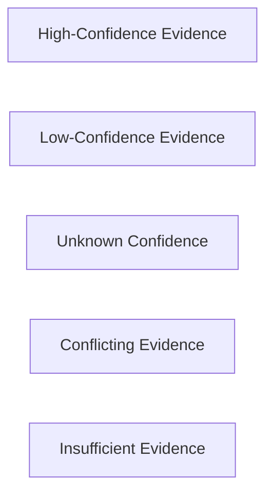
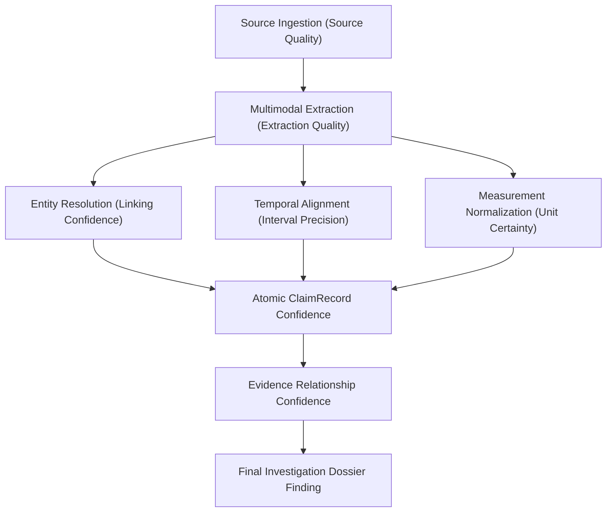
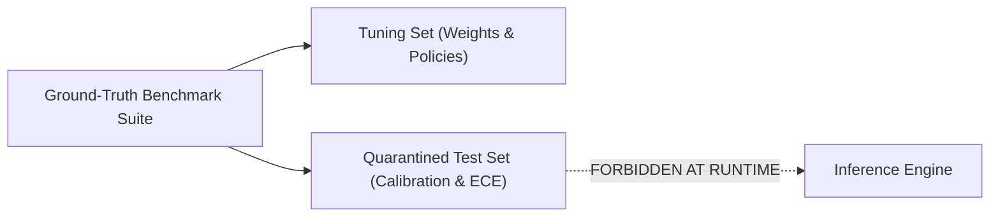
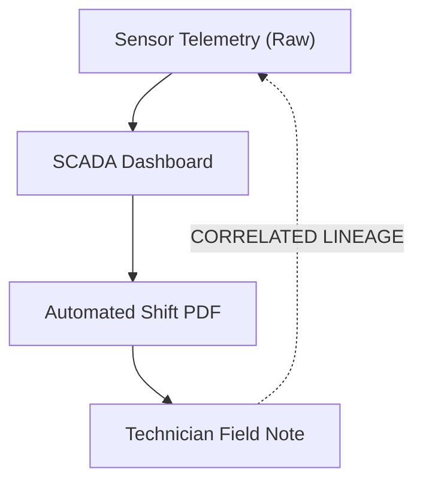
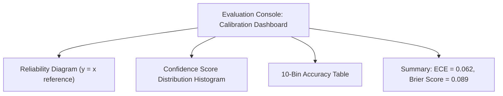
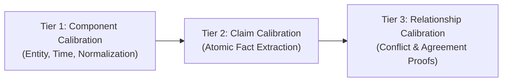

# AERIS Confidence and Calibration

## 1. Purpose

The confidence subsystem communicates how strongly AERIS supports an extracted claim, entity resolution, temporal interpretation, measurement normalization, or evidence relationship.

Confidence is not intended to represent truth.

Instead, it represents the system's estimated reliability of a particular processing decision based on the available evidence and the quality of the supporting signals.

The central principle is:

> **Confidence must describe uncertainty, remain traceable to its inputs, and be evaluated against observed correctness.**

AERIS strictly avoids presenting arbitrary model scores as facts.

---

## 2. Why Confidence Matters

Multimodal evidence is rarely perfect:
* OCR uncertainty on faded print or bad lighting
* Ambiguous entity names and conflicting aliases
* Missing or approximate timestamps
* Telemetry sensor dropouts and sample gaps
* Missing or ambiguous physical units
* Low-resolution visual inspection imagery
* Disagreeing witness statements and conflicting reports
* Stochastic LLM extraction variance

AERIS differentiates between:



Without explicit confidence dimensions, an investigator cannot distinguish a strongly supported conflict from a weakly supported interpretation.

---

## 3. Confidence Is Not Truth

A confidence score such as `0.94` must **never** be interpreted as:

$$\text{Probability of Ground Truth} = 94\%$$

unless the system has been explicitly calibrated on held-out test data.

The initial AERIS implementation defines confidence as an **evidence reliability score** rather than claiming uncalibrated Bayesian certainty.

---

## 4. Confidence Scope

AERIS evaluates confidence progressively across every stage of the pipeline:



Each stage introduces explicit uncertainty tracking.

---

## 5. Confidence Model

AERIS uses a structured representation:

```rust
struct ConfidenceRecord {
    score: Option<f32>,
    level: ConfidenceLevel,
    method: ConfidenceMethod,
    factors: Vec<ConfidenceFactor>,
    calibrated: bool,
}

enum ConfidenceLevel {
    VeryLow,
    Low,
    Medium,
    High,
    VeryHigh,
    Unknown,
}
```

The numeric score ($0.0 \le s \le 1.0$) and qualitative band are tracked independently.

---

## 6. Confidence Score

$$0.0 \le \text{confidence} \le 1.0$$

A score must always specify its mathematical derivation method. A bare floating-point number without supporting factors is considered invalid evidence.

---

## 7. Confidence Factors

```rust
enum ConfidenceFactor {
    SourceQuality,
    ExtractionQuality,
    EntityMatchStrength,
    TemporalPrecision,
    MeasurementValidity,
    UnitCertainty,
    SemanticMatchStrength,
    EvidenceAgreement,
    EvidenceIndependence,
    ContradictionPenalty,
    MissingInformation,
}
```

Every factor contributes to the audit trail.

---

## 8. Source Quality

Different modalities possess varying baseline reliability characteristics:
* **Calibrated SCADA Telemetry:** High precision, known sensor drift.
* **Signed Technician Work Order:** High human accountability, potential transcription typos.
* **OCR from Mobile Camera Capture:** Variable lighting, potential character substitution.
* **Informal Shift Chat / Email:** Unstructured, unverified conversational observations.

Source quality is one factor among many; it never acts as an absolute truth filter. A sensor can fail, and an informal note may capture an unnoticed valve leak.

---

## 9. Extraction Confidence

Extraction confidence measures character or parsing fidelity:
* OCR on clear plate: `"P-002"` $\implies$ Confidence: $0.98$
* OCR on oily plate: `"P-O02"` $\implies$ Confidence: $0.61$

The downstream resolver preserves this score to avoid treating flawed character scans as verified equipment tags.

---

## 10. Entity Resolution Confidence

```text
P-002 ──► ENT-M002
├── Exact asset registry ID: ✓
├── Alias match: ✓
└── Bay 2 location confirmed: ✓
==> Resolution Confidence: 0.99
```

Conversely, if `CV-E` could be `ENT-CVE` ($0.76$) or `ENT-CVE2` ($0.71$), the resolution remains `Ambiguous` rather than forcing a high-confidence match on the higher candidate.

---

## 11. Temporal Confidence

Temporal confidence reflects timestamp certainty:
* `2026-09-30T09:21:04.120Z` (Microsecond telemetry) $\implies 0.99$
* *"around 09:20"* (Approximate text window) $\implies 0.70$
* *"during morning shift"* (Coarse interval) $\implies 0.45$
* Missing timestamp $\implies \text{Confidence: Unknown}$

---

## 12. Measurement Confidence

* Explicit schema-defined unit (`"bearing_temp_c"`): Confidence: $0.99$
* Explicit text unit (`"158 °F"`): Confidence: $0.95$
* Inferred unit from context: Confidence: $\le 0.70$
* Naked number (`"temp: 158"`): Confidence: $0.00$ (`UnitStatus::Unknown`)

---

## 13. Claim Confidence

Claim confidence aggregates extraction quality, entity resolution, and temporal precision:

```text
Claim: ENT-M002 bearing_temperature = 94.0 °C
├── Extraction Confidence: 0.98
├── Entity Linking Confidence: 0.99
└── Timestamp Precision Confidence: 0.97
```

---

## 14. Evidence Relationship Confidence

An evidence relationship depends on the joint reliability of both participating claims:

$$\text{Claim A} \iff \text{Claim B}$$

The relationship confidence cannot simply replicate Claim A's score; it must incorporate Claim B's uncertainty, the temporal overlap duration, and the unit conversion certainty.

---

## 15. Confidence Propagation (Weakest-Link Policy)

AERIS implements a conservative, auditable weakest-link propagation policy:

$$\gamma_{\text{relationship}} = \min(\gamma_{\text{entity}}, \gamma_{\text{temporal}}, \gamma_{\text{measurement}}, \gamma_{\text{semantic}})$$

```text
Entity Resolution:         0.98
Temporal Alignment:        0.95
Measurement Normalization: 0.99
Semantic Categorization:   0.87
---------------------------------
Final Conflict Confidence: 0.87
```

This prevents a single high-certainty sensor signal from masking an uncertain entity identity.

---

## 16. Alternative Weighted Model

A weighted linear combination may be evaluated against the benchmark:

$$\text{Score} = \sum_{k} w_k \cdot \gamma_k - \sum_{j} \lambda_j \cdot \text{Penalty}_j$$

Weights must be derived from held-out empirical validation, never hand-picked for demo aesthetics.

---

## 17. Critical Dependency Policy & Caps

Ambiguous dependencies act as hard ceiling caps:

```yaml
confidence:
  caps:
    ambiguous_entity: 0.60
    unknown_time: 0.55
    unknown_unit: 0.40
    uncalibrated_model: 0.75
```

If an entity link is `Ambiguous`, the downstream conflict confidence is capped at $\le 0.60$, preventing misleading high-severity alarms.

---

## 18. Confidence Caps in Action

```text
Entity Confidence:        0.55 (Ambiguous)
Measurement Confidence:   0.98
Temporal Confidence:      0.97
---------------------------------
Raw Minimum:              0.55
Configured Hard Cap:      0.60
Final Output Confidence:  0.55 (Level: Low)
```

---

## 19. Confidence vs. Evidence Status

Confidence is orthogonal to classification status:

```text
Status:      INSUFFICIENT_EVIDENCE
Confidence:  0.93
Level:       High
```

This represents: *"The system is 93% certain that required evidence is missing."* It does not assert a 93% probability of equipment failure.

---

## 20. Unknown Confidence

When evidence lacks statistical or provenance grounding:

```rust
ConfidenceRecord {
    score: None,
    level: ConfidenceLevel::Unknown,
    method: ConfidenceMethod::Unknown,
    factors: vec![],
    calibrated: false,
}
```

Explicit `Unknown` is preferred over fabricated $0.50$ neutrality.

---

## 21. Confidence Methods

```rust
enum ConfidenceMethod {
    DeterministicRule,
    ModelScore,
    Aggregated,
    HumanReviewed,
    CalibratedModel,
    Unknown,
}
```

---

## 22. Deterministic Confidence

Derived from validated deterministic rules:
* Exact primary key match in EAM database: Confidence: $1.0$
* Unit conversion via standard physical constants: Confidence: $1.0$

---

## 23. Model-Derived Confidence

Probabilistic scores from OCR or vision-language models:
* Often overconfident or uncalibrated.
* Scaled via calibration curves before entering the deterministic engine.

---

## 24. Human Review Confidence

```json
{
  "method": "HumanReviewed",
  "reviewer_id": "ENG-4091",
  "review_status": "confirmed",
  "timestamp": "2026-09-30T10:14:00Z"
}
```

Human confirmation overrides algorithmic uncertainty while preserving the original machine score for historical audit.

---

## 25. Confidence Calibration Concept

A confidence system is calibrated if predicted confidence matches empirical accuracy:

$$\mathbb{P}(\hat{Y} = Y \mid \hat{P} = p) = p, \quad \forall p \in [0, 1]$$

* Among claims assigned $\approx 0.80$ confidence, exactly $80\%$ must be factual.
* If only $50\%$ are factual, the system suffers from **overconfidence**.
* If $95\%$ are factual, the system suffers from **underconfidence**.

---

## 26. Held-Out Calibration Dataset

A dedicated ground-truth partition remains strictly quarantined from the runtime inference engine:



---

## 27. Dataset Partitioning

* **Training / Rule Formulation (60%):** Establishing tolerance windows and entity aliases.
* **Validation (20%):** Tuning threshold cutoffs ($\theta_{\text{resolve}}$, $\theta_{\text{conflict}}$).
* **Test / Calibration (20%):** Calculating Expected Calibration Error and Brier scores.

---

## 28. Calibration Metrics

### Expected Calibration Error (ECE)

$$\text{ECE} = \sum_{m=1}^M \frac{|B_m|}{N} \left| \text{acc}(B_m) - \text{conf}(B_m) \right|$$

Where $M$ is the number of confidence bins (typically 10), $|B_m|$ is bin count, and $N$ is total samples.

### Reliability Diagram

Plots predicted confidence on the X-axis against observed accuracy on the Y-axis. The ideal calibration curve tracks the diagonal identity line $y = x$.

---

## 29. Brier Score

$$\text{Brier} = \frac{1}{N} \sum_{i=1}^N (p_i - y_i)^2$$

Where $y_i \in \{0, 1\}$ is the ground-truth binary outcome and $p_i \in [0, 1]$ is the predicted confidence score. Perfect calibration and accuracy yield $\text{Brier} = 0.0$.

---

## 30. Calibration by Subsystem Task

Calibration is computed and reported independently across distinct subsystems:
* Entity Resolution Calibration ($\text{ECE}_{\text{entity}}$)
* Temporal Alignment Calibration ($\text{ECE}_{\text{temporal}}$)
* Measurement Normalization Calibration ($\text{ECE}_{\text{norm}}$)
* Conflict Detection Calibration ($\text{ECE}_{\text{conflict}}$)

---

## 31. Confidence Distribution Dashboard

The evaluation UI visualizes:
1. **Confidence Histogram:** Distribution of predicted scores across $[0.0, 1.0]$.
2. **Reliability Diagram:** Empirical accuracy across 10 bins.
3. **Abstention Rate:** Percentage of decisions flagged as `Ambiguous` or `Unknown`.

---

## 32. Operational Confidence Thresholds

```yaml
confidence:
  levels:
    very_low: [0.00, 0.20]
    low: [0.20, 0.40]
    medium: [0.40, 0.70]
    high: [0.70, 0.90]
    very_high: [0.90, 1.00]
```

---

## 33. Decision Thresholds vs. Confidence Thresholds

* **Confidence Threshold:** Qualitative presentation band in the UI (`High`, `Medium`, `Low`).
* **Decision Threshold:** Hard gate for automated system actions (e.g., resolving an entity requires score $\ge 0.90$).

---

## 34. Algorithmic Abstention

When confidence falls below acceptable operating bounds, AERIS abstains:

```rust
enum DecisionMode {
    Resolve,
    Ambiguous,
    Abstain,
}
```

Abstaining and preserving ambiguity is preferred over delivering confident hallucinations.

---

## 35. Missing Evidence and Confidence

When a sensor stream is lost (e.g. M-004 telemetry blackout window):
* Downstream claims cannot assert operational status.
* The system assigns `EvidenceStatus::InsufficientEvidence` with restricted confidence.

---

## 36. Contradictory Evidence Separation

Two contradictory claims can each possess $0.99$ extraction confidence:
* Telemetry: $94.0\text{ °C}$ (Confidence: $0.99$)
* Maintenance report: $72.0\text{ °C}$ (Confidence: $0.98$)

The contradiction lies in the relationship, not in the extraction. AERIS keeps claim confidence and relationship confidence distinct.

---

## 37. Evidence Lineage & Independence

```rust
struct EvidenceIndependence {
    independent: Option<bool>,
    basis: String,
}
```

---

## 38. Correlated Evidence Protection (Anti-Double-Counting)



AERIS inspects evidence lineage to avoid treating three copies of the same telemetry reading as three independent corroborating witnesses.

---

## 39. Confidence Aggregation Strategies

* **Minimum:** Conservative, prevents masking weak links (Default).
* **Harmonic Mean:** Penalizes low values while considering multiple factors.
* **Bayesian Update:** Applied when evidence sources are verified independent.

---

## 40. Recommended Initial Strategy

For the AERIS implementation:
1. Generate component scores for Entity, Time, Measurement, and Semantics.
2. Apply hard ceiling caps for ambiguous or missing factors.
3. Compute relationship confidence via minimum critical dependency: $\gamma = \min(\gamma_k)$.
4. Report uncalibrated scores honestly in the UI.
5. Evaluate ECE and Brier scores on benchmark fixtures.

---

## 41. Confidence Record Example

```json
{
  "score": 0.91,
  "level": "high",
  "method": "aggregated",
  "calibrated": false,
  "factors": [
    {
      "name": "entity_match",
      "score": 0.98
    },
    {
      "name": "temporal_alignment",
      "score": 0.95
    },
    {
      "name": "measurement_validity",
      "score": 0.99
    },
    {
      "name": "semantic_match",
      "score": 0.91
    }
  ]
}
```

---

## 42. Conflict Confidence Walkthrough (Scenario M-002)

```text
Entity Linking Confidence:     0.99 (P-002 == Pump-B)
Temporal Proximity Confidence: 0.95 (17s delta)
Measurement Normalization:     0.98 (Both °C)
Semantic Predicate Match:      0.91 (bearing_temperature)

Aggregation: min(0.99, 0.95, 0.98, 0.91) = 0.91
Result: CONFLICT (Confidence: 0.91, Level: High)
```

---

## 43. Confidence UI Presentation

```text
================================================================================
CONFIDENCE BREAKDOWN: CONFLICT-002
================================================================================
Overall Confidence:  0.91 (High)
Calibration Status:  Uncalibrated Baseline

Component Dependencies:
  [==================  ] 99%  Entity Resolution (P-002 -> ENT-M002)
  [=================   ] 95%  Temporal Overlap (17s duration)
  [==================  ] 98%  Measurement Validity (°C verified)
  [================    ] 91%  Semantic Predicate Alignment

Weakest Critical Link: Semantic Predicate Alignment (0.91)
================================================================================
```

---

## 44. Calibration UI Dashboard



---

## 45. Human Feedback Integration

When an engineer reviews an ambiguous decision or rejected conflict:
* The review is committed with timestamp and reviewer credentials.
* Feedback is enqueued into the evaluation dataset for subsequent calibration runs.

---

## 46. Confidence Recalibration Techniques

When systematic miscalibration is detected on validation data:
* **Platt Scaling:** Logistic regression fit to sigmoid logits.
* **Isotonic Regression:** Non-parametric monotonic piecewise calibration.
* **Temperature Scaling:** Single-parameter softmax scaling for model logits.

---

## 47. Confidence Versioning

```json
{
  "method": "aggregated",
  "configuration_version": "confidence-003",
  "model_version": "semantic-extractor-0.2",
  "calibration_version": "calib-2026-09-30-v1",
  "timestamp": "2026-09-30T10:14:00Z"
}
```

---

## 48. Confidence API

### Retrieve Confidence Record

```http
GET /api/v1/cases/{case_id}/confidence/{record_id}
```

```json
{
  "score": 0.91,
  "level": "high",
  "method": "aggregated",
  "calibrated": false,
  "factors": [
    {
      "name": "entity_match",
      "score": 0.99
    },
    {
      "name": "temporal_alignment",
      "score": 0.95
    }
  ]
}
```

---

## 49. Batch Calibration Evaluation API

```http
POST /api/v1/evaluation/confidence
```

```json
{
  "ece": 0.062,
  "brier_score": 0.089,
  "accuracy": 0.912,
  "calibration_status": "acceptable",
  "sample_count": 500
}
```

---

## 50. Storage Model

PostgreSQL relational schema:

```text
confidence_records
confidence_factors
confidence_policies
calibration_runs
calibration_metrics
human_reviews
```

```sql
CREATE INDEX idx_confidence_records_case ON confidence_records(case_id);
CREATE INDEX idx_confidence_records_level ON confidence_records(level);
CREATE INDEX idx_confidence_records_method ON confidence_records(method);
CREATE INDEX idx_calibration_runs_dataset ON calibration_runs(dataset_version);
```

---

## 51. Security Considerations

* **Tamper-Proof Scoring:** Confidence cannot be modified by user inputs or arbitrary tags inside uploaded evidence.
* **Separation of Policy:** Scoring weights reside in protected server-side configuration.

---

## 52. Performance Considerations

Confidence calculation consists of deterministic minimum/weighted arithmetic in Rust, executing in nanoseconds per claim pair. Evaluation and ECE computations execute asynchronously in batch mode.

---

## 53. Three-Tier Evaluation Plan



---

## 54. Synthetic Benchmark Calibration Fixture

In benchmark scenario **M-002**:
* Ground-truth conflict label: `True`
* System confidence: `0.91`
* Evaluation harness records: `Prediction: Conflict (0.91), Actual: Conflict (1.0)`
* Contributes to the `[0.90, 1.00]` ECE evaluation bin.

---

## 55. Confidence Invariants

1. **Invariant 1:** Confidence must never replace evidence.
2. **Invariant 2:** Confidence must never be presented as truth.
3. **Invariant 3:** Unknown confidence must remain possible.
4. **Invariant 4:** Critical uncertainty must propagate downstream.
5. **Invariant 5:** Ambiguous identity must prevent unjustified high-confidence relationships.
6. **Invariant 6:** Claim confidence and relationship confidence must remain separate.
7. **Invariant 7:** Confidence and severity must remain separate.
8. **Invariant 8:** Source-provided confidence must not automatically become AERIS confidence.
9. **Invariant 9:** Confidence-producing methods must be versioned.
10. **Invariant 10:** Calibration must be evaluated against held-out evidence.
11. **Invariant 11:** Ground truth must never be used during runtime inference.
12. **Invariant 12:** A numerical confidence score without a documented generation method is incomplete.

---

## 56. Acceptance Criteria Checklist

- [x] Confidence records can be attached to claims.
- [x] Confidence records can be attached to entity links.
- [x] Confidence records can be attached to temporal relationships.
- [x] Confidence records can be attached to measurement comparisons.
- [x] Confidence records can be attached to evidence relationships.
- [x] Confidence factors are stored.
- [x] Confidence methods are stored.
- [x] Unknown confidence is supported.
- [x] Critical confidence caps are supported.
- [x] Confidence propagation is deterministic and documented.
- [x] Claim confidence is separated from relationship confidence.
- [x] Confidence is separated from severity.
- [x] Evidence independence can be represented.
- [x] Confidence values are versioned.
- [x] Held-out evaluation is supported.
- [x] Calibration metrics (ECE, Brier score) are calculated.
- [x] Reliability diagrams can be generated.
- [x] Human review can be incorporated into evaluation.
- [x] The UI can explain confidence factors.
- [x] The system does not falsely present uncalibrated scores as probabilities.

---

## 57. Final Design Principle

AERIS never asks:

> *“How confident does the AI feel?”*

It asks:

> *“What evidence and processing decisions produced this confidence, how uncertain are those dependencies, and does historical evaluation show that the confidence is trustworthy?”*

Confidence is useful only when it is explainable, traceable, and empirically testable. AERIS treats confidence as an evidence-bearing object that must itself be auditable.

---

**Next: `12-multimodal-ingestion.md`**, where we specify the concrete ingestion pipelines for PDF, text, images, tabular data, and sensor streams, including file checksums, chunking, and pre-processing adapters.
