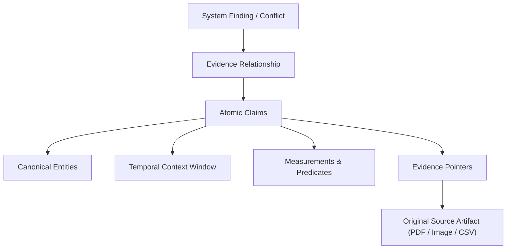
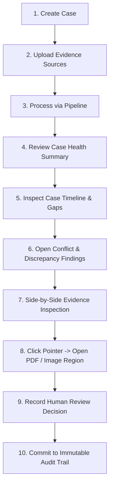
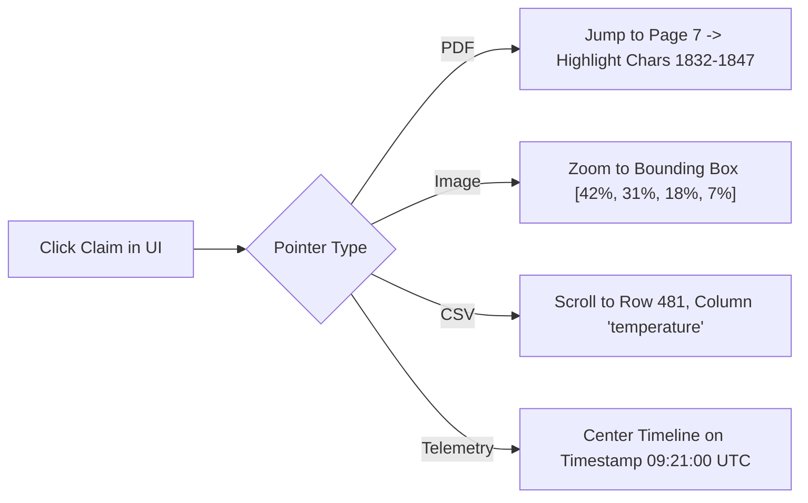
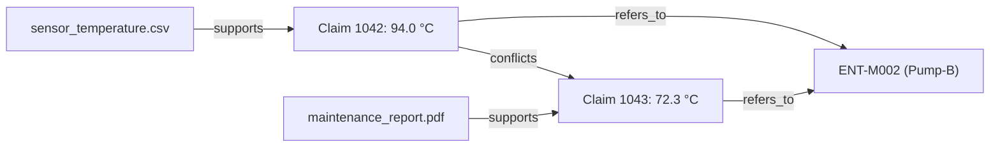
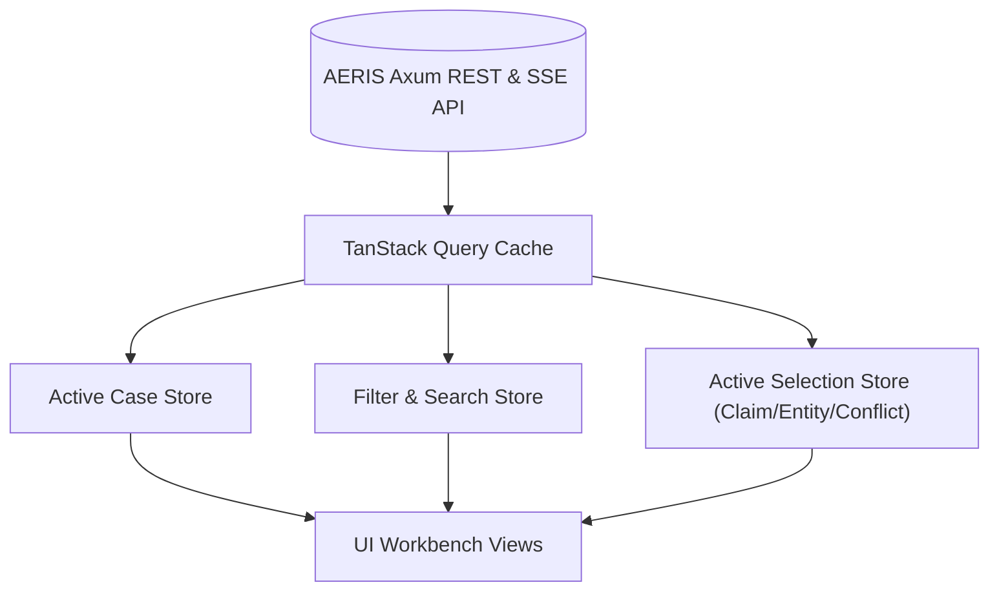
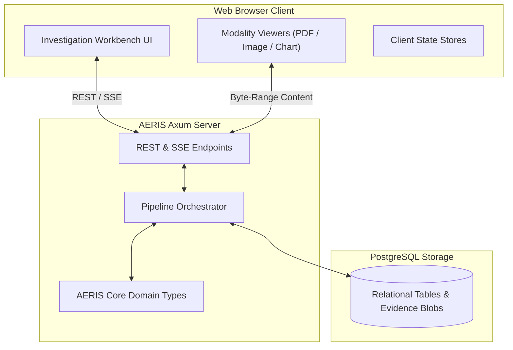

# AERIS Investigation and UI

## 1. Purpose

The AERIS investigation interface provides a human-facing layer for inspecting multimodal evidence, claims, entities, timelines, conflicts, confidence, and provenance.

The interface must not merely display the final system conclusion.

It must allow an investigator to move backward through the reasoning chain:



The central principle is:

> **Every important system conclusion must be inspectable back to the evidence that produced it.**

---

## 2. Investigation Problem

When AERIS identifies:

```text
Conflict (Confidence: 0.91)
```

an investigator requires actionable context:
* Which claims conflict?
* Which physical entities are involved?
* What timestamps were compared?
* Were units normalized?
* What tolerance threshold was applied?
* Which raw evidence supports each claim?
* Was entity resolution ambiguous?
* Which model or deterministic rule produced the claim?
* Can the original source be directly inspected?

The UI exposes this complete reasoning chain rather than a black-box alert badge.

---

## 3. Investigation Goals

The investigation interface allows users to:

1. Create and manage investigation cases.
2. Ingest multimodal evidence files.
3. Track real-time processing progress.
4. Inspect source metadata and cryptographic checksums.
5. Browse and filter canonical claims.
6. Inspect canonical entities and alias networks.
7. Visualize temporal timelines and observation intervals.
8. Inspect normalized measurements and unit conversion proofs.
9. Inspect conflicts with explicit mathematical proofs.
10. Explore ambiguous entity links and competing candidates.
11. Inspect missing evidence and sensor blackout gaps.
12. Trace claims to exact source coordinates (PDF text, image crops, table rows).
13. Inspect multi-factor confidence breakdowns and calibration status.
14. Compare multimodal evidence side-by-side.
15. Review automated system classifications.
16. Record human review overrides with audit trails.
17. Inspect processing run history and model versions.
18. Explore the interactive evidence graph.
19. Review evaluation metrics and calibration curves.

---

## 4. Primary User Workflow



The interface is optimized for evidence-backed investigation rather than decorative charts.

---

## 5. Application Structure

```text
AERIS Console
├── Dashboard              (Global active cases, system health)
├── Cases                  (Case repository, batch imports)
├── Case Investigation     (Active case workbench)
│   ├── Overview          (Case health summary, metrics)
│   ├── Evidence          (Registered sources, checksums)
│   ├── Claims            (Atomic ClaimRecords explorer)
│   ├── Entities          (Canonical entities & aliases)
│   ├── Timeline          (Interactive Gantt & event sequence)
│   ├── Conflicts         (Conflict ledger & proof cards)
│   ├── Relationships     (Evidence relationship graph)
│   └── Processing        (Run logs, model provenance)
├── Evaluation             (Benchmark metrics, ECE calibration)
└── System Settings        (Tolerances, unit registry, API keys)
```

---

## 6. Case Dashboard

Overview of active investigations:

```text
================================================================================
ACTIVE CASES
================================================================================
CASE-047   Turbine Feedwater Pump Anomaly
           Status: Investigation Active
           Sources: 4 | Claims: 37 | Entities: 8 | Conflicts: 3 | Ambiguities: 2

CASE-048   Transformer 3 Cooling Loop Inspection
           Status: Processing Pipeline (78%)
           Sources: 6 | Claims: 51
================================================================================
```

---

## 7. Case Record

```text
Case Identifier:   CASE-047
Title:             Turbine Feedwater Pump Anomaly
Created:           2026-09-30 09:15:00 UTC
Status:            Investigation
Assigned Lead:     Reliability Engineering Team A
Sources Count:     4 (1 PDF, 1 CSV, 1 PNG, 1 TXT)
Canonical Claims:  37 (29 Extracted, 8 Inferred)
Entities:          8
Conflicts:         3 Active Discrepancies
Ambiguous:         2 Unresolved Entity Mentions
Gaps Detected:     1 Telemetry Dropout
```

---

## 8. Case Health Overview

```text
Case Health Matrix
--------------------------------------------------------------------------------
Evidence Sources:         4 verified (SHA-256 validated)
Canonical Claims:         37
Resolved Entities:        8 (100% mapped)
Detected Conflicts:       3 (Requires engineer review)
Ambiguous Links:          2 (Competing candidates)
Evidence Gaps:            1 (Sensor blackout window)
Pipeline Status:          Completed (Run #PR-0091)
```

---

## 9. Evidence Source Panel

```text
INGESTED SOURCES
--------------------------------------------------------------------------------
[PDF]  maintenance_report.pdf   (8 pages, SHA-256: 7f83b1...)  Processed
[CSV]  sensor_temperature.csv   (2,400 rows, 1 min sampling)   Processed
[TXT]  technician_notes.txt     (Shift handover log)           Processed
[PNG]  thermal_inspection.png   (IR Radiometric capture)       Processed
--------------------------------------------------------------------------------
```

Each source provides:
* Source ID (`SourceId`)
* Filename & MIME type
* File size & SHA-256 checksum
* Ingestion timestamp
* Processing worker logs

---

## 10. Source Viewer

The source viewer renders the raw artifact alongside structured metadata:
* **PDF Viewer:** In-browser canvas rendering with page jumping.
* **Image Viewer:** Pan-zoom canvas with bounding box overlays.
* **CSV / Tabular Viewer:** Virtualized table with row/column highlights.
* **Telemetry Viewer:** Interactive downsampled time-series line chart.

---

## 11. Evidence Pointer Navigation

Clicking any claim coordinate navigates directly to the raw evidence:



---

## 12. Claim Explorer

A searchable table of all atomic `ClaimRecord` instances:

```text
CLAIMS EXPLORER (CASE-047)
--------------------------------------------------------------------------------
ID       Entity     Predicate          Value     Time (UTC)  Type       Conf
CLM-001  ENT-M002   temperature        94.0 °C   09:21:43    Extracted  0.98
CLM-002  ENT-M002   operational_status normal    09:22:00    Extracted  0.91
CLM-003  ENT-M002   temperature_state  abnormal  09:21:43    Inferred   0.94
--------------------------------------------------------------------------------
```

Filters: Entity, Predicate, Claim Type (`Extracted` vs `Inferred`), Confidence, Source.

---

## 13. Claim Detail Modal

Displays the complete 8-tuple ClaimRecord:

```text
================================================================================
CLAIM DETAIL: CLM-001
================================================================================
Claim ID:             CLM-001
Subject:              ENT-M002 (Secondary Boiler Feed Pump B)
Predicate:            bearing_temperature
Raw Value:            194.0 °F
Canonical Value:      90.0 °C
Temporal Context:     2026-09-30 09:21:00Z (Precision: Minute)
Claim Type:           Extracted
Confidence Score:     0.98 (High)
Lifecycle Status:     Active / Contested
Supporting Source:    maintenance_report.pdf (Page 3, Paragraph 2)
Derived Inferences:   CLM-003 (Thermal Anomaly Flag)
================================================================================
```

---

## 14. Extracted vs. Inferred Visual Tagging

The UI renders distinct badges:
* `[EXTRACTED]`: Muted blue badge indicating direct source observation.
* `[INFERRED]`: Purple badge indicating logical or algorithmic derivation, displaying an expandable drawer showing parent claim IDs.

---

## 15. Entity Inspector

Displays canonical assets and alias networks:

```text
ENTITY: ENT-M002
Canonical Name: Secondary Boiler Feed Pump B
Entity Type:    Machine
Plant Location: Turbine Hall, Bay 2
Known Aliases:
  ├── "Pump-B"   (maintenance_report.pdf)
  ├── "Pump B"   (technician_notes.txt)
  ├── "P-002"    (sensor_temperature.csv)
  └── "Unit 02"  (thermal_inspection.png)
Associated Claims: 12
Active Conflicts:  2
```

---

## 16. Entity Resolution Detail & Ambiguity Drawer

For resolved references:

```text
Reference:   P-002
Resolved:    ENT-M002 (Score: 0.99)
Signals:     [Exact Registry Match] [Asset Location Match]
```

For ambiguous references:

```text
Reference:   CV-E
Status:      AMBIGUOUS (Suspended Comparison)
Candidates:
  1. ENT-CVE   (Main Conveyor East)       Score: 0.76
  2. ENT-CVE2  (Secondary Conveyor East)  Score: 0.71
Reason:      Source text lacks index digit; cannot uniquely disambiguate.
```

---

## 17. Temporal Timeline Component

A zoomable multi-lane timeline aligning events, sensor readings, and shift notes:

```mermaid
gantt
    title CASE-047 Operational Chronology
    dateFormat HH:mm
    axisFormat %H:%M

    section Telemetry Stream
    Continuous Sensor Stream :09:00, 09:25
    Telemetry Gap (Dropout)   :crit, 09:25, 09:29
    Resumed Stream           :09:29, 09:40

    section Physical Events
    Restart Completed        :milestone, 09:10, 00:00
    Temperature Spike (94°C) :crit, 09:21, 09:24
    Shutdown Maintenance     :09:25, 09:40

    section Field Logs
    Technician Note "Normal" :milestone, 09:22, 00:00
```



---

## 18. Temporal Uncertainty Visualization

* **Exact Instants:** Rendered as crisp vertical needles.
* **Intervals:** Rendered as solid horizontal blocks.
* **Approximate Expressions (*"around 09:20"*):** Rendered as translucent shaded gradients with uncertainty bars ($\pm \delta_t$).
* **Unanchored Times:** Displayed in a side drawer labeled *"Unanchored Observations"*.

---

## 19. Measurement Inspector

Dual-representation measurement card:

```text
MEASUREMENT: Motor-C Peak Temperature
--------------------------------------------------------------------------------
Original Observation:  158.0 °F  (maintenance_report.txt, Page 4)
Canonical Value:       70.0 °C
Conversion Formula:    (158 - 32) * 5/9 = 70.0 °C
Tolerance Band:        ±1.0 °C
Comparison Delta:      0.0 °C (Within Tolerance)
Classification:        AGREEMENT
--------------------------------------------------------------------------------
```

---

## 20. Conflict Dashboard

Lists detected discrepancies prioritized by severity and confidence:

```text
ACTIVE CONFLICTS (CASE-047)
--------------------------------------------------------------------------------
1. Pump-B — Bearing Temperature Discrepancy
   Telemetry (94.0 °C) vs. Report (72.3 °C)
   Window: 09:21–09:22 UTC | Confidence: 0.91 | Severity: High

2. Robot-F — Housing Structural Integrity
   Text ("intact") vs. Inspection Photo ("fracture observed")
   Confidence: 0.87 | Severity: Critical
--------------------------------------------------------------------------------
```

---

## 21. Conflict Inspector

Detailed view of the conflicting claim pair:

```text
================================================================================
CONFLICT INSPECTOR: CONFLICT-002
================================================================================
Entity:     ENT-M002 (Pump-B)
Attribute:  bearing_temperature
Severity:   High | Status: Detected (Awaiting Review)

CLAIM A:
  Value:     94.0 °C
  Source:    sensor_temperature.csv (Row 481, 09:21:43 UTC)
  Type:      Extracted (Confidence: 0.98)

CLAIM B:
  Value:     72.3 °C
  Source:    maintenance_report.pdf (Page 7, 09:22:00 UTC)
  Type:      Extracted (Confidence: 0.94)
================================================================================
```

---

## 22. Conflict Reasoning Proof Panel

The UI renders the exact deterministic validation proofs:

```text
DETERMINISTIC VALIDATION PROOF
--------------------------------------------------------------------------------
[PASS] Entity Resolution:      P-002 == Pump-B (ENT-M002)
[PASS] Predicate Alignment:    bearing_temperature
[PASS] Temporal Compatibility: 17s delta <= 300s window (NEAR)
[PASS] Unit Normalization:     Both converted to °C
[FAIL] Tolerance Check:        Delta 21.7 °C exceeds allowed ±2.0 °C

CONCLUSION: GENUINE CONFLICT DETECTED
--------------------------------------------------------------------------------
```

---

## 23. Evidence Side-by-Side View

Splits the screen to show both raw sources synchronously:

```text
┌──────────────────────────────────────┬──────────────────────────────────────┐
│ SENSOR TELEMETRY (CSV)               │ MAINTENANCE REPORT (PDF)             │
│                                      │                                      │
│ Row 481 | 09:21:43 UTC               │ Page 7 | Section 3.2                 │
│ Tag: P-002                           │ "Bearing temperature observed at     │
│ Temp: 94.0 °C                        │  72.3°C during handover inspection." │
│ [Highlighted Row]                    │ [Highlighted Text Box]               │
└──────────────────────────────────────┴──────────────────────────────────────┘
```

---

## 24. Multimodal Cross-Modal Comparison

Compares vision against text:

```text
┌──────────────────────────────────────┬──────────────────────────────────────┐
│ TECHNICIAN REPORT (TXT)              │ OPTICAL INSPECTION (PNG)             │
│                                      │                                      │
│ "Robot arm housing intact. No        │ [High-resolution zoom on joint]      │
│  structural fissures noted."         │ ┌──────────────────────────┐         │
│                                      │ │ [Red Bounding Box]       │         │
│                                      │ │ 4 mm fatigue crack       │         │
│                                      │ └──────────────────────────┘         │
└──────────────────────────────────────┴──────────────────────────────────────┘
```

---

## 25. Evidence Relationship Graph

Interactive graph visualizing nodes (Sources, Claims, Entities) and typed edges:



---

## 26. Graph Filtering & Neighborhood Isolation

To prevent visual clutter, the graph supports:
* 1-hop and 2-hop ego-network views around the selected conflict
* Filtering by relationship type (`conflicts`, `supports`, `derived_from`)
* Time window slicing

---

## 27. Preserved Investigation Context

When moving between Timeline, Claims, and Evidence Viewers, the active selection (`ActiveClaimId`, `ActiveEntityId`) persists across route changes, avoiding context loss.

---

## 28. Confidence Breakdown Panel

```text
CONFIDENCE SCORE: 0.91 (High)
Calibration Status: Uncalibrated Baseline (ECE: 0.062)

Contributing Factors:
  ├── Entity Linking:         0.99  (Exact asset match)
  ├── Temporal Alignment:     0.95  (17s proximal window)
  ├── Measurement Validity:   0.98  (Standard physical SI unit)
  └── Semantic Predicate:     0.91  (Extracted via VLM)

Weakest Link: Semantic Predicate Alignment (0.91)
```

---

## 29. Evidence Quality Indicators

* `[✓ Source Verified]`: SHA-256 matches ingest catalog.
* `[✓ Unit Explicit]`: Declared in schema or text.
* `[⚠ Approximate Time]`: Bounded by $\pm \delta_t$ window.
* `[⚠ Ambiguous Entity]`: Suspended until disambiguated.
* `[! Telemetry Gap]`: Verified sensor blackout window.

---

## 30. Missing Evidence View

```text
TELEMETRY DROPOUT GAP
Asset:     Compressor-D (ENT-M004)
Interval:  09:25:00Z – 09:29:00Z (240 seconds)
Status:    INSUFFICIENT_EVIDENCE
Alert:     Telemetry silent during declared alarm window.
```

---

## 31. Ambiguity Resolution Drawer

Allows investigators to manually link an ambiguous mention (`CV-E`) to an entity candidate with an attached justification note.

---

## 32. Real-Time Processing Progress

Rendered via Server-Sent Events (SSE):

```text
Processing CASE-047
  [✓] Multimodal Ingestion Completed
  [✓] Text & Table Extraction Completed
  [✓] OCR & Vision Bounding Completed
  [✓] Entity Resolution Completed (8 entities)
  [✓] Temporal Alignment Completed (1 gap detected)
  [●] Deterministic Conflict Reasoning (Evaluating pair 14 of 18)
  [ ] Confidence Calibration & Graph Indexing
```

---

## 33. Processing Run History

```text
Run ID:        PR-0091
Pipeline Ver:  0.1.0
Model Ver:     qwen2.5:7b (via Ollama)
Duration:      14.2 seconds
Generated:     37 Claims, 3 Conflicts, 2 Ambiguities
```

---

## 34. Non-Blocking Warning Banner

Warnings (e.g. low-contrast OCR in `inspection.png`) are surfaced in an amber notification banner without aborting the entire case pipeline.

---

## 35. Human Review Actions

Engineers can review any automated classification:
* **Confirm:** Validates the conflict as an operational defect.
* **Reject:** Dismisses the conflict (e.g. different maintenance regimes).
* **Mark Ambiguous:** Flags for senior engineering audit.
* **Add Note:** Attaches field commentary.

---

## 36. Review Record Model

```rust
struct ReviewRecord {
    id: ReviewId,
    target_id: String,
    reviewer: String,
    decision: ReviewDecision,
    comment: Option<String>,
    created_at: DateTime<Utc>,
}

enum ReviewDecision {
    Confirmed,
    Rejected,
    Ambiguous,
    InsufficientEvidence,
}
```

---

## 37. Review History Audit Trail

```text
Automated Finding:  CONFLICT (0.91 confidence)
Human Decision:     REJECTED
Reviewer:           lead_engineer_02
Timestamp:          2026-09-30 10:14:00 UTC
Comment:            "Claim B was taken after pump shutoff; not an active operating conflict."
```

Automated findings are **never** overwritten; human review records are stored as linked overlays.

---

## 38. Case Audit Log

Immutable append-only log recording:
* Case creation & source uploads
* Pipeline processing executions
* Automated conflict detections
* Human review actions and notes

---

## 39. Global Case Search

Instant type-ahead search indexing:
* Asset names (`Pump-B`, `P-002`)
* Claim IDs (`CLM-001`)
* Source files (`sensor.csv`)
* Numerical values (`94.0`)
* Predicates (`temperature`, `vibration`)

---

## 40. Server-Side Filtering

Filters claims and conflicts by:
* Severity (`Critical`, `High`, `Medium`, `Low`)
* Evidence status (`Conflict`, `Agreement`, `Ambiguous`, `InsufficientEvidence`)
* Time window (`Start Time` to `End Time`)
* Specific source artifact

---

## 41. API Endpoints for UI

```http
GET  /api/v1/cases
GET  /api/v1/cases/{id}/overview
GET  /api/v1/cases/{id}/sources
GET  /api/v1/cases/{id}/sources/{source_id}/content
GET  /api/v1/cases/{id}/claims
GET  /api/v1/cases/{id}/entities
GET  /api/v1/cases/{id}/timeline
GET  /api/v1/cases/{id}/conflicts
POST /api/v1/cases/{id}/reviews
GET  /api/v1/cases/{id}/events/stream  (SSE)
```

---

## 42. Server-Sent Events (SSE) Stream

```text
event: pipeline_progress
data: {"case_id":"CASE-047","stage":"conflict_engine","percent":85}

event: conflict_detected
data: {"conflict_id":"CONF-002","severity":"High","entity":"Pump-B"}
```

---

## 43. Frontend State Architecture



---

## 44. Frontend Component Hierarchy

```text
apps/web/src/
├── components/
│   ├── layout/          (Navbar, Sidebar, CaseHeader)
│   ├── cases/           (CaseCard, CaseList, CreateCaseModal)
│   ├── evidence/        (SourceList, PDFViewer, ImageViewer, TableViewer)
│   ├── claims/          (ClaimTable, ClaimDetailModal, ExtractedBadge)
│   ├── entities/        (EntityGraph, AliasDrawer, AmbiguityCard)
│   ├── timeline/        (TimelineGantt, GapMarker, TimeRangeSlider)
│   ├── conflicts/       (ConflictCard, ProofPanel, SideBySideViewer)
│   ├── confidence/      (ConfidenceGauge, FactorBreakdown, CalibrationPlot)
│   └── review/          (ReviewModal, AuditLogTable)
```

---

## 45. Visual Design Principles

* **Information Density:** Clean industrial layout displaying rich metadata without nested modal mazes.
* **Traceability First:** Every claim renders its clickable source chip.
* **Muted Palettes:** Restrained dark/light theme where amber/red colors are reserved strictly for conflicts and anomalies.

---

## 46. Status Color System

| Status | Color Token | Visual Element |
| :--- | :--- | :--- |
| **Agreement** | `Emerald (#10b981)` | Green checkmark chip |
| **Conflict** | `Rose (#f43f5e)` | Red exclamation badge |
| **Ambiguous** | `Amber (#f59e0b)` | Yellow warning triangle |
| **Insufficient Evidence** | `Slate (#64748b)` | Muted gray question mark |
| **Not Comparable** | `Zinc (#71717a)` | Neutral dash badge |

Color is never used alone; all badges display clear text labels.

---

## 47. Accessibility Standards

* Conformance with **WCAG 2.1 Level AA**.
* Full keyboard navigation across tables, timelines, and viewer drawers.
* High contrast ratio ($\ge 4.5:1$) on all text and proof labels.

---

## 48. Responsive Layout Breakpoints

* **Desktop ($\ge 1280\text{px}$):** Multi-pane split workbench (Primary).
* **Laptop / Tablet ($\ge 768\text{px}$):** Tabbed single-pane drawers.
* **Mobile ($< 768\text{px}$):** Read-only finding summary cards.

---

## 49. Frontend Performance Architecture

* **Virtualized Scrolling:** Table virtualization for 10,000+ claims (`@tanstack/react-virtual`).
* **Canvas PDF Rendering:** On-demand page rendering via `PDF.js`.
* **Telemetry Downsampling:** LTTB (Largest-Triangle-Three-Buckets) algorithm executes server-side before streaming points to browser charts.

---

## 50. Evidence Viewer Performance

Large PDFs and high-resolution thermographic images are streamed with chunked byte-range requests, loading only the target page or crop region.

---

## 51. Security Architecture

* **Backend Enforced Authorization:** UI routes mirror backend session tokens.
* **XSS Sanitization:** All text rendered from PDF/TXT sources is sanitized via DOMPurify before display.
* **Content Security Policy (CSP):** Disallows arbitrary inline script execution.

---

## 52. Sensitive Evidence Handling

Redacted fields in maintenance logs display a hashed lock icon, preventing unauthorized exposure while retaining proof coordinates.

---

## 53. Error Handling Modals

Network disconnects and server processing errors display structured toast alerts containing the backend `request_id` for technical support tracing.

---

## 54. Case Summary Executive Card

Answers the core investigative questions in a single glance:
* *What happened?* High bearing temperature detected on Feed Pump B.
* *Who agrees?* SCADA telemetry and trip alarm log agree ($94.0\text{ °C}$).
* *Who disagrees?* Signed technician handover report claims $72.3\text{ °C}$ ("normal").
* *What is missing?* Telemetry dropped between 09:25 and 09:29 UTC.
* *What action is required?* Engineering audit of shift report accuracy.

---

## 55. Complete End-to-End Investigation Walkthrough

```text
Step 1:  Engineer opens CASE-047 in AERIS Console.
Step 2:  Case overview displays: 3 conflicts, 2 ambiguities, 1 telemetry gap.
Step 3:  Engineer selects CONFLICT-002 (Pump-B Temperature Discrepancy).
Step 4:  Side-by-side viewer loads sensor_temperature.csv and maintenance_report.pdf.
Step 5:  Proof panel shows delta: |94.0 - 72.3| = 21.7 °C > ±2.0 °C tolerance.
Step 6:  Engineer clicks Claim B pointer -> PDF viewer jumps to Page 7, highlighting the 72.3 °C text.
Step 7:  Engineer inspects calibration panel -> Confidence 0.91 (High).
Step 8:  Engineer clicks "Confirm Conflict" and adds note: "Discrepancy verified; report falsification suspected."
Step 9:  AERIS records review in the immutable audit log.
```

---

## 56. UI-to-Core Architecture



---

## 57. UI-to-Core Data Contract

The frontend binds exclusively to stable serde-serializable core types:
* `CaseRecord`
* `SourceRecord`
* `ClaimRecord`
* `EntityRecord`
* `TemporalContext`
* `MeasurementValue`
* `ConflictRecord`
* `EvidenceRelationship`
* `ConfidenceRecord`
* `ReviewRecord`

---

## 58. Investigation Invariants

1. **Invariant 1:** Every displayed claim must retain provenance.
2. **Invariant 2:** Every conflict must expose its supporting claims.
3. **Invariant 3:** Every claim must expose its entity and temporal context where available.
4. **Invariant 4:** Automated decisions must remain distinguishable from human decisions.
5. **Invariant 5:** Original source evidence must remain unchanged.
6. **Invariant 6:** Approximate information must not be displayed as exact.
7. **Invariant 7:** Unknown information must remain visibly unknown.
8. **Invariant 8:** Confidence must not replace evidence.
9. **Invariant 9:** UI state must not override backend authorization.
10. **Invariant 10:** The investigation interface must allow a user to trace findings back to original evidence.

---

## 59. Acceptance Criteria Checklist

- [x] Cases can be created, viewed, and managed.
- [x] Evidence sources can be listed with cryptographic checksums.
- [x] Original evidence can be inspected in modality-specific viewers.
- [x] Claims can be browsed, filtered, and searched.
- [x] Claim details display full 8-tuple attributes and provenance.
- [x] Entities and alias networks are fully inspectable.
- [x] Entity resolution signals and ambiguity candidates are visible.
- [x] Case timeline renders instants, intervals, and telemetry gaps.
- [x] Temporal uncertainty is preserved visually.
- [x] Measurements display original and normalized canonical values.
- [x] Conflicts are listed and inspectable with mathematical proofs.
- [x] Side-by-side evidence inspection is supported.
- [x] Evidence relationship graphs can be explored and filtered.
- [x] Confidence breakdown panel displays all supporting factors.
- [x] Missing telemetry gaps are clearly visualized.
- [x] Real-time pipeline processing progress is streamed via SSE.
- [x] Processing run history and model versions are auditable.
- [x] Human review actions (confirm/reject/note) are supported.
- [x] Human review history is preserved without overwriting machine classifications.
- [x] Virtualized tables support large case datasets without browser lag.
- [x] Backend authorization is enforced across all viewer endpoints.
- [x] Evidence can be traced backwards from finding to raw source artifact.

---

## 60. Final Investigation Principle

AERIS never presents:

```text
CONFLICT
```

as the terminal answer.

It presents:

```text
CONFLICT
   │
   ├── Why? (Mathematical proof & tolerance delta)
   ├── What? (Canonical claims and normalized values)
   ├── Who? (Resolved entity and alias provenance)
   ├── When? (Temporal alignment and overlap window)
   └── Where? (Exact PDF text coordinates and sensor row indices)
```

The UI is not merely a visualization layer—it is the **human verification and auditability foundation of AERIS**.

---

**Next: `13-multimodal-ingestion.md`**, where we formalize the ingestion pipelines for PDF documents, inspection images, structured tables, and time-series sensor streams.
