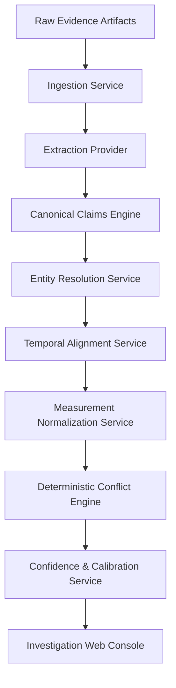
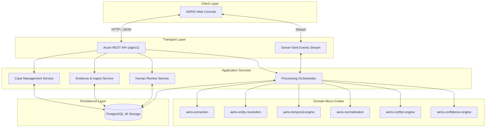
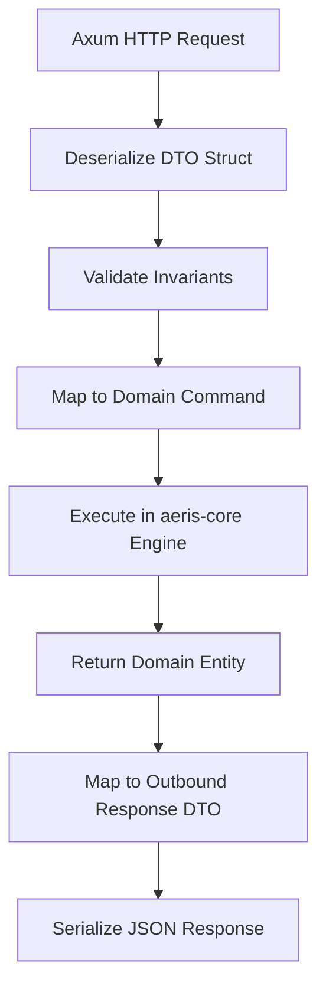
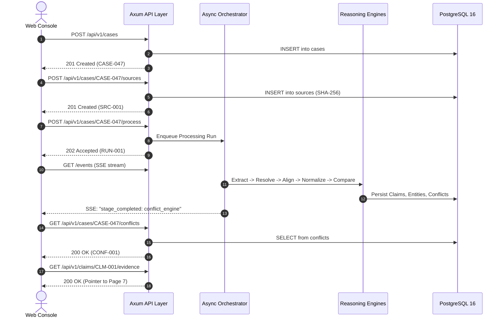

# AERIS API and Service Contracts

## 1. Purpose

The AERIS API layer provides stable, versioned interfaces between the investigation frontend, processing pipeline, reasoning engines, storage services, and external integrations.

The API exposes canonical domain objects rather than leaking internal database schemas or engine mechanics.

The central principle is:

> **Services communicate through explicit contracts, not shared assumptions.**

AERIS orchestrates multiple processing stages:



Each stage operates under a strictly typed input and output contract.

---

## 2. API Goals

The API layer must:

1. Create and manage cases.
2. Accept multimodal evidence sources (PDF, CSV, Image, Text, Telemetry).
3. Trigger asynchronous processing runs with idempotency keys.
4. Report real-time processing progress over Server-Sent Events (SSE).
5. Expose canonical claims with full provenance metadata.
6. Expose canonical entities, aliases, and ambiguous candidate links.
7. Expose temporal relationships and gap analysis.
8. Expose normalized measurements and conversion formulas.
9. Expose conflicts with machine-readable mathematical proofs.
10. Expose multi-factor confidence breakdowns and calibration metrics.
11. Support byte-range and bounding-box evidence inspection.
12. Support human review decisions without overwriting automated findings.
13. Support benchmark evaluation and ground-truth comparisons.
14. Provide structured, predictable error responses.
15. Preserve pipeline, model, and schema version information.
16. Support idempotent processing operations.

---

## 3. API Architecture



---

## 4. API Versioning

All public API endpoints are prefixed with explicit version paths:

```text
/api/v1/
```

Example: `/api/v1/cases`, `/api/v1/conflicts`.

---

## 5. API Conventions

* **HTTP Verbs:**
  * `GET`: Safe retrieval; idempotent; caches allowed.
  * `POST`: Creation of resources or triggering pipeline runs.
  * `PATCH`: Partial updates to mutable metadata.
  * `DELETE`: Soft-delete or archive where explicitly permitted.
* **Payload Format:** `application/json` (UTF-8).
* **Timestamps:** ISO 8601 / RFC 3339 formatted UTC strings (`2026-09-30T09:21:00Z`).
* **Identifiers:** Stable opaque strings (UUID v4 or domain prefixes like `CASE-047`, `CLM-1042`).

---

## 6. Case API: Create Case

```http
POST /api/v1/cases
Content-Type: application/json

{
  "name": "Turbine Engine Anomaly",
  "description": "Multimodal investigation of turbine evidence."
}
```

```json
{
  "id": "CASE-047",
  "name": "Turbine Engine Anomaly",
  "status": "created",
  "created_at": "2026-09-30T09:15:00Z"
}
```

---

## 7. Case API: Get Case

```http
GET /api/v1/cases/{case_id}
```

```json
{
  "id": "CASE-047",
  "name": "Turbine Engine Anomaly",
  "status": "investigation",
  "source_count": 4,
  "claim_count": 37,
  "entity_count": 8,
  "conflict_count": 3,
  "ambiguity_count": 2,
  "created_at": "2026-09-30T09:15:00Z",
  "updated_at": "2026-09-30T09:32:14Z"
}
```

---

## 8. Case API: List Cases

```http
GET /api/v1/cases?status=investigation&page=1&limit=20
```

```json
{
  "items": [
    {
      "id": "CASE-047",
      "name": "Turbine Engine Anomaly",
      "status": "investigation",
      "source_count": 4,
      "conflict_count": 3
    }
  ],
  "page": 1,
  "limit": 20,
  "total": 42
}
```

---

## 9. Case API: Update Case

```http
PATCH /api/v1/cases/{case_id}
Content-Type: application/json

{
  "name": "Updated Investigation Name",
  "description": "Updated description."
}
```

Only case-level descriptive metadata is mutable. Canonical claims and historical reasoning records are immutable.

---

## 10. Evidence API: Upload Evidence

```http
POST /api/v1/cases/{case_id}/sources
Content-Type: multipart/form-data
```

Form parameters:
* `file`: Binary file stream (PDF, PNG, CSV, TXT)
* `source_type`: `pdf` | `csv` | `image` | `text` | `timeseries`
* `description`: Optional provenance commentary

---

## 11. Source Registration Response

```json
{
  "id": "SRC-M002-REPORT",
  "case_id": "CASE-047",
  "filename": "maintenance_report.pdf",
  "source_type": "pdf",
  "size_bytes": 482193,
  "checksum": "sha256:7f83b1657ff1fc53b92dc18148a1d65dfc2d4b1fa3d677284addd200126d9069",
  "status": "registered",
  "created_at": "2026-09-30T09:16:00Z"
}
```

---

## 12. Source Status Lifecycle

```rust
enum SourceStatus {
    Registered,
    Queued,
    Processing,
    Processed,
    ProcessedWithWarnings,
    Failed,
}
```

---

## 13. List Sources

```http
GET /api/v1/cases/{case_id}/sources
```

```json
{
  "items": [
    {
      "id": "SRC-M002-REPORT",
      "filename": "maintenance_report.pdf",
      "source_type": "pdf",
      "status": "processed",
      "size_bytes": 482193
    }
  ]
}
```

---

## 14. Source Detail

```http
GET /api/v1/sources/{source_id}
```

Returns full metadata, file hashes, MIME attributes, author tags, and processing history.

---

## 15. Source Content Streaming

```http
GET /api/v1/sources/{source_id}/content
Range: bytes=0-1048575
```

Enforces authentication and supports standard HTTP range queries for chunked loading of large PDFs and images.

---

## 16. Evidence Pointer API

```http
GET /api/v1/evidence/{evidence_id}
```

```json
{
  "id": "EVD-001",
  "source_id": "SRC-M002-REPORT",
  "type": "text",
  "location": {
    "page": 7,
    "char_start": 1832,
    "char_end": 1847
  }
}
```

---

## 17. Processing API: Start Processing

```http
POST /api/v1/cases/{case_id}/process
Content-Type: application/json
Idempotency-Key: 8d6e3f14-9b2c-4e8a-bf90-384910284729

{
  "mode": "full"
}
```

```json
{
  "run_id": "RUN-20260930-001",
  "status": "queued",
  "case_id": "CASE-047"
}
```

---

## 18. Processing Modes

```rust
enum ProcessingMode {
    Full,
    ExtractionOnly,
    ReasoningOnly,
    Reprocess,
}
```

---

## 19. Processing Run Model

```rust
struct ProcessingRun {
    id: ProcessingRunId,
    case_id: CaseId,
    mode: ProcessingMode,
    status: ProcessingStatus,
    started_at: Option<DateTime<Utc>>,
    completed_at: Option<DateTime<Utc>>,
    software_version: String,
    model_versions: Vec<ModelVersion>,
    configuration_version: String,
}
```

---

## 20. Processing Status Lifecycle

```rust
enum ProcessingStatus {
    Queued,
    Running,
    Completed,
    CompletedWithWarnings,
    Failed,
    Cancelled,
}
```

---

## 21. Processing Progress Polling

```http
GET /api/v1/cases/{case_id}/processing/{run_id}
```

```json
{
  "run_id": "RUN-20260930-001",
  "status": "running",
  "stage": "entity_resolution",
  "completed": 73,
  "total": 100,
  "progress": 0.73
}
```

---

## 22. Real-Time Processing Events (SSE)

```http
GET /api/v1/cases/{case_id}/processing/{run_id}/events
Accept: text/event-stream
```

```text
event: stage_started
data: {"stage":"entity_resolution","timestamp":"2026-09-30T09:30:12Z"}

event: progress
data: {"stage":"entity_resolution","completed":73,"total":100,"percent":73}

event: stage_completed
data: {"stage":"entity_resolution","elapsed_ms":1420}
```

---

## 23. Claim API: List Claims

```http
GET /api/v1/cases/{case_id}/claims?entity_id=ENT-M002&claim_type=extracted
```

---

## 24. Get Claim

```http
GET /api/v1/claims/{claim_id}
```

```json
{
  "id": "CLM-001",
  "case_id": "CASE-047",
  "subject": {
    "entity_id": "ENT-M002"
  },
  "predicate": "bearing_temperature",
  "object": {
    "value": 94.0,
    "unit": "degC"
  },
  "claim_type": "extracted",
  "confidence": {
    "score": 0.98
  },
  "temporal_context": {
    "start": "2026-09-30T09:21:00Z",
    "precision": "minute"
  },
  "status": "active"
}
```

---

## 25. Claim Evidence Endpoint

```http
GET /api/v1/claims/{claim_id}/evidence
```

```json
{
  "items": [
    {
      "source_id": "SRC-M002-SENSOR",
      "pointer": {
        "type": "timeseries",
        "timestamp": "2026-09-30T09:21:00Z"
      }
    }
  ]
}
```

---

## 26. Entity API: List Entities

```http
GET /api/v1/cases/{case_id}/entities?type=machine
```

---

## 27. Entity Detail

```http
GET /api/v1/entities/{entity_id}
```

```json
{
  "id": "ENT-M002",
  "canonical_name": "Pump-B",
  "entity_type": "machine",
  "aliases": [
    "Pump B",
    "P-002",
    "PUMP-002"
  ],
  "status": "active",
  "confidence": 0.99
}
```

---

## 28. Entity Links API

```http
GET /api/v1/cases/{case_id}/entity-links
```

```json
{
  "items": [
    {
      "id": "LINK-001",
      "source_reference": "P-002",
      "resolved_entity": "ENT-M002",
      "status": "resolved",
      "confidence": 0.99
    }
  ]
}
```

---

## 29. Resolve Entity Endpoint

```http
POST /api/v1/cases/{case_id}/entities/resolve
Content-Type: application/json

{
  "source_id": "SRC-M002-REPORT",
  "reference": "Pump-B"
}
```

```json
{
  "status": "resolved",
  "entity_id": "ENT-M002",
  "confidence": 0.97
}
```

---

## 30. Temporal Alignment API

```http
POST /api/v1/cases/{case_id}/temporal/align
Content-Type: application/json

{
  "claim_a": "CLM-001",
  "claim_b": "CLM-002"
}
```

```json
{
  "relationship": "near",
  "compatible": true,
  "distance_ms": 60000,
  "confidence": 0.95
}
```

---

## 31. Timeline API

```http
GET /api/v1/cases/{case_id}/timeline?start=2026-09-30T09:00:00Z&end=2026-09-30T10:00:00Z
```

Returns chronological sequence of events, claims, and telemetry gaps.

---

## 32. Measurement Normalization API

```http
POST /api/v1/cases/{case_id}/measurements/normalize
Content-Type: application/json

{
  "value": 158.0,
  "unit": "degF"
}
```

```json
{
  "original": {
    "value": 158.0,
    "unit": "degF"
  },
  "canonical": {
    "value": 70.0,
    "unit": "degC"
  },
  "dimension": "temperature",
  "status": "converted"
}
```

---

## 33. Compare Measurements API

```http
POST /api/v1/cases/{case_id}/measurements/compare
Content-Type: application/json

{
  "measurement_a": "MEAS-001",
  "measurement_b": "MEAS-002"
}
```

```json
{
  "comparable": true,
  "canonical_a": 70.0,
  "canonical_b": 70.2,
  "difference": 0.2,
  "tolerance": 0.5,
  "within_tolerance": true
}
```

---

## 34. Conflict API: List Conflicts

```http
GET /api/v1/cases/{case_id}/conflicts?severity=High
```

---

## 35. Conflict Detail

```http
GET /api/v1/conflicts/{conflict_id}
```

```json
{
  "id": "CONF-001",
  "status": "conflict",
  "claim_a": "CLM-001",
  "claim_b": "CLM-002",
  "confidence": {
    "score": 0.91
  },
  "reasons": [
    "same_entity",
    "same_attribute",
    "temporal_compatibility",
    "difference_beyond_tolerance"
  ]
}
```

---

## 36. Run Targeted Comparison

```http
POST /api/v1/cases/{case_id}/reasoning/compare
Content-Type: application/json

{
  "claim_a": "CLM-001",
  "claim_b": "CLM-002"
}
```

```json
{
  "status": "conflict",
  "confidence": 0.91,
  "temporal_relationship": "near",
  "value_difference": 21.7,
  "tolerance": 2.0
}
```

---

## 37. Batch Reasoning Trigger

```http
POST /api/v1/cases/{case_id}/reasoning/analyze
```

```json
{
  "run_id": "REASON-001",
  "status": "queued"
}
```

---

## 38. Evidence Relationship API

```http
GET /api/v1/cases/{case_id}/relationships
```

```json
{
  "items": [
    {
      "source": "CLM-001",
      "target": "CLM-002",
      "type": "conflicts",
      "confidence": 0.91
    }
  ]
}
```

---

## 39. Evidence Graph API

```http
GET /api/v1/cases/{case_id}/graph?claim_id=CLM-001&depth=2
```

Returns bounded subgraph nodes and edges for visual rendering.

---

## 40. Confidence Query API

```http
GET /api/v1/confidence/{record_id}
```

```json
{
  "score": 0.91,
  "level": "high",
  "method": "aggregated",
  "calibrated": false,
  "factors": [
    {
      "name": "entity_match",
      "score": 0.99
    },
    {
      "name": "temporal_alignment",
      "score": 0.95
    }
  ]
}
```

---

## 41. Human Review API: Create Review

```http
POST /api/v1/reviews
Content-Type: application/json

{
  "target_id": "CONF-001",
  "decision": "confirmed",
  "comment": "Reviewed against the original sensor record."
}
```

```json
{
  "id": "REV-001",
  "target_id": "CONF-001",
  "decision": "confirmed",
  "created_at": "2026-09-30T10:12:00Z"
}
```

---

## 42. Review Decisions

```rust
enum ReviewDecision {
    Confirmed,
    Rejected,
    Ambiguous,
    InsufficientEvidence,
}
```

The underlying machine findings are never mutated.

---

## 43. Review History

```http
GET /api/v1/reviews/{target_id}
```

```json
{
  "items": [
    {
      "id": "REV-001",
      "decision": "rejected",
      "reviewer": "analyst-01",
      "comment": "Different maintenance periods.",
      "created_at": "2026-09-30T10:12:00Z"
    }
  ]
}
```

---

## 44. Evaluation API: Run Evaluation

```http
POST /api/v1/evaluation/runs
Content-Type: application/json

{
  "dataset": "aeris-benchmark-v0.1",
  "scope": "full"
}
```

```json
{
  "run_id": "EVAL-001",
  "status": "queued"
}
```

---

## 45. Evaluation Results

```http
GET /api/v1/evaluation/runs/{run_id}
```

```json
{
  "run_id": "EVAL-001",
  "status": "completed",
  "metrics": {
    "entity_precision": 0.94,
    "entity_recall": 0.91,
    "conflict_f1": 0.89
  }
}
```

---

## 46. Calibration API

```http
GET /api/v1/evaluation/runs/{run_id}/calibration
```

```json
{
  "ece": 0.08,
  "brier_score": 0.11,
  "bins": [
    {
      "range": [0.8, 0.9],
      "count": 42,
      "accuracy": 0.83
    }
  ]
}
```

---

## 47. API Error Model

Uniform error schema:

```json
{
  "error": {
    "code": "CLAIM_NOT_FOUND",
    "message": "The requested claim does not exist.",
    "request_id": "REQ-00192"
  }
}
```

---

## 48. Canonical Error Codes

```text
CASE_NOT_FOUND
SOURCE_NOT_FOUND
CLAIM_NOT_FOUND
ENTITY_NOT_FOUND
CONFLICT_NOT_FOUND
PROCESSING_RUN_NOT_FOUND
INVALID_REQUEST
INVALID_FILE
UNSUPPORTED_SOURCE_TYPE
PROCESSING_FAILED
UNAUTHORIZED
FORBIDDEN
RATE_LIMITED
INTERNAL_ERROR
```

---

## 49. HTTP Status Code Mapping

| Status | Code | Usage |
| :--- | :--- | :--- |
| **OK** | 200 | Successful query or retrieval |
| **Created** | 201 | Resource created (`Case`, `SourceRecord`, `Review`) |
| **Accepted** | 202 | Long-running asynchronous job queued |
| **Bad Request** | 400 | Syntactically invalid JSON or malformed params |
| **Unauthorized**| 401 | Missing or expired auth token |
| **Forbidden** | 403 | Insufficient permission for case |
| **Not Found** | 404 | Resource ID does not exist |
| **Conflict** | 409 | Resource state collision (e.g., duplicate upload) |
| **Payload Too Large** | 413 | Upload exceeds size limit |
| **Unprocessable Entity** | 422 | Semantic validation failure |
| **Too Many Requests** | 429 | Rate limit exceeded |
| **Internal Server Error** | 500 | Unhandled server exception |
| **Service Unavailable** | 503 | Database or worker offline |

---

## 50. Request IDs & Correlation

Every request receives a unique identifier:

```text
X-Request-ID: REQ-00192
```

Included in all response headers, audit logs, and error payloads.

---

## 51. Idempotency Key Semantics

Requests with an `Idempotency-Key` header prevent duplicate processing runs on network retries.

---

## 52. Pagination

List responses support standardized pagination:

```json
{
  "items": [],
  "page": 2,
  "limit": 50,
  "total": 347,
  "has_next": true
}
```

---

## 53. Composable Filtering

Supported on all collection endpoints:

```http
GET /api/v1/cases/CASE-047/claims?entity_id=ENT-M002&predicate=temperature&start_time=2026-09-30T09:00:00Z
```

---

## 54. Strict Sorting Controls

Sorting is restricted to explicitly whitelisted columns:

```text
?sort=created_at&order=desc
```

Arbitrary SQL injection clauses are rejected with HTTP 400.

---

## 55. Authentication Architecture

Bearer token authorization:

```http
Authorization: Bearer <aeris_session_token>
```

---

## 56. Role-Based Access Control (RBAC)

```rust
enum Role {
    Viewer,
    Investigator,
    Reviewer,
    Administrator,
}
```

---

## 57. Upload Security Protocols

1. Maximum file size capped ($50\text{ MB}$ per file).
2. MIME verification against magic bytes.
3. Random UUID storage names (no direct client filesystem paths).
4. Storage outside web root with no execution privileges.

---

## 58. Service Contract: Ingestion

```rust
struct IngestionRequest {
    source_id: SourceId,
    file_location: String,
    source_type: SourceType,
}

struct IngestionResult {
    source_id: SourceId,
    evidence_records: Vec<EvidenceRecord>,
    warnings: Vec<ProcessingWarning>,
}
```

---

## 59. Service Contract: Extraction

```rust
struct ExtractionRequest {
    source_id: SourceId,
    evidence_records: Vec<EvidenceRecord>,
}

struct ExtractionResult {
    candidate_claims: Vec<CandidateClaim>,
    extracted_entities: Vec<EntityMention>,
    temporal_mentions: Vec<TemporalMention>,
    measurements: Vec<MeasurementValue>,
}
```

---

## 60. Service Contract: Entity Resolution

```rust
struct EntityResolutionRequest {
    case_id: CaseId,
    references: Vec<EntityMention>,
}

struct EntityResolutionResult {
    links: Vec<EntityLink>,
}
```

---

## 61. Service Contract: Temporal Engine

```rust
struct TemporalAlignmentRequest {
    claim_a: ClaimId,
    claim_b: ClaimId,
}

struct TemporalAlignmentResult {
    relationship: TemporalRelationshipType,
    compatible: bool,
    distance_ms: Option<i64>,
    confidence: ConfidenceRecord,
}
```

---

## 62. Service Contract: Normalization

```rust
struct MeasurementNormalizationRequest {
    measurement: MeasurementValue,
}

struct MeasurementNormalizationResult {
    original: MeasurementValue,
    canonical: MeasurementValue,
    status: MeasurementStatus,
}
```

---

## 63. Service Contract: Conflict Engine

```rust
struct ConflictDetectionRequest {
    claim_a: ClaimRecord,
    claim_b: ClaimRecord,
}

struct ConflictDetectionResult {
    status: EvidenceStatus,
    reasons: Vec<ConflictReason>,
    confidence: ConfidenceRecord,
}
```

---

## 64. Service Contract: Confidence Engine

```rust
struct ConfidenceRequest {
    factors: Vec<ConfidenceFactorValue>,
    policy: ConfidencePolicy,
}

struct ConfidenceResult {
    record: ConfidenceRecord,
}
```

---

## 65. Internal Event Contracts

Event choreography names:
* `CaseCreated`
* `SourceRegistered`
* `SourceProcessed`
* `ClaimsExtracted`
* `EntitiesResolved`
* `TemporalAlignmentCompleted`
* `MeasurementsNormalized`
* `ConflictDetected`
* `ConfidenceCalculated`
* `ProcessingCompleted`
* `ProcessingFailed`

```json
{
  "event": "ClaimsExtracted",
  "case_id": "CASE-047",
  "source_id": "SRC-M002-REPORT",
  "run_id": "RUN-001"
}
```

---

## 66. Event Schema Versioning

```json
{
  "event": "ClaimsExtracted",
  "version": 1,
  "case_id": "CASE-047"
}
```

---

## 67. API & Database Decoupling

Public DTOs are decoupled from PostgreSQL internal row layouts. Internal column names and DB primary keys are never leaked to API consumers.

---

## 68. API and Core Boundary Flow



---

## 69. Crate & DTO Separation

```text
crates/aeris-api/
├── src/
│   ├── dto/        (Inbound request & outbound response structs)
│   ├── handlers/   (Axum handler functions)
│   ├── routes/     (Endpoint router definitions)
│   └── errors/     (HTTP error response mappings)

crates/aeris-core/  (Stable domain types with zero web dependencies)
```

---

## 70. OpenAPI 3.1 Specification

Auto-generated via `utoipa` Rust macros:

```http
GET /api/v1/openapi.json
```

---

## 71. Health & Readiness Probes

```http
GET /health  ──►  HTTP 200 {"status":"ok"}
GET /ready   ──►  HTTP 200 {"status":"ready","database":"ok","worker":"ok"}
```

---

## 72. Prometheus Metrics

```http
GET /metrics
```

Exposes `aeris_requests_total`, `aeris_processing_duration_seconds`, and `aeris_conflicts_detected_total`.

---

## 73. Rate Limiting Limits

* Case processing triggers: $10\text{ requests / minute / IP}$
* Evidence file uploads: $20\text{ requests / minute / IP}$
* General read queries: $200\text{ requests / minute / IP}$

---

## 74. End-to-End Tracing & Correlation

Every log trace binds:
$$\langle \text{RequestID}, \text{CaseID}, \text{RunID}, \text{Stage}, \text{ElapsedMs} \rangle$$

---

## 75. Contract Test Suite

Unit contract tests verify that each engine crate satisfies its input/output schema without running full database integration tests.

---

## 76. Automated Integration Test Pipeline

Executes the 10-step verification flow:
1. Create Case
2. Upload Sources
3. Trigger Processing
4. Await SSE Completion
5. Query Claims
6. Query Entities
7. Query Conflicts
8. Inspect Provenance Coordinates
9. Submit Review Decision
10. Verify Audit Trail Consistency

---

## 77. End-to-End Flow Walkthrough



---

## 78. API Invariants

1. **Invariant 1:** API responses must expose canonical domain objects.
2. **Invariant 2:** Long-running processing must be asynchronous.
3. **Invariant 3:** Processing requests must support idempotency.
4. **Invariant 4:** Every processing run must be versioned.
5. **Invariant 5:** Every important request must be traceable through a request ID.
6. **Invariant 6:** Original evidence must never be silently overwritten.
7. **Invariant 7:** API clients must not bypass domain validation.
8. **Invariant 8:** Authorization must be enforced by the backend.
9. **Invariant 9:** Internal database structures must not become public API contracts.
10. **Invariant 10:** Service contracts must remain independently testable.

---

## 79. Acceptance Criteria Checklist

- [x] Cases can be created and retrieved.
- [x] Multimodal evidence can be uploaded.
- [x] Processing can be started asynchronously.
- [x] Processing progress is streamed via SSE.
- [x] Canonical claims can be queried and inspected.
- [x] Entity records and alias links can be retrieved.
- [x] Temporal relationships and timelines can be queried.
- [x] Measurements can be normalized and compared via dedicated endpoints.
- [x] Conflicts can be retrieved with mathematical proofs.
- [x] Evidence relationships and graph neighborhoods can be explored.
- [x] Confidence records can be queried.
- [x] Human review actions can be submitted and recorded.
- [x] Benchmark evaluation runs can be triggered and scored.
- [x] API errors return consistent JSON structures with request IDs.
- [x] Operations support idempotency keys.
- [x] OpenAPI 3.1 specification is generated.
- [x] Health and readiness endpoints are active.
- [x] Backend authorization is enforced.

---

## 80. Final Design Principle

The AERIS API is not an ad-hoc collection of endpoints assembled until the demo stops crashing.

Every API boundary reflects a fundamental domain contract:

```text
Evidence  ──►  Claims  ──►  Entities  ──►  Time  ──►  Measurements  ──►  Relationships  ──►  Findings
```

The API succeeds when each engine evolves independently without breaking the evidence model. AERIS treats service contracts as **first-class architectural components**.

---

**Next: `14-database-design.md`**, where we define the complete PostgreSQL schema, tables, foreign keys, indexes, JSONB structures, and migration scripts.
