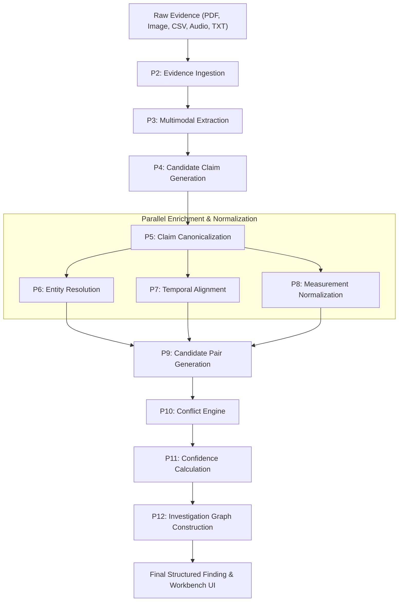
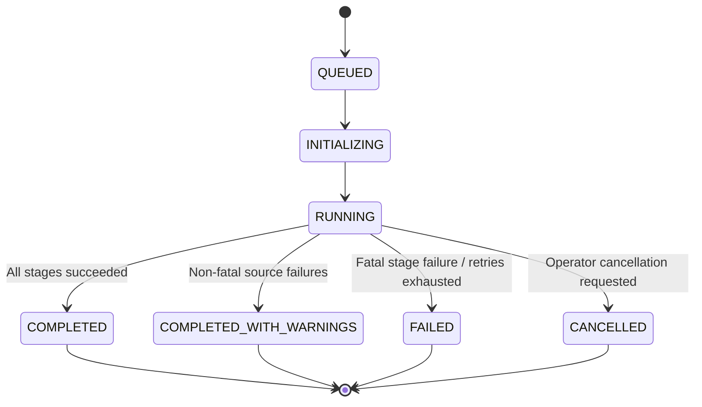
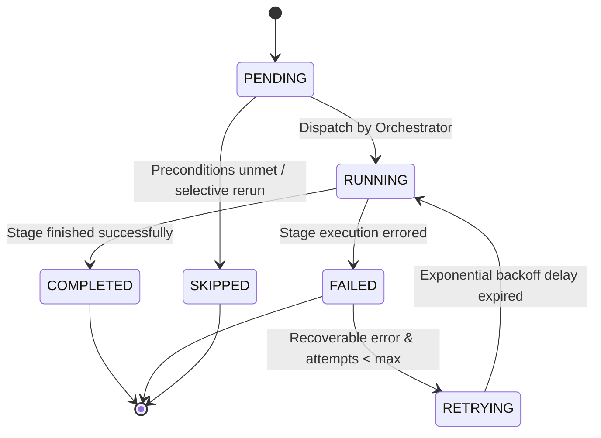
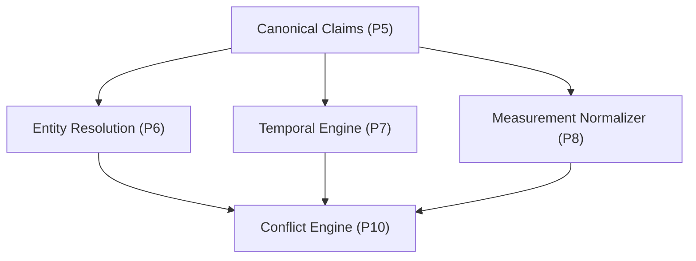
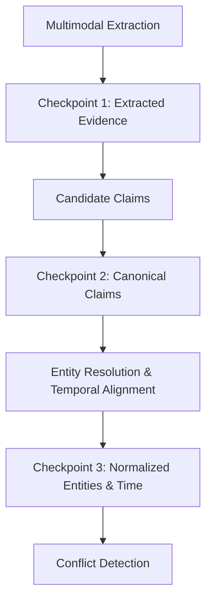
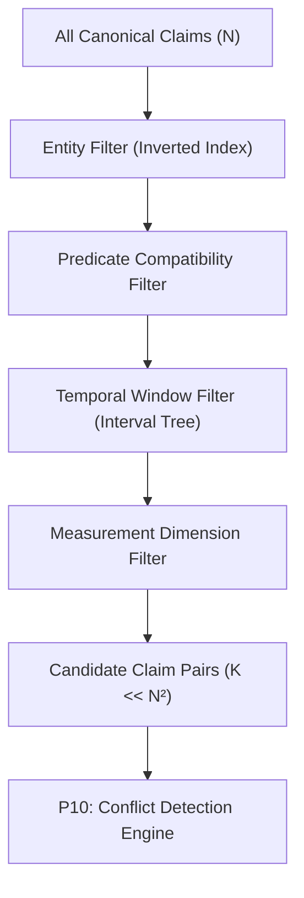
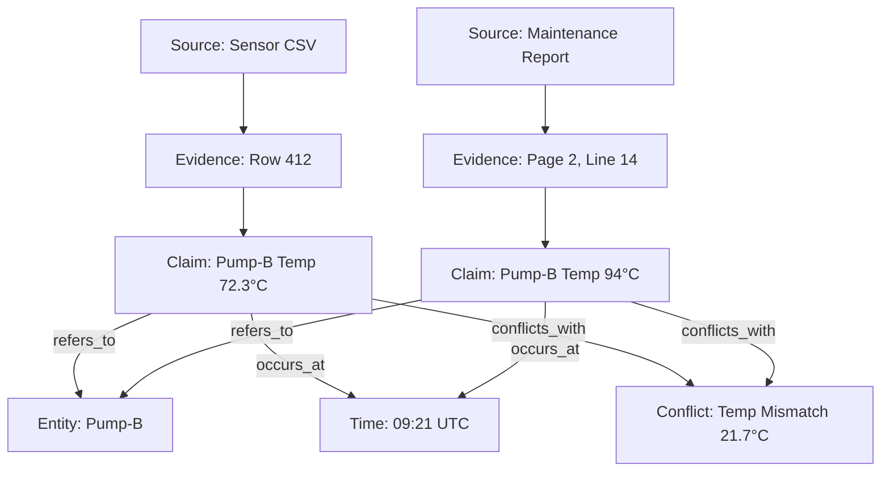
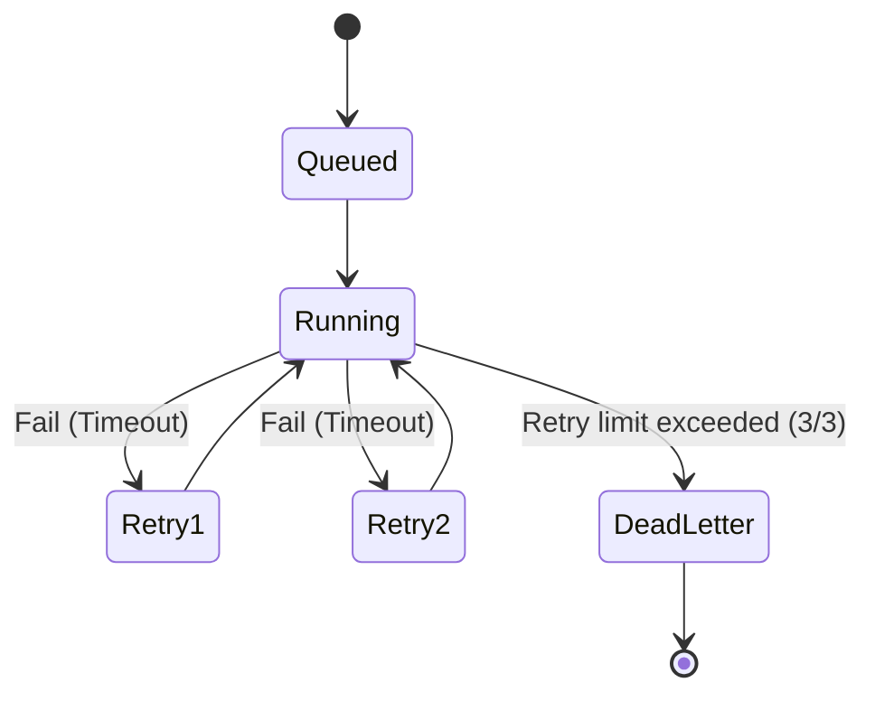
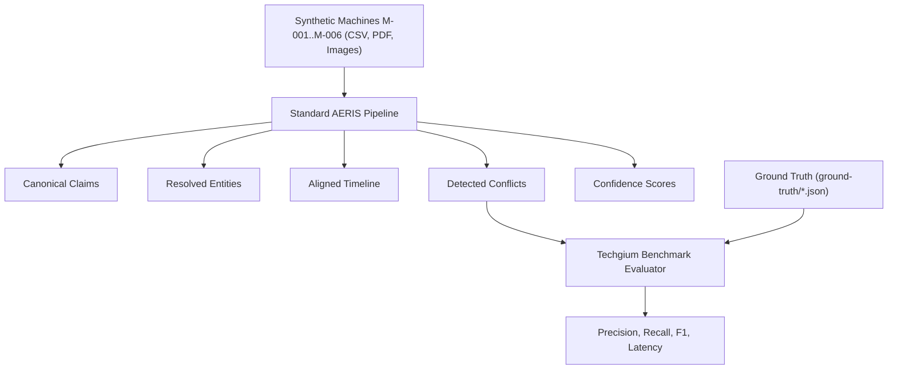
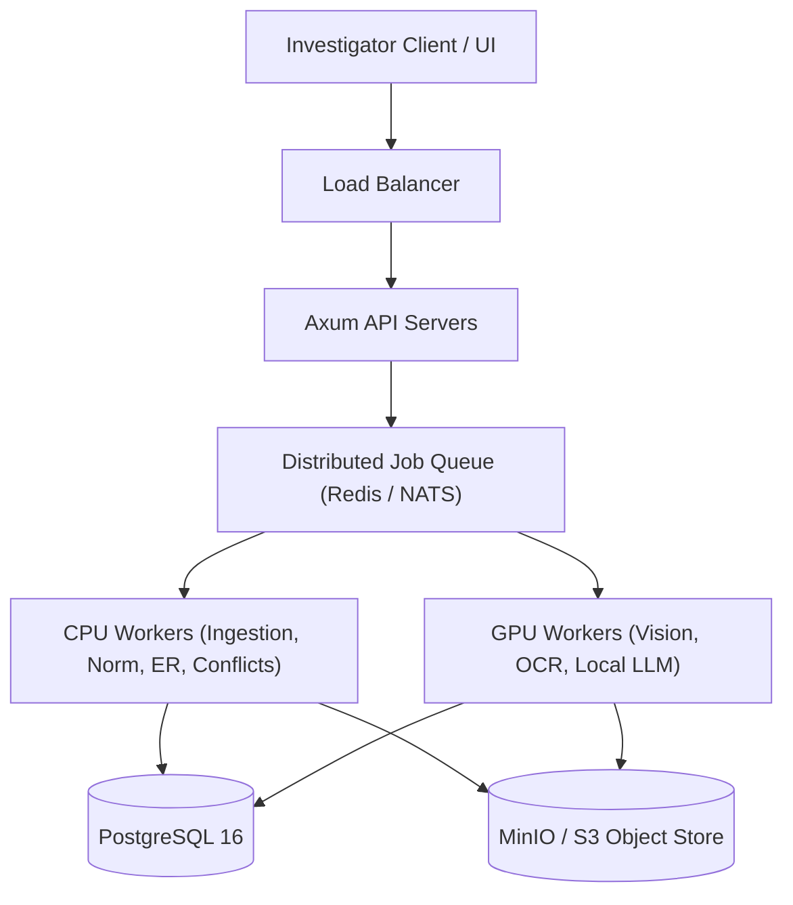

# 14 — Processing Pipeline and Orchestration

## 1. Purpose

The AERIS processing pipeline coordinates the complete transformation of raw multimodal evidence into structured, validated, and explainable findings.

The pipeline must ensure that:

* Every processing stage has a defined input and output.
* Processing stages execute in the correct dependency order.
* Failures are isolated.
* Partial results are preserved.
* Processing can be retried.
* Results are reproducible.
* Every output can be traced to its processing run and source evidence.

The central principle is:

> **AERIS should process evidence as a deterministic pipeline with controlled AI-assisted interpretation, not as an opaque chain of model calls.**

---

# 2. End-to-End Pipeline



```text
                    RAW EVIDENCE
                         │
                         ▼
                ┌─────────────────┐
                │   INGESTION     │
                └────────┬────────┘
                         │
                         ▼
                ┌─────────────────┐
                │   EXTRACTION    │
                └────────┬────────┘
                         │
                         ▼
                ┌─────────────────┐
                │ CLAIM CANDIDATES│
                └────────┬────────┘
                         │
                         ▼
                ┌─────────────────┐
                │ CANONICAL CLAIMS│
                └────────┬────────┘
                         │
              ┌──────────┼──────────┐
              ▼          ▼          ▼
          ENTITY       TIME      MEASUREMENT
        RESOLUTION   ALIGNMENT   NORMALIZATION
              │          │          │
              └──────────┼──────────┘
                         ▼
                ┌─────────────────┐
                │  CLAIM PAIRING  │
                └────────┬────────┘
                         │
                         ▼
                ┌─────────────────┐
                │ CONFLICT ENGINE │
                └────────┬────────┘
                         │
                         ▼
                ┌─────────────────┐
                │ CONFIDENCE      │
                │ CALCULATION     │
                └────────┬────────┘
                         │
                         ▼
                ┌─────────────────┐
                │ INVESTIGATION   │
                │      GRAPH      │
                └────────┬────────┘
                         │
                         ▼
                   FINAL RESULT
```

---

# 3. Pipeline Stages

The initial pipeline consists of 15 sequential and branchable stages:

```text
P0  Case Initialization
P1  Source Registration
P2  Evidence Ingestion
P3  Multimodal Extraction
P4  Candidate Claim Generation
P5  Claim Canonicalization
P6  Entity Resolution
P7  Temporal Alignment
P8  Measurement Normalization
P9  Candidate Pair Generation
P10 Conflict Detection
P11 Confidence Calculation
P12 Investigation Graph Construction
P13 Evaluation
P14 Processing Completion
```

Not every stage must execute for every source modality.

For example, image evidence:

```text
image
  → ingestion
  → vision extraction
  → claim generation
```

while structured telemetry:

```text
CSV
  → ingestion
  → schema parsing
  → time-series extraction
  → claim generation
```

---

# 4. Pipeline Orchestrator

The orchestrator controls stage discovery, dependency resolution, execution dispatch, concurrency management, and lifecycle events.

Recommended Rust abstraction:

```rust
pub struct PipelineOrchestrator {
    stages: Vec<Box<dyn PipelineStage>>,
    state_store: PipelineStateStore,
    event_bus: EventBus,
}
```

Each stage implements:

```rust
use async_trait::async_trait;

#[async_trait]
pub trait PipelineStage: Send + Sync {
    async fn execute(
        &self,
        context: &PipelineContext,
    ) -> Result<StageResult, PipelineError>;

    fn name(&self) -> &'static str;
}
```

---

# 5. Pipeline Context

Every stage receives a shared, immutable-by-reference processing context.

```rust
use chrono::{DateTime, Utc};
use serde::{Deserialize, Serialize};

#[derive(Debug, Clone, Serialize, Deserialize)]
pub struct PipelineContext {
    pub case_id: CaseId,
    pub run_id: ProcessingRunId,
    pub configuration: PipelineConfiguration,
    pub software_version: String,
    pub model_versions: Vec<ModelVersion>,
}
```

> [!IMPORTANT]
> The context must not contain arbitrary mutable global state. Stage outputs must be persisted explicitly to storage or emitted as structured events.

---

# 6. Processing Run

Every complete pipeline execution receives a unique `ProcessingRun`.

```rust
#[derive(Debug, Clone, Serialize, Deserialize)]
pub struct ProcessingRun {
    pub id: ProcessingRunId,
    pub case_id: CaseId,
    pub mode: ProcessingMode,
    pub status: ProcessingStatus,

    pub software_version: String,
    pub configuration_version: String,

    pub started_at: Option<DateTime<Utc>>,
    pub completed_at: Option<DateTime<Utc>>,

    pub model_versions: Vec<ModelVersion>,
}
```

This makes every single result, inference, and conflict traceable to a specific execution environment and snapshot.

---

# 7. Run Lifecycle



```text
QUEUED
  ↓
INITIALIZING
  ↓
RUNNING
  ↓
COMPLETED
```

Failure:
```text
RUNNING
   ↓
FAILED
```

Partial completion:
```text
RUNNING
   ↓
COMPLETED_WITH_WARNINGS
```

Explicit cancellation:
```text
RUNNING
   ↓
CANCELLED
```

---

# 8. Stage Lifecycle

Each individual stage follows a controlled state progression:



```text
PENDING
   ↓
RUNNING
   ↓
COMPLETED
```

Failure:
```text
RUNNING
   ↓
FAILED
```

Retry:
```text
FAILED
   ↓
RETRYING
   ↓
RUNNING
```

Stage status enumeration:

```rust
#[derive(Debug, Clone, Copy, PartialEq, Eq, Serialize, Deserialize)]
pub enum StageStatus {
    Pending,
    Running,
    Completed,
    Failed,
    Retrying,
    Skipped,
}
```

---

# 9. Stage Record

```rust
#[derive(Debug, Clone, Serialize, Deserialize)]
pub struct ProcessingStageRecord {
    pub id: StageRunId,
    pub run_id: ProcessingRunId,
    pub stage_name: String,
    pub status: StageStatus,

    pub started_at: Option<DateTime<Utc>>,
    pub completed_at: Option<DateTime<Utc>>,

    pub input_count: u64,
    pub output_count: u64,

    pub warnings: Vec<ProcessingWarning>,
    pub error: Option<ProcessingError>,
}
```

This allows the UI and API to display exactly where processing succeeded, degraded, or failed.

---

# 10. Stage Dependencies

Certain stages require previous stages to finish:

```text
Extraction
    ↓
Claims
    ↓
Entity Resolution
    ↓
Temporal Alignment
    ↓
Conflict Detection
```

However, entity, temporal, and measurement processing execute concurrently after canonical claims exist:



```text
                 Canonical Claims
                       │
          ┌────────────┼────────────┐
          ▼            ▼            ▼
       Entity        Temporal    Measurement
      Resolution     Engine      Normalizer
          │            │            │
          └────────────┼────────────┘
                       ▼
                 Conflict Engine
```

This fork-join pattern substantially reduces total processing latency.

---

# 11. Dependency Graph

The orchestrator represents dependencies explicitly as a directed acyclic graph (DAG):

```rust
#[derive(Debug, Clone, Serialize, Deserialize)]
pub struct StageDefinition {
    pub name: String,
    pub dependencies: Vec<String>,
}
```

Configuration dependency chain:

```text
ingestion
  → extraction
  → claims
  → entity_resolution
  → temporal_alignment
  → normalization
  → conflict_detection
  → confidence
  → graph
```

---

# 12. Parallel Execution

Independent stages execute concurrently within Tokio task scopes:

```rust
// Parallel execution of independent enrichment stages
let (entity_res, temporal_res, norm_res) = tokio::join!(
    entity_resolution_stage.execute(&context),
    temporal_alignment_stage.execute(&context),
    measurement_normalization_stage.execute(&context),
);
```

The actual runtime implementation must enforce global and per-pool resource limits.

> [!WARNING]
> Unlimited concurrency is not an architecture. It is a particularly creative way to turn a server into a space heater.

---

# 13. Concurrency Limits

Processing concurrency is strictly bounded via configuration:

```toml
[processing]
max_cases = 4
max_extraction_workers = 4
max_vision_workers = 2
max_reasoning_workers = 4
```

GPU-intensive stages (vision OCR, local LLM claim extraction) use separate, dedicated semaphores and worker queues from CPU-bound and I/O-bound workers.

---

# 14. Resource-Aware Scheduling

The orchestrator distinguishes between distinct resource profiles:

```text
CPU stages
GPU stages
I/O stages
Database stages
External model stages
```

Workload allocation breakdown:

```text
CSV parsing       → CPU
PDF parsing       → CPU / I/O
Vision extraction → GPU
Embedding         → GPU
Entity matching   → CPU
Database writes   → I/O
Conflict engine   → CPU
```

This prevents GPU workloads from stalling database writes, and prevents large PDF I/O streams from starving deterministic reasoning algorithms.

---

# 15. Stage Input Contracts

Each stage declares what artifacts it consumes and produces:

```rust
pub trait PipelineStage: Send + Sync {
    fn required_inputs(&self) -> Vec<DataArtifact>;
    fn produced_outputs(&self) -> Vec<DataArtifact>;
}
```

Example contract for Entity Resolution:

```text
EntityResolutionStage

Inputs:
- CandidateClaims
- EntityRegistry

Outputs:
- EntityLinks
- EntityRecords
```

---

# 16. Stage Output Artifacts

Outputs are persisted as first-class domain artifacts rather than ephemeral in-memory objects:

```text
EvidenceRecord
CandidateClaim
ClaimRecord
EntityRecord
EntityLink
TemporalRelationship
MeasurementValue
ClaimComparison
ConflictRecord
ConfidenceRecord
```

A stage must never rely solely on transient memory objects. Persisting domain artifacts guarantees replayability, auditability, and step-by-step debugging.

---

# 17. Checkpointing

Long-running or multi-modal processing supports persistent checkpoints:



```text
Extraction
   ↓
checkpoint
   ↓
Claims
   ↓
checkpoint
   ↓
Entity Resolution
   ↓
checkpoint
```

If conflict detection or confidence calibration fails or requires configuration adjustments, the system never repeats expensive OCR, vision extraction, or document parsing.

---

# 18. Checkpoint Model

```rust
#[derive(Debug, Clone, Serialize, Deserialize)]
pub struct PipelineCheckpoint {
    pub run_id: ProcessingRunId,
    pub stage: String,
    pub artifact_ids: Vec<String>,
    pub created_at: DateTime<Utc>,
    pub checksum: String,
}
```

---

# 19. Retry Policy

Retries only occur for transient, recoverable errors:

### Recoverable Errors
```text
database timeout
temporary model service failure
network timeout
temporary worker failure
rate limit / 429 backpressure
```

### Non-Recoverable Errors
```text
invalid PDF
unsupported file type
corrupted source archive
invalid JSON/CSV schema
malformed pipeline configuration
```

---

# 20. Retry Configuration

Example retry configuration:

```toml
[retry]
max_attempts = 3
initial_delay_ms = 500
max_delay_ms = 10000
backoff = "exponential"
```

Conceptual backoff sequence:

```text
Attempt 1: failure → wait 500ms
Attempt 2: failure → wait 1000ms
Attempt 3: failure → wait 2000ms
Attempt 4: failure → wait 4000ms
...capped at max_delay_ms (10000ms)
```

---

# 21. Idempotent Stages

Every pipeline stage is designed to be idempotent:

$$\text{Input} + \text{Configuration} + \text{Model Version} \implies \text{Equivalent Output}$$

Given the same input artifacts, configuration parameters, and model versions, the stage produces equivalent, deterministic output.

This is strictly enforced for:
* Ingestion
* Measurement normalization
* Entity resolution
* Conflict detection

---

# 22. Deterministic Processing

AERIS minimizes non-determinism across all reasoning-critical subsystems:

Deterministic components include:
```text
unit conversion
timestamp normalization
temporal overlap calculations
tolerance boundary comparisons
conflict classification
benchmark scoring against ground truth
```

AI-assisted extraction may have stochastic variance, but its raw output, temperature, seed, and prompt snapshot are persisted permanently before any deterministic stage executes.

---

# 23. AI Provider Boundary

AI models are accessed exclusively through a decoupled provider abstraction:

```rust
use async_trait::async_trait;

#[async_trait]
pub trait AIProvider: Send + Sync {
    async fn extract_claims(
        &self,
        input: ExtractionInput,
    ) -> Result<ExtractionOutput, AIError>;

    async fn analyze_image(
        &self,
        input: ImageInput,
    ) -> Result<VisionOutput, AIError>;
}
```

Available provider implementations:
```text
OllamaProvider       (Local Ollama instance)
ExternalLLMProvider  (Cloud API provider)
VisionProvider       (Dedicated vision service)
MockProvider         (Deterministic unit/integration test mock)
```

---

# 24. AI Model Version Tracking

Every AI-generated inference or candidate claim records its exact execution provenance:

```text
provider
model
model_version
prompt_version
temperature
configuration
timestamp
```

Example JSON provenance snippet:

```json
{
  "provider": "ollama",
  "model": "local-vision-model",
  "model_version": "v1.4.2",
  "prompt_version": "claim-extraction-v3",
  "temperature": 0.0,
  "top_p": 1.0,
  "timestamp": "2026-09-30T09:21:05Z"
}
```

---

# 25. Prompt Versioning

Prompts used for claim extraction and OCR interpretation are versioned artifacts maintained under source control:

```text
prompts/
├── claim-extraction-v1.txt
├── claim-extraction-v2.txt
├── claim-extraction-v3.txt
├── image-analysis-v1.txt
└── entity-candidate-v1.txt
```

A processing run must reference the exact prompt name and hash to guarantee forensic reproducibility.

---

# 26. Extraction Stage

The extraction stage converts raw multimodal evidence into structured observations:

**Inputs:**
```text
PDF
Image
CSV
JSON
TXT
```

**Outputs:**
```text
EvidenceRecord
EntityMention
TemporalMention
Measurement
CandidateClaim
```

---

# 27. Extraction Failure Handling

A failure on an individual source does not abort the entire case processing run:

```text
Source A → success
Source B → success
Source C → failed (e.g. unreadable image or corrupt PDF)
Source D → success
```

The case continues if sufficient evidence remains to build a coherent case timeline.

The overall processing run concludes with status:
```text
COMPLETED_WITH_WARNINGS
```
rather than falsely presenting a complete analysis or dropping the case entirely.

---

# 28. Candidate Claim Generation

Candidate claims are intermediate, unverified extractions:

```json
{
  "subject_text": "Pump-B",
  "predicate": "temperature",
  "value": 94,
  "unit": "C",
  "time": "09:21"
}
```

Candidate claims are not yet authoritative. They require:
* Entity resolution
* Temporal normalization
* Measurement normalization
* Schema validation

before becoming canonical claims.

---

# 29. Claim Canonicalization

The canonicalization stage converts candidate observations into formal `ClaimRecord` instances:

```text
"Pump B temperature is 94 C"
```

becomes the canonical representation:

```text
subject = ENT-M002
predicate = temperature
object = 94°C
time = 2026-09-30T09:21:00Z
claim_type = Extracted
```

---

# 30. Entity Resolution Stage

The entity resolution pipeline executes the following sequence:

1. Extracts entity surface references.
2. Normalizes identifiers (removes punctuation, lowercases, standardizes prefixes).
3. Generates candidate matches from the known entity registry.
4. Scores candidates across multiple deterministic and topological signals.
5. Resolves high-confidence deterministic matches.
6. Preserves explicit ambiguity if multiple candidates exceed threshold.
7. Records full provenance and match scoring.

**Output:**
```text
EntityLink
EntityRecord
```

---

# 31. Temporal Stage

The temporal engine processes:

1. Time expression parsing (ISO 8601, log timestamps, conversational text).
2. Timezone normalization.
3. Timestamp conversion to canonical UTC.
4. Precision interval assignment (e.g. minute, millisecond, day).
5. Temporal context creation.
6. Overlap and Allen interval relation detection.
7. Temporal distance calculation.
8. Telemetry sampling gap detection.

**Output:**
```text
TemporalContext
TemporalRelationship
```

---

# 32. Measurement Stage

The normalization engine operates as follows:

1. Identifies measurement dimensions (temperature, pressure, vibration, flow).
2. Validates units against the dimension registry.
3. Converts values to canonical base units (e.g. Celsius, kPa, mm/s).
4. Preserves raw original values and source strings.
5. Applies precision and rounding rules.
6. Records measurement tolerance and instrument uncertainty.
7. Stores conversion provenance.

```text
158°F
   ↓ [Conversion: (°F - 32) * 5/9]
70°C
```

The raw string `"158°F"` remains permanently available in the claim's provenance metadata.

---

# 33. Candidate Pair Generation

The conflict engine must never compare every claim against every other claim ($O(N^2)$ explosion).

```text
Naive approach:
N claims → N² comparisons
For 10,000 claims: 100,000,000 comparisons (computationally intractable)
```

Instead, candidate pairs are generated using indexed filters:
* Same canonical entity ID
* Same or comparable predicate
* Compatible or overlapping temporal window
* Compatible physical measurement dimension

---

# 34. Candidate Pair Pipeline



```text
All Claims
    ↓
Entity Filter
    ↓
Predicate Filter
    ↓
Temporal Filter
    ↓
Measurement Compatibility
    ↓
Candidate Claim Pairs
```

Only surviving candidate pairs enter the conflict classification engine.

---

# 35. Conflict Detection

Each candidate pair is evaluated by the deterministic rule engine and classified into one of five mutually exclusive states:

* **`Agreement`**: Observations are within defined tolerance bounds.
* **`Conflict`**: Observations contradict each other beyond allowed tolerance.
* **`Ambiguous`**: Entity or temporal alignment cannot be established with certainty.
* **`InsufficientEvidence`**: Crucial context or time intervals are missing.
* **`NotComparable`**: Different measurement dimensions or non-overlapping contexts.

---

# 36. Example Conflict

```text
Claim A:
Pump-B
temperature = 94°C
time = 09:21

Claim B:
Pump-B
temperature = 72.3°C
time = 09:21
```

Evaluation sequence:
```text
Same entity (ENT-M002)
      ↓
Same predicate (temperature)
      ↓
Temporal overlap (09:21 UTC == 09:21 UTC)
      ↓
Same measurement dimension (Temperature: °C)
      ↓
|94.0 - 72.3| = 21.7°C > 2.0°C tolerance
      ↓
CONFLICT
```

---

# 37. Example Agreement After Normalization

```text
Claim A:
70°C

Claim B:
158°F
```

Normalization and comparison:
```text
158°F → 70°C canonical
      ↓
|70.0 - 70.0| = 0.0°C <= 2.0°C tolerance
      ↓
AGREEMENT
```

---

# 38. Example Ambiguity

```text
Source A → Control Valve "CV-E"
Source B → Control Valve "CV-E2"
```

If the entity registry or evidence context cannot determine whether `CV-E == CV-E2` or if they are separate control valves:

```text
AMBIGUOUS
```

AERIS preserves the ambiguity. It never silently guesses or merges unresolved entities.

---

# 39. Example Insufficient Evidence

Expected telemetry sampling rate: 1 sample per minute.

```text
09:24: 45 kPa
09:25: 46 kPa
        ← gap (09:26 - 09:29 missing)
09:30: 89 kPa
```

The system classifies the unmonitored interval as missing evidence. It never interpolates or hallucinates observations that were never recorded.

---

# 40. Confidence Stage

Confidence calculation executes after structural relationships are established.

Contributing factors:
* Extraction confidence (OCR / LLM probability)
* Entity resolution confidence (signal match score)
* Temporal confidence (precision and alignment clarity)
* Measurement normalization confidence (unit certainty)
* Source quality rating (e.g. calibrated sensor vs. handwritten note)
* Relationship confidence

The resulting `ConfidenceRecord` preserves all contributing factor weights.

---

# 41. Confidence Propagation

AERIS adopts a weakest-link conservative propagation model:

$$\text{Final Confidence} = \min(\text{Entity}, \text{Temporal}, \text{Measurement}, \text{Extraction}) \times \text{Source Quality Penalty}$$

Example:

```text
Entity confidence:       0.98
Temporal confidence:     0.95
Measurement confidence:  0.99
Extraction confidence:   0.91

Final Confidence: 0.91
```

---

# 42. Investigation Graph

The investigation graph integrates all processed artifacts into a navigable semantic network:

**Nodes:**
* `Source`
* `Evidence`
* `Entity`
* `Event`
* `Claim`
* `Measurement`
* `Conflict`
* `Review`

**Edges:**
* `supports`
* `derived_from`
* `refers_to`
* `occurs_at`
* `conflicts_with`
* `agrees_with`
* `ambiguous_with`
* `reviewed_by`

---

# 43. Graph Construction



```text
Sensor CSV
    │
    └── Evidence
          │
          └── Claim
                │
                ├── refers_to → Pump-B
                │
                ├── occurs_at → 09:21
                │
                └── conflicts_with
                         │
                         ▼
                    Report Claim
```

This graph serves as the foundation for the visual investigation UI and proof cards.

---

# 44. Processing Event Stream

Stages broadcast lifecycle events over the system event bus (and SSE streams to the UI):

* `StageStarted`
* `StageProgress`
* `StageWarning`
* `StageCompleted`
* `StageFailed`

Example event payload:

```json
{
  "event": "StageCompleted",
  "run_id": "RUN-001",
  "stage": "entity_resolution",
  "output_count": 8,
  "duration_ms": 342
}
```

---

# 45. Event Persistence

All processing events are stored in an append-only PostgreSQL event log table:

Benefits:
* Real-time progress updates via Server-Sent Events (SSE)
* Forensic auditability of system behavior
* Root-cause failure analysis
* Processing step replayability and debugging
* Performance bottleneck profiling

---

# 46. Processing Warnings

Warnings are surfaced directly in the case report and stage record:

```json
{
  "code": "MISSING_TELEMETRY",
  "stage": "temporal_alignment",
  "message": "Telemetry gap detected between 09:25 and 09:29 UTC.",
  "source_id": "SRC-001",
  "entity_id": "ENT-M002"
}
```

---

# 47. Partial Results

If a downstream stage fails, all prior stage outputs are safely retained:

```text
Extraction            ✓ (Preserved)
Entity Resolution     ✓ (Preserved)
Temporal Alignment    ✓ (Preserved)
Measurement Normalizer✓ (Preserved)
Conflict Detection    ✗ (Failed)
```

The system preserves claims, entities, temporal relations, and normalized measurements. The UI reports:

```text
Analysis incomplete
Conflict detection failed
Previous stage results preserved
```

---

# 48. Failure Isolation

Corrupt evidence in one machine or file does not abort the entire benchmark run:

```text
M-001 → success
M-002 → success
M-003 → success
M-004 → extraction warning (unreadable OCR page)
M-005 → success
M-006 → success
```

The pipeline isolates the issue, flags M-004 with a warning, and completes the benchmark for all valid sources.

---

# 49. Dead-Letter Handling

Jobs that exceed retry limits are transitioned to a permanent failed state:



```text
Queued
  ↓
Running
  ↓
Retry 1
  ↓
Retry 2
  ↓
Retry 3
  ↓
Dead / Failed
```

The exact error stack trace, input parameters, and attempted worker ID are permanently preserved.

---

# 50. Cancellation

Processing runs support non-destructive, cooperative cancellation:

```http
POST /api/v1/cases/{case_id}/processing/{run_id}/cancel
```

Cancellation sequence:
1. Mark the run status as `Cancelling`.
2. Stop dispatching queued stages.
3. Signal active Tokio tasks via `tokio_util::sync::CancellationToken`.
4. Allow running database transactions to commit or roll back cleanly.
5. Persist partial stage artifacts generated up to the cancellation point.
6. Set the run status to `Cancelled`.

---

# 51. Reprocessing

A case supports multiple re-runs with different settings:

```text
Original Run:
RUN-001 (Version v1, Temperature Tolerance 2.0°C)

Updated Configuration:
RUN-002 (Version v1, Temperature Tolerance 1.0°C)
```

> [!IMPORTANT]
> The original run results (`RUN-001`) are never overwritten. Both runs exist concurrently with distinct run IDs, allowing side-by-side comparison of results.

---

# 52. Selective Reprocessing

AERIS supports stage-selective invalidation and re-execution:

```text
New Entity Registry / Alias Added
       ↓
Re-run P6: Entity Resolution
       ↓
Re-run P7: Temporal Alignment
       ↓
Re-run P10: Conflict Detection
```

There is no reason to re-run expensive OCR on a 50-page PDF document simply because an entity alias was updated.

---

# 53. Configuration Snapshot

Each processing run serializes an immutable snapshot of its effective runtime configuration:

```json
{
  "entity_candidate_threshold": 0.70,
  "entity_resolution_threshold": 0.90,
  "temperature_tolerance_c": 2.0,
  "pressure_tolerance_kpa": 5.0,
  "temporal_window_seconds": 120,
  "confidence_policy": "critical-min"
}
```

This guarantees that benchmark results can be reproduced bit-for-bit months later.

---

# 54. Pipeline Configuration

Recommended configuration format (`aeris.toml`):

```toml
[pipeline]
version = "v1"

[entity_resolution]
candidate_threshold = 0.70
resolution_threshold = 0.90

[temporal]
default_window_seconds = 120

[measurement]
temperature_tolerance_c = 2.0
pressure_tolerance_kpa = 5.0

[confidence]
policy = "critical-min"
```

---

# 55. Deterministic Benchmark Mode

AERIS provides an evaluation mode:

```bash
export AERIS_BENCHMARK=true
```

Benchmark mode enforces:
* Fixed configuration snapshot
* Pinned model versions and seeds
* Disabled random sampling (`temperature = 0.0`)
* Fixed synthetic dataset ingestion
* Separate storage for ground truth
* Generation of machine-readable metrics (JSON / CSV)

---

# 56. Synthetic Dataset Integration

The six-machine benchmark dataset (M-001 through M-006) executes through the standard production pipeline:



```text
M-001 .. M-006
   ↓
AERIS Pipeline
   ↓
Claims, Entities, Timeline, Measurements, Conflicts, Confidence
   ↓
Evaluation
```

No benchmark-specific shortcuts or hardcoded rules are permitted in the core engine.

---

# 57. Ground Truth Separation

Ground truth must never be loaded into or accessible by the reasoning pipeline:

```text
Correct Separation:
Dataset
 ├── evidence/      ──► AERIS Pipeline ──► Predicted Conflicts ┐
 └── ground-truth/  ──────────────────────────────────────────► Evaluator ──► F1 Score

Incorrect (Prohibited):
Ground Truth ──► Reasoning Pipeline (Data Leakage)
```

The evaluator compares predictions against ground truth only after the processing pipeline terminates.

---

# 58. Pipeline Observability

The orchestrator captures comprehensive telemetry per stage:

```text
stage duration (wall clock)
CPU user/system time
peak memory usage (RSS)
GPU compute time & VRAM
input artifact count
output artifact count
warning count
error count
retry count
```

Example stage metrics record:

```json
{
  "stage": "conflict_detection",
  "duration_ms": 428,
  "cpu_time_ms": 380,
  "peak_memory_mb": 42,
  "input_pairs": 182,
  "conflicts": 7,
  "agreements": 132,
  "ambiguous": 14,
  "insufficient_evidence": 29
}
```

---

# 59. Performance Targets

Engineering latency targets for the six-machine synthetic benchmark:

| Stage / Operation | Latency Target | Resource Profile |
| :--- | :--- | :--- |
| **Case creation** | < 100 ms | Database I/O |
| **Source registration** | < 500 ms | File I/O + Hash |
| **CSV ingestion (10k rows)** | < 2.0 s | CPU / Polars |
| **Claim normalization** | < 2.0 s | CPU |
| **Entity resolution** | < 5.0 s | CPU |
| **Temporal alignment** | < 5.0 s | CPU |
| **Conflict detection** | < 5.0 s | CPU |
| **Full benchmark suite** | < practical demo duration | Mixed |

---

# 60. Memory Management

Large evidence files are never buffered entirely into RAM:

```text
Disk / S3
  ↓
Tokio AsyncRead Stream
  ↓
Chunked Processing (64 KB / 1000 rows)
  ↓
Pipeline Processing
  ↓
Persist to DB / Artifact Storage
```

Applies specifically to:
* Large CSV telemetry logs
* Audio / video recordings
* High-resolution maintenance photos
* Multi-page scanned engineering schematics

---

# 61. Backpressure

When extraction workers generate candidate claims faster than reasoning engines can consume them, bounded channels apply backpressure:

```text
Extraction Workers
       ↓
Bounded Tokio mpsc Channel (buffer: 1000)
       ↓
Reasoning Engines
```

If the channel reaches capacity, upstream extraction workers pause reading until downstream engines process the queue.

---

# 62. Queue Architecture

For initial development, an internal bounded Tokio queue (`tokio::sync::mpsc`) provides high throughput with zero external dependencies.

For distributed production deployment, the queue trait abstracts external message brokers:
```text
Tokio In-Memory Queue (Hackathon / Dev)
Redis Streams (Single-host production)
NATS / Kafka / RabbitMQ (Distributed enterprise)
```

Domain logic interacts only with the abstract `JobQueue` trait.

---

# 63. Local Development Mode

For local testing and hackathon judging, the entire system runs locally:

```text
Axum (HTTP REST API + SSE)
+
Tokio (Async Runtime)
+
PostgreSQL 16 (Local / Docker Compose)
+
Local Model Provider (Ollama / Mock)
```

A distributed cluster is not required to run the six-machine synthetic benchmark.

---

# 64. Production Deployment Mode

For high-throughput enterprise deployments:



```text
                  Load Balancer
                       │
                ┌──────▼──────┐
                │ API Servers │
                └──────┬──────┘
                       │
                     Queue
                       │
          ┌────────────┴────────────┐
          ▼                         ▼
     CPU Workers               GPU Workers
          │                         │
          └────────────┬────────────┘
                       ▼
                  PostgreSQL
```

---

# 65. Security Boundaries

Pipeline workers treat all evidence sources as untrusted input:

Risky operations:
* PDF parsing (sandboxed parsers)
* Image decoding (bounded resolution and memory allocations)
* Archive extraction (zip-slip protection, directory traversal checks)
* External AI calls (timeout protection, payload bounds)

Security constraints:
* No arbitrary file system write paths outside designated scratch directories
* Path traversal sanitization on all uploaded filenames
* Strict file size and parsing execution time limits

---

# 66. Pipeline Audit Trail

Every stage execution writes an immutable audit record:

```text
who / what initiated run
run ID
stage name
configuration snapshot hash
model & prompt version
input artifact counts and IDs
output artifact counts and IDs
stage status
start & completion timestamps
warnings & errors
```

This guarantees forensic accountability for every decision reached by AERIS.

---

# 67. Recommended Rust Module Structure

```text
crates/
├── orchestration/
│   ├── Cargo.toml
│   ├── src/
│   │   ├── lib.rs
│   │   ├── orchestrator.rs
│   │   ├── stage.rs
│   │   ├── context.rs
│   │   ├── checkpoint.rs
│   │   ├── retry.rs
│   │   ├── events.rs
│   │   └── scheduler.rs
│
├── ingestion/
├── extraction/
├── entity-resolution/
├── temporal-engine/
├── normalization/
├── conflict-engine/
├── confidence-engine/
└── reasoning/
```

---

# 68. Core Pipeline Interface

Recommended initial trait definition:

```rust
use async_trait::async_trait;

#[async_trait]
pub trait PipelineStage: Send + Sync {
    fn name(&self) -> &'static str;

    fn dependencies(&self) -> &'static [&'static str];

    async fn execute(
        &self,
        context: &PipelineContext,
    ) -> Result<StageResult, PipelineError>;
}
```

---

# 69. Processing Flow Example (M-002)

Step-by-step trace of how machine M-002 is processed:

```text
maintenance_report.txt
        │
        ▼
     ingestion
        │
        ▼
     extraction
        │
        ▼
temperature = 94°C
        │
        ▼
entity resolution
        │
        ▼
ENT-M002
        │
        ▼
temporal alignment
        │
        ▼
09:21 UTC
        │
        ▼
measurement normalization
        │
        ▼
94°C
        │
        ▼
claim pairing
        │
        ▼
sensor claim = 72.3°C
        │
        ▼
conflict engine
        │
        ▼
CONFLICT
        │
        ▼
confidence engine
        │
        ▼
investigation graph
```

---

# 70. Processing Invariants

### Invariant 1
Every processing result belongs to a processing run.

### Invariant 2
Every stage has an explicit status.

### Invariant 3
Stage dependencies are explicit.

### Invariant 4
Failed stages do not silently produce successful results.

### Invariant 5
Partial results are preserved.

### Invariant 6
Retries do not create duplicate canonical records.

### Invariant 7
AI-generated results record model and prompt versions.

### Invariant 8
Original evidence remains immutable.

### Invariant 9
Ground truth is never available to the reasoning engine.

### Invariant 10
Processing configuration is versioned.

### Invariant 11
Long-running work is asynchronous.

### Invariant 12
Reasoning-critical relationships remain deterministic wherever possible.

---

# 71. Acceptance Criteria

The orchestration layer is complete when:

* [ ] A processing run can be created.
* [ ] Pipeline stages execute in dependency order.
* [ ] Independent stages can execute concurrently.
* [ ] Stage state is persisted.
* [ ] Processing progress is observable.
* [ ] Failures are isolated.
* [ ] Recoverable failures are retried.
* [ ] Non-recoverable failures terminate the relevant stage.
* [ ] Partial results survive failures.
* [ ] Checkpoints are supported.
* [ ] Processing can be cancelled.
* [ ] Processing can be re-run.
* [ ] Processing configuration is versioned.
* [ ] AI model versions are recorded.
* [ ] Prompt versions are recorded.
* [ ] Processing events are persisted.
* [ ] Ground truth remains isolated.
* [ ] Benchmark mode is deterministic.
* [ ] Pipeline metrics are collected.
* [ ] Large inputs are processed safely.
* [ ] Backpressure exists for asynchronous work.
* [ ] The synthetic benchmark runs through the normal pipeline.

---

# 72. Final Principle

AERIS should behave like an evidence-processing system, not a mysterious box that occasionally emits the word `conflict`.

The orchestration layer provides the discipline required to make the rest of the architecture trustworthy:

```text
Raw Evidence
     ↓
Controlled Processing
     ↓
Versioned Intermediate Results
     ↓
Deterministic Validation
     ↓
Traceable Findings
```

Every result must answer four fundamental questions:

```text
What was processed?
How was it processed?
Which version produced it?
What evidence supports it?
```

If AERIS can answer those four questions consistently, the system becomes reproducible, debuggable, auditable, and suitable for the Techgium evaluation environment.
