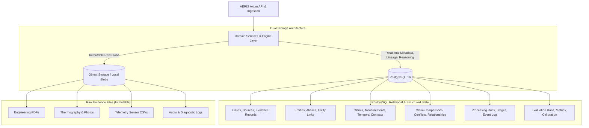
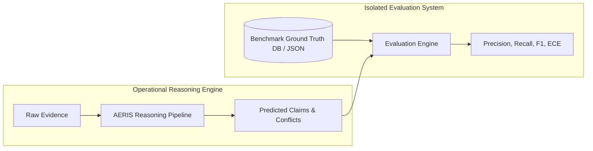
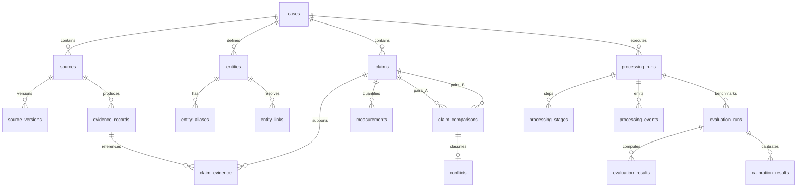
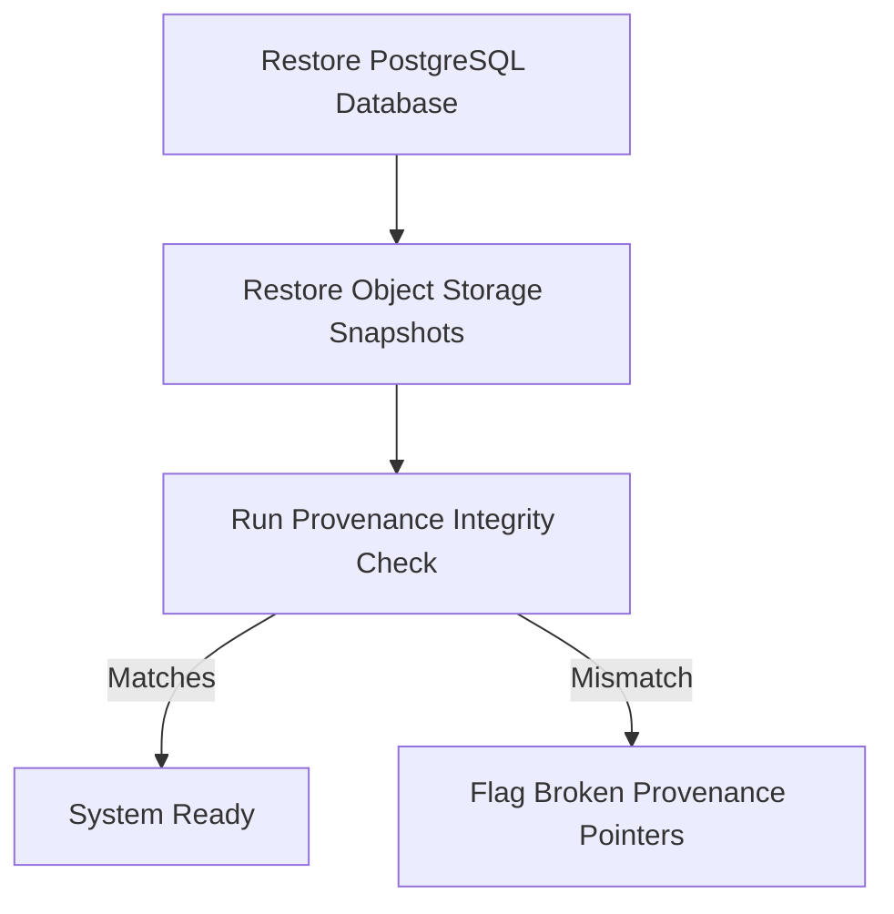
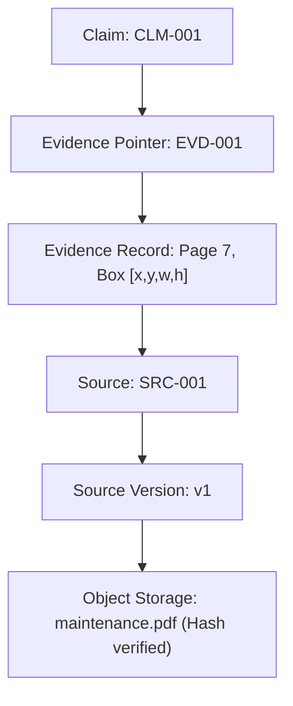
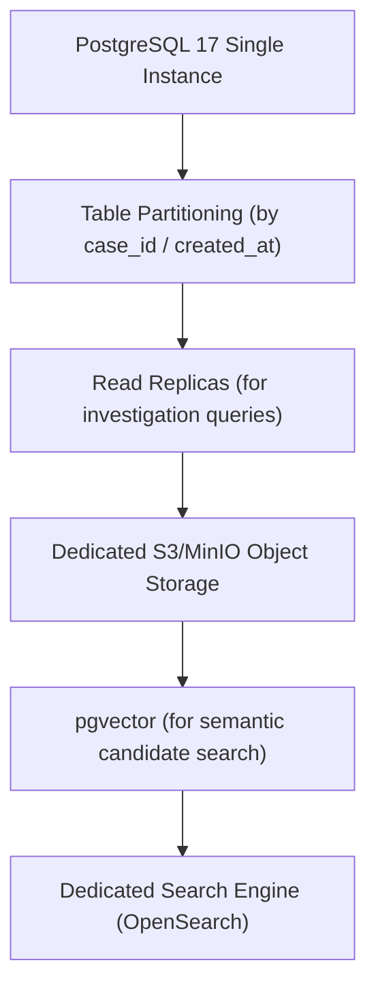

# 15 — Storage and Database Architecture

## 1. Purpose

The AERIS storage layer provides durable persistence for:

* Cases
* Evidence sources
* Evidence pointers
* Entities
* Entity links
* Events
* Claims
* Measurements
* Temporal relationships
* Claim comparisons
* Conflicts
* Confidence records
* Processing runs
* Processing stages
* Reviews
* Audit events
* Evaluation results

The storage architecture must preserve the central AERIS properties:

```text
Provenance
Traceability
Immutability
Versioning
Reproducibility
Queryability
```

The primary relational store is:

```text
PostgreSQL 16
```

Large binary evidence files are stored separately from relational metadata in object storage or local filesystem blobs.

---

# 2. Storage Architecture



```text
                    AERIS API
                        │
                        ▼
                ┌──────────────┐
                │ Domain Layer │
                └──────┬───────┘
                       │
             ┌─────────┴─────────┐
             ▼                   ▼
      PostgreSQL            Object Storage
             │                   │
             │                   ├── PDFs
             │                   ├── Images
             │                   ├── CSV
             │                   └── Raw Files
             │
             ├── Cases
             ├── Sources
             ├── Claims
             ├── Entities
             ├── Relationships
             ├── Conflicts
             ├── Processing
             └── Evaluation
```

PostgreSQL stores relational metadata, entities, claims, confidence scores, and structured reasoning state.

Object storage stores the original, byte-for-byte immutable evidence artifacts.

---

# 3. Storage Principles

## 3.1 Original evidence is immutable

Once a source is registered, its original content must never be silently modified or overwritten.

If a corrected or re-scanned file is uploaded, it is registered as a new source version with an updated checksum and unique identifier.

---

## 3.2 Derived data is versioned

Claims, entity links, temporal alignments, conflict results, and confidence records are derived artifacts.

Every derived record must retain:

```text
processing_run_id
software_version
configuration_version
model_version
```

where applicable.

---

## 3.3 Ground truth is isolated

Benchmark ground truth must never be mixed into operational reasoning tables.



```text
operational data
        │
        └── AERIS reasoning

ground truth
        │
        └── evaluation engine
```

---

# 4. PostgreSQL Schema Overview

The logical schema is organized into modular relational domains:

```text
cases
sources
source_versions
evidence_records

entities
entity_aliases
entity_links

events
claims
claim_evidence

measurements
temporal_contexts
temporal_relationships

claim_comparisons
conflicts
evidence_relationships

confidence_records

processing_runs
processing_models
processing_stages
processing_events

reviews
audit_events

evaluation_runs
evaluation_results
calibration_results
```

---

# 5. Cases Table

```sql
CREATE TABLE cases (
    id UUID PRIMARY KEY,
    case_key TEXT UNIQUE NOT NULL,
    name TEXT NOT NULL,
    description TEXT,
    status TEXT NOT NULL,
    created_at TIMESTAMPTZ NOT NULL,
    updated_at TIMESTAMPTZ NOT NULL
);
```

Example:

```text
case_key = CASE-047
name = Turbine Engine Anomaly
```

---

# 6. Case Status

Recommended domain values:

```text
created
ingesting
processing
investigation
completed
completed_with_warnings
failed
archived
```

The database enforces valid states at the application and domain boundary.

---

# 7. Sources Table

```sql
CREATE TABLE sources (
    id UUID PRIMARY KEY,
    case_id UUID NOT NULL REFERENCES cases(id) ON DELETE CASCADE,
    source_key TEXT NOT NULL,
    source_type TEXT NOT NULL,
    filename TEXT,
    mime_type TEXT,
    size_bytes BIGINT,
    checksum TEXT NOT NULL,
    status TEXT NOT NULL,
    created_at TIMESTAMPTZ NOT NULL,

    UNIQUE(case_id, source_key)
);
```

---

# 8. Source Types

```text
text
pdf
image
csv
json
table
timeseries
structured
```

Additional source types (e.g., audio, thermal_matrix) can be registered as domain plugins.

---

# 9. Source Versions

When evidence is updated, re-scanned, or corrected:

```sql
CREATE TABLE source_versions (
    id UUID PRIMARY KEY,
    source_id UUID NOT NULL REFERENCES sources(id) ON DELETE CASCADE,
    version_number INTEGER NOT NULL,
    object_location TEXT NOT NULL,
    checksum TEXT NOT NULL,
    created_at TIMESTAMPTZ NOT NULL,

    UNIQUE(source_id, version_number)
);
```

This ensures full historical reconstruction of earlier processing runs.

---

# 10. Object Storage

Original files are stored outside PostgreSQL in dedicated object storage (or local content-addressed directory):

Example logical storage path:

```text
cases/
  CASE-047/
    sources/
      SRC-001/
        v1/
          maintenance_report.pdf
```

The relational database stores:

```text
object_location
checksum
mime_type
size
```

rather than bloated binary BLOBs inside PostgreSQL tables.

---

# 11. Evidence Records

Evidence records identify specific, addressable sub-segments of a source:

```sql
CREATE TABLE evidence_records (
    id UUID PRIMARY KEY,
    source_id UUID NOT NULL REFERENCES sources(id) ON DELETE CASCADE,
    evidence_type TEXT NOT NULL,
    location JSONB NOT NULL,
    content_hash TEXT,
    created_at TIMESTAMPTZ NOT NULL
);
```

`location` represents the exact pointer:

```text
text span
PDF page + bounding box
image region / polygon
table row & column
timestamp / log line offset
structured JSON field path
```

---

# 12. Why JSONB Is Used

Provenance locations vary fundamentally across modalities:

Document span:
```json
{
  "page": 7,
  "char_start": 1832,
  "char_end": 1847
}
```

Telemetry timestamp:
```json
{
  "timestamp": "2026-09-30T09:21:00Z",
  "row_index": 412,
  "column": "vibration_rms"
}
```

A rigid relational schema across all modalities would force dozens of nullable columns.

Therefore:

```text
stable query identifiers → relational columns
modality-specific location coordinates → JSONB
```

---

# 13. Entities Table

```sql
CREATE TABLE entities (
    id UUID PRIMARY KEY,
    case_id UUID NOT NULL REFERENCES cases(id) ON DELETE CASCADE,
    entity_type TEXT NOT NULL,
    canonical_name TEXT NOT NULL,
    status TEXT NOT NULL,
    confidence_id UUID,
    created_at TIMESTAMPTZ NOT NULL,
    updated_at TIMESTAMPTZ NOT NULL
);
```

---

# 14. Entity Attributes

Flexible attributes use JSONB:

```sql
ALTER TABLE entities
ADD COLUMN attributes JSONB;
```

Example payload:

```json
{
  "manufacturer": "Example Corp",
  "model": "PX-200",
  "location": "Line-2",
  "rated_temp_max_c": 120.0
}
```

Frequently queried attributes (such as machine serial or site code) can receive generated columns or functional indexes.

---

# 15. Entity Aliases

```sql
CREATE TABLE entity_aliases (
    id UUID PRIMARY KEY,
    entity_id UUID NOT NULL REFERENCES entities(id) ON DELETE CASCADE,
    alias TEXT NOT NULL,
    normalized_alias TEXT NOT NULL,
    source_id UUID REFERENCES sources(id) ON DELETE SET NULL,
    created_at TIMESTAMPTZ NOT NULL
);
```

Example alias mappings:

```text
Pump-B
Pump B
P-002
PUMP-002
Unit 02 Secondary Pump
```

---

# 16. Entity Links

```sql
CREATE TABLE entity_links (
    id UUID PRIMARY KEY,
    source_id UUID NOT NULL REFERENCES sources(id) ON DELETE CASCADE,
    source_reference TEXT NOT NULL,
    normalized_reference TEXT NOT NULL,
    resolved_entity_id UUID REFERENCES entities(id) ON DELETE SET NULL,
    status TEXT NOT NULL,
    confidence_id UUID,
    resolver_version TEXT NOT NULL,
    created_at TIMESTAMPTZ NOT NULL
);
```

Ambiguous links remain representable with `status = 'ambiguous'` and `resolved_entity_id = NULL`.

---

# 17. Entity Candidates

Candidate scoring can be stored in JSONB during resolution:

```json
{
  "candidates": [
    {
      "entity_id": "ENT-M002",
      "score": 0.87,
      "signals": {"prefix": 1.0, "context": 0.85}
    },
    {
      "entity_id": "ENT-M005",
      "score": 0.82,
      "signals": {"prefix": 0.8, "context": 0.83}
    }
  ]
}
```

---

# 18. Events Table

```sql
CREATE TABLE events (
    id UUID PRIMARY KEY,
    case_id UUID NOT NULL REFERENCES cases(id) ON DELETE CASCADE,
    entity_id UUID REFERENCES entities(id) ON DELETE SET NULL,
    event_type TEXT NOT NULL,
    description TEXT,
    temporal_context JSONB,
    provenance JSONB,
    created_at TIMESTAMPTZ NOT NULL
);
```

---

# 19. Claims Table

Claims are central reasoning entities in AERIS:

```sql
CREATE TABLE claims (
    id UUID PRIMARY KEY,
    case_id UUID NOT NULL REFERENCES cases(id) ON DELETE CASCADE,
    subject_entity_id UUID REFERENCES entities(id) ON DELETE SET NULL,
    predicate TEXT NOT NULL,
    object JSONB NOT NULL,
    claim_type TEXT NOT NULL,
    status TEXT NOT NULL,
    temporal_context JSONB,
    confidence_id UUID,
    processing_run_id UUID NOT NULL,
    created_at TIMESTAMPTZ NOT NULL
);
```

---

# 20. Claim Object

The JSONB object encapsulates diverse claim payload structures:

```text
scalar
text
boolean
measurement
range
categorical value
structured value
```

Example measurement claim payload:

```json
{
  "type": "measurement",
  "value": 94.0,
  "unit": "degC"
}
```

---

# 21. Claim Provenance

Claim provenance is managed through a dedicated junction table:

```sql
CREATE TABLE claim_evidence (
    claim_id UUID NOT NULL REFERENCES claims(id) ON DELETE CASCADE,
    evidence_id UUID NOT NULL REFERENCES evidence_records(id) ON DELETE CASCADE,
    relationship TEXT NOT NULL,

    PRIMARY KEY(claim_id, evidence_id, relationship)
);
```

Relationship values:

```text
supports
derived_from
contradicts
context
```

---

# 22. Measurements

Measurements are normalized into relational records for high-speed numeric comparisons:

```sql
CREATE TABLE measurements (
    id UUID PRIMARY KEY,
    claim_id UUID REFERENCES claims(id) ON DELETE CASCADE,
    value DOUBLE PRECISION NOT NULL,
    unit TEXT NOT NULL,
    canonical_value DOUBLE PRECISION,
    canonical_unit TEXT,
    uncertainty DOUBLE PRECISION,
    tolerance DOUBLE PRECISION,
    created_at TIMESTAMPTZ NOT NULL
);
```

---

# 23. Temporal Context

Temporal contexts support interval arithmetic:

```sql
CREATE TABLE temporal_contexts (
    id UUID PRIMARY KEY,
    start_time TIMESTAMPTZ,
    end_time TIMESTAMPTZ,
    precision TEXT NOT NULL,
    timezone TEXT,
    approximate BOOLEAN NOT NULL DEFAULT FALSE,
    original_expression TEXT
);
```

Claims and events can link to explicit `temporal_contexts` records.

---

# 24. Temporal Relationships

```sql
CREATE TABLE temporal_relationships (
    id UUID PRIMARY KEY,
    source_claim_id UUID NOT NULL REFERENCES claims(id) ON DELETE CASCADE,
    target_claim_id UUID NOT NULL REFERENCES claims(id) ON DELETE CASCADE,
    relationship TEXT NOT NULL,
    overlap_start TIMESTAMPTZ,
    overlap_end TIMESTAMPTZ,
    distance_ms BIGINT,
    confidence_id UUID
);
```

---

# 25. Claim Comparisons

```sql
CREATE TABLE claim_comparisons (
    id UUID PRIMARY KEY,
    claim_a UUID NOT NULL REFERENCES claims(id) ON DELETE CASCADE,
    claim_b UUID NOT NULL REFERENCES claims(id) ON DELETE CASCADE,
    entity_relation TEXT NOT NULL,
    temporal_relation TEXT NOT NULL,
    attribute_relation TEXT NOT NULL,
    value_relation TEXT NOT NULL,
    status TEXT NOT NULL,
    confidence_id UUID,
    created_at TIMESTAMPTZ NOT NULL
);
```

---

# 26. Conflict Records

```sql
CREATE TABLE conflicts (
    id UUID PRIMARY KEY,
    case_id UUID NOT NULL REFERENCES cases(id) ON DELETE CASCADE,
    claim_a UUID NOT NULL REFERENCES claims(id) ON DELETE CASCADE,
    claim_b UUID NOT NULL REFERENCES claims(id) ON DELETE CASCADE,
    comparison_id UUID REFERENCES claim_comparisons(id) ON DELETE SET NULL,
    status TEXT NOT NULL,
    reasons JSONB NOT NULL,
    confidence_id UUID,
    created_at TIMESTAMPTZ NOT NULL
);
```

---

# 27. Evidence Relationships

Generic graph edges for building the interactive investigation network:

```sql
CREATE TABLE evidence_relationships (
    id UUID PRIMARY KEY,
    case_id UUID NOT NULL REFERENCES cases(id) ON DELETE CASCADE,
    source_type TEXT NOT NULL,
    source_id UUID NOT NULL,
    target_type TEXT NOT NULL,
    target_id UUID NOT NULL,
    relationship_type TEXT NOT NULL,
    confidence_id UUID,
    created_at TIMESTAMPTZ NOT NULL
);
```

Supported edge relations:

```text
claim → entity
claim → evidence
claim → claim
claim → conflict
review → claim
```

---

# 28. Confidence Records

```sql
CREATE TABLE confidence_records (
    id UUID PRIMARY KEY,
    score REAL,
    level TEXT NOT NULL,
    method TEXT NOT NULL,
    calibrated BOOLEAN NOT NULL DEFAULT FALSE,
    factors JSONB NOT NULL,
    created_at TIMESTAMPTZ NOT NULL
);
```

> [!NOTE]
> The database explicitly allows `score = NULL` because uncalculated or unknown confidence is semantically distinct from zero confidence.

---

# 29. Processing Runs

```sql
CREATE TABLE processing_runs (
    id UUID PRIMARY KEY,
    case_id UUID NOT NULL REFERENCES cases(id) ON DELETE CASCADE,
    mode TEXT NOT NULL,
    status TEXT NOT NULL,
    software_version TEXT NOT NULL,
    configuration_version TEXT NOT NULL,
    configuration JSONB NOT NULL,
    started_at TIMESTAMPTZ,
    completed_at TIMESTAMPTZ,
    created_at TIMESTAMPTZ NOT NULL
);
```

---

# 30. Processing Model Versions

```sql
CREATE TABLE processing_models (
    id UUID PRIMARY KEY,
    processing_run_id UUID NOT NULL REFERENCES processing_runs(id) ON DELETE CASCADE,
    provider TEXT NOT NULL,
    model_name TEXT NOT NULL,
    model_version TEXT,
    prompt_version TEXT
);
```

This enables a single processing run to record versions across multiple models (e.g. OCR vision model + claim extraction model).

---

# 31. Processing Stages

```sql
CREATE TABLE processing_stages (
    id UUID PRIMARY KEY,
    processing_run_id UUID NOT NULL REFERENCES processing_runs(id) ON DELETE CASCADE,
    stage_name TEXT NOT NULL,
    status TEXT NOT NULL,
    attempt INTEGER NOT NULL DEFAULT 1,
    input_count BIGINT DEFAULT 0,
    output_count BIGINT DEFAULT 0,
    warnings JSONB,
    error JSONB,
    started_at TIMESTAMPTZ,
    completed_at TIMESTAMPTZ
);
```

---

# 32. Processing Events

```sql
CREATE TABLE processing_events (
    id UUID PRIMARY KEY,
    processing_run_id UUID NOT NULL REFERENCES processing_runs(id) ON DELETE CASCADE,
    stage_name TEXT,
    event_type TEXT NOT NULL,
    payload JSONB,
    created_at TIMESTAMPTZ NOT NULL
);
```

> [!IMPORTANT]
> The `processing_events` table is strictly append-only. Rows are never updated or deleted.

---

# 33. Reviews

```sql
CREATE TABLE reviews (
    id UUID PRIMARY KEY,
    target_type TEXT NOT NULL,
    target_id UUID NOT NULL,
    decision TEXT NOT NULL,
    comment TEXT,
    reviewer_id TEXT,
    created_at TIMESTAMPTZ NOT NULL
);
```

The automated system reasoning remains unchanged. A human review is an independent overlay record.

---

# 34. Audit Events

```sql
CREATE TABLE audit_events (
    id UUID PRIMARY KEY,
    actor_id TEXT,
    action TEXT NOT NULL,
    resource_type TEXT NOT NULL,
    resource_id UUID,
    metadata JSONB,
    created_at TIMESTAMPTZ NOT NULL
);
```

Action types:

```text
case.created
source.uploaded
processing.started
review.created
configuration.changed
```

---

# 35. Evaluation Runs

```sql
CREATE TABLE evaluation_runs (
    id UUID PRIMARY KEY,
    dataset_name TEXT NOT NULL,
    dataset_version TEXT NOT NULL,
    processing_run_id UUID NOT NULL REFERENCES processing_runs(id) ON DELETE CASCADE,
    status TEXT NOT NULL,
    created_at TIMESTAMPTZ NOT NULL,
    completed_at TIMESTAMPTZ
);
```

---

# 36. Evaluation Results

```sql
CREATE TABLE evaluation_results (
    id UUID PRIMARY KEY,
    evaluation_run_id UUID NOT NULL REFERENCES evaluation_runs(id) ON DELETE CASCADE,
    metric_name TEXT NOT NULL,
    metric_value DOUBLE PRECISION NOT NULL,
    scope JSONB,
    created_at TIMESTAMPTZ NOT NULL
);
```

Metrics captured:

```text
entity_precision
entity_recall
conflict_precision
conflict_recall
conflict_f1
temporal_alignment_f1
```

---

# 37. Calibration Results

```sql
CREATE TABLE calibration_results (
    id UUID PRIMARY KEY,
    evaluation_run_id UUID NOT NULL REFERENCES evaluation_runs(id) ON DELETE CASCADE,
    metric_name TEXT NOT NULL,
    metric_value DOUBLE PRECISION NOT NULL,
    bin_data JSONB,
    created_at TIMESTAMPTZ NOT NULL
);
```

Metrics:

```text
ECE (Expected Calibration Error)
Brier score
Reliability diagram bins
```

---

# 38. Database Relationships



```text
Case
 │
 ├── Sources
 │     └── Evidence Records
 │
 ├── Entities
 │     └── Entity Links
 │
 ├── Events
 │
 ├── Claims
 │     ├── Evidence Links
 │     ├── Measurements
 │     └── Temporal Context
 │
 ├── Comparisons
 │     └── Conflicts
 │
 ├── Relationships
 │
 ├── Processing Runs
 │     └── Processing Stages
 │
 ├── Reviews
 │
 └── Audit Events
```

---

# 39. Indexing Strategy

Targeted B-Tree indexes for primary investigation queries:

```sql
-- Fast case lookups
CREATE INDEX idx_sources_case ON sources(case_id);
CREATE INDEX idx_entities_case ON entities(case_id);
CREATE INDEX idx_claims_case ON claims(case_id);
CREATE INDEX idx_conflicts_case ON conflicts(case_id);
CREATE INDEX idx_processing_runs_case ON processing_runs(case_id);

-- Claim join & pairing performance
CREATE INDEX idx_claims_entity ON claims(subject_entity_id);
CREATE INDEX idx_claims_predicate ON claims(predicate);
CREATE INDEX idx_claims_run ON claims(processing_run_id);

-- Junction lookups
CREATE INDEX idx_claim_evidence_evd ON claim_evidence(evidence_id);
CREATE INDEX idx_comparisons_pair ON claim_comparisons(claim_a, claim_b);
CREATE INDEX idx_conflicts_comparison ON conflicts(comparison_id);
```

---

# 40. Temporal Indexing

For large-scale temporal queries, PostgreSQL native range types enable fast indexed lookups:

```sql
-- Optional range index for high-volume logs
ALTER TABLE temporal_contexts
ADD COLUMN time_range TSTZRANGE
GENERATED ALWAYS AS (tstzrange(start_time, end_time, '[)')) STORED;

CREATE INDEX idx_temporal_contexts_range
ON temporal_contexts
USING GIST(time_range);
```

For the initial synthetic benchmark, indexed `TIMESTAMPTZ` columns (`start_time`, `end_time`) are completely sufficient.

---

# 41. JSONB Indexing

JSONB columns are only indexed when query profiles demand it:

```sql
-- GIN index for attribute filtering
CREATE INDEX idx_entities_attributes
ON entities
USING GIN(attributes);

-- GIN index for evidence location coordinates
CREATE INDEX idx_evidence_location
ON evidence_records
USING GIN(location);
```

> [!CAUTION]
> Avoid indexing every JSONB column automatically. GIN indexes carry high write penalties during high-throughput ingestion.

---

# 42. Full-Text Search

AERIS supports fast textual search over evidence text and entity descriptions:

```sql
-- Generated tsvector for search
ALTER TABLE claims
ADD COLUMN search_vector TSVECTOR
GENERATED ALWAYS AS (to_tsvector('english', predicate || ' ' || (object->>'value'))) STORED;

CREATE INDEX idx_claims_search
ON claims
USING GIN(search_vector);
```

---

# 43. Vector Storage

> [!IMPORTANT]
> Vector embeddings are strictly optional retrieval accelerators. They must **never** become the canonical evidence representation.

If embeddings are enabled for semantic claim or entity retrieval:
* Use PostgreSQL with the `pgvector` extension.
* Store embeddings in a dedicated table.
* Keep vector search isolated to candidate retrieval.

---

# 44. Embedding Record

```sql
CREATE TABLE embeddings (
    id UUID PRIMARY KEY,
    object_type TEXT NOT NULL,
    object_id UUID NOT NULL,
    model_name TEXT NOT NULL,
    model_version TEXT,
    dimensions INTEGER NOT NULL,
    vector VECTOR,
    created_at TIMESTAMPTZ NOT NULL
);
```

---

# 45. Database Transactions

Operations that persist logically linked domain records execute in atomic transactions:


```text
Create Claim
   +
Create Claim-Evidence Relationship
   +
Create Measurement
```

These records commit together or roll back entirely.

---

# 46. Transaction Boundary

> [!WARNING]
> Never hold a database transaction open while awaiting AI model responses, vision OCR, or large file network downloads.

Correct boundary:

```text
Process AI / OCR / Ingestion
   ↓
Validate Result
   ↓
Open Short Database Transaction (< 10 ms)
   ↓
Commit / Persist
```

This prevents database connection pool exhaustion and transaction lock contention.

---

# 47. Optimistic Concurrency

Mutable resources (such as cases, reviews, and entity registry entries) use monotonic version counters:

```sql
ALTER TABLE cases
ADD COLUMN version INTEGER NOT NULL DEFAULT 1;
```

Updates require:

```sql
UPDATE cases
SET status = 'investigation', version = version + 1
WHERE id = $1 AND version = $2;
```

---

# 48. Immutability Rules

The following records are strictly immutable:

```text
original source files
source checksums
evidence pointers
processing events
processing run configurations
claim evidence provenance links
review audit history
audit events
```

Corrections must produce new versions, new records, or explicit review overlays.

---

# 49. Soft Deletion

Operational evidence is never physically deleted during investigations:

```text
status = 'archived'
```

or:

```sql
deleted_at TIMESTAMPTZ
```

Permanent purging requires an explicit administrative audit log.

---

# 50. Migration Strategy

All schema migrations are managed via versioned SQL files using SQLx migrations:

```text
migrations/
├── 0001_initial_schema.sql
├── 0002_source_versions.sql
├── 0003_processing_runs.sql
├── 0004_confidence.sql
└── 0005_evaluation.sql
```

Migrations execute automatically on application startup in development and via `aeris-admin migrate` in production.

---

# 51. Backup Strategy

Complete disaster recovery requires dual-layer backups:

```text
PostgreSQL Dump (pg_dump / WAL archiving)
+
Object Storage Snapshot (S3 / MinIO versioning)
```

Backing up only PostgreSQL is catastrophic because evidence files reside in object storage.

---

# 52. Restore Strategy



```text
Database metadata ↕ Object storage
```

A restoration routine must verify that all registered file checksums match their physical objects.

---

# 53. Data Retention

Retention is configurable by policy:

```text
original evidence    → Retain indefinitely (forensic legal hold)
processing logs      → 90 days
derived claims       → Retain with case lifecycle
audit events         → Retain 1-7 years
evaluation results   → Retain with model release lifecycle
```

---

# 54. Storage Security

* Database credentials configured via `DATABASE_URL` environment variables.
* Enforced TLS (`sslmode=require`) in transit.
* At-rest database volume encryption.
* Least-privilege role segregation.

---

# 55. Database Roles

```text
aeris_app       (SELECT, INSERT, UPDATE on operational tables)
aeris_readonly  (SELECT on operational and evaluation tables)
aeris_migration (DDL privileges for schema migrations)
```

The application never runs as `postgres` or database superuser.

---

# 56. Object Storage Security

Object storage uses opaque, generated UUID object paths:

```text
cases/{case_id}/sources/{source_id}/{checksum}.bin
```

User-supplied filenames (e.g. `../../etc/passwd`) are never used as physical storage paths.

---

# 57. Data Integrity

Source registration computes a cryptographic hash:

```text
SHA-256 Checksum:
sha256:9b1f7d8e2a3c...
```

The checksum is verified on upload, re-verified prior to processing, and checked during backup audits.

---

# 58. Provenance Integrity




Any broken link raises an immediate integrity violation.

---

# 59. Example Stored Claim

```json
{
  "id": "CLM-M002-001",
  "case_id": "CASE-047",
  "subject_entity_id": "ENT-M002",
  "predicate": "temperature",
  "object": {
    "type": "measurement",
    "value": 94.0,
    "unit": "degC"
  },
  "claim_type": "extracted",
  "status": "active",
  "processing_run_id": "RUN-001"
}
```

Provenance:

```text
CLM-M002-001
    ↓
EVD-M002-REPORT-07
    ↓
SRC-M002-REPORT
    ↓
maintenance_report.pdf
```

---

# 60. Example Conflict Storage

```json
{
  "id": "CONF-001",
  "case_id": "CASE-047",
  "claim_a": "CLM-M002-001",
  "claim_b": "CLM-M002-002",
  "status": "conflict",
  "reasons": [
    "same_entity",
    "same_attribute",
    "temporal_overlap",
    "difference_beyond_tolerance"
  ]
}
```

---

# 61. Query Pattern: Case Summary

Fast dashboard summary query avoiding full table scans:

```sql
SELECT 
    c.id, c.case_key, c.name, c.status,
    (SELECT COUNT(*) FROM sources s WHERE s.case_id = c.id) AS source_count,
    (SELECT COUNT(*) FROM entities e WHERE e.case_id = c.id) AS entity_count,
    (SELECT COUNT(*) FROM claims cl WHERE cl.case_id = c.id) AS claim_count,
    (SELECT COUNT(*) FROM conflicts cf WHERE cf.case_id = c.id) AS conflict_count
FROM cases c
WHERE c.id = $1;
```

---

# 62. Query Pattern: Conflict Investigation

Traversing from a conflict record to both supporting evidence records:

```sql
SELECT 
    conf.id AS conflict_id,
    cl_a.predicate,
    cl_a.object AS val_a,
    ev_a.location AS loc_a,
    s_a.filename AS file_a,
    cl_b.object AS val_b,
    ev_b.location AS loc_b,
    s_b.filename AS file_b
FROM conflicts conf
JOIN claims cl_a ON conf.claim_a = cl_a.id
JOIN claim_evidence ce_a ON cl_a.id = ce_a.claim_id
JOIN evidence_records ev_a ON ce_a.evidence_id = ev_a.id
JOIN sources s_a ON ev_a.source_id = s_a.id
JOIN claims cl_b ON conf.claim_b = cl_b.id
JOIN claim_evidence ce_b ON cl_b.id = ce_b.claim_id
JOIN evidence_records ev_b ON ce_b.evidence_id = ev_b.id
JOIN sources s_b ON ev_b.source_id = s_b.id
WHERE conf.id = $1;
```

---

# 63. Query Pattern: Timeline

Filtered by temporal window:

```sql
SELECT 
    cl.id, cl.predicate, cl.object, tc.start_time, tc.end_time, e.canonical_name
FROM claims cl
JOIN entities e ON cl.subject_entity_id = e.id
LEFT JOIN temporal_contexts tc ON (cl.temporal_context->>'id')::uuid = tc.id
WHERE cl.case_id = $1
  AND tc.start_time >= $2 
  AND tc.end_time <= $3
ORDER BY tc.start_time ASC;
```

---

# 64. Query Pattern: Entity Investigation

```sql
SELECT 
    e.id, e.canonical_name, e.attributes,
    COALESCE(json_agg(DISTINCT ea.alias) FILTER (WHERE ea.alias IS NOT NULL), '[]') AS aliases,
    COALESCE(json_agg(DISTINCT cl.predicate) FILTER (WHERE cl.predicate IS NOT NULL), '[]') AS predicates
FROM entities e
LEFT JOIN entity_aliases ea ON e.id = ea.entity_id
LEFT JOIN claims cl ON e.id = cl.subject_entity_id
WHERE e.id = $1
GROUP BY e.id;
```

---

# 65. Repository Layer

Rust storage crate architecture:

```text
crates/storage/
├── Cargo.toml
├── src/
│   ├── lib.rs
│   ├── error.rs
│   ├── postgres/
│   │   ├── mod.rs
│   │   ├── cases.rs
│   │   ├── sources.rs
│   │   ├── evidence.rs
│   │   ├── entities.rs
│   │   ├── claims.rs
│   │   ├── conflicts.rs
│   │   ├── processing.rs
│   │   └── evaluation.rs
│   ├── repositories/
│   │   ├── mod.rs
│   │   ├── case_repo.rs
│   │   ├── claim_repo.rs
│   │   └── conflict_repo.rs
│   └── transactions.rs
```

---

# 66. Repository Interfaces

Domain services rely strictly on repository traits:

```rust
use async_trait::async_trait;

#[async_trait]
pub trait ClaimRepository: Send + Sync {
    async fn create(
        &self,
        claim: &ClaimRecord,
    ) -> Result<(), StorageError>;

    async fn get(
        &self,
        id: ClaimId,
    ) -> Result<Option<ClaimRecord>, StorageError>;

    async fn list_by_case(
        &self,
        case_id: CaseId,
    ) -> Result<Vec<ClaimRecord>, StorageError>;
}
```

---

# 67. SQLx Integration

Core technology stack:
* `axum` (REST endpoints)
* `tokio` (Async runtime)
* `sqlx` (Type-safe async PostgreSQL client)
* `serde` / `serde_json` (JSON serialization)
* `uuid` (UUID v4 & v7 identifiers)
* `chrono` (UTC timestamp management)

---

# 68. Connection Pool

Production connection pool management:

```rust
pub struct DatabasePool {
    pool: sqlx::PgPool,
}

impl DatabasePool {
    pub async fn new(config: &DatabaseConfig) -> Result<Self, StorageError> {
        let pool = sqlx::postgres::PgPoolOptions::new()
            .max_connections(config.max_connections)
            .min_connections(config.min_connections)
            .acquire_timeout(std::time::Duration::from_secs(5))
            .idle_timeout(std::time::Duration::from_secs(60))
            .connect(&config.database_url)
            .await?;

        Ok(Self { pool })
    }
}
```

---

# 69. Storage Performance

For the synthetic benchmark (M-001 through M-006):

```text
Priority order:
1. Correctness
2. Traceability
3. Query simplicity
4. Reliability
5. Performance optimization
```

> [!TIP]
> Prematurely building a distributed storage system for six synthetic machines would be an excellent way to win the architecture award nobody asked for.

---

# 70. Scaling Path

When data volume grows beyond initial hackathon targets:



---

# 71. Storage Invariants

### Invariant 1
Original evidence is immutable.

### Invariant 2
Every source has a cryptographic SHA-256 checksum.

### Invariant 3
Every derived result references a processing run.

### Invariant 4
Claims preserve complete evidence provenance.

### Invariant 5
Entity links preserve resolution status.

### Invariant 6
Temporal relationships preserve their source claims.

### Invariant 7
Conflict records reference the exact compared claims.

### Invariant 8
Confidence records preserve their calculation method.

### Invariant 9
Processing events are append-only.

### Invariant 10
Ground truth is strictly isolated from operational reasoning data.

### Invariant 11
Database migrations are versioned.

### Invariant 12
Object storage and database metadata must remain consistent.

---

# 72. Acceptance Criteria

The storage layer is complete when:

* [ ] Cases can be persisted.
* [ ] Sources can be registered.
* [ ] Source versions can be stored.
* [ ] Original files can be stored externally.
* [ ] Evidence pointers can be persisted.
* [ ] Entities and aliases can be persisted.
* [ ] Entity links can be persisted.
* [ ] Events can be persisted.
* [ ] Claims can be persisted.
* [ ] Claim provenance can be queried.
* [ ] Measurements can be persisted.
* [ ] Temporal relationships can be persisted.
* [ ] Claim comparisons can be persisted.
* [ ] Conflicts can be persisted.
* [ ] Confidence records can be persisted.
* [ ] Processing runs can be persisted.
* [ ] Processing stages can be persisted.
* [ ] Processing events can be persisted.
* [ ] Reviews can be persisted.
* [ ] Audit events can be persisted.
* [ ] Evaluation results can be persisted.
* [ ] Database migrations exist.
* [ ] Backups include both database and evidence objects.
* [ ] Checksums validate source integrity.
* [ ] Repository interfaces isolate domain logic from SQL.
* [ ] Required investigation queries are indexed.
* [ ] Provenance chains can be reconstructed.

---

# 73. Final Principle

AERIS storage is not merely a place to put JSON until the demo ends.

It is the persistent representation of the investigation itself.

The storage layer must preserve:

```text
What was observed
        ↓
Where it came from
        ↓
How it was interpreted
        ↓
Which entity it refers to
        ↓
When it occurred
        ↓
How it compares with other evidence
        ↓
Why the system reached its result
```

The database exists to preserve **evidence lineage and reasoning state**, while object storage preserves the original evidence and the evaluation layer independently preserves ground truth.

That separation is what keeps AERIS auditable and reproducible.
