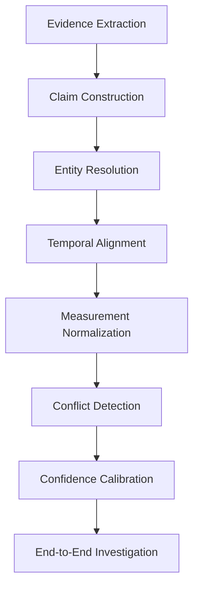
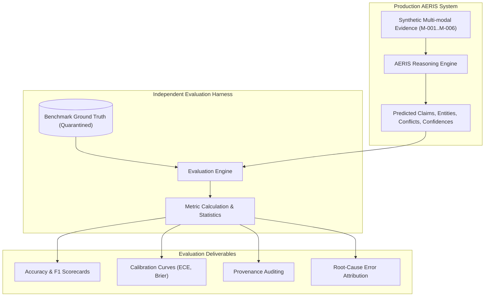
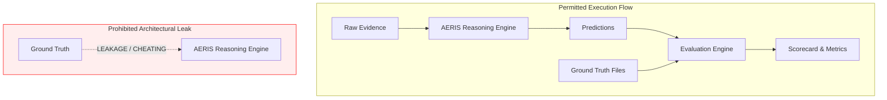
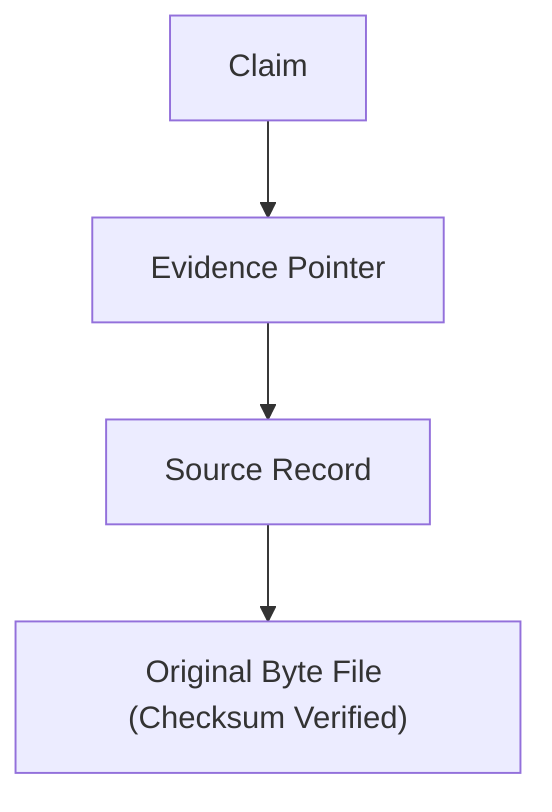
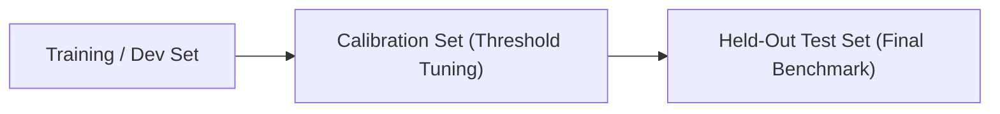
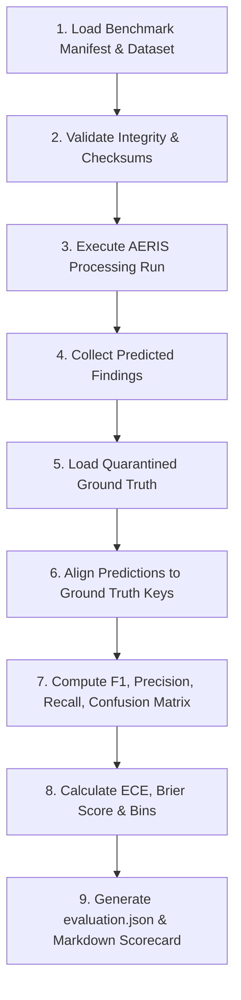
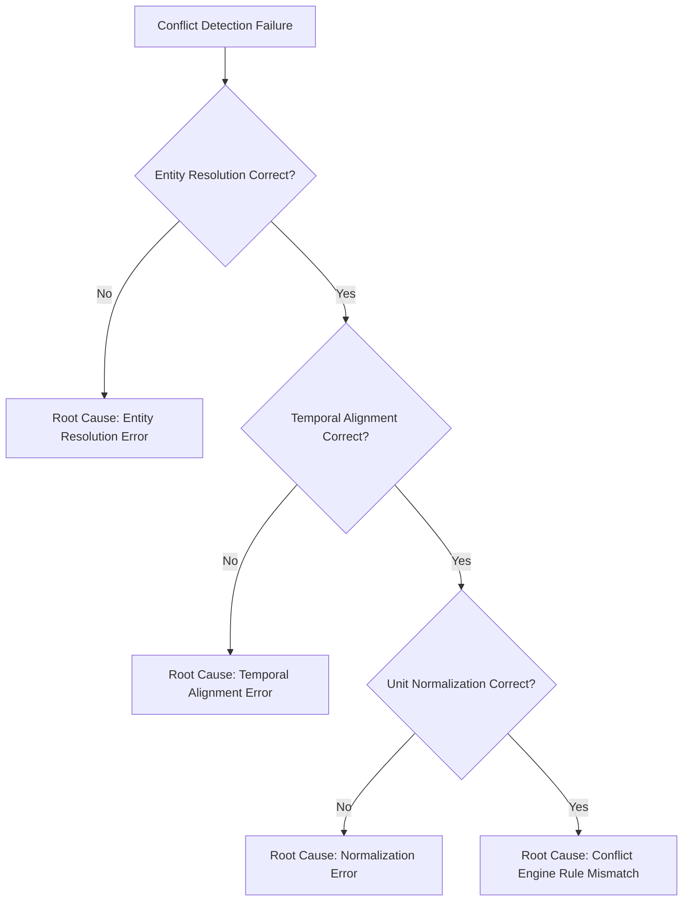
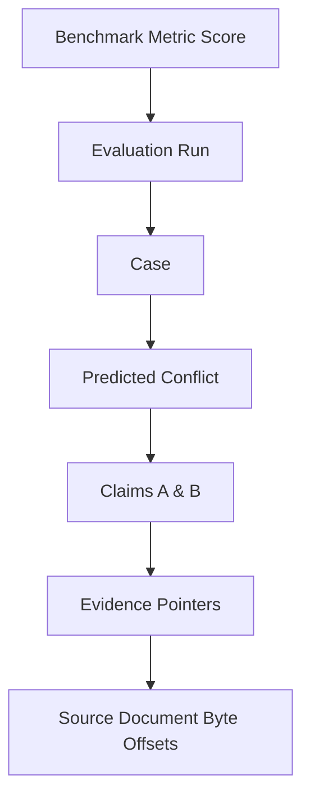
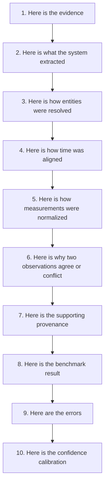

# 16 — Benchmark and Evaluation

## 1. Purpose

The AERIS evaluation framework measures whether the system correctly transforms multimodal evidence into structured claims and evidence relationships.

Evaluation must measure more than final conflict detection.

AERIS must evaluate every intermediate reasoning transformation:



The evaluation framework must remain strictly independent from the operational reasoning engine.

The central principle is:

> **Ground truth evaluates AERIS. Ground truth must never help AERIS reason.**

---

# 2. Evaluation Objectives

The benchmark must rigorously answer ten empirical questions:

1. Did AERIS extract the correct observations from raw text, PDF tables, images, and telemetry CSVs?
2. Did it construct valid, well-formed candidate and canonical claims?
3. Did it link evidence to the correct physical entities without false matches?
4. Did it correctly normalize timestamps to UTC and establish temporal interval relations?
5. Did it accurately convert and normalize units across measurement dimensions?
6. Did it identify genuine physical and logical contradictions?
7. Did it preserve genuine ambiguity rather than forcing arbitrary links?
8. Did it detect telemetry gaps and recognize insufficient evidence?
9. Did confidence estimates reliably reflect observed empirical accuracy (calibration)?
10. Can every conclusion be traced back to bit-level evidence provenance?

---

# 3. Evaluation Architecture



```text
              Synthetic Evidence
                     │
                     ▼
                AERIS Engine
                     │
                     ▼
              Predicted Results
                     │
                     │
                     ▼
        ┌────────────────────────┐
        │     Evaluation Engine  │
        └────────────┬───────────┘
                     │
             Ground Truth
                     │
                     ▼
              Metric Calculation
                     │
        ┌────────────┼────────────┐
        ▼            ▼            ▼
    Accuracy     Calibration   Coverage
```

The evaluator treats AERIS as a black box: it consumes predictions over the standard REST/JSON API or output artifacts and checks them against isolated ground truth.

---

# 4. Benchmark Dataset

The foundational evaluation benchmark is the synthetic factory dataset comprising six industrial machine units:

```text
M-001 Press-A
M-002 Pump-B
M-003 Motor-C
M-004 Compressor-D
M-005 Conveyor-E
M-006 Robot-F
```

Each machine provides heterogeneous, multi-source evidence packages (sensor logs, maintenance work orders, operator shift logs, visual inspection photos, and engineering spec sheets).

---

# 5. Machine Scenario Matrix

| Machine | Name | Primary Scenario | Primary Evaluation Target | Modalities |
| :--- | :--- | :--- | :--- | :--- |
| **M-001** | Press-A | Normal operation baseline | Agreement / baseline validation (no false conflicts) | CSV telemetry, Shift log TXT |
| **M-002** | Pump-B | Temperature conflict | Conflict detection & tolerance thresholds | Sensor CSV, Maintenance PDF |
| **M-003** | Motor-C | Unit variation (°F vs. °C, PSI vs. kPa) | Measurement normalization algebra | Scanned PDF, Sensor CSV |
| **M-004** | Compressor-D | Missing telemetry window | Insufficient evidence / gap detection | Sensor CSV, Operator log |
| **M-005** | Conveyor-E | Entity alias ambiguity (CV-E vs. CV-E2) | Entity resolution & ambiguity preservation | Work order PDF, Schematic |
| **M-006** | Robot-F | Cross-modal disagreement | Multimodal conflict (Vision photo vs. Operator report) | Thermal Image, Text report |

This mapping is strictly maintained in the benchmark manifest.

---

# 6. Ground Truth Structure

Ground truth documents define expected facts, entities, measurements, temporal boundaries, and relationships independently of AERIS:

```json
{
  "case_id": "CASE-M002",
  "entities": [
    {
      "entity_id": "ENT-M002",
      "canonical_name": "Pump-B",
      "aliases": ["Pump-B", "Pump B", "P-002", "PUMP_002"]
    }
  ],
  "claims": [
    {
      "id": "GT-CLM-001",
      "subject": "ENT-M002",
      "predicate": "temperature",
      "canonical_value": 72.3,
      "canonical_unit": "degC",
      "time_window": {
        "start": "2026-09-30T09:21:00Z",
        "end": "2026-09-30T09:21:00Z"
      }
    },
    {
      "id": "GT-CLM-002",
      "subject": "ENT-M002",
      "predicate": "temperature",
      "canonical_value": 94.0,
      "canonical_unit": "degC",
      "time_window": {
        "start": "2026-09-30T09:21:00Z",
        "end": "2026-09-30T09:21:00Z"
      }
    }
  ],
  "expected_relationships": [
    {
      "claim_a": "GT-CLM-001",
      "claim_b": "GT-CLM-002",
      "expected_status": "conflict",
      "reasons": ["difference_beyond_tolerance"]
    }
  ]
}
```

> [!CAUTION]
> Ground truth must never be loaded into, queried by, or referenced in operational pipeline code.

---

# 7. Ground Truth Separation



```text
Correct Architecture:
                    Evidence
                       │
                       ▼
                  AERIS Engine
                       │
                       ▼
                  Predictions
                       │
                       ▼
              Evaluation Engine
                       ▲
                       │
                  Ground Truth

Incorrect (Prohibited):
Ground Truth ──► AERIS Reasoning (Invalidates Benchmark)
```

The second pattern makes the entire benchmark meaningless and is strictly barred by architectural tests.

---

# 8. Dataset Versioning

Every benchmark dataset snapshot is versioned and immutably tagged:

```text
aeris-benchmark-v0.1  (Initial hackathon baseline)
aeris-benchmark-v0.2  (Added edge cases & noisy telemetry)
aeris-benchmark-v1.0  (Full 50-machine industrial challenge)
```

Dataset changes must be committed as new versions with accompanying changelogs rather than silently modifying files in place.

---

# 9. Benchmark Manifest

Each dataset release contains a root `manifest.json`:

```json
{
  "name": "aeris-benchmark",
  "version": "0.1",
  "created_at": "2026-09-30T20:00:00Z",
  "cases": 6,
  "modalities": [
    "text",
    "pdf",
    "image",
    "csv",
    "structured"
  ],
  "machine_cases": [
    {"machine_id": "M-001", "name": "Press-A", "case_key": "CASE-M001"},
    {"machine_id": "M-002", "name": "Pump-B", "case_key": "CASE-M002"},
    {"machine_id": "M-003", "name": "Motor-C", "case_key": "CASE-M003"},
    {"machine_id": "M-004", "name": "Compressor-D", "case_key": "CASE-M004"},
    {"machine_id": "M-005", "name": "Conveyor-E", "case_key": "CASE-M005"},
    {"machine_id": "M-006", "name": "Robot-F", "case_key": "CASE-M006"}
  ]
}
```

---

# 10. Evaluation Categories

The benchmark evaluates performance across eight distinct functional dimensions:

```text
A. Extraction
B. Entity Resolution
C. Temporal Alignment
D. Measurement Normalization
E. Conflict Detection
F. Confidence Calibration
G. Provenance
H. End-to-End Performance
```

---

# 11. Extraction Evaluation

Extraction measures whether raw multimodal evidence was converted into accurate candidate observations.

Example:

* **Source text:** `"Pump-B temperature reached 94°C during test cycle."`
* **Expected extraction observation:**
  ```text
  subject = "Pump-B"
  predicate = "temperature"
  value = 94.0
  unit = "°C"
  ```

---

# 12. Extraction Metrics

* **Field-Level Accuracy:** $\frac{\text{Correct Predicate/Value/Unit Fields}}{\text{Total Ground-Truth Fields}}$
* **Exact Match (EM):** Percent of claims where subject, predicate, value, and unit match ground truth exactly.
* **Timestamp Extraction Accuracy:** Precision of temporal offsets derived from log lines or document metadata.

---

# 13. Claim Extraction F1

For candidate claim generation:

$$\text{Precision} = \frac{|\text{Correctly Extracted Claims}|}{|\text{All Predicted Claims}|}$$

$$\text{Recall} = \frac{|\text{Correctly Extracted Claims}|}{|\text{All Ground-Truth Claims}|}$$

$$\text{F1} = \frac{2 \times \text{Precision} \times \text{Recall}}{\text{Precision} + \text{Recall}}$$

---

# 14. Entity Resolution Evaluation

Measures whether entity mentions are properly linked to canonical entities, ambiguous mentions are explicitly preserved, and unrelated entities remain unlinked.

Four outcomes per mention:
1. **Correct Resolution:** Linked to true canonical entity.
2. **Incorrect Resolution:** Linked to wrong entity (false positive match).
3. **Correct Ambiguity:** System returned `Ambiguous` for true ambiguous mention.
4. **Unresolved:** System correctly identified an unknown entity.

> [!IMPORTANT]
> The system receives severe penalties for confidently selecting the wrong entity.

---

# 15. Entity Resolution Metrics

* **Entity Precision:** $\frac{\text{True Canonical Matches}}{\text{All Attempted Canonical Matches}}$
* **Entity Recall:** $\frac{\text{True Canonical Matches}}{\text{All Ground-Truth Resolvable Entities}}$
* **Entity F1:** Harmonic mean of precision and recall.
* **Ambiguity Detection Rate:** $\frac{\text{Correct Ambiguities Preserved}}{\text{Ground-Truth Ambiguities}}$
* **False Resolution Rate:** $\frac{\text{Incorrect Matches}}{\text{Total Resolvable Mentions}}$

---

# 16. Entity Resolution Example

Ground truth:
```text
Alias: "CV-E" → Canonical Entity: "ENT-CONVEYOR-05" (Conveyor-E)
```

Prediction:
```text
Reference: "CV-E" → Canonical Entity: "ENT-CONVEYOR-05" (Confidence: 0.94)
```

Outcome:
```text
Correct Resolution (True Positive)
```

---

# 17. Ambiguity Evaluation

For machine M-005:

```text
Mention A: "CV-E"
Mention B: "CV-E2"
```

If evidence does not prove identity equivalence, the only correct system state is:

```text
Ambiguous
```

A system that arbitrarily guesses or merges `CV-E` with `CV-E2` receives an evaluation failure.

---

# 18. Ambiguity Detection Rate

$$\text{Ambiguity Detection Rate} = \frac{\text{Ground-Truth Ambiguous Cases Correctly Flagged as Ambiguous}}{\text{Total Ground-Truth Ambiguous Cases}}$$

AERIS is explicitly engineered not to force unsupported conclusions.

---

# 19. Temporal Evaluation

Evaluates:
* Timestamp parsing and conversion to UTC.
* Precision interval assignment (e.g. seconds vs. days).
* Overlap detection and Allen interval calculus.
* Telemetry gap identification.

---

# 20. Temporal Accuracy

For discrete timestamps:

$$\text{Temporal Accuracy} = \frac{\text{Timestamps Correctly Normalized to UTC}}{\text{Total Evaluated Timestamps}}$$

For temporal intervals:
* **Interval Overlap Precision:** Overlapping intervals that truly overlap in ground truth.
* **Interval Overlap Recall:** Ground-truth overlapping intervals correctly captured.

---

# 21. Temporal Relationship Evaluation

Evaluates predicted relationships between pairs of claims:

```text
overlaps
before
after
during
meets
contains
unknown
```

The evaluator builds a confusion matrix across all Allen interval relationships.

---

# 22. Missing Telemetry Evaluation

Machine M-004 contains a deliberate sensor dropout:

```text
Expected Telemetry Sampling: 1 sample / 60 seconds
Observed Dropout Window: 09:25 UTC to 09:30 UTC
```

The benchmark verifies:
```text
gap_detected = true
gap_start = 2026-09-30T09:25:00Z
gap_end = 2026-09-30T09:30:00Z
```

The system is heavily penalized if it hallucinates readings or assumes continuity during the outage.

---

# 23. Measurement Normalization Evaluation

Checks:
* Unit symbol identification (e.g., `degF`, `F`, `°F`, `fahrenheit`).
* Physical dimension compatibility checking.
* Algebraic conversion to SI / base units.
* Numerical tolerance enforcement.

---

# 24. Unit Conversion Accuracy

For machine M-003:

* Raw input: `158°F`
* Expected canonical output: `70.0°C`

The evaluator applies an allowable numerical tolerance:

$$|\text{Predicted Canonical} - \text{Expected Canonical}| \le 0.01^\circ\text{C}$$

---

# 25. Measurement Comparison

Normalization must precede comparison:

```text
Claim A: 158°F
Claim B: 70°C
```

* **Expected Evaluation Result:** `Comparable`, `Agreement`
* **Defective System:** Compares raw numbers $158 \ne 70$ and outputs `Conflict` $\implies$ **Test Failed**.

---

# 26. Conflict Detection Evaluation

Conflict detection is the core reasoning capability of AERIS.

All candidate pairs are evaluated across five mutually exclusive classification labels:

```text
Agreement
Conflict
Ambiguous
InsufficientEvidence
NotComparable
```

---

# 27. Conflict Confusion Matrix

The evaluator produces a comprehensive $5 \times 5$ multi-class confusion matrix:

| Actual \ Predicted | Agreement | Conflict | Ambiguous | Insufficient | NotComparable |
| :--- | :---: | :---: | :---: | :---: | :---: |
| **Agreement** | $N_{AA}$ | $N_{AC}$ | $N_{A\_Amb}$ | $N_{A\_Ins}$ | $N_{A\_NC}$ |
| **Conflict** | $N_{CA}$ | $N_{CC}$ | $N_{C\_Amb}$ | $N_{C\_Ins}$ | $N_{C\_NC}$ |
| **Ambiguous** | $N_{Amb\_A}$ | $N_{Amb\_C}$ | $N_{Amb\_Amb}$ | $N_{Amb\_Ins}$ | $N_{Amb\_NC}$ |
| **Insufficient** | $N_{Ins\_A}$ | $N_{Ins\_C}$ | $N_{Ins\_Amb}$ | $N_{Ins\_Ins}$ | $N_{Ins\_NC}$ |
| **NotComparable** | $N_{NC\_A}$ | $N_{NC\_C}$ | $N_{NC\_Amb}$ | $N_{NC\_Ins}$ | $N_{NC\_NC}$ |

---

# 28. Conflict Precision

$$\text{Conflict Precision} = \frac{\text{True Conflicts Detected}}{\text{All Predicted Conflicts}}$$

Measures false alarm rate (avoiding false alarms during critical plant operations).

---

# 29. Conflict Recall

$$\text{Conflict Recall} = \frac{\text{True Conflicts Detected}}{\text{All Ground-Truth Conflicts}}$$

Measures detection rate (ensuring genuine anomalies are never missed).

---

# 30. Conflict F1

$$\text{Conflict F1} = \frac{2 \times \text{Conflict Precision} \times \text{Conflict Recall}}{\text{Conflict Precision} + \text{Conflict Recall}}$$

---

# 31. Per-Class Metrics

AERIS computes precision, recall, and F1 independently for each reasoning outcome:

* `F1_Agreement`
* `F1_Conflict`
* `F1_Ambiguous`
* `F1_InsufficientEvidence`
* `F1_NotComparable`

This prevents high performance on dominant trivial classes (`Agreement`) from concealing failure on critical rare classes (`Conflict`).

---

# 32. M-001 Baseline Evaluation

* **Dataset:** Press-A (consistent sensor CSV and operator shift log).
* **Expected Reasoning:**
  $$\text{Consistent Evidence} \implies \text{Agreement}$$
* **Verification:** Confirms the system does not hallucinate conflicts where physical agreement exists.

---

# 33. M-002 Conflict Evaluation

* **Dataset:** Pump-B (Sensor: 72.3°C vs. Maintenance Report: 94°C at 09:21 UTC).
* **Chain of Proof Verification:**
  1. Identifies same entity (`ENT-M002`)
  2. Identifies same predicate (`temperature`)
  3. Verifies temporal interval overlap (`09:21 UTC`)
  4. Confirms measurement dimension compatibility (`temperature`)
  5. Computes delta: $|94.0 - 72.3| = 21.7^\circ\text{C} > 2.0^\circ\text{C}$ tolerance
  6. Outputs `Conflict`

The evaluator tests that every step in the reasoning chain was executed.

---

# 34. M-003 Normalization Evaluation

* **Dataset:** Motor-C (158°F converted to 70°C, compared against 70.1°C telemetry).
* **Expected:** Correct mathematical conversion, delta within 2.0°C tolerance $\implies$ `Agreement`.

---

# 35. M-004 Missing Evidence Evaluation

* **Dataset:** Compressor-D (Sensor dropout during pressure anomaly).
* **Expected:** Flagged as `InsufficientEvidence` for the missing duration.
* **Penalties:** Penalizes any system that infers or interpolates missing pressure readings.

---

# 36. M-005 Entity Ambiguity Evaluation

* **Dataset:** Conveyor-E (`CV-E` vs. `CV-E2`).
* **Expected:** Flagged as `Ambiguous`.
* **Evaluation Check:** Ensures the system preserves epistemic uncertainty.

---

# 37. M-006 Multimodal Evaluation

* **Dataset:** Robot-F (Thermal image showing hot joint vs. text log stating `"Joint inspected normal"`).
* **Expected:** Cross-modal `Conflict`.
* **Significance:** Demonstrates true multimodal evidence reasoning rather than superficial document parsing.

---

# 38. Provenance Evaluation

For every extracted claim and conflict:



The evaluator tests:
1. Pointer exists.
2. Source file exists in object storage.
3. Byte offset / page number / bounding box contains the exact source text/pixels.
4. Claim-to-evidence relation is valid.

---

# 39. Provenance Completeness

$$\text{Provenance Completeness} = \frac{\text{Claims with Valid, Resolving Provenance Chains}}{\text{Total Evaluated Claims}}$$

Target: **100%**. Unlinked claims receive zero provenance credit.

---

# 40. Provenance Accuracy

$$\text{Provenance Accuracy} = \frac{\text{Evidence Pointers Matching Ground-Truth Source Spans}}{\text{Total Evaluated Evidence Pointers}}$$

Prevents systems from outputting valid-looking but incorrect source coordinates.

---

# 41. Confidence Evaluation

Confidence is evaluated independently of raw classification accuracy.

A system can achieve 90% accuracy but be catastrophically miscalibrated if all predictions claim 99.9% certainty.

---

# 42. Calibration Dataset

Evaluation enforces strict dataset separation:



> [!CAUTION]
> The final held-out test benchmark must never be used to tune confidence thresholds.

---

# 43. Expected Calibration Error (ECE)

$$\text{ECE} = \sum_{m=1}^{M} \frac{|B_m|}{N} \left| \text{acc}(B_m) - \text{conf}(B_m) \right|$$

Where $M$ is the number of confidence bins (typically 10), $|B_m|$ is bin sample size, $\text{acc}(B_m)$ is empirical accuracy, and $\text{conf}(B_m)$ is average confidence.

Target: $\text{ECE} < 0.10$.

---

# 44. Brier Score

For probabilistic conflict predictions:

$$\text{Brier Score} = \frac{1}{N} \sum_{i=1}^{N} (p_i - y_i)^2$$

Where $p_i \in [0, 1]$ is predicted confidence and $y_i \in \{0, 1\}$ is actual binary ground truth.

---

# 45. Reliability Diagram

The evaluation suite outputs 10-bin calibration curves:

| Confidence Bin | Average Confidence | Observed Accuracy | Sample Count |
| :---: | :---: | :---: | :---: |
| 0.0 – 0.1 | 0.05 | 0.04 | 12 |
| 0.1 – 0.2 | 0.16 | 0.15 | 8 |
| ... | ... | ... | ... |
| 0.8 – 0.9 | 0.86 | 0.84 | 45 |
| 0.9 – 1.0 | 0.95 | 0.93 | 110 |

Displayed visually in the Benchmark UI tab.

---

# 46. Abstention Evaluation

Measures the system's ability to abstain when evidence is insufficient or ambiguous:

* **Abstention Precision:** $\frac{\text{True Ambiguous / Insufficient Cases}}{\text{All Cases Where System Abstained}}$
* **Abstention Recall:** $\frac{\text{True Ambiguous / Insufficient Cases Detected}}{\text{All Ground-Truth Cases Requiring Abstention}}$

---

# 47. Selective Prediction

Plots **Coverage vs. Accuracy**:

```text
High Confidence Threshold (e.g. > 0.90)  ──► 98% Accuracy (70% Coverage)
Medium Confidence Threshold (e.g. > 0.70)──► 92% Accuracy (88% Coverage)
Low Confidence Threshold (e.g. > 0.50)   ──► 88% Accuracy (98% Coverage)
```

Demonstrates that an investigator can trust high-confidence alerts unconditionally.

---

# 48. End-to-End Scorecard

The complete benchmark outputs a unified scorecard:

| Category | Primary Metric | Target |
| :--- | :--- | :---: |
| **Multimodal Extraction** | Claim F1 Score | $\ge 0.90$ |
| **Entity Resolution** | Canonical Entity F1 | $\ge 0.92$ |
| **Ambiguity Preservation** | Ambiguity Detection Rate | $\ge 0.85$ |
| **Temporal Alignment** | Timestamp & Interval F1 | $\ge 0.95$ |
| **Measurement Normalization** | Conversion Accuracy | $1.00$ |
| **Conflict Detection** | Conflict F1 Score | $\ge 0.90$ |
| **Evidence Provenance** | Provenance Completeness | $1.00$ |
| **Confidence Reliability** | Expected Calibration Error (ECE) | $\le 0.10$ |
| **System Latency** | Full 6-Machine Benchmark Duration | $< 60\text{ s}$ |

---

# 49. Avoiding Metric Gaming

The evaluation engine actively guards against statistical gaming:
* Prevents "always predict agreement" exploitation by reporting **Macro F1** and per-class recall.
* Prevents false claim flooding by penalizing ungrounded claims in extraction precision.
* Prevents trivial ambiguity exploitation by evaluating abstention precision.

---

# 50. Macro F1

$$\text{Macro F1} = \frac{\text{F1}_{\text{Agreement}} + \text{F1}_{\text{Conflict}} + \text{F1}_{\text{Ambiguous}} + \text{F1}_{\text{Insufficient}} + \text{F1}_{\text{NotComparable}}}{5}$$

Equal weighting prevents the dominant `Agreement` class from masking poor `Conflict` detection.

---

# 51. Micro Metrics

Micro-averaged metrics are reported for global transaction throughput, but never substitute for Macro F1 in official evaluations.

---

# 52. Benchmark Reproducibility

Every evaluation execution records:
* Dataset version and git commit hash
* Processing run ID
* Core engine software version
* Configuration snapshot hash (`aeris.toml`)
* AI model versions and provider names
* Prompt versions and hashes
* Execution timestamp and hardware platform

---

# 53. Evaluation Run Record

```rust
use chrono::{DateTime, Utc};
use serde::{Deserialize, Serialize};

#[derive(Debug, Clone, Serialize, Deserialize)]
pub struct EvaluationRun {
    pub id: EvaluationRunId,
    pub dataset_name: String,
    pub dataset_version: String,
    pub processing_run_id: ProcessingRunId,
    pub software_version: String,
    pub configuration_version: String,
    pub status: EvaluationStatus,
    pub created_at: DateTime<Utc>,
}
```

---

# 54. Evaluation Pipeline



```text
Load Benchmark
      ↓
Validate Dataset
      ↓
Run AERIS
      ↓
Collect Predictions
      ↓
Load Ground Truth
      ↓
Align Predictions
      ↓
Calculate Metrics
      ↓
Calculate Calibration
      ↓
Generate Report
```

---

# 55. Prediction Alignment

Ground truth and system predictions are aligned using deterministic canonical identifiers:

```text
Ground Truth:
Entity: ENT-M002, Predicate: temperature, Time: 09:21 UTC

System Prediction:
Claim: CLM-8472 (Subject: ENT-M002, Predicate: temperature, Time: 09:21 UTC)

        ↓ [Alignment Matcher]
Matched Evaluation Pair (GT-CLM-002 ↔ CLM-8472)
```

---

# 56. Evaluation Artifacts

Every benchmark run exports persistent artifacts under `benchmark/runs/{eval_id}/`:

```text
evaluation.json          (Complete raw evaluation payload)
metrics.json             (Per-stage F1, precision, recall)
confusion_matrix.json    (5x5 conflict classification matrix)
calibration.json         (ECE, Brier, and 10-bin reliability data)
provenance_report.json   (Pointer validity and completeness)
summary.md               (Executive markdown scorecard)
```

---

# 57. Example Metrics Output

```json
{
  "dataset": "aeris-benchmark-v0.1",
  "eval_run_id": "EVAL-20260930-01",
  "entity_resolution": {
    "precision": 0.942,
    "recall": 0.915,
    "f1": 0.928
  },
  "conflict_detection": {
    "precision": 0.923,
    "recall": 0.895,
    "f1": 0.909,
    "macro_f1": 0.914
  },
  "calibration": {
    "ece": 0.078,
    "brier_score": 0.092
  },
  "provenance": {
    "completeness": 1.0,
    "accuracy": 0.985
  }
}
```

---

# 58. Error Analysis

Evaluation failures are categorized by root-cause stage:

```text
Extraction Error        (Failed to parse text / OCR issue)
Entity Error            (Incorrect entity alias link)
Temporal Error          (Timestamp parsed wrong / offset issue)
Normalization Error     (Unit algebra error)
Comparison Error        (Numerical tolerance / logic mismatch)
Classification Error    (Wrong conflict state assignment)
Provenance Error        (Broken or invalid evidence pointer)
Confidence Error        (Extreme overconfidence / underconfidence)
```

---

# 59. Error Analysis Example

Scenario:
* **Expected:** `Conflict`
* **Predicted:** `Agreement`

Root-cause diagnosis:
1. Entity resolution: Correct (`ENT-M002`)
2. Temporal alignment: Correct (`09:21 UTC`)
3. Unit normalization: Correct (`158°F → 70°C`)
4. Value comparison: Failed (Tolerance configured at 5.0°C instead of 2.0°C)

**Attribution:** `Comparison Error` (Configuration fault, not extraction fault).

---

# 60. Failure Attribution Tree



Enables engineering teams to prioritize fixes based on exact systemic bottlenecks.

---

# 61. Benchmark Regression Testing

The evaluation suite runs as a mandatory CI/CD gate:

```text
git commit
   ↓
cargo test (Unit & Integration tests)
   ↓
AERIS Benchmark Run
   ↓
Automated Regression Comparison
   ↓
Pull Request Gate (Pass / Fail)
```

---

# 62. Regression Thresholds

Enforced CI merge gates:

```toml
[evaluation.regression_thresholds]
max_conflict_f1_drop = 0.02
max_entity_f1_drop = 0.02
max_provenance_completeness_drop = 0.00
max_ece_increase = 0.03
```

A pull request cannot merge if Conflict F1 degrades by more than 2%.

---

# 63. Benchmark Snapshot

Historical evaluation snapshots are archived permanently:

```text
benchmark/
  runs/
    EVAL-20260930-001/
      metrics.json
      confusion_matrix.json
      summary.md
    EVAL-20260930-002/
      metrics.json
      ...
```

Enables cross-version historical progress graphing.

---

# 64. Performance Evaluation

System profiling metrics:
* Total wall-clock processing duration
* Per-stage processing latency
* User / system CPU time
* GPU compute time & VRAM allocation
* Peak memory RSS
* PostgreSQL query latency & transaction time

---

# 65. Performance by Modality

Benchmarked across individual input modalities:
* Structured CSV parsing throughput (rows / sec)
* Multi-page PDF text extraction latency (ms / page)
* High-resolution image OCR & vision inference (ms / image)
* Plaintext log extraction (KB / sec)

---

# 66. Scalability Evaluation

Stress testing stages:
* 1 case (M-001)
* 6 cases (Standard synthetic factory)
* 50 cases (Batch industrial benchmark)
* 1,000 cases (High-throughput stress simulation)

Ensures zero memory leaks or $O(N^2)$ candidate pairing explosions.

---

# 67. Evaluation UI

The investigation frontend includes a dedicated **Benchmark & Evaluation** dashboard:

```text
Benchmark Dashboard
├── Executive Summary (Macro F1, ECE, Provenance)
├── Machine Matrix (M-001 .. M-006 Status)
├── 5x5 Confusion Matrix Visualizer
├── Calibration Curve (Reliability Diagram)
├── Coverage vs. Accuracy Curves
├── Stage-by-Stage Error Attribution Tree
└── Latency & Throughput Telemetry
```

---

# 68. Case-Level Evaluation

Individual cases can be inspected in isolation:

```text
Case: CASE-M002 (Pump-B)
Expected Finding: Conflict (Temp mismatch 21.7°C at 09:21 UTC)
Predicted Finding: Conflict (Temp mismatch 21.7°C at 09:21 UTC)
Status: PASSED
Confidence: 0.94 (Calibrated)
Provenance: 100% Verified
```

Crucial for live hackathon judging and demonstration walkthroughs.

---

# 69. Evidence-Level Evaluation

Inspectors can drill down from any benchmark metric directly into supporting proof cards:



---

# 70. Unit Tests

Fine-grained deterministic engine tests:
* Temperature, pressure, and vibration unit algebra conversions.
* ISO 8601 parsing and UTC normalization.
* Allen interval relationship logic.
* Numeric tolerance boundary checks.
* Entity identifier clean-up and signal weighting.
* Confidence propagation formulas.

---

# 71. Integration Tests

Multi-stage pipeline integration tests:
* `Raw Source → Candidate Claims → Canonical Claims`
* `Canonical Claims → Entity Resolution + Temporal Engine + Normalizer`
* `Normalized Claims → Candidate Pairing → Conflict Detection`

---

# 72. End-to-End Tests

Complete black-box test runs for each synthetic machine:
* Full run of machine M-002 generates expected conflict and proof card.
* Full run of machine M-004 detects missing telemetry window.
* Full run of machine M-005 outputs ambiguous conveyor link.

---

# 73. Evaluation Security

Ground truth assets are kept in a protected, read-only directory:

```text
aeris/
├── crates/ (Core engine code)
├── data/
│   └── evidence/ (Uploaded files processed by pipeline)
└── test/
    └── ground-truth/ (Restricted access, used only by test harness)
```

API endpoints serving operational users never expose raw ground-truth JSON files.

---

# 74. Evaluation Invariants

### Invariant 1
Ground truth never enters the operational reasoning pipeline.

### Invariant 2
Every benchmark dataset has an immutable version.

### Invariant 3
Every evaluation run records its associated processing run ID.

### Invariant 4
All metrics are computed deterministically and automatically.

### Invariant 5
Per-class metrics and confusion matrices are always preserved.

### Invariant 6
Ambiguity and insufficient evidence are explicitly scored.

### Invariant 7
Provenance completeness and accuracy are evaluated as primary metrics.

### Invariant 8
Confidence calibration strictly uses held-out data.

### Invariant 9
Mock or illustrative metrics are never presented as measured test results.

### Invariant 10
Benchmark regressions fail the CI build.

---

# 75. Acceptance Criteria

The evaluation framework is complete when:

* [ ] Benchmark dataset is versioned (`aeris-benchmark-v0.1`).
* [ ] Ground truth is isolated from the reasoning engine.
* [ ] Predictions can be exported via API or CLI.
* [ ] Multimodal extraction metrics are calculated.
* [ ] Entity resolution precision, recall, and F1 are calculated.
* [ ] Temporal accuracy and interval relations are evaluated.
* [ ] Measurement normalization conversions are validated.
* [ ] Conflict detection precision, recall, and F1 are calculated.
* [ ] Full $5 \times 5$ confusion matrix is generated.
* [ ] Ambiguity detection rate is scored.
* [ ] Telemetry gap detection is evaluated.
* [ ] Provenance completeness and pointer accuracy are scored.
* [ ] Confidence calibration (ECE and Brier score) is calculated.
* [ ] Reliability diagrams are generated.
* [ ] Root-cause failure attribution tree is operational.
* [ ] Per-machine test cases (M-001 through M-006) pass.
* [ ] Automated CI regression testing is configured.
* [ ] Evaluation artifacts (`evaluation.json`, `summary.md`) are exported.

---

# 76. Final Evaluation Principle

AERIS should never claim:

> *"Our AI is accurate."*

It must demonstrate:



That is the difference between a visually impressive prototype and an evidence reasoning system that can withstand forensic scrutiny.

The benchmark is part of the AERIS architecture, not merely a final presentation slide.
