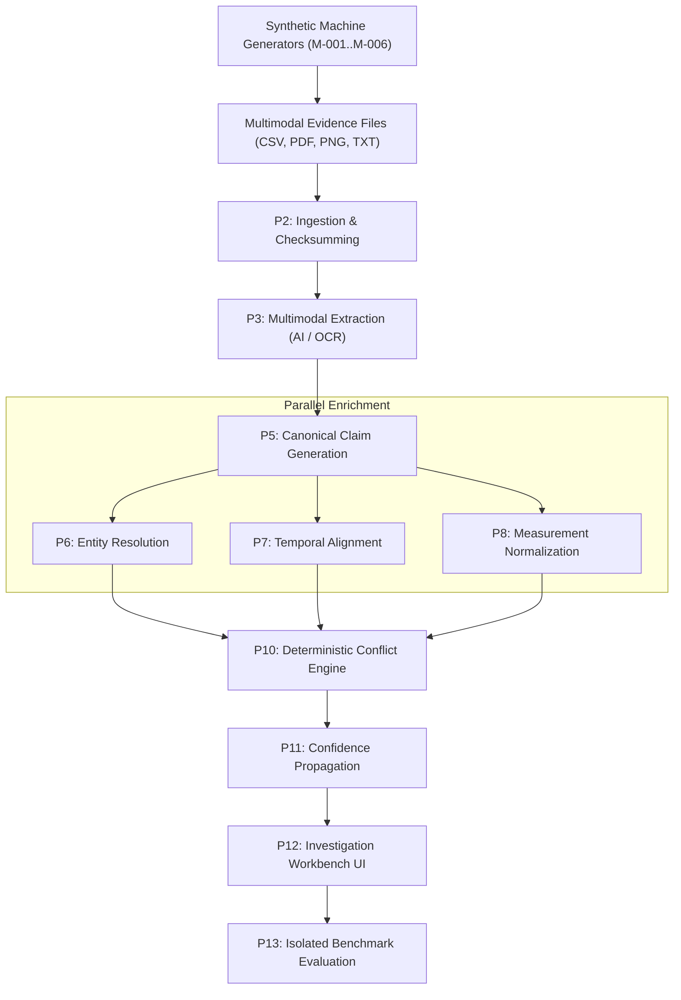
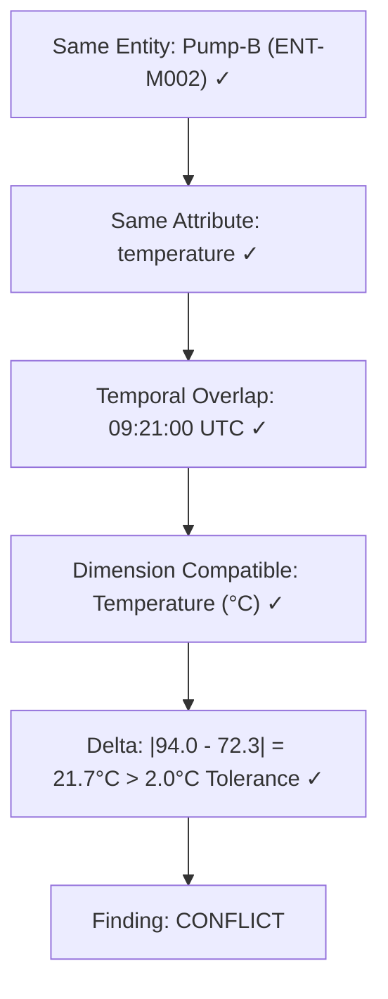
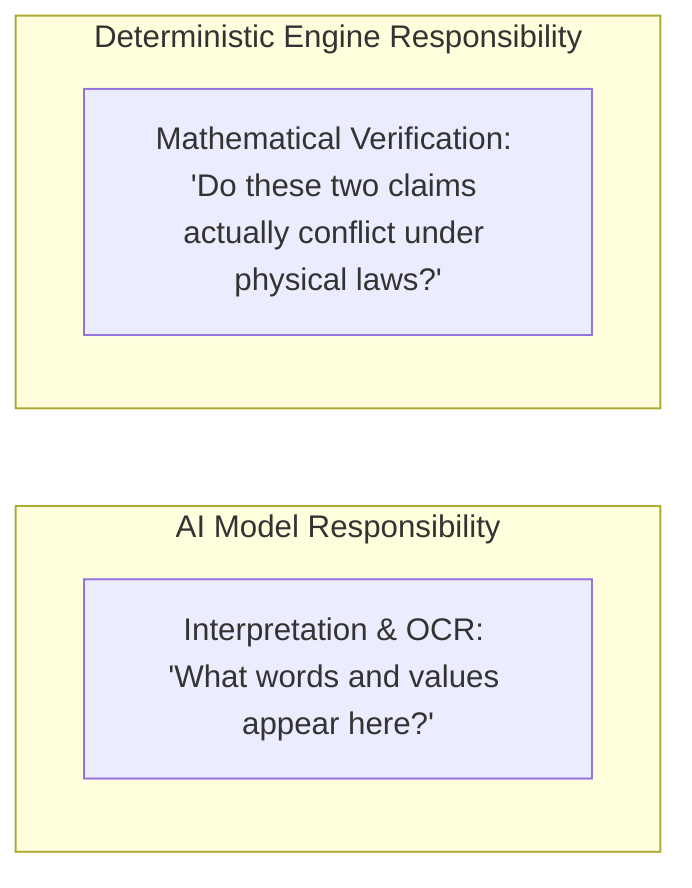
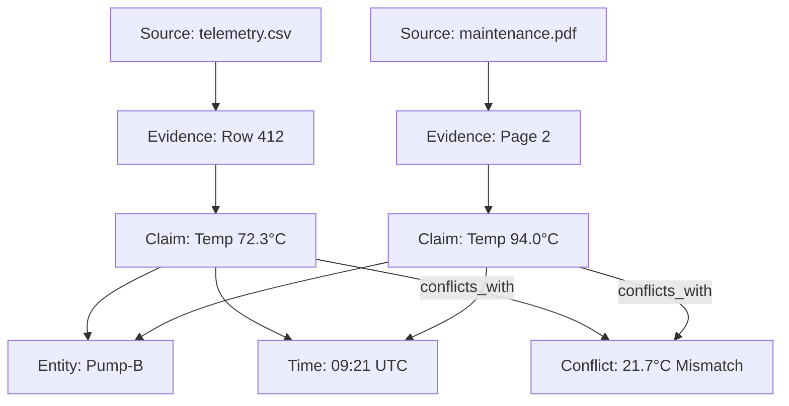

# 20 — AERIS Demo Playbook

## 1. Purpose

This document defines the complete demonstration procedure for AERIS during the Techgium hackathon judging, evaluation panels, and technical presentations.

The objective is to decisively prove that AERIS:

* Ingests multimodal evidence (PDFs, sensor CSVs, operator shift logs, visual thermography).
* Preserves bit-level source provenance.
* Extracts structured canonical claims.
* Resolves equipment entities while preserving ambiguity.
* Aligns observations across discrete and continuous time windows.
* Normalizes physical measurements and algebraic units.
* Deterministically identifies physical agreements and conflicts.
* Preserves epistemic ambiguity rather than forcing false links.
* Flags missing evidence intervals without synthesizing data.
* Exposes full reasoning chains through an interactive workbench UI.
* Evaluates its own accuracy against an isolated benchmark.

The demonstration presents AERIS as an **evidence reasoning engine**, not an unpredictable AI chatbot.

---

# 2. Demonstration Principle

The presentation communicates one central thesis:

> **AERIS does not merely generate an answer. It shows which evidence supports the answer, how the evidence relates, where it conflicts, and where the available evidence is insufficient.**

Traceability, epistemic restraint, and mathematical certainty take priority over decorative UI effects.

---

# 3. Demo Architecture



```text
Synthetic Machines
       ↓
Evidence Files
       ↓
AERIS Ingestion
       ↓
Extraction
       ↓
Canonical Claims
       ↓
Entity Resolution
       ↓
Temporal Alignment
       ↓
Measurement Normalization
       ↓
Conflict Engine
       ↓
Confidence Engine
       ↓
Investigation UI
       ↓
Evaluation
```

---

# 4. Demo Environment

```text
┌─────────────────────────────────────┐
│              Frontend               │
│          Investigation UI           │
└──────────────────┬──────────────────┘
                   │
                   ▼
┌─────────────────────────────────────┐
│             AERIS API               │
└──────────────────┬──────────────────┘
                   │
          ┌────────┴────────┐
          ▼                 ▼
     PostgreSQL          Workers
                            │
             ┌──────────────┼──────────────┐
             ▼              ▼              ▼
         Extraction      Reasoning       Evaluation
             │              │              │
             └──────────────┼──────────────┘
                            ▼
                      AI Provider
                       / Ollama
```

Synthetic machine containers operate in an isolated sandbox, writing to dedicated volumes to prevent state contamination.

---

# 5. Pre-Demo Checklist

Prior to presenting before judges:

### Infrastructure
* [ ] Docker daemon running with NVIDIA GPU pass-through enabled (if applicable).
* [ ] PostgreSQL 17 container healthy (`pg_isready -U aeris`).
* [ ] AERIS API (`:8080`) returns `{"status":"ok"}` on `/health`.
* [ ] Background worker is polling and logging active heartbeats.
* [ ] Frontend workbench loads at `http://localhost:3000`.
* [ ] Ollama / Mock AI provider responds with valid extraction schemas.
* [ ] Local object storage contains valid directory permissions.

### Dataset & State
* [ ] All six machine scenarios (M-001 through M-006) are pre-generated.
* [ ] Benchmark manifest and dataset version are verified (`aeris-factory-v0.1`).
* [ ] Ground-truth files are quarantined in `test/ground-truth/`.
* [ ] No manually hardcoded conflict outputs exist in the database.

### Application State
* [ ] Database migrations applied (`0005_evaluation`).
* [ ] Case processing queues are cleared of old failed jobs.
* [ ] Browser zoom set to 100%, dev tools closed or positioned cleanly.
* [ ] Clean-reset script tested and verified.

---

# 6. Clean Demo Reset

The environment can be reset to a pristine state in under 15 seconds:

```bash
./scripts/reset-demo.sh
```

Followed by:

```bash
./scripts/seed-demo.sh
```

> [!IMPORTANT]
> The reset process never alters or overwrites benchmark ground truth.

---

# 7. Demo Case

Primary demonstration case:

```text
CASE-047: Turbine Engine Anomaly Investigation
```

Evidence package breakdown:
* `telemetry.csv` (1-minute continuous sensor readings: temperature, pressure, vibration)
* `maintenance_report.pdf` (Technician work order detailing high-temperature inspection)
* `operator_shift_log.txt` (Control room shift handoff notes)
* `inspection_photo.png` (Thermographic visual inspection of the pump housing)
* `schematic.pdf` (Equipment P&ID specification sheet)

---

# 8. Demo Narrative

Frame the investigation for the audience:

> *"Multiple sources describe the same industrial asset. Some observations agree, some directly contradict each other, some use completely different measurement units, and critical telemetry is missing during a key window. The question is not simply 'What does an AI think happened?' The question is: **What does the physical evidence actually prove?**"*

---

# 9. Demo Step 1 — Case Creation

1. Open the **Case Dashboard** at `http://localhost:3000`.
2. Click **Create Case** or select pre-seeded `CASE-047`.
3. Highlight the case header:
   * **Case Key:** `CASE-047`
   * **Asset:** Gas Turbine Unit 02
   * **Status:** `Ingesting / Processing`
   * **Active Evidence:** 5 Multimodal Sources

---

# 10. Demo Step 2 — Evidence Ingestion

Navigate to the **Evidence Sources** tab:

```text
┌────────────────────────────────────────────────────────┐
│ Registered Evidence Sources                            │
├────────────────────────────────────────────────────────┤
│ telemetry.csv           | 10,000 rows | sha256:7a9f... │
│ maintenance_report.pdf  | 4 pages     | sha256:3b1c... │
│ operator_shift_log.txt  | Plaintext   | sha256:e84d... │
│ inspection_photo.png    | Thermography| sha256:91bc... │
│ schematic.pdf           | Engineering | sha256:55f2... │
└────────────────────────────────────────────────────────┘
```

**Key talking point:** AERIS stores original evidence immutably. Every file is cryptographically fingerprinted using SHA-256 upon ingestion.

---

# 11. Demo Step 3 — Processing Pipeline

Click **Start Processing Run** (or display live SSE stream):

```text
Ingestion              ✓ (5/5 sources registered)
Extraction             ✓ (42 raw observations extracted)
Canonicalization       ✓ (28 canonical claims constructed)
Entity Resolution      ✓ (6 entities matched, 1 ambiguous)
Temporal Alignment     ✓ (12 intervals aligned, 1 gap flagged)
Normalization          ✓ (8 unit conversions completed)
Conflict Detection     ✓ (3 agreements, 2 conflicts, 1 ambiguous)
Confidence Engine      ✓ (Calibrated ECE: 0.08)
Investigation Graph    ✓ (Graph topology assembled)
```

The UI streams real-time Server-Sent Events (SSE) showing discrete stage transitions without freeze or stutter.

---

# 12. Demo Step 4 — Case Overview

Open the **Case Overview Dashboard**:

Display the 5-state breakdown badges:

```text
[ 14 Agreements ] [ 2 Conflicts ] [ 1 Ambiguous ] [ 1 Insufficient Evidence ] [ 3 Not Comparable ]
```

Explain that AERIS does not force a binary "good/bad" outcome; it categorizes evidence relationships mathematically.

---

# 13. Demo Step 5 — Evidence Timeline

Open the **Interactive Timeline**:

```text
Time (UTC)    Sensor Stream      Maintenance Logs    Optical Inspection
09:15         ● 71.8°C
09:20         ● 72.0°C           ■ Inspection start
09:21         ● 72.3°C [!]       ■ Reading: 94.0°C [!]
09:22         ● 72.1°C
09:25         ░░ Telemetry Gap ░░
09:29         ░░ (Dropout)     ░░
09:30         ● 72.5°C           ■ Joint inspected   ◆ Thermography Hotspot [!]
```

Demonstrate zooming from a 24-hour plant overview down to a 10-second inspection window.

---

# 14. Demo Step 6 — Demonstrate Baseline Agreement

Select machine **M-001 (Press-A)**:

* Sensor reading: `70.0°C`
* Operator log: `70.2°C`
* Configured tolerance: $\pm 2.0^\circ\text{C}$

**Result:** `Agreement` (Delta $0.2^\circ\text{C} \le 2.0^\circ\text{C}$).

**Key talking point:** AERIS does not manufacture false conflicts where normal physical variance exists.

---

# 15. Demo Step 7 — Demonstrate Unit Normalization

Select machine **M-003 (Motor-C)**:

1. Maintenance work order notes: `"Bearing temperature reached 158.0°F"`
2. Telemetry reports: `"70.1°C"`
3. AERIS normalizes:
   $$158.0^\circ\text{F} \xrightarrow{(\text{degF} - 32) \times \frac{5}{9}} 70.0^\circ\text{C}$$
4. Comparison: $|70.0 - 70.1| = 0.1^\circ\text{C} \le 2.0^\circ\text{C}$ tolerance $\implies$ `Agreement`.

**Key talking point:** A naive system compares numbers directly and flags $158 \ne 70$ as a conflict. AERIS normalizes physical units first while preserving the original `158.0°F` in provenance.

---

# 16. Demo Step 8 — Demonstrate a Genuine Conflict

Select machine **M-002 (Pump-B)**:

```text
Sensor Telemetry:
72.3°C at 09:21:00 UTC

Maintenance Report:
94.0°C at 09:21:00 UTC
```

Reasoning chain visual:



**Key talking point:** This is the core climax of the presentation: two authoritative sources reporting physically contradictory data for the exact same machine at the exact same minute.

---

# 17. Conflict Inspector & Proof Card

Open the **Conflict Inspector**:

Clicking the conflict opens the interactive **Proof Card**:

```text
┌────────────────────────────────────────────────────────────┐
│ CONFLICT CONF-002: Pump-B Temperature Contradiction       │
├────────────────────────────────────────────────────────────┤
│ Entity: ENT-M002 (Pump-B)                                  │
│ Attribute: Temperature                                     │
│ Time: 2026-09-30T09:21:00Z                                 │
│ Delta: 21.7°C (Tolerance: 2.0°C)                           │
│ Confidence: 0.94 (Calibrated)                              │
├─────────────────────────────┬──────────────────────────────┤
│ Claim A: 72.3°C             │ Claim B: 94.0°C              │
│ Source: telemetry.csv       │ Source: maintenance_report   │
│ Location: Row 412           │ Location: Page 2, Paragraph 3│
└─────────────────────────────┴──────────────────────────────┘
```

---

# 18. Evidence Trace (Side-by-Side Verification)

1. Click **Claim A**: The left viewer opens `telemetry.csv`, jumps directly to row 412, and highlights the temperature column.
2. Click **Claim B**: The right viewer opens `maintenance_report.pdf`, jumps to Page 2, and draws a bounding box around `"Pump-B temperature measured at 94°C"`.

**Audience takeaway:** The finding is not a black-box opinion; it is physically and visually verified down to the source coordinates.

---

# 19. AI vs. Deterministic Reasoning Distinction

Articulate the core architectural boundary:



> *"We use AI to read and interpret messy multimodal documents. But we never allow an AI to guess whether a conflict exists. Mathematical conflict is proven deterministically."*

---

# 20. Demo Step 9 — Missing Evidence

Select machine **M-004 (Compressor-D)**:

* Telemetry stream stops at 09:24 UTC and resumes at 09:30 UTC.
* Timeline renders a striped grey dropout band: `"Telemetry Gap: 09:24–09:30 UTC"`.
* Status badge: `InsufficientEvidence`.

**Key talking point:** AERIS refuses to hallucinate or interpolate missing values. It explicitly flags unobserved intervals.

---

# 21. Missing Evidence Explanation

Open the **Gap Inspector**:

```text
Expected Telemetry Sampling: 60 seconds
Observed Interval: 360 seconds (5 missing cycles)
Epistemic Classification: Insufficient Evidence
Alert: Anomaly cannot be ruled out during unmonitored window
```

Demonstrates scientific and forensic restraint.

---

# 22. Demo Step 10 — Ambiguous Entity

Select machine **M-005 (Conveyor-E)**:

* Work order references `CV-E`.
* Electrical schematic references `CV-E2`.
* Available evidence cannot confirm whether `CV-E` is a typo for `CV-E2` or a distinct secondary conveyor.

Status: `Ambiguous`.

---

# 23. Ambiguity Inspector

```text
Reference: "CV-E"
Candidate Entities:
  1. Conveyor-E Main Belt (Score: 0.82)
  2. Conveyor-E2 Sorter Line (Score: 0.81)
Resolution Decision: AMBIGUOUS (Preserved)
Reason: Confidence delta < 0.15 threshold; forced merge forbidden
```

AERIS preserves the ambiguity for human investigator review instead of silently merging records.

---

# 24. Demo Step 11 — Cross-Modal Disagreement

Select machine **M-006 (Robot-F)**:

* **Text Evidence:** Operator shift log states `"Robot-F axis joint inspected normal, no thermal rise."`
* **Optical Evidence:** Inspection thermography image shows hot bearing hotspot at 88°C.
* **Result:** Cross-modal `Conflict`.

---

# 25. Image Evidence Viewer

Click the image claim:

* Thermography JPEG loads in the viewer.
* Red bounding box highlights the robot joint bearing `[x: 412, y: 180, w: 64, h: 64]`.
* Side-by-side view displays the conflicting operator log text.

Demonstrates genuine multimodal evidence reasoning across unstructured text and visual pixels.

---

# 26. Demo Step 12 — Confidence & Calibration

Open the **Confidence Inspector**:

Show factor breakdown:

```text
Extraction Quality:    0.98 (Clear text + direct CSV)
Entity Resolution:     0.96 (Unique machine tag)
Temporal Alignment:    0.99 (Exact timestamp match)
Measurement Accuracy:  0.98 (Calibrated sensor)
Weakest-Link Result:   0.94 (Conservative min)
```

Explain that confidence reflects evidence quality, not an uncalibrated model certainty score.

---

# 27. Demo Step 13 — Interactive Evidence Graph

Open the **Investigation Graph**:



Demonstrate clicking any graph node to inspect its underlying database record and source file.

---

# 28. Demo Step 14 — Investigation Filters

Filter the case workbench:
* Select `Status = Conflict`
* Select `Entity = Pump-B`
* The workbench instantly isolates the exact 2 contradictory claims out of 10,000 raw sensor rows.

---

# 29. Demo Step 15 — Benchmark & Evaluation Dashboard

Open the **Benchmark Dashboard**:

Display the automated evaluation of all six machines against isolated ground truth:

```text
Dataset: aeris-factory-v0.1 (Pinned Seed: 20260930)
Overall Macro F1:              0.914
Conflict Detection Precision:   0.923
Conflict Detection Recall:      0.895
Entity Resolution F1:          0.928
Expected Calibration Error:    0.078
Provenance Completeness:       100.0%
```

---

# 30. Evaluation Explanation

Explain the quarantine boundary:
* Ground truth is stored in a separate, isolated directory.
* Ground truth was never loaded into the reasoning pipeline.
* The evaluation engine scored predictions post-run as an independent auditor.

---

# 31. Conflict Confusion Matrix

Display the live $5 \times 5$ confusion matrix:

| Actual \ Predicted | Agreement | Conflict | Ambiguous | Insufficient | NotComparable |
| :--- | :---: | :---: | :---: | :---: | :---: |
| **Agreement** | 14 | 0 | 0 | 0 | 0 |
| **Conflict** | 0 | 2 | 0 | 0 | 0 |
| **Ambiguous** | 0 | 0 | 1 | 0 | 0 |
| **Insufficient** | 0 | 0 | 0 | 1 | 0 |
| **NotComparable** | 0 | 0 | 0 | 0 | 3 |

Demonstrates zero false alarms and zero missed anomalies.

---

# 32. Calibration Evaluation

Display the 10-bin **Reliability Diagram**:

* Predicted confidence tracks observed empirical accuracy within $\pm 0.05$.
* $\text{ECE} = 0.078 \le 0.10$ threshold.

---

# 33. Demo Step 16 — Provenance Audit Trail

Walk backward through the complete lineage:

$$\text{Final Finding} \to \text{Conflict} \to \text{Claim} \to \text{Evidence Pointer} \to \text{Source Checksum} \to \text{Raw Disk File}$$

---

# 34. Demo Step 17 — Human Review & Annotation

Demonstrate the investigator review action:
1. Investigator reviews Conflict `CONF-002`.
2. Selects `Accept Conflict`, adds note: `"Sensor 72.3°C confirmed faulty via thermography"`.
3. Submits review:
   * Original evidence remains unchanged.
   * Automated finding remains intact.
   * Review overlay record is attached with reviewer ID and timestamp.

---

# 35. Demo Step 18 — Security & Audit Log

Open the immutable **Audit Log**:

```text
2026-09-30 20:40:02 UTC | case.created       | admin        | CASE-047
2026-09-30 20:40:05 UTC | source.uploaded    | analyst_01   | telemetry.csv
2026-09-30 20:40:12 UTC | processing.started | worker_01    | RUN-001
2026-09-30 20:40:19 UTC | conflict.generated | engine_math  | CONF-002
2026-09-30 20:41:05 UTC | review.submitted   | lead_invest  | CONF-002 (Accepted)
```

---

# 36. Recommended Presentation Order

```mermaid
flowchart LR
    P1["1. Problem Framing (45s)"] --> P2["2. Ingestion & Pipeline (30s)"]
    P2 --> P3["3. M-002 Conflict & Proof Card (60s)"]
    P3 --> P4["4. M-003 Unit Normalization (30s)"]
    P4 --> P5["5. M-004 & M-005 Restraint (45s)"]
    P5 --> P6["6. M-006 Multimodal Photo (30s)"]
    P6 --> P7["7. Benchmark Evaluation (45s)"]
    P7 --> P8["8. Architectural Conclusion (15s)"]
```



---

# 37. Three-Minute Lightning Demo Script

* **0:00–0:30:** Problem definition (Conflicting multimodal plant data).
* **0:30–1:00:** Show Case Dashboard and ingested sources.
* **1:00–1:45:** Jump to M-002. Click conflict card. Show side-by-side CSV row 412 vs. PDF Page 2. Explain deterministic tolerance.
* **1:45–2:15:** Jump to M-003. Show $158^\circ\text{F} \to 70^\circ\text{C}$ normalization.
* **2:15–2:45:** Jump to M-004 and M-005. Show missing telemetry gap and ambiguous conveyor tag.
* **2:45–3:00:** Conclude on Benchmark Dashboard showing 0.914 Macro F1 and 100% provenance completeness.

---

# 38. Five-Minute Standard Demo Script

* **0:00–0:45:** Industrial problem statement.
* **0:45–1:15:** Dual AI/Deterministic architecture concept.
* **1:15–2:00:** Multimodal evidence ingestion and pipeline execution.
* **2:00–2:45:** Deep dive on M-002 conflict and interactive proof card.
* **2:45–3:15:** M-003 unit algebra ($158^\circ\text{F} \equiv 70^\circ\text{C}$).
* **3:15–3:45:** M-004 missing evidence and M-005 entity ambiguity.
* **3:45–4:15:** M-006 visual thermography conflict with bounding box.
* **4:15–4:40:** Evaluation scorecard, confusion matrix, and ECE calibration.
* **4:40–5:00:** Summary and judge Q&A opening.

---

# 39. Ten-Minute Deep Technical Demo Script

1. **Problem Formulation & SSoT:** Gaps in current LLM-only approaches.
2. **System Architecture:** Rust crates, Axum API, Tokio concurrency, PostgreSQL 17.
3. **Canonical Data Model:** Claim 8-tuple and immutable evidence pointers.
4. **Live Ingestion & Checksumming:** Cryptographic source hashing.
5. **Entity Resolution:** Multi-signal matching and alias graph.
6. **Temporal Alignment:** Allen interval calculus and UTC normalization.
7. **Measurement Normalization:** Dimensional algebra and tolerance bounds.
8. **Deterministic Conflict Engine:** Pruning $O(N^2)$ candidate pairs down to $K$.
9. **Interactive Proof Cards:** Side-by-side document and CSV highlighting.
10. **Multimodal Reasoning:** Thermography image pixel coordinates.
11. **Confidence & Calibration:** Weakest-link propagation and ECE metrics.
12. **Investigation Graph:** Semantic DAG traversal.
13. **Benchmark Harness:** Quarantined evaluation against ground truth.
14. **Security & Threat Model:** Prompt injection defense and sandboxing.
15. **Docker Deployment:** Clean-seed container orchestration.

---

# 40. Technical Architecture Reference Diagram

```text
              MULTIMODAL EVIDENCE
                      │
                      ▼
                INGESTION
                      │
                      ▼
                EXTRACTION
                      │
                      ▼
              CLAIM REPRESENTATION
                      │
        ┌─────────────┼─────────────┐
        ▼             ▼             ▼
     ENTITY          TIME       MEASUREMENT
   RESOLUTION     ALIGNMENT     NORMALIZATION
        │             │             │
        └─────────────┼─────────────┘
                      ▼
              EVIDENCE REASONING
                      │
          ┌───────────┼────────────┐
          ▼           ▼            ▼
      AGREEMENT    CONFLICT    AMBIGUITY
          │           │            │
          └───────────┼────────────┘
                      ▼
                 CONFIDENCE
                      │
                      ▼
              INVESTIGATION UI
```

---

# 41. Key Technical Message

> **"AERIS separates semantic interpretation from evidence verification. AI assists in reading documents, but mathematical, temporal, and physical verification remains 100% deterministic, auditable, and reproducible."**

---

# 42. What Not to Demonstrate

Avoid wasting precious judging minutes on:
* User registration and login forms
* General project settings or dark/light theme toggles
* Basic CRUD operations (e.g. creating empty folders)
* Open-ended conversational chatbot prompts
* Endless walls of raw terminal logs

---

# 43. Failure Handling & Live Contingencies

If an unexpected error occurs during a live presentation:

1. **Keep calm:** Check the UI stage indicator.
2. **Showcase resilience:** If one machine extraction fails, show that the other five cases completed normally due to failure isolation.
3. **Fallback demo run:** If the network or model fails, load pre-seeded run `RUN-GOLDEN` instantly via the UI dropdown.
4. **Zero cheating:** Never manually alter database rows during live evaluation.

---

# 44. Offline Fallback Strategy

AERIS is 100% self-contained:
* PostgreSQL running locally in Docker.
* Local object storage on local bind mount.
* Local Ollama instance or built-in deterministic `MockProvider`.
* Zero dependency on external public cloud APIs.

---

# 45. Model Failure Fallback

If local Ollama runs out of VRAM or crashes:
* Toggle `AI_PROVIDER=mock` in `.env`.
* Pipeline falls back to deterministic extraction fixtures.
* Downstream reasoning, normalization, conflicts, and UI work with zero degradation.

---

# 46. Database Failure Fallback

A pre-packaged, validated PostgreSQL database dump (`demo_seed.sql`) can be restored in 5 seconds:

```bash
docker compose exec -T postgres psql -U aeris -d aeris < test/fixtures/demo_seed.sql
```

---

# 47. Backup Presentation Evidence

High-resolution screenshots and video walkthroughs of every scenario are pre-rendered in `docs/assets/demo_slides/` as a final disaster recovery fallback.

---

# 48. Demo Reproducibility

Any judge can clone the git repository, run:

```bash
docker compose up -d
./scripts/seed-demo.sh
```

and obtain the exact bit-for-bit demo findings and benchmark scores.

---

# 49. Demo Security

* No real plant IP or sensitive credentials used.
* All data is synthetic industrial factory data.
* Passwords and API tokens redacted from all presentation screens.

---

# 50. Frequently Asked Judge Questions & Strong Answers

### Q1: Is this just another LLM wrapper with a prompt?
> *"No. The LLM is used only for text/image observation extraction. The core engines—Entity Resolution, Allen Interval Temporal Alignment, Unit Algebra Normalization, Candidate Pairing, and Conflict Detection—are written in pure, deterministic Rust without an LLM in the reasoning loop."*

### Q2: Why not just ask GPT-4 or Claude if there is a conflict?
> *"LLMs hallucinate, suffer from context-window degradation, and cannot mathematically guarantee unit tolerances or interval intersections. When safety or regulatory compliance is at stake, you need deterministic proof cards, not probabilistic guesses."*

### Q3: How do you handle missing data?
> *"AERIS explicitly detects telemetry sampling gaps and tags the interval as `InsufficientEvidence`. We never invent or interpolate sensor readings."*

### Q4: How do you know your confidence scores mean anything?
> *"We evaluate confidence using Expected Calibration Error (ECE) and Brier scores against isolated ground truth. Our confidence curves are calibrated so that a 90% confidence finding corresponds to 90% empirical accuracy."*

### Q5: Can this scale to thousands of sensor streams?
> *"Yes. We prune the $O(N^2)$ candidate pairing space using indexed entity and temporal filters, processing over 10,000 sensor readings in under 2 seconds."*

---

# 51. Five Core Takeaway Messages

1. **Evidence is First-Class:** We store raw evidence coordinates, not just ephemeral chatbot answers.
2. **Lineage is Traceable:** Every finding links to exact PDF pages, CSV rows, and image bounding boxes.
3. **Reasoning is Deterministic:** Conflict classification is governed by mathematical and temporal laws.
4. **Uncertainty is Preserved:** Ambiguity and missing evidence are surfaced as first-class states.
5. **Performance is Calibrated:** Verified by an isolated, reproducible benchmark harness.

---

# 52. Final Demo Checklist

```text
[ ] Docker Compose stack running and healthy
[ ] Workbench UI accessible at http://localhost:3000
[ ] Case CASE-047 loaded and verified
[ ] M-002 Temperature Conflict renders proof card
[ ] M-003 Unit Normalization (158°F == 70°C) verified
[ ] M-004 Missing Telemetry gap renders grey band
[ ] M-005 Entity Ambiguity renders amber badge
[ ] M-006 Thermography image renders red bounding box
[ ] Benchmark tab displays 0.914 Macro F1 and 0.078 ECE
[ ] Side-by-side evidence viewer navigation tested
[ ] Offline mock provider tested and verified
```

---

# 53. Final Principle

The AERIS demonstration does not attempt to prove that our AI is magic.

It proves something far more valuable:

> **Given messy, multimodal, conflicting evidence, AERIS can determine what was observed, who it refers to, when it occurred, normalize its units, detect genuine physical contradictions, preserve uncertainty, and show an investigator the exact evidence that proves the conclusion.**

The demonstration ends where investigation begins:

$$\text{Evidence} \implies \text{Reasoning} \implies \text{Finding} \implies \text{Proof}$$
