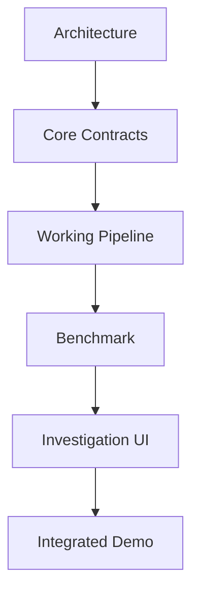
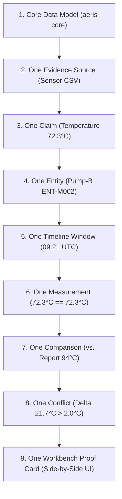
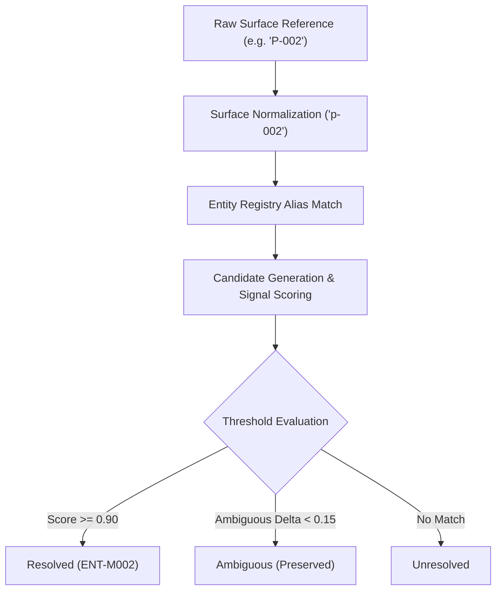
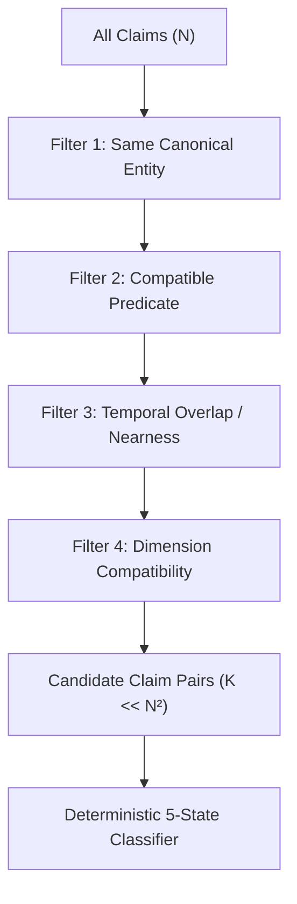
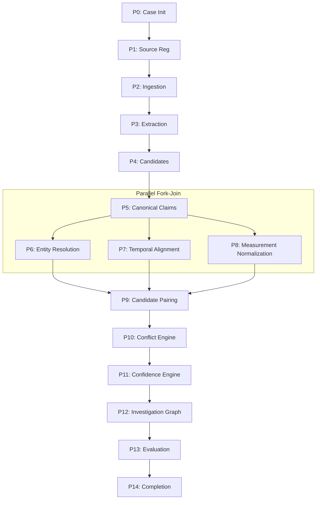
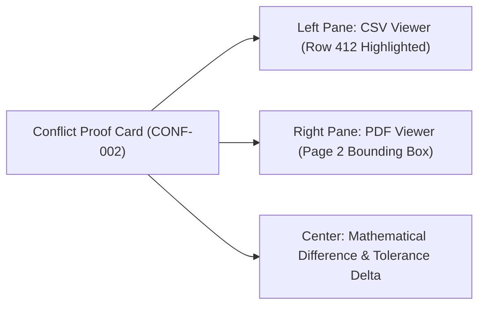
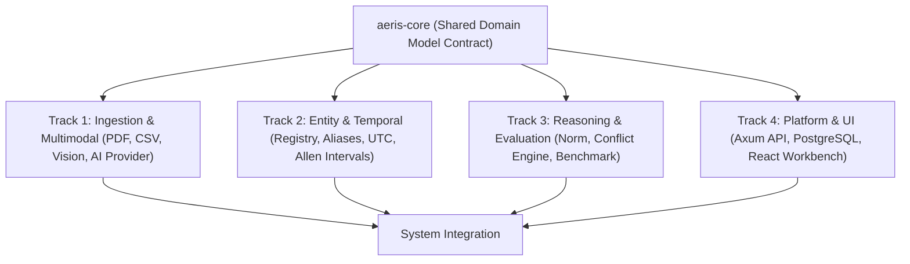
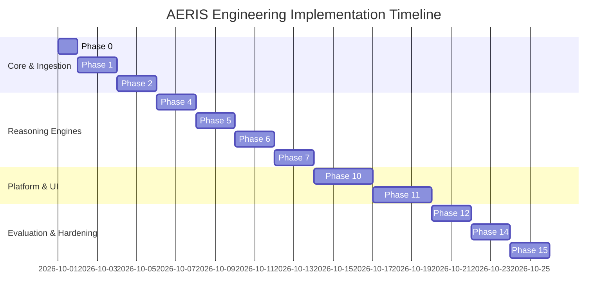

# 21 — AERIS Implementation Roadmap

## 1. Purpose

This roadmap converts the AERIS architectural specifications into an actionable, phased engineering implementation sequence.

The objective is to systematically progress from:



The implementation prioritizes the **minimum complete reasoning path** before adding secondary features.

---

# 2. Implementation Strategy

AERIS is constructed using a **vertical thin-slice strategy** rather than attempting to build isolated horizontal layers for weeks:



```text
Core Model
    ↓
One Evidence Source
    ↓
One Claim
    ↓
One Entity
    ↓
One Timeline
    ↓
One Measurement
    ↓
One Comparison
    ↓
One Conflict
    ↓
One UI Investigation
```

Once this single vertical thread functions from end to end, the system is generalized to multimodal evidence, all six synthetic machines, and the automated benchmark harness.

---

# 3. Development Phases

```text
Phase 0   Repository Setup & Tooling
Phase 1   Core Domain Contracts (aeris-core)
Phase 2   Evidence Ingestion & Checksumming
Phase 3   Multimodal Claim Extraction
Phase 4   Entity Resolution Subsystem
Phase 5   Temporal Alignment Engine
Phase 6   Measurement Normalization Algebra
Phase 7   Deterministic Conflict Engine
Phase 8   Confidence Propagation & Calibration
Phase 9   Pipeline Orchestration & Concurrency
Phase 10  PostgreSQL Storage & REST/SSE API
Phase 11  Investigation Workbench UI
Phase 12  Synthetic Benchmark & Evaluation Harness
Phase 13  Security Hardening & Sandboxing
Phase 14  Full System End-to-End Integration
Phase 15  Demo Hardening & Rehearsal
```

---

# 4. Phase 0 — Repository Setup & Tooling

Directory layout initialization:

```text
aeris/
├── Cargo.toml
├── Cargo.lock
├── docker-compose.yml
├── .env.example
├── crates/
│   ├── aeris-core/
│   ├── ingestion/
│   ├── extraction/
│   ├── entity-resolution/
│   ├── temporal-engine/
│   ├── normalization/
│   ├── conflict-engine/
│   ├── confidence-engine/
│   ├── orchestration/
│   ├── storage/
│   └── api/
├── apps/
│   └── workbench/
├── benchmark/
├── datasets/
│   ├── generated/
│   └── ground-truth/
├── docs/
├── docker/
├── scripts/
└── tests/
```

Tooling:
* Rust 1.85+ toolchain pinned via `rust-toolchain.toml`
* Cargo workspace configured with strict workspace lints
* Node.js 22 LTS with Vite and React for `apps/workbench`
* Docker Compose environment with PostgreSQL 17

---

# 5. Phase 0 Deliverables

* [ ] Git repository initialized with `.gitignore` and `.gitattributes`.
* [ ] Cargo workspace compiling cleanly across all crates.
* [ ] Frontend workbench workspace configured.
* [ ] `docker-compose.yml` spinning up PostgreSQL 17 with health checks.
* [ ] CI pipeline configured (`cargo fmt`, `cargo clippy`, `cargo test`).
* [ ] `.env.example` defining database URLs and port allocations.
* [ ] Root `README.md` with build and execution instructions.

---

# 6. Phase 1 — Core Domain Contracts (`aeris-core`)

Implement pure domain structures without infrastructure dependencies:

```text
CaseRecord
SourceRecord
EvidenceRecord
EvidencePointer
EntityRecord
EntityLink
EventRecord
TemporalContext
ClaimRecord
MeasurementValue
ConfidenceRecord
EvidenceRelationship
ConflictRecord
ProcessingRun
```

> [!IMPORTANT]
> The `aeris-core` crate must never depend on the API, database drivers (SQLx), or web frameworks. It represents pure, portable domain models.

---

# 7. Core Enums

```rust
#[derive(Debug, Clone, Copy, PartialEq, Eq, Serialize, Deserialize)]
pub enum ClaimType {
    Extracted,
    Inferred,
    Hypothesized,
}

#[derive(Debug, Clone, Copy, PartialEq, Eq, Serialize, Deserialize)]
pub enum EvidenceStatus {
    Agreement,
    Conflict,
    Ambiguous,
    InsufficientEvidence,
    NotComparable,
}
```

---

# 8. Core Validation

Implement `validate()` traits across domain entities:
* `ClaimRecord`: Subject cannot be empty; predicate must be sanitized; object must conform to valid value types.
* `EvidencePointer`: Requires valid source ID and location coordinates.
* `TemporalContext`: Start timestamp cannot be after end timestamp.
* `MeasurementValue`: Numbers cannot be `NaN` or `Infinite`; unit string must be non-empty.

---

# 9. Phase 1 Acceptance

* [ ] All domain types compile and derive `Debug`, `Clone`, `Serialize`, `Deserialize`.
* [ ] Comprehensive JSON serialization/deserialization unit tests pass.
* [ ] Invariant validation catches malformed records.
* [ ] `aeris-core` has zero network or database dependencies.

---

# 10. Phase 2 — Evidence Ingestion

Implement `crates/ingestion`:

```text
ingestion/
├── src/
│   ├── lib.rs
│   ├── text.rs
│   ├── csv.rs
│   ├── json.rs
│   ├── image.rs
│   └── checksum.rs
```

Every ingested file produces an immutable `SourceRecord` and is written to content-addressed storage.

---

# 11. Source Registration

```text
Source
 ├── source_id (UUID v4 / v7)
 ├── case_id
 ├── source_type (text, pdf, csv, image)
 ├── filename
 ├── checksum (SHA-256)
 ├── size_bytes
 ├── metadata (JSONB)
 └── status (registered)
```

---

# 12. Text & Document Ingestion

Supports:
* Raw `.txt` and `.md` logs
* PDF text streams with page numbers and character offsets
* Extracts character boundaries `[char_start..char_end]` for exact provenance linking

---

# 13. Structured Data Ingestion (CSV / JSON)

* Streams CSV files in bounded chunks.
* Indexes rows by row number and column name.
* Tracks exact cell coordinates: `location = {"row": 412, "column": "temp_c"}`.

---

# 14. Image Ingestion

* Computes SHA-256 fingerprint.
* Extracts image dimensions (`width`, `height`, MIME type).
* Preserves original byte stream without destructive recompression.

---

# 15. Phase 2 Acceptance

* [ ] Text, CSV, JSON, and Image ingestion handlers functional.
* [ ] SHA-256 checksums calculated and verified on ingest.
* [ ] Exact evidence pointer locations generated per modality.
* [ ] Ingestion rejection on files exceeding 100 MB.
* [ ] Comprehensive unit and integration tests passing.

---

# 16. Phase 3 — Claim Extraction

Implement `crates/extraction`:

```rust
#[async_trait]
pub trait EvidenceExtractor: Send + Sync {
    async fn extract(
        &self,
        source: &SourceRecord,
        content: &[u8],
    ) -> Result<Vec<CandidateClaim>, ExtractionError>;
}
```

Implementations:
* `CsvExtractor` (Polars / streaming tabular extractor)
* `TextRegexExtractor` (Deterministic patterns for structured logs)
* `VisionOcrExtractor` (Image text & bounding box extractor)
* `AiClaimExtractor` (Structured LLM extractor)
* `MockExtractor` (Deterministic fixture extractor for unit testing)

---

# 17. Candidate Claims

Raw observations are first captured as unverified `CandidateClaim` structs:

```json
{
  "subject_text": "Pump-B",
  "predicate": "temperature",
  "value": 94.0,
  "unit": "degC",
  "time_expression": "09:21 UTC",
  "provenance_pointer": {
    "source_id": "SRC-002",
    "location": {"page": 2, "box": [120, 450, 80, 20]}
  }
}
```

---

# 18. AI Provider Interface

Decoupled model abstraction in `aeris-core`:

```rust
#[async_trait]
pub trait AIProvider: Send + Sync {
    async fn extract_claims(
        &self,
        input: ExtractionInput,
    ) -> Result<ExtractionOutput, AIError>;
}
```

Implementations:
* `MockProvider` (Offline deterministic testing)
* `OllamaProvider` (Local Llama 3 / Mistral)
* `ExternalProvider` (OpenAI / Anthropic compatible APIs)

---

# 19. Structured AI Output

Extraction prompts strictly mandate JSON schemas:

```json
{
  "observations": [
    {
      "subject": "Pump-B",
      "predicate": "temperature",
      "value": 94.0,
      "unit": "degC"
    }
  ]
}
```

Schema validation rejects malformed or unstructured responses before canonical claim creation.

---

# 20. Phase 3 Acceptance

* [ ] Candidate claims generated across Text, CSV, and Images.
* [ ] `AIProvider` trait implemented with `MockProvider` and `OllamaProvider`.
* [ ] Schema validation prevents non-conforming model responses.
* [ ] Bit-level evidence pointers preserved on every candidate claim.

---

# 21. Phase 4 — Entity Resolution Subsystem

Implement `crates/entity-resolution`:

```text
entity-resolution/
├── src/
│   ├── lib.rs
│   ├── normalize.rs
│   ├── registry.rs
│   ├── candidate.rs
│   ├── scoring.rs
│   └── resolver.rs
```

---

# 22. Entity Resolution Pipeline



---

# 23. Initial Resolver Implementation

1. **Exact Canonical ID Match:** (e.g., `ENT-M002` $\to$ `ENT-M002`)
2. **Normalized Alias Match:** (e.g., `Pump B` $\to$ `pump-b` $\to$ `ENT-M002`)
3. **Prefix / Machine Signal Weighting:** Standardized equipment tags.
4. **Ambiguity Gate:** If two candidates score within 0.15 of each other, explicitly output `Ambiguous`.

---

# 24. Entity Resolution Tests

Test cases covering all synthetic machine entities:
* `Pump-B` $\to$ `ENT-M002`
* `PUMP-B` $\to$ `ENT-M002`
* `P-002` $\to$ `ENT-M002`
* `CV-E` vs. `CV-E2` $\to$ `Ambiguous` (Conveyor-E M-005)
* `Unknown-XYZ` $\to$ `Unresolved`

---

# 25. Phase 4 Acceptance

* [ ] Canonical entity registry and alias graph operational.
* [ ] Multi-signal scoring engine implemented.
* [ ] Ambiguity preserved when signals are insufficient.
* [ ] `EntityLink` records link candidate claims to canonical entities.

---

# 26. Phase 5 — Temporal Alignment Engine

Implement `crates/temporal-engine`:

```text
temporal-engine/
├── src/
│   ├── lib.rs
│   ├── parser.rs
│   ├── normalizer.rs
│   ├── overlap.rs
│   ├── allen.rs
│   └── gaps.rs
```

---

# 27. Temporal Processing Pipeline

```text
Raw Timestamp (e.g. "09:21 local +05:30")
       ↓
Parser & Timezone Normalizer
       ↓
Canonical UTC (2026-09-30T03:51:00Z)
       ↓
TemporalContext (Start, End, Precision)
       ↓
Allen Interval Relations (Overlaps, Before, After, Meets)
```

---

# 28. Telemetry Gap Detection

Analyzes time-series sampling frequencies:

$$\Delta t_{\text{actual}} > 2 \times \Delta t_{\text{expected}} \implies \text{Gap Interval}$$

Flags gaps as `InsufficientEvidence` windows rather than fabricating readings.

---

# 29. Temporal Tests

* ISO 8601, RFC 3339, and custom plant timestamp parsing.
* Timezone normalization to UTC.
* Overlapping vs. disjoint interval tests.
* Telemetry gap detection (Machine M-004 dropout).

---

# 30. Phase 5 Acceptance

* [ ] Timestamps normalized to UTC across all formats.
* [ ] Allen interval relations computed between claim pairs.
* [ ] Telemetry sampling dropouts flagged as missing evidence.
* [ ] Unit test suite passing.

---

# 31. Phase 6 — Measurement Normalization Algebra

Implement `crates/normalization`:

```text
normalization/
├── src/
│   ├── lib.rs
│   ├── registry.rs
│   ├── dimensions.rs
│   ├── conversion.rs
│   ├── precision.rs
│   └── tolerance.rs
```

---

# 32. Unit Registry & Base Units

Configurable unit dimensions:

| Dimension | Canonical Unit | Supported Source Units |
| :--- | :--- | :--- |
| **Temperature** | Celsius (`degC`) | `°C`, `degC`, `°F`, `degF`, `K` |
| **Pressure** | Kilopascal (`kPa`) | `Pa`, `kPa`, `bar`, `psi` |
| **Vibration** | Millimeters/sec (`mm/s`)| `mm/s`, `in/s`, `g` |
| **Flow Rate** | Liters/min (`L/min`) | `L/min`, `GPM`, `m3/h` |

---

# 33. Algebraic Conversion Pipeline

```text
Raw Measurement (158.0, "degF")
       ↓
Dimension Check (Temperature)
       ↓
Conversion Formula: (158 - 32) * 5/9
       ↓
Canonical Output: (70.0, "degC")
       ↓
Provenance: Raw value preserved in claim metadata
```

---

# 34. Tolerance Models

* **Absolute Tolerance:** $|A - B| \le \epsilon$ (e.g. $\pm 2.0^\circ\text{C}$)
* **Relative Tolerance:** $\frac{|A - B|}{\max(|A|, |B|)} \le \delta$ (e.g. $\pm 5\%$)

---

# 35. Phase 6 Acceptance

* [ ] Unit registry covers temperature, pressure, vibration, and flow.
* [ ] Incompatible dimension comparisons rejected (`degF` vs. `kPa`).
* [ ] Numerical precision preserved without floating point corruption.
* [ ] Unit tests pass for M-003 scenario ($158^\circ\text{F} \to 70^\circ\text{C}$).

---

# 36. Phase 7 — Deterministic Conflict Engine

Implement `crates/conflict-engine`:

```text
conflict-engine/
├── src/
│   ├── lib.rs
│   ├── candidate_pairs.rs
│   ├── gates.rs
│   ├── comparator.rs
│   ├── classifier.rs
│   └── explanation.rs
```

---

# 37. Comparison Pipeline & Pruning

Prunes $O(N^2)$ candidate pairs down to $K$ using indexed filters:



---

# 38. Deterministic Conflict Rule

$$\text{SameEntity} \land \text{SamePredicate} \land \text{TemporalOverlap} \land \text{SameDimension} \land (\Delta > \text{Tolerance}) \implies \mathbf{Conflict}$$

$$\text{SameEntity} \land \text{SamePredicate} \land \text{TemporalOverlap} \land \text{SameDimension} \land (\Delta \le \text{Tolerance}) \implies \mathbf{Agreement}$$

---

# 39. Structured Proof & Explanation

Every classification outputs machine-readable reasoning steps:

```json
{
  "status": "Conflict",
  "reasons": [
    "same_entity: ENT-M002",
    "same_predicate: temperature",
    "temporal_overlap: 09:21:00Z == 09:21:00Z",
    "measurement_delta: 21.7 degC > 2.0 degC tolerance"
  ]
}
```

---

# 40. Phase 7 Acceptance

* [ ] Candidate pair pruning operational.
* [ ] 5-state classification matrix passes all truth-table tests.
* [ ] Structured explanation proof cards generated.
* [ ] M-002 temperature conflict integration test passing.

---

# 41. Phase 8 — Confidence & Calibration

Implement `crates/confidence-engine`:

```text
confidence-engine/
├── src/
│   ├── lib.rs
│   ├── factors.rs
│   ├── propagation.rs
│   ├── calibration.rs
│   └── metrics.rs
```

---

# 42. Weakest-Link Confidence Propagation

$$\text{Confidence} = \min(\text{Extraction}, \text{Entity}, \text{Temporal}, \text{Measurement}) \times \text{Source Quality Penalty}$$

Hard caps applied when:
* Entity is ambiguous (Cap: $0.40$)
* Telemetry contains missing intervals (Cap: $0.30$)

---

# 43. Calibration & Metrics

* Expected Calibration Error (ECE) across 10 confidence bins.
* Brier score calculation.
* Generation of reliability curves for the workbench UI.

---

# 44. Phase 8 Acceptance

* [ ] Weakest-link propagation formula verified.
* [ ] Hard caps triggered on ambiguous or incomplete evidence.
* [ ] ECE and Brier score calculators pass unit tests.

---

# 45. Phase 9 — Processing Pipeline Orchestration

Implement `crates/orchestration`:

```text
orchestration/
├── src/
│   ├── lib.rs
│   ├── orchestrator.rs
│   ├── stage.rs
│   ├── context.rs
│   ├── checkpoint.rs
│   ├── retry.rs
│   └── events.rs
```

---

# 46. Execution Sequence (Stages P0 to P14)



---

# 47. Stage Fault Isolation & Checkpoints

* Upstream extractions are saved to disk checkpoints.
* Downstream reasoning failure retains all extracted claims.
* Recoverable errors retry up to 3 times with exponential backoff.

---

# 48. Phase 9 Acceptance

* [ ] Orchestrator executes DAG in strict dependency order.
* [ ] Parallel fork-join branches execute concurrently via `tokio::join!`.
* [ ] Failure in one source isolates gracefully (`COMPLETED_WITH_WARNINGS`).
* [ ] Cooperative cancellation tokens halt runs cleanly.

---

# 49. Phase 10 — Storage and REST/SSE API

Implement `crates/storage` and `crates/api`:

* PostgreSQL 17 migrations (`0001` through `0005`)
* SQLx typed queries and repository traits
* Axum HTTP REST router
* Server-Sent Events (SSE) progress broadcast on `GET /api/v1/cases/events`

---

# 50. API Endpoints Implementation Order

1. `POST /api/v1/cases` & `GET /api/v1/cases/{id}`
2. `POST /api/v1/cases/{id}/sources`
3. `POST /api/v1/cases/{id}/process`
4. `GET /api/v1/cases/events` (SSE Stream)
5. `GET /api/v1/cases/{id}/claims`
6. `GET /api/v1/cases/{id}/conflicts`
7. `GET /api/v1/cases/{id}/graph`

---

# 51. Phase 10 Acceptance

* [ ] Database migrations execute cleanly.
* [ ] Repositories persist and query domain records.
* [ ] REST endpoints conform to OpenAPI contracts.
* [ ] SSE stream delivers live stage transitions.

---

# 52. Phase 11 — Investigation Workbench UI

Build `apps/workbench` (Vite, React, TypeScript, Vanilla CSS design tokens):

```text
apps/workbench/src/
├── components/
│   ├── CaseDashboard.tsx
│   ├── TimelineView.tsx
│   ├── ConflictInspector.tsx
│   ├── ProofCard.tsx
│   ├── EvidenceViewer.tsx
│   ├── EntityInspector.tsx
│   ├── GraphView.tsx
│   └── EvaluationDashboard.tsx
├── hooks/
│   └── useSSE.ts
└── api/
```

---

# 53. The Killer UI Workflow: Side-by-Side Proof Card



Investigator clicks a conflict card, and the UI immediately splits:
* Left: Highlights raw telemetry row 412 in `telemetry.csv`
* Right: Draws bounding box around technician note in `maintenance_report.pdf`
* Center: Displays $|94.0 - 72.3| = 21.7^\circ\text{C} > 2.0^\circ\text{C}$ mathematical proof

---

# 54. Phase 11 Acceptance

* [ ] Case dashboard loads live summary counts.
* [ ] Timeline visualizes discrete events and sensor streams.
* [ ] Side-by-side evidence viewer highlights exact document coordinates.
* [ ] Ambiguity and missing evidence badges render distinct colors.
* [ ] Interactive graph canvas renders claims and conflicts.

---

# 55. Phase 12 — Synthetic Benchmark & Evaluation Harness

Implement `benchmark/` and isolated evaluation harness:
* Six machine containers (M-001 through M-006).
* Ground truth quarantined in `test/ground-truth/`.
* Computes Macro F1, $5 \times 5$ confusion matrix, and ECE.

---

# 56. Six-Machine Scenario Validation

* **M-001 (Press-A):** Baseline Agreement verified.
* **M-002 (Pump-B):** 21.7°C temperature conflict flagged.
* **M-003 (Motor-C):** Unit normalization verified ($158^\circ\text{F} \equiv 70^\circ\text{C}$).
* **M-004 (Compressor-D):** 5-minute telemetry gap flagged as insufficient evidence.
* **M-005 (Conveyor-E):** `CV-E` vs `CV-E2` preserved as ambiguous.
* **M-006 (Robot-F):** Thermography visual hotspot vs operator log text conflict flagged.

---

# 57. Phase 12 Acceptance

* [ ] Benchmark runs headless via CLI or Docker Compose.
* [ ] Evaluation metrics export `evaluation.json` and `summary.md`.
* [ ] Macro F1 meets target ($\ge 0.90$).
* [ ] Ground truth quarantine asserted by automated test.

---

# 58. Phase 13 — Security Hardening & Sandboxing

* Sandboxed parsers with dropped Linux capabilities.
* Input validation for MIME, magic bytes, and 100 MB file caps.
* Path traversal sanitization via UUID content paths.
* Prompt injection boundaries (`<untrusted_evidence_content>`).
* Parameterized SQLx queries preventing SQL injection.

---

# 59. Phase 13 Acceptance

* [ ] Adversarial prompt injection test cases pass.
* [ ] Zip-slip and path traversal payloads rejected.
* [ ] Non-root execution verified across all containers.
* [ ] `cargo audit` and `npm audit` pass with 0 critical/high CVEs.

---

# 60. Phase 14 — Full System End-to-End Integration

* Execute the complete pipeline against all six machines concurrently.
* Verify bit-level provenance navigation from findings to raw files.
* Validate performance: Full 6-machine benchmark completes in $< 60\text{ seconds}$.

---

# 61. Phase 14 Acceptance

* [ ] Full pipeline runs end-to-end without manual intervention.
* [ ] Zero broken provenance links across the entire benchmark.
* [ ] UI state reflects 100% parity with backend PostgreSQL state.

---

# 62. Phase 15 — Demo Hardening & Rehearsal

* Implement `scripts/seed-demo.sh` and `scripts/reset-demo.sh`.
* Freeze release tag `v0.1.0-demo`.
* Validate offline execution with local Ollama / Mock AI provider.
* Execute 3-minute, 5-minute, and 10-minute rehearsal runs.

---

# 63. Phase 15 Acceptance

* [ ] Single-command demo reset functions in $< 15\text{ seconds}$.
* [ ] Offline execution verified without internet access.
* [ ] Rehearsal walkthrough successfully completed.

---

# 64. Feature Triage & Priority Tiers

```text
┌────────────────────────────────────────────────────────┐
│ TIER 1: MANDATORY (Core Architecture - Must Not Cut)  │
├────────────────────────────────────────────────────────┤
│ • Canonical Claim & Evidence Model                     │
│ • Deterministic Unit Normalization & Tolerance Engine  │
│ • Deterministic Conflict Detection Matrix              │
│ • Exact Source Coordinate Provenance Pointers          │
│ • Ambiguity & Missing Evidence Preservation            │
│ • Side-by-Side Proof Card Investigation UI             │
│ • Six-Machine Synthetic Benchmark & Ground Truth Eval  │
└────────────────────────────────────────────────────────┘
                           │
┌────────────────────────────────────────────────────────┐
│ TIER 2: IMPORTANT (High Value - Implement for Polish) │
├────────────────────────────────────────────────────────┤
│ • Calibrated Confidence & ECE Reliability Curves       │
│ • Interactive Timeline Zoom & Pan                      │
│ • Visual Bounding Box Highlighting on Thermography     │
│ • Human Review & Override Overlay                      │
│ • Append-Only Audit Event Trail                        │
└────────────────────────────────────────────────────────┘
                           │
┌────────────────────────────────────────────────────────┐
│ TIER 3: OPTIONAL (Defer if Constrained)                │
├────────────────────────────────────────────────────────┤
│ • Multi-Tenant RBAC & Complex JWT Authentication       │
│ • Distributed Message Queues (Redis / NATS)            │
│ • Advanced Vector Search (pgvector)                    │
│ • 50+ Machine Scalability Profiling                    │
└────────────────────────────────────────────────────────┘
```

---

# 65. Team Track Allocation



---

# 66. Milestone Timeline



---

# 67. Definition of Done (DoD)

A milestone or feature is considered **Done** only when:

1. **Code:** Rust code compiles with zero warnings under `cargo clippy -- -D warnings`.
2. **Tests:** Unit, contract, and integration tests pass with $\ge 85\%$ coverage on reasoning crates.
3. **Docs:** Architectural decisions and schemas are reflected in `docs/`.
4. **Integration:** Feature runs within the Docker Compose environment.
5. **No Regressions:** Benchmark Macro F1 does not degrade.

---

# 68. Final Acceptance Checklist

* [ ] `aeris-core` defines all canonical data structures and validation logic.
* [ ] Multimodal ingestion handles Text, CSV, JSON, and Images with SHA-256 hashing.
* [ ] Entity resolution matches aliases and preserves `CV-E` ambiguity.
* [ ] Temporal engine normalizes UTC and detects sampling dropouts.
* [ ] Normalization engine converts units and checks dimensional compatibility.
* [ ] Conflict engine outputs deterministic classifications with structured proof cards.
* [ ] Weakest-link confidence calculation and ECE calibration operational.
* [ ] Pipeline orchestrator executes 15-stage DAG with concurrency.
* [ ] PostgreSQL 17 storage and REST/SSE API fully operational.
* [ ] React workbench UI provides side-by-side evidence inspection.
* [ ] Six synthetic machine cases pass through the production pipeline.
* [ ] Automated evaluation harness reports Macro F1 $\ge 0.90$.
* [ ] Clean demo reset and seed scripts validated.

---

# 69. Final Principle

AERIS is built from the **inside out**:

```text
Domain Logic
     ↓
Evidence Lineage
     ↓
Reasoning Engines
     ↓
Pipeline Orchestration
     ↓
Storage & API
     ↓
Investigation UI
     ↓
Benchmark Evaluation
```

The foundation is not an attractive mockup.

The foundation is this mathematical guarantee:

$$\text{Evidence} \xrightarrow{\text{Validated}} \text{Claims} \xrightarrow{\text{Aligned}} \text{Physical Comparison} \xrightarrow{\text{Deterministic}} \text{Proven Finding}$$

Once that chain of custody is established in pure Rust, the rest of the system becomes disciplined engineering around an unshakeable core.
