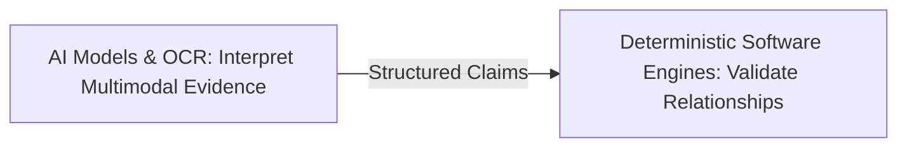
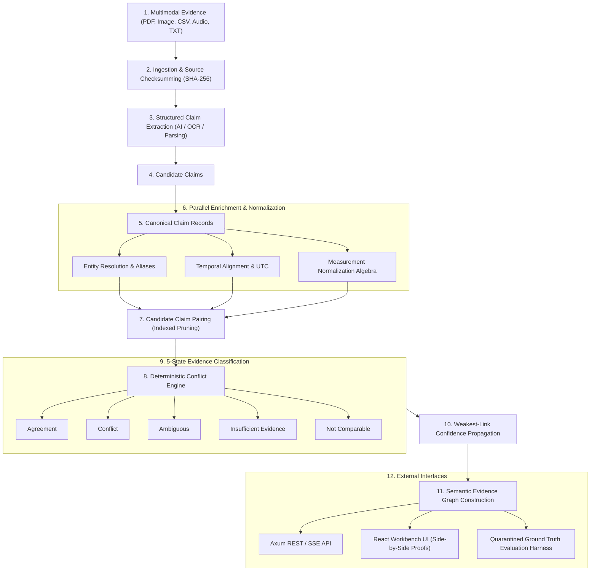
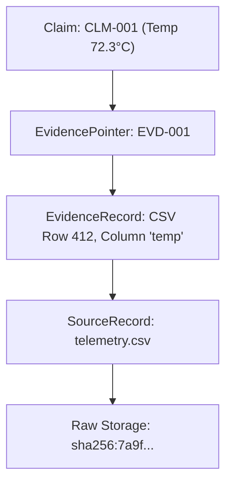
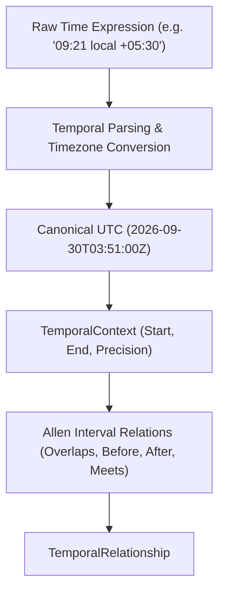
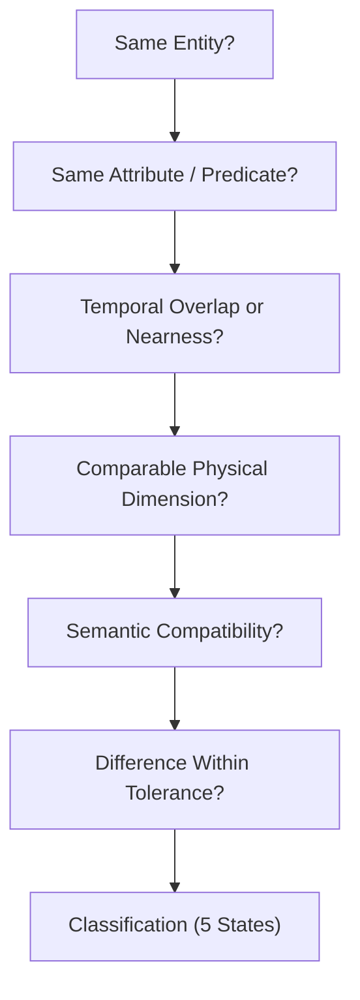
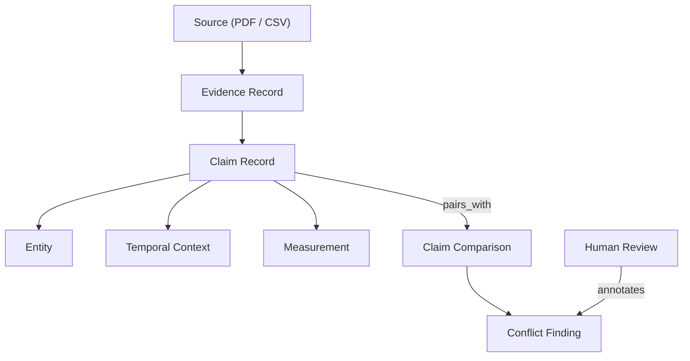
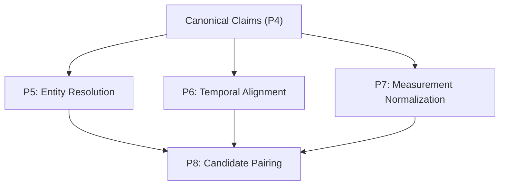

# 23 — AERIS Final Architecture

## 1. Purpose

This document is the consolidated technical architecture for AERIS.

It converts the previously defined:

* requirements,
* data model,
* provenance model,
* entity resolution,
* temporal alignment,
* measurement normalization,
* conflict detection,
* confidence,
* investigation UI,
* API,
* orchestration,
* storage,
* evaluation,
* deployment,
* security,
* testing,
* and team ownership

into one implementation reference.

The purpose is to eliminate architectural ambiguity before full implementation begins.

---

# 2. AERIS Definition

**AERIS — Evidence Alignment and Reasoning Intelligence System**

AERIS is a multimodal evidence reasoning engine that transforms heterogeneous evidence into structured claims and determines how those claims relate.

It accepts:

```text
Text
Images
Structured Tables
CSV
JSON
Time-Series / Sensor Data
```

and produces:

```text
Entities
Events
Claims
Temporal Relationships
Measurements
Evidence Relationships
Conflicts
Confidence
Provenance
```

---

# 3. Core Principle

The entire architecture is based on one foundational separation:



```text
AI
↓
Interpret evidence

Deterministic Software
↓
Validate evidence relationships
```

AI may assist with:

```text
text interpretation
image interpretation
claim extraction
semantic similarity
candidate generation
```

Deterministic components establish:

```text
entity compatibility
temporal compatibility
unit compatibility
measurement comparison
tolerance
conflict classification
provenance integrity
```

---

# 4. Complete Architecture




---

# 5. Architectural Layers

AERIS consists of nine major layers:

```text
1. Input Layer                 (Raw multi-format file streams)
2. Ingestion Layer             (Validation, SHA-256 fingerprinting, segmentation)
3. Interpretation Layer        (OCR, vision inference, LLM observation extraction)
4. Canonical Evidence Layer    (ClaimRecord, EntityRecord, EvidencePointer)
5. Reasoning Layer             (Entity resolution, Allen temporal calculus, unit algebra)
6. Confidence Layer            (Weakest-link propagation, ECE calibration)
7. Persistence Layer           (PostgreSQL 17 metadata & content-addressed object store)
8. Investigation Layer         (Workbench UI, side-by-side proof cards, timeline)
9. Evaluation Layer            (Quarantined ground truth, Macro F1, confusion matrix)
```

---

# 6. Input Layer

Supported evidence modalities:

```text
Text
PDF-derived text
Images
CSV
JSON
Structured records
Sensor telemetry
```

All input is treated as untrusted data. No raw source input is ever permitted to bypass validation or directly mutate canonical reasoning state.

---

# 7. Ingestion Layer

Responsibilities:

```text
file validation
source registration
cryptographic checksumming (SHA-256)
metadata extraction
immutable object storage
evidence coordinate segmentation
```

Primary artifacts generated:

```text
SourceRecord
EvidenceRecord
EvidencePointer
```

---

# 8. Interpretation Layer

Converts raw multimodal evidence into candidate observations without deciding canonical truth:

Components:

```text
TextExtractor
TableExtractor
ImageExtractor
StructuredExtractor
AIProvider (Ollama / Cloud / Mock)
```

Output:

```text
CandidateClaim
```

The output of an AI extractor is a proposal, not a fact.

---

# 9. Canonical Evidence Layer

Converts candidate observations into validated, strongly-typed AERIS domain objects.

Primary object:

```rust
pub struct ClaimRecord {
    pub id: ClaimId,
    pub case_id: CaseId,
    pub subject_entity_id: Option<EntityId>,
    pub predicate: String,
    pub object: ClaimValue,
    pub temporal_context: Option<TemporalContext>,
    pub provenance: Vec<EvidencePointer>,
    pub claim_type: ClaimType,
    pub confidence: Option<ConfidenceRecord>,
    pub status: ClaimStatus,
    pub processing_run_id: ProcessingRunId,
}
```

---

# 10. Claim Types

```rust
#[derive(Debug, Clone, Copy, PartialEq, Eq, Serialize, Deserialize)]
pub enum ClaimType {
    Extracted,
    Inferred,
}
```

The distinction remains permanent: an inferred claim is never represented as though it were directly observed by a physical instrument.

---

# 11. Evidence Provenance

Every canonical claim traces directly to raw source coordinates:



```text
Claim
 ↓
EvidencePointer
 ↓
EvidenceRecord
 ↓
SourceRecord
 ↓
Original Artifact
```

Supported pointer coordinate types:

```text
Text              (Page, character start/end)
Image             (Bounding box: x, y, width, height)
Table             (Row index, column key)
TimeSeries        (Timestamp window, channel ID)
StructuredField   (JSONPointer / path)
```

---

# 12. Entity Resolution Layer

Converts surface references into canonical physical entities:

```text
Source Reference (e.g. "P-002")
       ↓
Surface Normalization ("p-002")
       ↓
Registry Lookup
       ↓
Candidate Generation
       ↓
Multi-Signal Scoring
       ↓
Resolution Status
```

Possible outcomes:

```text
Resolved     (Score >= 0.90)
Ambiguous    (Multiple candidates within 0.15 threshold)
Distinct     (Verified separate entity)
Unresolved   (Unknown equipment tag)
```

---

# 13. Entity Model

```rust
pub struct EntityRecord {
    pub id: EntityId,
    pub case_id: CaseId,
    pub entity_type: EntityType,
    pub canonical_name: String,
    pub aliases: Vec<EntityAlias>,
    pub attributes: HashMap<String, serde_json::Value>,
    pub source_references: Vec<SourceReference>,
    pub confidence: Option<ConfidenceRecord>,
    pub status: EntityStatus,
}
```

---

# 14. Temporal Layer

Normalizes temporal expressions and evaluates interval relationships:



---

# 15. Temporal Model

```rust
pub struct TemporalContext {
    pub start: Option<DateTime<Utc>>,
    pub end: Option<DateTime<Utc>>,
    pub precision: TemporalPrecision,
    pub timezone: Option<String>,
    pub approximate: bool,
    pub original_expression: Option<String>,
}
```

Temporal modalities supported:
* Discrete Instant
* Time Interval
* Approximate Window
* Unknown / Missing
* Event-Relative Expression

---

# 16. Measurement Layer

Physical measurements are normalized into canonical dimensions before mathematical comparison:

```text
Raw Measurement (158.0, "degF")
      ↓
Unit Detection ("degF")
      ↓
Dimension Validation (Temperature)
      ↓
Canonical Conversion ((158 - 32) * 5/9 -> 70.0 degC)
      ↓
Tolerance Application (+/- 2.0 degC)
      ↓
Comparison
```

---

# 17. Measurement Model

```rust
pub struct MeasurementValue {
    pub value: f64,
    pub unit: Unit,
    pub canonical_value: Option<f64>,
    pub canonical_unit: Option<Unit>,
    pub uncertainty: Option<f64>,
    pub tolerance: Option<f64>,
    pub provenance: Vec<EvidencePointer>,
}
```

---

# 18. Canonical Units

Centralized SI base unit registry:

| Physical Dimension | Canonical Unit | Supported Source Units |
| :--- | :--- | :--- |
| **Temperature** | Celsius (`degC`) | `°C`, `degC`, `°F`, `degF`, `K` |
| **Pressure** | Kilopascal (`kPa`) | `Pa`, `kPa`, `bar`, `psi` |
| **Length** | Meter (`m`) | `m`, `cm`, `mm`, `in`, `ft` |
| **Mass** | Kilogram (`kg`) | `kg`, `g`, `lb` |
| **Time** | Second (`s`) | `s`, `ms`, `min`, `h` |
| **Velocity** | Meters/sec (`m/s`) | `m/s`, `km/h`, `mph`, `ft/s` |
| **Acceleration** | Meters/sec² (`m/s²`)| `m/s²`, `g` |
| **Energy** | Joule (`J`) | `J`, `kJ`, `cal`, `BTU` |
| **Power** | Watt (`W`) | `W`, `kW`, `HP` |
| **Frequency** | Hertz (`Hz`) | `Hz`, `kHz`, `RPM` |
| **Voltage** | Volt (`V`) | `V`, `mV`, `kV` |
| **Current** | Ampere (`A`) | `A`, `mA` |
| **Resistance** | Ohm (`Ω`) | `Ω`, `kΩ`, `MΩ` |

---

# 19. Evidence Reasoning Layer

Deterministic decision sequence for candidate claim pairs:



---

# 20. Evidence Status

```rust
#[derive(Debug, Clone, Copy, PartialEq, Eq, Serialize, Deserialize)]
pub enum EvidenceStatus {
    Agreement,
    Conflict,
    Ambiguous,
    InsufficientEvidence,
    NotComparable,
}
```

---

# 21. Conflict Rule

Formal deterministic rule:

$$\text{Conflict}(A,B) = \text{SameEntity}(A,B) \land \text{SameAttribute}(A,B) \land \text{TemporalOverlap}(A,B) \land \text{ComparableUnits}(A,B) \land \text{SemanticCompatibility}(A,B) \land \text{DifferenceBeyondTolerance}(A,B)$$

---

# 22. Conflict Comparison Model

```rust
pub struct ClaimComparison {
    pub id: ComparisonId,
    pub claim_a: ClaimId,
    pub claim_b: ClaimId,
    pub entity_relation: EntityRelation,
    pub temporal_relation: TemporalRelationshipType,
    pub attribute_relation: AttributeRelation,
    pub value_relation: ValueRelation,
    pub status: EvidenceStatus,
    pub confidence: Option<ConfidenceRecord>,
    pub reasons: Vec<ConflictReason>,
}
```

---

# 23. Conflict Explanation

Every finding produces human-readable and machine-verifiable proofs:

```json
{
  "status": "Conflict",
  "reasons": [
    "same_entity: ENT-M002 (Pump-B)",
    "same_attribute: temperature",
    "temporal_overlap: 09:21:00Z == 09:21:00Z",
    "compatible_units: degC == degC",
    "difference_beyond_tolerance: |94.0 - 72.3| = 21.7 > 2.0 degC"
  ]
}
```

---

# 24. Confidence Layer

Confidence communicates reasoning reliability and evidence quality, not subjective belief:

```rust
pub struct ConfidenceRecord {
    pub score: Option<f32>,
    pub level: ConfidenceLevel,
    pub method: ConfidenceMethod,
    pub factors: Vec<ConfidenceFactor>,
    pub calibrated: bool,
}
```

---

# 25. Confidence Pipeline

$$\text{Final Confidence} = \min(\text{Extraction}, \text{Entity}, \text{Temporal}, \text{Measurement}) \times \text{Quality Penalty}$$

Hard caps apply when epistemic uncertainty is identified:
* Ambiguous entity: Capped at $0.40$.
* Telemetry dropout: Capped at $0.30$.

---

# 26. Evidence Graph

Maintains complete relational topology:



```text
Source
  │
  ▼
Evidence
  │
  ▼
Claim ───────► Entity
  │              │
  │              ▼
  │            Event
  │
  ├──────────► Measurement
  │
  └──────────► Temporal Context
                   │
                   ▼
              Comparison
                   │
                   ▼
                Conflict
```

---

# 27. Pipeline Architecture

15-stage DAG controlled by `aeris-orchestration`:

```text
P0  Case Initialization
P1  Source Registration
P2  Evidence Ingestion
P3  Extraction
P4  Claim Canonicalization
P5  Entity Resolution
P6  Temporal Alignment
P7  Measurement Normalization
P8  Candidate Pair Generation
P9  Conflict Detection
P10 Confidence Engine
P11 Evidence Graph Construction
P12 Evaluation
P13 Finalization
```

---

# 28. Pipeline Parallelism

Concurrently executed enrichment stages:


---

# 29. Pipeline Contract

```rust
#[async_trait]
pub trait PipelineStage: Send + Sync {
    async fn execute(
        &self,
        context: &mut PipelineContext,
    ) -> Result<StageOutput, StageError>;
    
    fn name(&self) -> &'static str;
    fn dependencies(&self) -> &'static [&'static str];
}
```

---

# 30. Failure Isolation

If a single file or parser fails:

```text
Source A (CSV)       ✓ (Processed)
Source B (Corrupt)   ✗ (Failed gracefully)
Source C (Report)    ✓ (Processed)
```

AERIS completes processing for sources A and C, flags source B with `EXTRACTION_WARNING`, and concludes with status `COMPLETED_WITH_WARNINGS`.

---

# 31. Checkpointing

Disk checkpoints preserve expensive upstream extractions. Restarting after a conflict engine adjustment resumes immediately without re-running OCR.

---

# 32. Retry Policy

* **Recoverable Errors:** Network timeouts, temporary DB locks $\to$ Exponential backoff (max 3 retries).
* **Non-Recoverable Errors:** Corrupted PDFs, bad JSON schemas, invalid syntax $\to$ Fail immediately without looping.

---

# 33. Storage Architecture

```text
                 AERIS Storage
                       │
          ┌────────────┴────────────┐
          ▼                         ▼
    PostgreSQL 17             Object Store
          │                         │
Relational Metadata,         Immutable Raw Binary Files
Lineage, Claims, Conflicts   (PDFs, CSVs, Images, Audio)
```

---

# 34. Storage Principle

Original evidence is strictly immutable. Derived claims and conflict findings reference immutable `processing_run_id` snapshots.

---

# 35. Ground Truth Isolation

Quarantined directory separation:

```text
operational evidence ──► AERIS Pipeline ──► Predictions ┐
                                                         ├──► Evaluator ──► F1 Score
ground-truth/*.json  ───────────────────────────────────┘
```

Reasoning engines have zero file or network access to ground-truth benchmarks.

---

# 36. API Architecture

REST base: `/api/v1`

Primary endpoints:
* `/cases` (CRUD case management)
* `/sources` (Multipart uploads and checksums)
* `/process` (Non-blocking pipeline execution dispatch)
* `/events` (Live SSE progress broadcasting)
* `/claims` (Canonical claim query interfaces)
* `/conflicts` (Conflict inspection and proof cards)
* `/graph` (Semantic DAG traversal)

---

# 37. API Flow

```text
POST /cases
      ↓
POST /cases/{id}/sources
      ↓
POST /cases/{id}/process
      ↓
GET /processing/{id}
      ↓
SSE /processing/{id}/events
      ↓
GET /cases/{id}/claims
      ↓
GET /cases/{id}/conflicts
```

---

# 38. API and Domain Separation

Strict layered architecture:

```text
HTTP Request ──► DTO ──► Service Layer ──► Domain Entity ──► SQLx Repository
```

Domain models never leak internal database IDs or transient states directly to HTTP handlers.

---

# 39. Processing Events

Broadcast via Server-Sent Events (`text/event-stream`):

```text
stage_started
stage_progress
stage_completed
stage_failed
stage_retried
pipeline_completed
```

---

# 40. Investigation Workbench UI

Primary views in `apps/workbench`:
* **Case Dashboard:** Overview counts and active processing runs
* **Evidence Viewer:** Multi-format inspection (PDF, CSV, Image bounding boxes)
* **Claim Explorer:** Filterable claim tables with provenance badges
* **Interactive Timeline:** Multimodal event markers and dropout bands
* **Conflict Inspector:** Side-by-side proof cards
* **Entity Inspector:** Equipment registries and alias ambiguity displays
* **Benchmark Dashboard:** Confusion matrices, ECE calibration curves, Macro F1

---

# 41. Case Dashboard Metrics

Displays real-time breakdown badges:

```text
[ 14 Agreements ] [ 2 Conflicts ] [ 1 Ambiguous ] [ 1 Insufficient Evidence ] [ 3 Not Comparable ]
```

---

# 42. Conflict Inspector (Proof Card)

```text
┌────────────────────────────────────────────────────────────┐
│ CONFLICT CONF-002: Pump-B Temperature Contradiction       │
├────────────────────────────────────────────────────────────┤
│ Entity: ENT-M002 (Pump-B)                                  │
│ Attribute: Temperature                                     │
│ Time: 2026-09-30T09:21:00Z                                 │
│ Delta: 21.7°C (Tolerance: 2.0°C)                           │
│ Confidence: 0.94 (Calibrated)                              │
├─────────────────────────────┬──────────────────────────────┤
│ Claim A: 72.3°C             │ Claim B: 94.0°C              │
│ Source: telemetry.csv       │ Source: maintenance_report   │
│ Location: Row 412           │ Location: Page 2, Paragraph 3│
└─────────────────────────────┴──────────────────────────────┘
```

---

# 43. Evidence Viewer

Modality-aware coordinate highlighting:
* **Text / PDF:** Character offsets and page bounding boxes
* **CSV:** Highlighted row number and column header
* **Image / Thermography:** Red rectangular bounding box `[x, y, w, h]`
* **Telemetry:** Highlighted timestamp and sensor channel

---

# 44. Timeline

Combines sensor streams, discrete events, work orders, and missing telemetry dropout bands on a unified temporal axis.

---

# 45. Entity Inspector

Surfaces equipment aliases and explicitly renders unresolved ambiguity:

```text
Reference: "CV-E"
Candidates: Conveyor-E Main Belt (0.82) vs Conveyor-E2 Sorter (0.81)
Status: AMBIGUOUS (Preserved)
```

---

# 46. Evaluation Layer

Consumes AERIS predictions post-run and compares them against isolated ground truth:

```text
AERIS Predictions + Quarantined Ground Truth ──► Evaluator ──► Metrics & Scorecard
```

---

# 47. Evaluation Metrics

* **Claim Extraction:** Precision, Recall, F1
* **Entity Resolution:** Precision, Recall, F1, Ambiguity Detection Rate
* **Temporal Alignment:** Accuracy, Allen Interval F1
* **Measurement Normalization:** Dimensional Accuracy ($1.00$)
* **Conflict Detection:** Precision, Recall, F1, **Macro F1**
* **Provenance:** Completeness ($100\%$), Accuracy
* **Confidence Calibration:** Expected Calibration Error (ECE $\le 0.10$), Brier Score

---

# 48. Synthetic Benchmark Matrix (Six Machines)

| Machine | Asset Name | Target Scenario | Expected Evaluation Outcome |
| :--- | :--- | :--- | :--- |
| **M-001** | Press-A | Normal baseline | Agreement (No false conflicts) |
| **M-002** | Pump-B | Temperature contradiction | Conflict ($72.3^\circ\text{C}$ vs. $94.0^\circ\text{C}$) |
| **M-003** | Motor-C | Unit variation | Agreement ($158.0^\circ\text{F} \equiv 70.0^\circ\text{C}$) |
| **M-004** | Compressor-D| Telemetry sensor dropout | Insufficient Evidence (Gap detected) |
| **M-005** | Conveyor-E | Alias ambiguity | Ambiguous (`CV-E` vs. `CV-E2`) |
| **M-006** | Robot-F | Cross-modal disagreement | Multimodal Conflict (Text vs. Image) |

---

# 49. Deployment Architecture

Local development and hackathon container topology:

```text
docker-compose.yml
├── postgres       (PostgreSQL 17 Database)
├── api            (Rust Axum API Server :8080)
├── worker         (Rust Orchestration Worker)
├── frontend       (Nginx + Vite React Workbench :3000)
├── ollama         (Local AI Inference :11434)
└── machines       (Isolated Synthetic Generators M-001..M-006)
```

---

# 50. Network Boundaries

Internal Docker bridge network (`aeris-net`). Host interfaces only publish port `3000` (Frontend) and `8080` (API Gateway). Database and workers remain internal.

---

# 51. Security Architecture

Zero-trust boundary protections:
* All uploaded files treated as untrusted data
* Path traversal prevented via UUID storage keys
* Sandboxed document parsers with dropped Linux capabilities
* Strict JSON schema validation on all AI model outputs
* Parameterized SQLx queries preventing SQL injection
* Append-only immutable audit logging

---

# 52. AI Security Boundary

The AI model acts as a reader, not a judge. It possesses zero direct database access, cannot alter conflict rules, and cannot access ground truth.

---

# 53. Observability

Real-time tracing via `tracing` crate:
* Structured JSON logs (`run_id`, `case_id`, `stage`)
* Per-stage wall-clock latency, CPU, and peak RSS memory metrics
* Prometheus/OpenTelemetry export hooks

---

# 54. Versioning

Every finding permanently records:
* Pipeline version
* Database schema migration version
* AI model and prompt version
* Configuration parameter hash (`aeris.toml`)
* Benchmark dataset version

---

# 55. Reproducibility

$$\text{Finding} = f(\text{Evidence}, \text{Pipeline Version}, \text{Model Version}, \text{Config Hash}, \text{Rule Version})$$

---

# 56. Final Repository Workspace Architecture

```text
aeris/
├── Cargo.toml
├── Cargo.lock
├── docker-compose.yml
├── crates/
│   ├── aeris-core/           (Portable canonical domain types)
│   ├── ingestion/            (File parsing, validation, SHA-256)
│   ├── extraction/           (OCR, Polars, structured AI extraction)
│   ├── entity-resolution/    (Multi-signal resolver & alias graph)
│   ├── temporal-engine/      (UTC normalizer & Allen interval calculus)
│   ├── normalization/        (Unit registry & dimensional algebra)
│   ├── conflict-engine/      (5-state conflict matrix & proof cards)
│   ├── confidence-engine/    (Weakest-link math & ECE calibration)
│   ├── orchestration/        (15-stage DAG orchestrator & checkpoints)
│   ├── storage/              (SQLx migrations & PostgreSQL repositories)
│   └── api/                  (Axum REST router & SSE broadcast)
├── apps/
│   └── workbench/            (React / TypeScript investigation frontend)
├── benchmark/                (Automated scoring harness & evaluator)
├── datasets/
│   ├── generated/            (Isolated machine simulation outputs)
│   └── ground-truth/         (Quarantined evaluation truths)
├── docker/
│   ├── api/
│   ├── worker/
│   ├── frontend/
│   └── machines/
├── scripts/
│   ├── seed-demo.sh
│   └── reset-demo.sh
└── docs/                     (Architectural source of truth)
```

---

# 57. Core Dependency Direction

Inward dependency flow:

```text
Frontend ──► API ──► Orchestration ──► Reasoning Engines ──► aeris-core
                          │
                          └──► Storage (SQLx) ──► aeris-core
```

`aeris-core` is the root dependency and depends on nothing else in the workspace.

---

# 58. Module Dependency Hierarchy

```text
aeris-core (Contracts)
    ▲
    ├── ingestion
    ├── extraction
    ├── entity-resolution
    ├── temporal-engine
    ├── normalization
    ├── conflict-engine
    ├── confidence-engine
    └── storage
         ▲
         ├── orchestration
         └── api
```

---

# 59. Core Architectural Invariants

### Invariant 1
Original evidence is immutable.

### Invariant 2
Every extracted claim has bit-level provenance.

### Invariant 3
Extracted and inferred claims remain permanently distinguishable.

### Invariant 4
Ambiguous entities are never silently resolved.

### Invariant 5
Unknown timestamps remain explicitly unknown.

### Invariant 6
Missing measurements are never fabricated or interpolated.

### Invariant 7
Measurements are normalized before mathematical comparison.

### Invariant 8
Conflict classification is deterministic once structured inputs exist.

### Invariant 9
AI output is validated against strict JSON schemas before entering canonical state.

### Invariant 10
Ground truth never enters the reasoning pipeline.

### Invariant 11
Confidence reflects evidence quality and uncertainty, not truth probability.

### Invariant 12
Every finding traces backward to source evidence coordinates.

### Invariant 13
Every processing run is versioned and reproducible.

### Invariant 14
The frontend workbench never independently computes reasoning rules.

---

# 60. End-to-End Walkthrough Example (Machine M-002)

1. **Ingest:** `telemetry.csv` and `maintenance_report.pdf` uploaded; SHA-256 hashed.
2. **Extract:** Sensor reports 72.3°C at 09:21; Work order reports 94.0°C at 09:21.
3. **Resolve:** Both references resolve to canonical entity `ENT-M002` (Pump-B).
4. **Time Align:** Both timestamps normalize to `2026-09-30T09:21:00Z` (Overlap verified).
5. **Normalize:** Both units verified as Celsius (`degC`).
6. **Compare:** Absolute delta computed: $|94.0 - 72.3| = 21.7^\circ\text{C}$.
7. **Classify:** $21.7^\circ\text{C} > 2.0^\circ\text{C}$ tolerance $\implies$ `Conflict`.
8. **Proof Card:** Conflict `CONF-002` links CSV Row 412 and PDF Page 2.

---

# 61. Final Classification Result

```text
Status:      CONFLICT
Entity:      ENT-M002 (Pump-B)
Attribute:   temperature
Claim A:     72.3°C (telemetry.csv, Row 412)
Claim B:     94.0°C (maintenance_report.pdf, Page 2)
Temporal:    Overlapping (09:21:00 UTC)
Measurement: Comparable (degC)
Delta:       21.7°C (Configured Tolerance: 2.0°C)
Confidence:  0.94 (Calibrated Weakest-Link)
```

---

# 62. What AERIS Does NOT Do

AERIS is not:
* A generic conversational chatbot
* An open-ended text summarizer
* A conventional RAG document QA wrapper
* A black-box neural classifier
* An autonomous equipment shutoff controller

---

# 63. What AERIS DOES Do

AERIS specializes in:
* Multimodal evidence representation
* Strict claim extraction with exact source coordinates
* Evidence-based entity resolution
* Allen interval temporal calculus
* Dimensional measurement algebra
* Deterministic conflict detection
* Explicit preservation of ambiguity and missing telemetry
* Forensic investigation workbench UI
* Rigorous ground-truth evaluation

---

# 64. Minimum Complete Product

```text
Text + Image + CSV ──► Claims ──► Entity ──► Time ──► Norm ──► Conflict ──► Provenance ──► UI ──► Eval
```

Successfully executes and explains synthetic machines M-001 through M-006.

---

# 65. Final Demonstration Path

$$\text{Open Case} \to \text{Inspect Sources} \to \text{Live SSE Pipeline} \to \text{Proof Card Side-by-Side} \to \text{Evaluate Benchmark}$$

---

# 66. Final System Contract

AERIS transforms:

```text
Untrusted Multimodal Evidence
```

into:

```text
Validated Canonical Claims
+ Resolved / Ambiguous Entities
+ Aligned Temporal Windows
+ Normalized SI Measurements
+ Deterministic Evidence Relationships (Agreement / Conflict / Ambiguity / Gaps)
+ Bit-Level Provenance Chains
+ Calibrated Confidence Scores
```

---

# 67. Final Architecture Flowchart

```text
                 EVIDENCE
                     │
                     ▼
               INTERPRETATION
                     │
                     ▼
                  CLAIMS
                     │
          ┌──────────┼──────────┐
          ▼          ▼          ▼
       ENTITY       TIME    MEASUREMENT
       RESOLUTION  ALIGNMENT  NORMALIZATION
          │          │          │
          └──────────┼──────────┘
                     ▼
                 COMPARISON
                     │
                     ▼
              EVIDENCE STATUS
                     │
       ┌─────────────┼─────────────┐
       ▼             ▼             ▼
   Agreement      Conflict      Ambiguous
       │             │             │
       └─────────────┼─────────────┘
                     ▼
          Insufficient / Non-Comparable
                     │
                     ▼
                CONFIDENCE
                     │
                     ▼
                PROVENANCE
                     │
                     ▼
              INVESTIGATION
                     │
                     ▼
                EVALUATION
```

---

# 68. Final Engineering Principle

AERIS is not judged by the eloquence of its generated text.

Its quality is defined by its ability to answer ten empirical questions without ambiguity:

```text
What was observed?
        ↓
Where was it observed?
        ↓
What entity does it refer to?
        ↓
When did it occur?
        ↓
What does the measurement mean?
        ↓
What other evidence refers to the same thing?
        ↓
Do those observations agree?
        ↓
If not, why not?
        ↓
How certain is that relationship?
        ↓
Can the investigator verify it?
```

The architecture is successful because every single question has an explicit, strongly-typed, auditable representation in pure Rust.

> **AERIS is an evidence alignment and reasoning system first, an AI system second, and a user interface third.**

That hierarchy is the foundation of the entire system.
