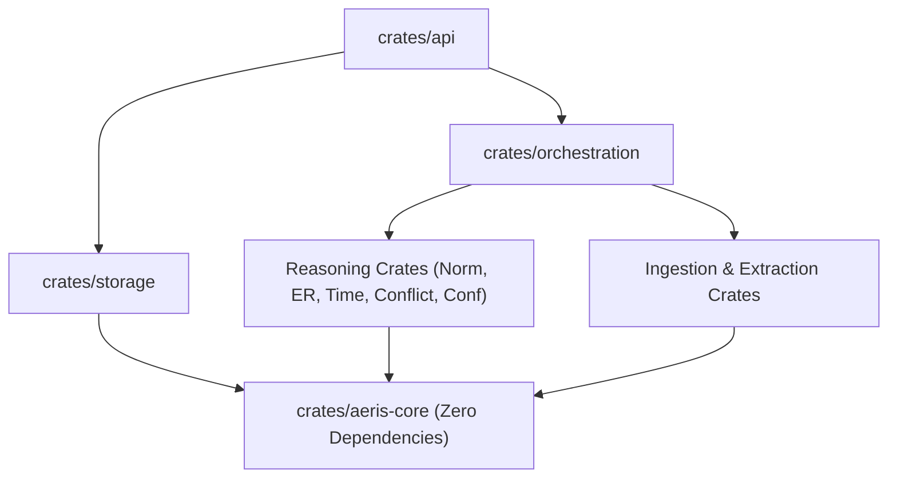
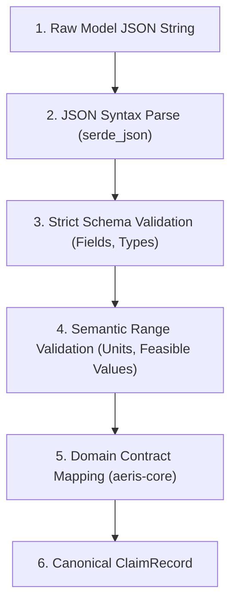
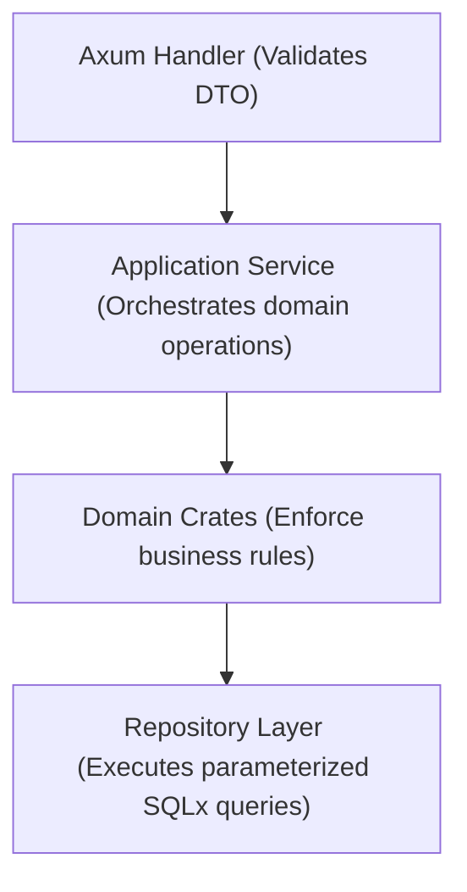
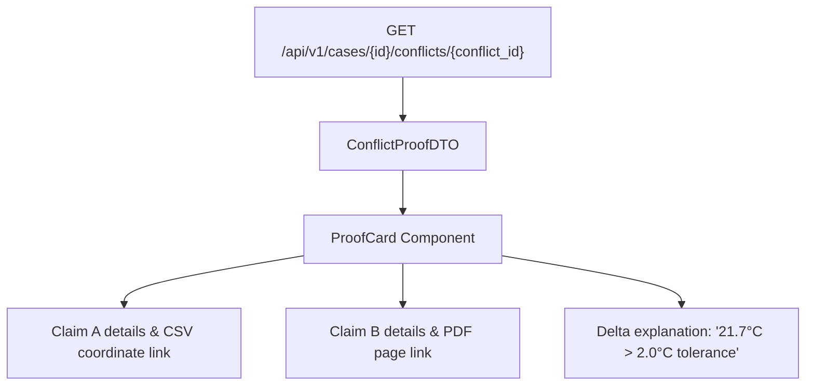

# 24 — AERIS Implementation Specification

## 1. Purpose

This document defines the implementation-level software specification for AERIS.

The previous architecture documents establish:

* what AERIS does,
* why each subsystem exists,
* how evidence moves through the system,
* how the four-person team is divided,
* and what the final product must demonstrate.

This document translates those decisions into concrete, enforceable software boundaries.

The goal is to eliminate implementation drift, establish exact Rust traits and structs, lock down API layers, and provide an unambiguous blueprint for development.

---

# 2. Implementation Philosophy

AERIS is implemented around four non-negotiable principles:

```text
1. Strong domain contracts (Strict Rust types, zero untyped JSON passing)
2. Explicit service boundaries (No business logic in HTTP handlers or DB queries)
3. Deterministic reasoning (Pure Rust algorithms; zero LLMs in conflict loops)
4. Traceable state transitions (Every claim and conflict links to source bytes)
```

Prohibited software anti-patterns:

```text
hidden global state
business logic inside HTTP handlers
business logic inside SQL queries
LLM-dependent conflict decisions
frontend-side reasoning
untyped JSON flowing through the entire system
```

---

# 3. Technology Baseline

```text
Language:            Rust 1.85+ (Edition 2021)
Async Runtime:       Tokio 1.x
Web Framework:       Axum 0.8+
Serialization:       Serde & serde_json
Database:            PostgreSQL 17
Database Access:     SQLx 0.8+ (Async, compile-time verified queries)
API Architecture:    REST (JSON) + Server-Sent Events (SSE)
Containerization:    Docker & Docker Compose
Frontend Workbench:  React 19, TypeScript, Vite, Vanilla CSS design tokens
AI Model Runtime:    Ollama (Local inference) + Provider abstraction traits
```

---

# 4. Workspace Structure

```text
aeris/
├── Cargo.toml
├── Cargo.lock
├── docker-compose.yml
├── README.md
│
├── crates/
│   ├── aeris-core/           (Contracts, types, identifiers, errors, traits)
│   ├── ingestion/            (File parsing, checksumming, segmentation)
│   ├── extraction/           (OCR, CSV parsing, structured AI observation)
│   ├── normalization/        (Unit registry, dimensional algebra, tolerances)
│   ├── entity-resolution/    (Multi-signal resolver, alias graph, ambiguity)
│   ├── temporal-engine/      (UTC normalizer, Allen interval calculus, gaps)
│   ├── conflict-engine/      (5-state matrix, candidate pairing, proof cards)
│   ├── confidence-engine/    (Weakest-link propagation, ECE calibration)
│   ├── orchestration/        (15-stage DAG orchestrator, checkpoints, retries)
│   ├── storage/              (SQLx migrations, repositories, transactions)
│   └── api/                  (Axum HTTP router, SSE broadcast, DTO mappers)
│
├── apps/
│   └── workbench/            (React / TypeScript investigation UI)
│
├── benchmark/
│   ├── cases/
│   ├── ground-truth/
│   └── evaluation/
│
├── datasets/
├── migrations/
├── docker/
├── scripts/
├── tests/
└── docs/
```

---

# 5. Cargo Workspace

Root `Cargo.toml`:

```toml
[workspace]
members = [
    "crates/aeris-core",
    "crates/ingestion",
    "crates/extraction",
    "crates/normalization",
    "crates/entity-resolution",
    "crates/temporal-engine",
    "crates/conflict-engine",
    "crates/confidence-engine",
    "crates/orchestration",
    "crates/storage",
    "crates/api"
]
resolver = "2"

[workspace.package]
version = "0.1.0"
edition = "2021"
authors = ["AERIS Engineering Team"]
license = "Apache-2.0"

[workspace.dependencies]
tokio = { version = "1.43", features = ["full"] }
serde = { version = "1.0", features = ["derive"] }
serde_json = "1.0"
chrono = { version = "0.4", features = ["serde"] }
uuid = { version = "1.13", features = ["v4", "v7", "serde"] }
async-trait = "0.1"
thiserror = "2.0"
tracing = "0.1"
```

---

# 6. Dependency Direction



```text
aeris-core
     ↑
     │
domain crates (ingestion, extraction, normalization, entity-resolution, etc.)
     ↑
services & orchestration
     ↑
API / storage
     ↑
application (binaries)
```

> [!CAUTION]
> `aeris-core` must remain completely independent of SQLx, PostgreSQL, Axum, or Docker.

---

# 7. `aeris-core` Specification

Central shared crate defining:
* Strongly typed identifiers
* Core domain structs and enums
* Error hierarchies
* Serialization formats
* Common domain traits

No I/O, no database operations, no HTTP logic.

---

# 8. Core Identifiers

Encapsulated newtypes preventing accidental parameter swapping:

```rust
use serde::{Deserialize, Serialize};
use uuid::Uuid;

#[derive(Debug, Clone, Copy, PartialEq, Eq, Hash, Serialize, Deserialize)]
pub struct CaseId(pub Uuid);

#[derive(Debug, Clone, Copy, PartialEq, Eq, Hash, Serialize, Deserialize)]
pub struct SourceId(pub Uuid);

#[derive(Debug, Clone, Copy, PartialEq, Eq, Hash, Serialize, Deserialize)]
pub struct EvidenceId(pub Uuid);

#[derive(Debug, Clone, Copy, PartialEq, Eq, Hash, Serialize, Deserialize)]
pub struct ClaimId(pub Uuid);

#[derive(Debug, Clone, Copy, PartialEq, Eq, Hash, Serialize, Deserialize)]
pub struct EntityId(pub Uuid);

#[derive(Debug, Clone, Copy, PartialEq, Eq, Hash, Serialize, Deserialize)]
pub struct ConflictId(pub Uuid);

#[derive(Debug, Clone, Copy, PartialEq, Eq, Hash, Serialize, Deserialize)]
pub struct ProcessingRunId(pub Uuid);
```

---

# 9. Case Model

```rust
use chrono::{DateTime, Utc};

#[derive(Debug, Clone, Serialize, Deserialize)]
pub struct CaseRecord {
    pub id: CaseId,
    pub name: String,
    pub description: Option<String>,
    pub status: CaseStatus,
    pub created_at: DateTime<Utc>,
    pub updated_at: DateTime<Utc>,
}

#[derive(Debug, Clone, Copy, PartialEq, Eq, Serialize, Deserialize)]
#[serde(rename_all = "snake_case")]
pub enum CaseStatus {
    Created,
    Ingesting,
    Processing,
    Completed,
    CompletedWithWarnings,
    Failed,
    Archived,
}
```

---

# 10. Source Model

```rust
#[derive(Debug, Clone, Serialize, Deserialize)]
pub struct SourceRecord {
    pub id: SourceId,
    pub case_id: CaseId,
    pub source_type: SourceType,
    pub filename: String,
    pub mime_type: String,
    pub size_bytes: u64,
    pub checksum: String,
    pub metadata: serde_json::Value,
    pub created_at: DateTime<Utc>,
}

#[derive(Debug, Clone, Copy, PartialEq, Eq, Serialize, Deserialize)]
#[serde(rename_all = "snake_case")]
pub enum SourceType {
    Text,
    Image,
    Table,
    Csv,
    Json,
    TimeSeries,
    Structured,
}
```

---

# 11. Evidence Model

```rust
#[derive(Debug, Clone, Serialize, Deserialize)]
pub struct EvidenceRecord {
    pub id: EvidenceId,
    pub source_id: SourceId,
    pub content_type: String,
    pub location: EvidencePointer,
    pub checksum: Option<String>,
    pub metadata: serde_json::Value,
    pub created_at: DateTime<Utc>,
}
```

---

# 12. Evidence Pointers

```rust
#[derive(Debug, Clone, Serialize, Deserialize, PartialEq)]
#[serde(tag = "pointer_type", rename_all = "snake_case")]
pub enum EvidencePointer {
    Text {
        source_id: SourceId,
        page: Option<u32>,
        char_start: Option<u32>,
        char_end: Option<u32>,
        snippet: Option<String>,
    },
    Image {
        source_id: SourceId,
        x: f32,
        y: f32,
        width: f32,
        height: f32,
    },
    Table {
        source_id: SourceId,
        row: u32,
        column: String,
        cell_value: Option<String>,
    },
    TimeSeries {
        source_id: SourceId,
        timestamp: DateTime<Utc>,
        channel: Option<String>,
    },
    StructuredField {
        source_id: SourceId,
        path: String,
    },
}
```

---

# 13. Claim Model

```rust
#[derive(Debug, Clone, Serialize, Deserialize)]
pub struct ClaimRecord {
    pub id: ClaimId,
    pub case_id: CaseId,
    pub subject: EntityRef,
    pub predicate: Predicate,
    pub object: ClaimValue,
    pub temporal_context: Option<TemporalContext>,
    pub provenance: Vec<EvidencePointer>,
    pub claim_type: ClaimType,
    pub confidence: Option<ConfidenceRecord>,
    pub status: ClaimStatus,
    pub processing_run_id: ProcessingRunId,
    pub created_at: DateTime<Utc>,
}
```

---

# 14. Claim Type

```rust
#[derive(Debug, Clone, Copy, PartialEq, Eq, Serialize, Deserialize)]
#[serde(rename_all = "snake_case")]
pub enum ClaimType {
    Extracted,
    Inferred,
}
```

---

# 15. Claim Value

```rust
#[derive(Debug, Clone, Serialize, Deserialize, PartialEq)]
#[serde(tag = "value_type", content = "value", rename_all = "snake_case")]
pub enum ClaimValue {
    Text(String),
    Number(f64),
    Boolean(bool),
    Measurement(MeasurementValue),
    Range {
        min: f64,
        max: f64,
        unit: Option<Unit>,
    },
    Category(String),
    Unknown,
}
```

---

# 16. Entity Reference

```rust
#[derive(Debug, Clone, Serialize, Deserialize, PartialEq)]
#[serde(tag = "ref_type", rename_all = "snake_case")]
pub enum EntityRef {
    Resolved {
        entity_id: EntityId,
        canonical_name: String,
    },
    Ambiguous {
        source_reference: String,
        candidates: Vec<EntityId>,
    },
    Unresolved {
        source_reference: String,
    },
}
```

---

# 17. Predicate

```rust
#[derive(Debug, Clone, Serialize, Deserialize, PartialEq, Eq, Hash)]
pub struct Predicate {
    pub name: String,
    pub normalized_name: String,
}

impl Predicate {
    pub fn new(name: impl Into<String>) -> Self {
        let name = name.into();
        let normalized = name.trim().to_lowercase().replace(' ', "_");
        Self { name, normalized_name: normalized }
    }
}
```

---

# 18. Temporal Context

```rust
#[derive(Debug, Clone, Serialize, Deserialize, PartialEq)]
pub struct TemporalContext {
    pub start: Option<DateTime<Utc>>,
    pub end: Option<DateTime<Utc>>,
    pub precision: TemporalPrecision,
    pub timezone: Option<String>,
    pub approximate: bool,
    pub original_expression: Option<String>,
}

#[derive(Debug, Clone, Copy, PartialEq, Eq, Serialize, Deserialize)]
#[serde(rename_all = "snake_case")]
pub enum TemporalPrecision {
    Millisecond,
    Second,
    Minute,
    Hour,
    Day,
    Month,
    Year,
    Approximate,
}
```

---

# 19. Entity Model

```rust
use std::collections::HashMap;

#[derive(Debug, Clone, Serialize, Deserialize)]
pub struct EntityRecord {
    pub id: EntityId,
    pub case_id: CaseId,
    pub entity_type: EntityType,
    pub canonical_name: String,
    pub aliases: Vec<EntityAlias>,
    pub attributes: HashMap<String, serde_json::Value>,
    pub confidence: Option<ConfidenceRecord>,
    pub status: EntityStatus,
    pub created_at: DateTime<Utc>,
}
```

---

# 20. Entity Link

```rust
#[derive(Debug, Clone, Serialize, Deserialize)]
pub struct EntityLink {
    pub id: Uuid,
    pub source_id: SourceId,
    pub source_reference: String,
    pub normalized_reference: String,
    pub resolved_entity_id: Option<EntityId>,
    pub candidates: Vec<EntityCandidate>,
    pub status: EntityLinkStatus,
    pub confidence: Option<ConfidenceRecord>,
    pub evidence: Vec<EvidencePointer>,
    pub resolver_version: String,
    pub created_at: DateTime<Utc>,
}
```

---

# 21. Entity Link Status

```rust
#[derive(Debug, Clone, Copy, PartialEq, Eq, Serialize, Deserialize)]
#[serde(rename_all = "snake_case")]
pub enum EntityLinkStatus {
    Resolved,
    Ambiguous,
    Distinct,
    Unresolved,
}
```

---

# 22. Measurement Model

```rust
#[derive(Debug, Clone, Serialize, Deserialize, PartialEq)]
pub struct MeasurementValue {
    pub raw_value: f64,
    pub raw_unit: Unit,
    pub canonical_value: f64,
    pub canonical_unit: Unit,
    pub uncertainty: Option<f64>,
    pub tolerance: Option<f64>,
    pub provenance: Vec<EvidencePointer>,
}
```

---

# 23. Unit Model

```rust
#[derive(Debug, Clone, Copy, PartialEq, Eq, Hash, Serialize, Deserialize)]
#[serde(rename_all = "snake_case")]
pub enum Unit {
    // Temperature
    Celsius,
    Fahrenheit,
    Kelvin,

    // Pressure
    Pascal,
    KiloPascal,
    Bar,
    Psi,

    // Length
    Meter,
    Centimeter,
    Millimeter,
    Inch,
    Foot,

    // Mass
    Kilogram,
    Gram,
    Pound,

    // Time
    Second,
    Millisecond,
    Minute,
    Hour,

    // Kinematics & Physical
    MeterPerSecond,
    Hertz,
    Joule,
    Watt,
    Volt,
    Ampere,
    Ohm,
}
```

---

# 24. Confidence Model

```rust
#[derive(Debug, Clone, Serialize, Deserialize, PartialEq)]
pub struct ConfidenceRecord {
    pub score: Option<f32>,
    pub level: ConfidenceLevel,
    pub method: ConfidenceMethod,
    pub factors: Vec<ConfidenceFactor>,
    pub calibrated: bool,
}

#[derive(Debug, Clone, Copy, PartialEq, Eq, Serialize, Deserialize)]
#[serde(rename_all = "snake_case")]
pub enum ConfidenceLevel {
    High,
    Medium,
    Low,
    Unknown,
}
```

---

# 25. Conflict Model

```rust
#[derive(Debug, Clone, Serialize, Deserialize)]
pub struct ConflictRecord {
    pub id: ConflictId,
    pub case_id: CaseId,
    pub claim_a: ClaimId,
    pub claim_b: ClaimId,
    pub status: EvidenceStatus,
    pub reasons: Vec<String>,
    pub temporal_relationship: String,
    pub confidence: Option<ConfidenceRecord>,
    pub supporting_evidence: Vec<EvidencePointer>,
    pub created_at: DateTime<Utc>,
}
```

---

# 26. Core Traits

```rust
use async_trait::async_trait;

#[async_trait]
pub trait EntityResolver: Send + Sync {
    async fn resolve(
        &self,
        reference: &str,
        case_id: CaseId,
    ) -> Result<EntityRef, EntityResolutionError>;
}

pub trait TemporalAligner: Send + Sync {
    fn align(
        &self,
        a: &TemporalContext,
        b: &TemporalContext,
    ) -> Result<TemporalRelationship, TemporalError>;
}

pub trait MeasurementNormalizer: Send + Sync {
    fn normalize(
        &self,
        val: f64,
        unit: Unit,
    ) -> Result<MeasurementValue, NormalizationError>;
}
```

---

# 27. Conflict Engine Trait

```rust
pub trait ConflictDetector: Send + Sync {
    fn compare(
        &self,
        a: &ClaimRecord,
        b: &ClaimRecord,
        tolerance_celsius: f64,
    ) -> Result<ClaimComparison, ConflictError>;
}
```

---

# 28. AI Provider Trait

```rust
#[async_trait]
pub trait AIProvider: Send + Sync {
    async fn extract_claims(
        &self,
        prompt: &str,
        text_chunk: &str,
    ) -> Result<Vec<CandidateClaim>, AIError>;

    async fn analyze_image(
        &self,
        image_bytes: &[u8],
        prompt: &str,
    ) -> Result<Vec<CandidateClaim>, AIError>;
}
```

---

# 29. Extraction Boundary

```text
Evidence Bytes
       ↓
EvidenceExtractor
       ↓
Vec<CandidateClaim> (Unverified proposals)
       ↓
Validation & Canonicalization
       ↓
Vec<ClaimRecord> (Persisted canonical state)
```

---

# 30. Candidate Claim

```rust
#[derive(Debug, Clone, Serialize, Deserialize)]
pub struct CandidateClaim {
    pub subject_reference: String,
    pub predicate: String,
    pub object: CandidateValue,
    pub temporal_expression: Option<String>,
    pub provenance: Vec<EvidencePointer>,
    pub extraction_confidence: Option<f32>,
}
```

---

# 31. AI Output Validation Flow



---

# 32. Semantic Validation

* Rejects `temperature = "high"` (requires numerical value and unit).
* Rejects `temperature = 94, unit = "potato"` (unit must exist in `Unit` enum).
* Rejects `temp_kelvin < 0.0` (physical impossibility).

---

# 33. Ingestion Interface

```rust
#[async_trait]
pub trait EvidenceIngestor: Send + Sync {
    async fn ingest(
        &self,
        case_id: CaseId,
        filename: &str,
        mime_type: &str,
        bytes: &[u8],
    ) -> Result<SourceRecord, IngestionError>;
}
```

---

# 34. Extraction Interface

```rust
#[async_trait]
pub trait EvidenceExtractor: Send + Sync {
    async fn extract(
        &self,
        source: &SourceRecord,
        bytes: &[u8],
    ) -> Result<Vec<CandidateClaim>, ExtractionError>;
}
```

---

# 35. Normalization Interface

```rust
pub trait Normalizer: Send + Sync {
    fn normalize_measurement(
        &self,
        value: f64,
        unit: Unit,
    ) -> Result<MeasurementValue, NormalizationError>;
}
```

---

# 36. Temporal Interface

```rust
pub trait TemporalEngine: Send + Sync {
    fn evaluate_overlap(
        &self,
        a: &TemporalContext,
        b: &TemporalContext,
    ) -> Result<bool, TemporalError>;
}
```

---

# 37. Processing Context

```rust
pub struct PipelineContext {
    pub run_id: ProcessingRunId,
    pub case_id: CaseId,
    pub sources: Vec<SourceRecord>,
    pub claims: Vec<ClaimRecord>,
    pub comparisons: Vec<ClaimComparison>,
    pub conflicts: Vec<ConflictRecord>,
}
```

---

# 38. Pipeline Stage Trait

```rust
#[async_trait]
pub trait PipelineStage: Send + Sync {
    fn name(&self) -> &'static str;
    fn dependencies(&self) -> &'static [&'static str];

    async fn execute(
        &self,
        context: &mut PipelineContext,
    ) -> Result<StageResult, PipelineError>;
}
```

---

# 39. Stage Registry

```rust
pub struct Pipeline {
    pub stages: Vec<Box<dyn PipelineStage>>,
}
```

---

# 40. Pipeline Execution Loop

```text
Initialize Run ──► Fetch Context ──► For each Stage (in DAG order) ──► Execute ──► Emit SSE ──► Commit
```

---

# 41. Stage State

```rust
#[derive(Debug, Clone, Copy, PartialEq, Eq, Serialize, Deserialize)]
pub enum StageStatus {
    Pending,
    Running,
    Completed,
    Failed,
    Retrying,
    Cancelled,
    Skipped,
}
```

---

# 42. Processing Run

```rust
#[derive(Debug, Clone, Serialize, Deserialize)]
pub struct ProcessingRun {
    pub id: ProcessingRunId,
    pub case_id: CaseId,
    pub pipeline_version: String,
    pub model_version: Option<String>,
    pub configuration_version: String,
    pub status: CaseStatus,
    pub started_at: DateTime<Utc>,
    pub completed_at: Option<DateTime<Utc>>,
}
```

---

# 43. Storage Boundary & Repository Traits

```rust
#[async_trait]
pub trait ClaimRepository: Send + Sync {
    async fn create(&self, claim: &ClaimRecord) -> Result<(), RepositoryError>;
    async fn get(&self, id: ClaimId) -> Result<Option<ClaimRecord>, RepositoryError>;
    async fn list_by_case(&self, case_id: CaseId) -> Result<Vec<ClaimRecord>, RepositoryError>;
}

#[async_trait]
pub trait ConflictRepository: Send + Sync {
    async fn create(&self, conflict: &ConflictRecord) -> Result<(), RepositoryError>;
    async fn list_by_case(&self, case_id: CaseId) -> Result<Vec<ConflictRecord>, RepositoryError>;
}
```

---

# 44. SQLx Implementation Layout

```text
crates/storage/src/
├── lib.rs
├── connection.rs
├── error.rs
└── postgres/
    ├── case_repo.rs
    ├── source_repo.rs
    ├── claim_repo.rs
    ├── entity_repo.rs
    └── conflict_repo.rs
```

---

# 45. Transaction Boundary Rule

Atomic domain operations execute within a single SQLx transaction:

```rust
let mut tx = pool.begin().await?;
claim_repo.create_with_tx(&mut tx, &claim).await?;
evidence_repo.link_claim_tx(&mut tx, claim.id, &claim.provenance).await?;
tx.commit().await?;
```

---

# 46. API Service Layer Flow



HTTP handlers contain zero business logic and zero SQL.

---

# 47. API State Flow

```http
POST /api/v1/cases/{id}/process
```

1. Validates case ID.
2. Checks case exists.
3. Inserts `ProcessingRun` record with status `Created`.
4. Spawns asynchronous Tokio worker task.
5. Returns `202 Accepted` immediately with `run_id`.

---

# 48. In-Memory Processing Queue

Initial implementation uses `tokio::sync::mpsc::channel(1000)`. Workers consume jobs asynchronously without stalling HTTP handlers.

---

# 49. SSE Events Contract

```http
GET /api/v1/cases/events
```

Payload structure:

```json
{
  "event": "stage_completed",
  "run_id": "018f3a5b-...",
  "stage": "entity_resolution",
  "status": "completed",
  "output_count": 8,
  "timestamp": "2026-09-30T20:21:05Z"
}
```

---

# 50. API Error Model

Uniform error response envelope:

```json
{
  "error": {
    "code": "ENTITY_RESOLUTION_FAILED",
    "message": "Entity reference CV-E is ambiguous.",
    "request_id": "req-98f2b...",
    "details": {
      "candidates": ["ENT-CONVEYOR-05", "ENT-CONVEYOR-05-B"]
    }
  }
}
```

---

# 51. HTTP Status Mapping

* `200 OK`: Successful read or synchronous update.
* `201 Created`: Resource successfully created (Case, Source).
* `202 Accepted`: Long-running processing run queued.
* `400 Bad Request`: Malformed JSON or invalid syntax.
* `403 Forbidden`: Cross-tenant or unauthorized case access.
* `404 Not Found`: Case, claim, or source ID not found.
* `422 Unprocessable Entity`: Validation failure on domain entities.
* `500 Internal Server Error`: Unhandled server exception.

---

# 52. Frontend State Management

The frontend is strictly presentation and navigation:
* Fetches state via TanStack Query (React Query).
* Listens to live SSE events to invalidate query caches.
* Never computes conflicts or normalizes temperatures on the client.

---

# 53. Frontend Component Structure

```text
apps/workbench/src/
├── components/
│   ├── CaseHeader.tsx
│   ├── ProofCard.tsx
│   ├── SideBySideViewer.tsx
│   ├── TimelineCanvas.tsx
│   ├── EntityTable.tsx
│   └── EvaluationScorecard.tsx
├── pages/
│   ├── CaseOverviewPage.tsx
│   ├── InvestigationPage.tsx
│   └── BenchmarkPage.tsx
└── api/
    └── client.ts
```

---

# 54. Conflict UI Data Flow



---

# 55. Evidence Navigation Data Contract

Text coordinate payload:

```json
{
  "type": "text",
  "source_id": "018f3a...",
  "page": 2,
  "char_start": 1024,
  "char_end": 1088,
  "snippet": "Pump-B temperature reached 94°C"
}
```

Image coordinate payload:

```json
{
  "type": "image",
  "source_id": "018f3b...",
  "x": 0.32,
  "y": 0.41,
  "width": 0.21,
  "height": 0.18
}
```

---

# 56. Database Schema Boundary

Twenty-two relational tables managed via versioned SQLx migrations in `migrations/`:

```text
cases, sources, source_versions, evidence_records,
entities, entity_aliases, entity_links,
events, claims, claim_evidence, measurements,
temporal_contexts, temporal_relationships,
claim_comparisons, conflicts, confidence_records,
processing_runs, processing_stages, processing_events,
reviews, audit_events, evaluation_runs, evaluation_results
```

---

# 57. JSONB Usage Rules

Allowed for:
* Extensible source metadata (`file_info`, `encoding`)
* AI model inference metadata (`prompt_hash`, `tokens`)
* Provenance coordinate dictionaries

> [!CAUTION]
> Prohibited: Storing the core claims, entities, or conflicts as raw unindexed JSON blobs.

---

# 58. Database Indexes

```sql
CREATE INDEX idx_claims_case_subject ON claims(case_id, subject_entity_id);
CREATE INDEX idx_claims_predicate ON claims(case_id, predicate);
CREATE INDEX idx_conflicts_case ON conflicts(case_id);
CREATE INDEX idx_entity_links_ref ON entity_links(normalized_reference);
CREATE INDEX idx_evidence_records_source ON evidence_records(source_id);
```

---

# 59. Candidate Pair Generation ($O(N^2)$ Pruning)

Blocking query logic:

```sql
-- Generate candidate pairs sharing the same entity and predicate
SELECT a.id, b.id 
FROM claims a
JOIN claims b ON a.subject_entity_id = b.subject_entity_id 
             AND a.predicate = b.predicate 
             AND a.id < b.id
WHERE a.case_id = $1;
```

---

# 60. Conflict Candidate Pipeline

```text
10,000 Raw Claims ──► Entity Blocking (50 pairs) ──► Temporal Filter (8 pairs) ──► Conflict Engine (2 conflicts)
```

---

# 61. Performance Rule

> **Clarity and correctness precede optimization.**

Build clean, readable, single-threaded algorithms first. Add caching and parallelism only when profiling data demands it.

---

# 62. Error Handling Hierarchy

Strongly typed `enum` errors using `thiserror`:

```rust
use thiserror::Error;

#[derive(Error, Debug)]
pub enum ExtractionError {
    #[error("Source file not found or unreadable: {0}")]
    IoError(#[from] std::io::Error),
    #[error("Invalid schema in model output: {0}")]
    SchemaMismatch(String),
    #[error("Extraction timed out after {0} seconds")]
    Timeout(u64),
}
```

---

# 63. Retry Classification

```rust
pub enum Retryability {
    Retryable,
    NonRetryable,
}

impl ExtractionError {
    pub fn retryability(&self) -> Retryability {
        match self {
            Self::Timeout(_) => Retryability::Retryable,
            Self::SchemaMismatch(_) => Retryability::NonRetryable,
            Self::IoError(_) => Retryability::NonRetryable,
        }
    }
}
```

---

# 64. Logging Specification

Structured JSON logs emitted via `tracing`:

```rust
tracing::info!(
    case_id = %case_id,
    run_id = %run_id,
    stage = "conflict_detection",
    conflicts_found = 2,
    duration_ms = 42,
    "Completed conflict detection"
);
```

---

# 65. Sensitive Logging Guard

Log sanitization forbids dumping:
* Raw file buffers
* JWT authorization tokens
* Database connection passwords

---

# 66. Configuration Struct

Loaded once via `config` crate into `AppState`:

```rust
#[derive(Debug, Clone, Deserialize)]
pub struct AppConfig {
    pub database_url: String,
    pub server_port: u16,
    pub storage_path: String,
    pub ai_provider: String,
    pub ollama_url: String,
    pub temperature_tolerance_celsius: f64,
}
```

---

# 67. Conflict Configuration

Rules are configured in `aeris.toml`:

```toml
[conflict.tolerances]
temperature_celsius = 2.0
pressure_kpa = 5.0
vibration_rms = 0.5
```

---

# 68. Model Versioning Record

Stored with every processing run:

```json
{
  "provider": "ollama",
  "model_name": "llama3:8b-instruct",
  "prompt_version": "v3.1",
  "temperature": 0.0
}
```

---

# 69. Prompt Versioning

Prompts are stored as immutable text files in `crates/extraction/prompts/` and hashed at compile time via `include_str!`.

---

# 70. Deterministic Rule Versioning

Conflict rules track an explicit semver string (`"conflict_rules_v1"`).

---

# 71. Benchmark Mode Execution

```bash
export AERIS_MODE=benchmark
cargo run --bin aeris-evaluator
```

Forces seeds, isolates ground truth, and writes `evaluation.json`.

---

# 72. Ground Truth Access Restriction

`test/ground-truth/` is omitted from Docker production containers and accessible only to the evaluator binary.

---

# 73. Testing Structure

```text
crates/*/tests/     (Unit & component tests)
tests/integration/  (Database & API integration tests)
tests/benchmarks/   (End-to-end 6-machine evaluation tests)
```

---

# 74. Test Naming Convention

Behavior-focused test names:

```rust
#[test]
fn detects_temperature_conflict_when_delta_exceeds_tolerance() {}

#[test]
fn preserves_ambiguous_conveyor_link_when_signals_are_indistinguishable() {}
```

---

# 75. Benchmark Regression Gate

CI runs `aeris-evaluator` and fails if Conflict Macro F1 drops $> 0.02$.

---

# 76. Security Boundary Tests

Adversarial test suite:
* Prompt injection strings inside shift logs
* Path traversal attempts (`../../etc/passwd`)
* Decompression bombs (100 MB cap enforcement)

---

# 77. Docker Architecture

`docker-compose.yml` launches:
* `postgres` (Port 5432)
* `api` (Port 8080)
* `worker` (Background jobs)
* `frontend` (Port 3000)
* `ollama` (Port 11434)
* `machine-m001` .. `machine-m006`

---

# 78. Health & Readiness Probes

* `GET /health`: Returns 200 if Axum is listening.
* `GET /ready`: Returns 200 if PostgreSQL is connected and storage is writable.

---

# 79. Deployment Flow

```text
Docker Build ──► PostgreSQL Healthy ──► Run SQLx Migrations ──► Start API ──► Start Workers ──► Ready
```

---

# 80. Demo Startup & Verification

```bash
docker compose up -d
./scripts/demo-check.sh
```

---

# 81. Final Implementation Sequence

```text
1. aeris-core (Domain models & traits)
2. Storage crate (Migrations & repositories)
3. Ingestion crate (File upload & checksums)
4. Extraction crate (Mock provider & candidate claims)
5. Entity resolution crate
6. Temporal engine crate
7. Measurement normalization crate
8. Conflict engine crate
9. Confidence engine crate
10. Orchestration crate
11. API crate
12. React workbench UI
13. Six-machine benchmark integration
14. Security & demo hardening
```

---

# 82. First Vertical Slice Milestone

One end-to-end path:

```text
maintenance_report.txt ──► Ingest ──► Extract 94°C ──► Resolve Pump-B ──► Align 09:21 UTC ──► Compare vs 72.3°C ──► Conflict CONF-002 ──► Side-by-Side Proof Card
```

---

# 83. First Vertical Slice Acceptance Checklist

* [ ] Source uploaded and SHA-256 hashed.
* [ ] Candidate claim extracted with page number.
* [ ] Pump-B resolved to `ENT-M002`.
* [ ] Timestamp normalized to UTC.
* [ ] Temperature compared against sensor reading.
* [ ] Conflict detected and persisted to PostgreSQL.
* [ ] Proof card visualizes delta on frontend workbench.

---

# 84. Six-Scenario Integration

All six machines (M-001 through M-006) execute through the exact same pipeline code without special branching.

---

# 85. Anti-Pattern: Scenario-Specific Branching

```rust
// PROHIBITED ANTI-PATTERN:
if case_id.contains("M-002") {
    return EvidenceStatus::Conflict;
}
```

The algorithm must evaluate physics and evidence, never the case name.

---

# 86. Anti-Pattern: LLM as Judge

```text
PROHIBITED:
Claim A + Claim B ──► Prompt: "Do these conflict?" ──► LLM says "Yes"

ENFORCED:
Claim A + Claim B ──► Rust Comparator ──► Delta > Tolerance ──► Conflict
```

---

# 87. Anti-Pattern: Discarding Raw Units

```text
PROHIBITED: Discard 158°F and only store 70°C.
ENFORCED: Store raw 158°F and canonical 70°C in the same struct with provenance.
```

---

# 88. Anti-Pattern: Forced Resolution

```text
PROHIBITED: Forcing CV-E2 to map to Conveyor-E because code dislikes None.
ENFORCED: Return EntityRef::Ambiguous.
```

---

# 89. Anti-Pattern: Interpreting Missing as Normal

```text
PROHIBITED: Treating sensor dropouts as "0 kPa" or "all good".
ENFORCED: Surface InsufficientEvidence badge.
```

---

# 90. Anti-Pattern: Fabricated Confidence

```text
PROHIBITED: Hardcoding confidence = 0.95 because it looks convincing.
ENFORCED: Compute weakest-link score with factors.
```

---

# 91. Anti-Pattern: Frontend Business Logic

The React frontend never evaluates:

```typescript
// PROHIBITED IN FRONTEND:
if (tempA - tempB > 2.0) status = "Conflict";
```

All reasoning lives in Rust crates.

---

# 92. Final Code Ownership Matrix

| Subsystem / Crate | Team Lead Track | Secondary Reviewer |
| :--- | :--- | :--- |
| **`aeris-core`** | Shared Architecture | All Team Members |
| **`ingestion` & `extraction`** | Team 1 (Multimodal) | Team 2 |
| **`entity-resolution` & `temporal-engine`** | Team 2 (Entity & Time) | Team 3 |
| **`normalization` & `conflict-engine`** | Team 3 (Reasoning) | Team 1 |
| **`confidence-engine` & `benchmark`** | Team 3 (Reasoning) | Team 4 |
| **`storage`, `api`, `orchestration`** | Team 4 (Platform) | Team 3 |
| **`apps/workbench` (UI)** | Team 4 (Platform) | Team 1 |

---

# 93. Implementation Definition of Done (DoD)

* [ ] Zero compiler warnings (`cargo clippy -- -D warnings`).
* [ ] Zero formatting discrepancies (`cargo fmt --check`).
* [ ] Unit test coverage $\ge 85\%$ on reasoning crates.
* [ ] All six synthetic machine cases pass without scenario hardcoding.
* [ ] Bit-level provenance navigation links resolve in browser.
* [ ] Docker Compose boots cleanly in $< 30\text{ seconds}$.

---

# 94. Final Implementation Contract

Every finding produced by AERIS must satisfy the full lineage contract:

$$\text{Raw File} \xrightarrow{\text{SHA-256}} \text{Evidence Pointer} \xrightarrow{\text{Extractor}} \text{Claim} \xrightarrow{\text{Enriched}} \text{Pair} \xrightarrow{\text{Deterministic Gate}} \text{Conflict Finding} \xrightarrow{\text{Workbench}} \text{Proof Card}$$

---

# 95. Final Principle

The implementation should make the architecture difficult to misuse.

A developer should not need to remember a dozen unwritten rules: the type system and crate boundaries must make the correct evidence-reasoning path the only path that compiles.

```text
Constrained Interfaces + Strong Rust Types = Forensic Trust
```

This implementation specification is the definitive contract for engineering AERIS.
